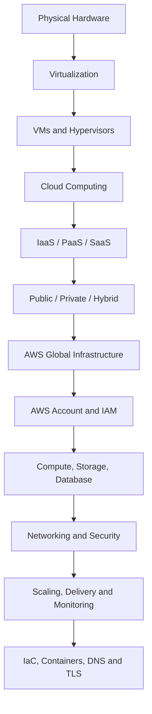

# AWS Zero-to-Hero — Part 1 (English)
## Course Introduction, Virtualization, Cloud Computing, and AWS Overview

> **Part 1 of 8 (planned).** This part covers Chapters 1–6 of the supplied transcript. The exact source transcript is preserved in Appendix A. The remaining chapters will be handled in later parts, in their original order.

## What you will learn in this part

1. The course purpose and end-to-end learning outcomes.
2. Virtualization, virtual machines (VMs), host machines, and hypervisors.
3. Type 1 (bare-metal) and Type 2 (hosted) hypervisors.
4. Cloud computing, its benefits, and IaaS/PaaS/SaaS service models.
5. Public, private, and hybrid cloud deployment models.
6. AWS overview, global infrastructure, common services, and career relevance.

## 1. Course purpose and end-to-end picture

The course aims to help beginners understand what happens after a website or application is built: deploying it, keeping it available, attaching a custom domain, configuring DNS, handling traffic, securing networking, backing up data, scaling capacity, and monitoring the system.

The course outline includes:

- Virtualization and virtual machines.
- Cloud computing and AWS.
- Account/lab setup and AWS services.
- Compute, storage, databases, networking, and security.
- Load balancing, auto scaling, CDN, and global delivery.
- Infrastructure as Code (IaC), Terraform, and CloudFormation.
- Containers and Kubernetes (ECS/EKS).
- DNS, SSL/TLS certificates, and HTTPS.
- Full-stack application deployment and CI/CD.
- Billing and cost awareness.

### Questions that arise in production

- How can a website remain available 24×7?
- How can capacity grow when traffic increases?
- How can latency be reduced for users in different countries?
- How can an application run across multiple instances?
- How should network ports, IPs, routes, and firewall rules be configured?
- How will data be backed up and recovered?
- How does HTTPS secure communication?

## 2. What is virtualization?

**Definition:** Virtualization is a technique that uses software to allocate a physical machine's hardware resources to multiple logical or virtual machines.

### 2.1 Physical machine layers

```text
Physical Hardware (CPU, RAM, Disk, Network)
                 ↓
        Host Operating System
                 ↓
       Hypervisor / Virtualization
                 ↓
     VM 1             VM 2
  Guest OS A        Guest OS B
  Applications     Applications
```

This is a simplified view of a hosted/Type 2 setup. With a Type 1 hypervisor, the hypervisor runs directly on the hardware.

### 2.2 Virtual machine (VM)

A VM is a software-defined computer assigned CPU, RAM, storage, and virtual networking resources. It can run its own guest operating system and applications.

**Transcript example:** If a host has 8 GB RAM and a 100 GB disk, a hypervisor can allocate portions of those resources to separate VMs—for example, 2 GB RAM/20 GB disk to one VM and 2 GB RAM/10 GB disk to another. This is illustrative; actual usable capacity depends on the host, hypervisor, and workload.

### 2.3 What does a hypervisor do?

A hypervisor is the software/layer that helps create and run VMs, allocate host resources, and manage their execution.

Examples:
- Oracle VirtualBox — a common desktop hosted hypervisor.
- VMware ESXi — an example of a bare-metal hypervisor.
- Microsoft Hyper-V and Xen — examples of hypervisor technologies.

### 2.4 Hypervisor types

| Type | Also called | Where it runs | Typical use |
|---|---|---|---|
| Type 1 | Bare-metal | Directly on physical hardware | Data centres, enterprise/server virtualization |
| Type 2 | Hosted | As an application on a host OS | Desktop labs, learning, and testing |

**Memory trick:**
- **Type 1 = Direct to hardware**
- **Type 2 = Through the host OS**

### 2.5 Benefits of virtualization

- **Resource utilization:** Multiple VMs can share one physical host.
- **Isolation:** VMs can run in separate environments; isolation should not be treated as an absolute security boundary.
- **Flexibility:** Different guest OSs and configurations can be tested.
- **Consolidation:** Multiple workloads can run on fewer physical machines.
- **Scalability/management:** Virtual resources may be easier to manage or resize than procuring physical hardware.
- **Cost efficiency:** Hardware utilization may improve, but virtualization is not automatically free.

### 2.6 Why companies use virtualization

Organizations may use virtualization to consolidate servers, isolate environments, make deployment more flexible, and improve resource utilization. Cloud providers use virtualization and related resource-management technologies to host customer workloads on shared physical infrastructure.

## 3. What is cloud computing?

**One-line definition in the transcript:** “On-demand delivery of IT resources over the internet with pay-as-you-go pricing.”

In simple terms, cloud computing means using servers, storage, databases, networking, and other IT resources over the internet as needed, paying according to the applicable pricing model.

The cloud provider operates the physical infrastructure. The customer retains some or more management responsibilities depending on the service selected. The provider does not take over every responsibility for every cloud service.

### 3.1 Why cloud computing is useful: e-commerce example

If a business hosts its e-commerce website on its own physical servers, it may need to manage hardware purchases, maintenance, patching, networking, security, backups, availability, and capacity planning. Growing demand may require more hardware and staff.

With cloud services, the business can provision resources as required and pay according to usage. However, customer responsibilities may still include secure configuration, data protection, architecture, and cost monitoring.

### 3.2 Key benefits of cloud computing

- **Scalability:** Increase or decrease resources with demand.
- **Flexibility:** Choose services and resources according to need.
- **Cost model:** Reduce large upfront hardware investments; usage-based billing may be available.
- **Speed:** Provision resources through dashboards, APIs, or CLIs.
- **Global reach:** Deploy across multiple regions/locations.
- **Availability options:** Use multi-AZ designs, load balancing, backups, and recovery patterns.
- **Managed services:** The provider operates some infrastructure components.

**Important:** Cloud does not mean “free.” Check current free-tier eligibility, limits, and pricing, and configure billing alerts/budgets.

## 4. Cloud service models — IaaS, PaaS, SaaS

| Model | What is provided? | Customer focus | Ice-cream shop analogy |
|---|---|---|---|
| **IaaS** — Infrastructure as a Service | Infrastructure building blocks such as compute, storage, and networking | Customer manages much of the OS, configuration, application, and data | Rent an empty shop and set it up yourself |
| **PaaS** — Platform as a Service | A managed platform/runtime for building and deploying applications | Focus on application and data; provider manages many platform operations | Shop and equipment are ready; focus on the product |
| **SaaS** — Software as a Service | Ready-to-use software accessed over the internet | User uses/configures the software; provider manages the underlying application/platform | Use a ready vending machine |

**Memory trick:**
- **IaaS = Infrastructure**
- **PaaS = Platform**
- **SaaS = Software**

These models represent different levels of responsibility. Exact boundaries vary by service and provider.

## 5. Cloud deployment models

| Model | Meaning | General trade-off | Analogy |
|---|---|---|---|
| **Public cloud** | Services run on a provider's cloud infrastructure for multiple customers, with logically separated environments | Fast provisioning and broad services; configuration, governance, and shared responsibility still matter | Your seat on public transport |
| **Private cloud** | A cloud environment dedicated to one organization | Can offer more control/customization; may increase cost and operational burden | Your own or rented private car |
| **Hybrid cloud** | A combination of private environments and public cloud | Workloads can be placed according to requirements; integration and operations can be more complex | One part of a journey by public transport, another by private transport |

Public cloud does not mean a customer's data is openly visible to other customers. Logical isolation and access controls are important parts of cloud architecture.

## 6. What is AWS?

**AWS (Amazon Web Services)** is Amazon's cloud services platform. It provides compute, storage, databases, networking, identity/security, serverless, content delivery, containers, and other infrastructure/application services.

### 6.1 Common AWS services and use cases

| Service | Primary purpose |
|---|---|
| **EC2** | Virtual servers/compute instances |
| **S3** | Object storage |
| **RDS** | Managed relational databases |
| **Lambda** | Event-driven serverless functions |
| **CloudFront** | Content delivery network (CDN) |
| **IAM** | Users, roles, policies, and permissions |
| **VPC** | Logically isolated virtual networking |
| **Route 53** | DNS and domain-routing services |
| **ELB** | Distribute incoming traffic across targets |
| **Auto Scaling** | Adjust capacity based on configured demand/metrics |

Later course chapters also cover EBS, AMIs, DynamoDB, CloudFormation, Amplify, ECS, EKS, Terraform, DNS, and SSL/TLS.

### 6.2 AWS global infrastructure concepts

- **Region:** A separate geographic area for AWS infrastructure.
- **Availability Zone (AZ):** An isolated infrastructure location/group within a Region; multi-AZ designs can help improve availability.
- **Local Zones / edge locations:** Additional infrastructure locations for particular workloads or content delivery; their exact purpose depends on the service.

When choosing a Region, consider user latency, data residency/compliance, service availability, resilience, and cost. Selecting the nearest Region alone is not always sufficient.

### 6.3 Advantages of AWS

- Multiple service categories on one platform.
- Options to scale resources with demand.
- Global infrastructure.
- Managed services and automation.
- Usage-based pricing models.
- Security building blocks such as IAM, logging, monitoring, and network controls.

**Caution:** The cloud provider supplies security capabilities, but secure configuration, least privilege, secrets management, backups, and cost monitoring are also important.

## 7. Beginner-friendly learning flow



## 8. Quick revision

| Question | Short answer |
|---|---|
| What is virtualization? | Abstracting physical resources and allocating them to virtual environments/VMs. |
| What is a VM? | A software-defined machine that can run a guest OS and applications. |
| What does a hypervisor do? | Creates/runs VMs and allocates/manages host resources. |
| Type 1 vs Type 2? | Type 1 runs directly on hardware; Type 2 runs on a host OS. |
| What is cloud computing? | On-demand IT resources over the internet, commonly with usage-based pricing. |
| IaaS/PaaS/SaaS? | Infrastructure / application platform / ready-to-use software. |
| Public/private/hybrid? | Provider cloud for multiple customers / organization-dedicated environment / combination. |
| What is AWS? | A cloud platform offering compute, storage, networking, databases, and more. |
| Region vs AZ? | A Region is a geographic area; an AZ is an isolated infrastructure location/group within a Region. |

## 9. Common mistakes / gotchas

1. Treating a VM as a physical computer: it is software-defined, but its assigned CPU/RAM/storage comes from physical capacity.
2. Confusing Type 1 and Type 2: the key distinction is the layer on which the hypervisor runs.
3. Assuming the cloud provider manages every security task: shared responsibility applies.
4. Assuming cloud is automatically cheaper/free: cost depends on workload, usage, architecture, and data transfer.
5. Interpreting “public cloud” as “public data”: public cloud does not mean public visibility.
6. Treating multi-AZ as a guarantee against every disaster: application design, replication, backups, and recovery testing matter too.
7. Memorizing AWS service names without understanding use cases: learn each service's purpose and trade-offs.

## 10. Board-level answer

Virtualization abstracts physical compute resources so multiple virtual machines can run. A hypervisor creates and manages VMs; a Type 1 hypervisor runs directly on hardware, whereas a Type 2 hypervisor runs on a host operating system. Cloud computing delivers infrastructure and managed capabilities as on-demand internet services. IaaS, PaaS, and SaaS represent different responsibility levels, while public, private, and hybrid cloud are deployment choices. AWS is a cloud platform that offers compute, storage, databases, networking, identity, serverless, and global delivery services. A real-world design must plan not only for scalability but also for security, availability, cost, and operational responsibility.

## 11. No-Skip Checklist — Part 1

- [ ] Course purpose and target audience
- [ ] Website deployment, scaling, global delivery, security, and networking motivation
- [ ] Virtualization definition and physical-host example
- [ ] VM resources and guest operating systems
- [ ] Hypervisor role and VirtualBox example
- [ ] Type 1 and Type 2 distinction
- [ ] Enterprise/cloud-provider virtualization use cases
- [ ] Cloud definition and pay-as-you-go concept
- [ ] E-commerce hosting challenges
- [ ] Cloud benefits and provider/customer responsibilities
- [ ] IaaS, PaaS, SaaS, and ice-cream analogies
- [ ] Public, private, and hybrid deployment models
- [ ] AWS overview, service examples, and benefits
- [ ] Region, Availability Zone, and global infrastructure concepts
- [ ] Pricing awareness and career relevance
- [ ] Original transcript preserved in Appendix A

## 12. Additional Points Added (separate from source)

These practical clarifications are additions to make the notes safer and technically clearer; they are not verbatim source transcript content.

- After creating an AWS account, avoid using the root user for everyday work; use appropriate IAM Identity Center/IAM-based least-privilege access.
- Set billing alerts/budgets and remove unused resources after labs.
- For production, plan backups, monitoring, health checks, security groups, IAM permissions, and recovery tests.
- AWS free-tier offers and pricing can change; verify current official pricing/eligibility rather than assuming fixed free usage.
- Keep IaC templates in version control and review changes before deployment.

## Appendix A — Original Source Preserved

The source file's Chapters 1–6 are preserved below in their original order, with timestamps and wording. The automatic transcript may contain speech-to-text errors; they have not been silently corrected in this source appendix.


```text
Chapter 1: Intro of Course
0:000 secondsऑलराइट सो एए ज़ीरो टू हीरो कोर्स इज फाइनली हेयर जो कि एब्सलूट बिगनर फ्रेंडली एक कोर्स होने वाला है एंड जो लोग ऑलरेडी
0:088 secondsप्लेलिस्ट को फॉलो कर रहे हो सो मैं क्लियर कर दूं यह वही सारी वीडियोस का एक कंबाइंड फॉर्मेट है एक डिटेल वीडियो ठीक
0:1515 secondsहै लॉन्ग फॉर्मेट वीडियो एंड इसमें एक दो पार्ट और ऐड ऑन किए है जैसे कि ईएस सर्विस मैंने और ऐड किया है बिलिंग से रिलेटेड थोड़े से और ऐड ऑन किए हैं जो लोग फर्स्ट
0:2424 secondsटाइम इस वीडियो पे आए हैं सो इस वीडियो का थोड़ा सा मैं आपको इंट्रोडक्शन दे देता हूं कि भाई क्या परपस है इस वीडियो का एंड इस वीडियो के बाद आपको क्या सीखने को
0:3232 secondsमिलेगा किन लोगों के लिए यह यूज़फुल है किनको यह वीडियो देखना चाहिए एंड क्या सीखने को मिलने वाला है वह चीजें सो बनती
Chapter 2: What you will Learn?
0:4040 secondsहै बातें देखो आप एक आईटी वर्ल्ड में काम कर रहे हो करो जैसे कि करंट वर्ल्ड में सारी चीजें ऑनलाइन है वेबसाइट बेस्ड है
0:4949 secondsएप्लीकेशन बेस्ड है अगर आप सिंपल सी वेबसाइट की अगर बात करो मान लीजिए आपको वेबसाइट नहीं भी आती है एक सिंपल एटीएमएल सीएसएस में आपने एक वेबसाइट बनाई उस
0:5757 secondsवेबसाइट के बाद की जर्नी जो कि एक रियल वर्ल्ड में कैसे काम करती है उसकी अंडरस्टैंडिंग जैसे कि एक वेबसाइट बना दी
1:051 minute, 5 secondsउसको आप डिप्लॉयड या तो रनिंग रखोगे उसमें अपनी
1:121 minute, 12 secondsकस्टम डोमेन कैसे ऐड करोगे डीएनएस क्या होता है डीएनएस कैसे वर्क करता है ओके यह सारी छोटी बेसिक चीजें और हम लोग ये सारी
1:211 minute, 21 secondsचीजें बिल्कुल प्रैक्टिकल करके देखेंगे मान लीजिए आपकी एक वेबसाइट है जो कि बिजनेस ओरिएंटेड है कि मतलब जो कस्टमर्स यूज कर रहे हैं सर्विसेस एंड आपका बिजनेस
1:291 minute, 29 secondsआ रहा है वेबसाइट से मतलब सिंपल नॉर्मल वेबसाइट नहीं है अब वो वेबसाइट आपके लिए कितनी इंपॉर्टेंट है तो उसकी स्केलिंग
1:361 minute, 36 secondsबहुत जरूरी है जैसे कि मान लो बहुत ज्यादा ट्रैफिक आ जाता है सो आपकी वेबसाइट कैसे हैंडल करेगी ठीक है वर्टिकल स्केलिंग हॉरिजॉन्टल स्केलिंग क्या डिफरेंट टाइप की
1:451 minute, 45 secondsस्केलिंग होती है कैसे स्केलिंग वर्क करती है इन रियल लाइफ इसके अलावा ग्लोबल डिप्लॉयड अगर आपकी वेबसाइट है जो पूरे
1:531 minute, 53 secondsग्लोबली पूरी दुनिया में यूजर्स हैं उसके वो अगर एक्सेस कर रहे हैं राइट तो उनको एक अच्छा एक्सपीरियंस लेटेंसी एक्सपीरियंस की
2:012 minutes, 1 secondज्यादा डिले ना हो ज्यादा फास्ट ठीक है लोड हो वो सारी चीजें कैसे होंगी कंटेंट डिलीवरी नेटवर्क सीडीएन क्या होता है लोड
2:102 minutes, 10 secondsबैलेंसिंग क्या होती है कि मतलब आप मल्टीपल इंस्टेंस रखो ज्यादा अच्छे एक्सपीरियंस दे सको मल्टीपल यूजर को साथ में हैंडल कर सको राइट इतनी बेसिक चीजें
2:192 minutes, 19 secondsहैं जो हर जगह एप्लीकेबल है और आपको पता ही होनी चाहिए एंड इसके अलावा जैसे कि अभी डिप्लॉयड हो गया और डिलीवरी हो गई ठीक है
2:272 minutes, 27 secondsअभी मान लो आपकी डिप्लॉयड कहीं किसी सर्वर पे हो रही है राइट तो वो सर्वर पे नेटवर्किंग कैसे काम कर रही है फायरवॉल रूल्स कैसे काम कर रहे हैं ठीक है क्योंकि
2:362 minutes, 36 secondsसिक्योरिटी भी वेरी इंपॉर्टेंट है इसके अलावा नेटवर्किंग की बेसिक चीजें जैसे कि अ वैसे तो इसमें हम लोग देखेंगे कि हम
2:442 minutes, 44 secondsअपना खुद का एक प्राइवेट नेटवर्क कैसे बना सकते हैं ठीक है नेटवर्किंग काम कैसे करती है नेटवर्किंग में हम लोग आईपी जो होती है
2:512 minutes, 51 secondsपोर्ट्स होते हैं क्या चीज होती हैं कैसे बनती हैं कैसे वर्क करती हैं कैसे असाइनमेंट होता है एवरीथिंग सिंपल छोटी-छोटी चीजें इंटरनेट गेट गेटवे क्या
3:003 minutesहोता है राउटिंग क्या होती है तो बेसिक आपकी नेटवर्किंग यहां पे क्लियर हो जाएगी इसके बाद आईएसी के आईएसी जो कि डेप्स के
3:073 minutes, 7 secondsटॉपिक्स है तो उसके में भी हम लोग थोड़ा बेसिस मतलब अपना हैंड्स ऑन कर लेंगे कि आईएसी क्या होता है इंफ्रास्ट्रक्चर एस
3:143 minutes, 14 secondsकोड कि एक फाइल की मदद से आप क्लाउड में अपने इंफ्रास्ट्रक्चर कैसे बना सकते हो यह भी चीजें हम लोग कवर करेंगे टेराफॉर्म का
3:213 minutes, 21 secondsआपको बेसिक मिल जाएगा इसके बाद कंटेनर्स अगर कंटेनर्स प आपने ऑलरेडी काम किया है जैसे डॉकर हो गया सो कंटेनर बेस्ड
3:283 minutes, 28 secondsएप्लीकेशन है उसको क्लाउड पे आप कैसे मेंटेन मैनेज कर सकते हो डिप्लॉयड ईए जिसमें कुब एटी सर्विस भी हम
3:363 minutes, 36 secondsलोग ठीक है यूज करेंगे इसके अलावा एसएसएलटी एलएस वर्क कैसे करते हैं एंड फुल स्टैक डेवलपमेंट या तो वेबसाइट है आपको वो
3:453 minutes, 45 secondsकैसे डिप्लॉयडी जें आपको मिल जाती है वेबसाइट से रिलेटेड अ सॉरी डेटाबेस से रिलेटेड हम लोग भी चीजें कवर करेंगे सो
3:533 minutes, 53 secondsओवरऑल अगर आप देखोगे सो इट्स अ लाइक अ कंप्लीट पैकेज इसके अलावा मतलब ये तो एक आईटी रिलेटेड बेसिक चीजें हैं जो आपको क
4:014 minutes, 1 secondमतलब यू नो सीखने को मिलेंगी एंड आप बहुत ज्यादा कॉन्फिडेंट फील करोगे अगर ये तो हमारी नॉर्मल बेसिक चीजें हो गई जनरल
4:094 minutes, 9 secondsचीजें हो गई इसके अलावा अगर बात करूं मैं क्लाउड की तो क्लाउड में अब जैसे कि क्लाउड प्लेटफॉर्म है क्लाउड बेस्ड आजकल
4:154 minutes, 15 secondsमतलब करंट मार्केट में बहुत बड़ा एक मार्केट जो शेयर है वो क्लाउड में जाते जा रहा है लोग जो कंपनीज हैं क्लाउड अडॉप्ट
4:244 minutes, 24 secondsकर रहे हैं तो क्लाउड वर्क कैसे वर्क करता है क्या-क्या ऑफि करती है क्या फायदे हैं इसका भी आपको आईडिया होगा लद चाहे आप
4:314 minutes, 31 secondsनॉर्मल आईटी कंपनी में हो चाहे आप किसी भी रोल में हो चाहे आपको एडब्ल्यू के साथ ही काम करना हो चाहे आप सपोर्ट में हो चाहे
4:384 minutes, 38 secondsकिसी भी रोल में हो यह चीजें आपको बहुत काम आने वाली हैं आपके आईटी के रिलेटेड फंडामेंटल्स को क्लियर करने में ओके सो यह
4:474 minutes, 47 secondsआपकी आईटी जर्नी में आपको ग्रो करने में बहुत ज्यादा हेल्पफुल होगा प्रैक्टिकल बेस्ड अप्रोच है एंड रिगार्डिंग द प्राइसिंग क्योंकि एडब्ल्यू काफी लोग
4:564 minutes, 56 secondsसोचते हैं इसमें भाई पैसे ऐसे लगते हैं ऑफकोर्स प्राइजिंग लगती है लेकिन यहां पे अधिकतर जो मैक्सिमम जो सर्विसेस है मैक्सिमम
5:045 minutes, 4 secondsसेइंग स्पेशली टेस्टिंग पर्पस के लिए सिर्फ हम लोग को प्रैक्टिस करने के लिए फ्री टियर सर्विसेस मिल जाती हैं ठीक है कि जिसमें हम लोग प्रैक्टिस कर सके एंड
5:135 minutes, 13 secondsउसमें बहुत लोअर कॉस्ट पे हमारा काम हो जाता है ओके सो डोंट वरी अबाउट दैट सो उसमें ज्यादा दिक्कत नहीं होगी सो बिना
5:225 minutes, 22 secondsकिसी टाइम वेस्ट के ऑल द बेस्ट फॉर योर जर्नी आई होप सो ये वीडियो पसंद आए एंड ऑफकोर्स वीडियो हेल्पफुल रहे पसंद आए तो
5:295 minutes, 29 secondsआप प्लीज थैंक्स बटन पर क्लिक करके सपोर्ट कर सकते हो या तो नो प्रॉब्लम लाइक और कमेंट्स बिल्कुल फ्री ऑफ कॉस्ट है वो तो बिल्कुल छोड़ के चले जाना एंड आपके जो
5:385 minutes, 38 secondsफ्रेंड्स है सर्कल हैं जिनको आप शेयर करना चाहो तो शेयर भी कर सकते हो सो ऑल द बेस्ट फॉर योर जर्नी चलिए वीडियो शुरू करते
Chapter 3: Overview of Topics
5:465 minutes, 46 secondsहैं ओके सो जल्दी से मैं टॉपिक्स के ओवरव्यू दे देता हूं कि हम लोग शुरुआत कैसे करेंगे ठीक है यह पूरे कोर्स की या तो वीडियो की
5:555 minutes, 55 secondsएजूमिस बिगनर हो इसलिए मैं शुरुआत कर रहा हूं कि वर्चुलाइजेशन से वर्चुलाइज क्या होता है वर्चुअल मशीनस कैसे काम करती हैं
6:026 minutes, 2 secondsएंड ऑल क्योंकि इसी कांसेप्ट पे हम लोग की क्लाउड कंप्यूटिंग काम करती है फिर उसके बाद हम लोग क्लाउड कंप्यूटिंग के बारे में थोड़ा सा डिस्कस करेंगे कि क्लाउड
6:096 minutes, 9 secondsकंप्यूटिंग क्या है कैसे वर्क करती हैं सो ऑन इसके बाद हम लोग एडब्ल्यू पे आएंगे कि क्लाउड कंप्यूटिंग के अंदर एडब्ल्यू क्या
6:176 minutes, 17 secondsहोता है कैसे वर्क करता है और क्यों सीखना चाहिए मार्केट डिमांड क्या है जॉब रिक्वायरमेंट क्या है एंड सो ऑन थोड़ा सा ओवरव्यू कि एडब्ल्यूएम हमें क्या
6:266 minutes, 26 secondsबेनिफिट्स मिलते हैं इसके बाद फिर एडब्ल्यू में हम लोग काम करना स्टार्ट करेंगे सिंपल शुरुआत करेंगे अकाउंट सेटअप
6:336 minutes, 33 secondsसे लैब सेटअप कि हम लोग ठीक है लोकली काम कर सके एंड सो ऑन फिर हम लोग ए वन बाय वन सर्विसेस देखेंगे सर्विसेस के इन डेप्थ में देखेंगे प्रैक्टिकल करके देखेंगे
6:416 minutes, 41 secondsऑफकोर्स एंड इसी के अंदर हम लोग नेटवर्किंग हो गया वेबसाइट डिप्लॉयड हो गया फायरवॉल हो गया एंड सो मेनी थिंग्स हम
6:506 minutes, 50 secondsलोग ठीक है वन बाय वन करेंगे एंड जैसे कि मैंने कहा सर्विसेस क्या-क्या कवर हो रही हैं अ वो उसकी लिस्ट आपको डिस्क्रिप्शन
6:586 minutes, 58 secondsमें मिल जाएगी सो वीडियो शुरुआत करते हैं सबसे पहले देखते हैं व्हाट इज वर्चुलाइजेशन चलिए इस वीडियो में समझते हैं
Chapter 4: What is Virtualization?
7:067 minutes, 6 secondsवर्चुलाइजेशन एंड वर्चुअल मशीनस जो कि आईटी इंडस्ट्री में मोस्ट कॉमनली यूज्ड टर्म्स है एक सिंपल से यूज केस के साथ
7:137 minutes, 13 secondsशुरुआत करते हैं सपोज आपके पास ये कि लैपटॉप है तो डेस्कटॉप है एंड अगर इसके कंपोनेंट्स के बारे में बात करें सबसे पहले आता है हार्डवेयर जिसमें आपका रम
7:217 minutes, 21 secondsसीपीयू हार्ड डिस्क स्टोरेज हो गया इसके ऊपर आपके पास होता है एक ऑपरेटिंग सिस्टम जैसे कि विज या तो मैक ओके एंड इसके ऊपर
7:307 minutes, 30 secondsआप काफी सारी एप्लीकेशंस को सेटअप करते हो इंस्टॉल करते हो एंड यूज करते हो सपोज आप एक सॉफ्टवेयर इंजीनियर हो ओके ये
7:377 minutes, 37 secondsसॉफ्टवेयर इंजीनियर्स हैं इन्होंने एक एप्लीकेशन बनाई सॉफ्टवेयर बनाया एंड जो इनके टारगेट यूजर्स हैं वह है
7:597 minutes, 59 secondsउस पे तो आराम से उसको टेस्ट कर सकते हो एप्लीकेशन को बट हाउ अबाउट द
8:298 minutes, 29 secondsहै वर्चुलाइजेशन ठीक है सो वर्चुलाइजेशन हमारी कैसे हेल्प करता है यहां पे यह हो गया हमारा मेन मशीन हार्डवेयर एंड विंडोज इसके ऊपर एक लेयर आ जाती है वर्चुलाइजेशन
8:388 minutes, 38 secondsकी एंड उसके ऊपर हम अपनी मनचाहा या तो जो भी हमें रिक्वायर्ड ऑपरेटिंग सिस्टम है उसको सेटअप कर सकते हैं यह जो कॉमिनेशन
8:468 minutes, 46 secondsमैं अभी एग्जांपल दिखा रहा हूं कि
8:588 minutes, 58 secondswss4j ऊपर भी वर्चुलाइजेशन यूज करके डिफरेंट टाइप का ऑपरेटिंग सिस्टम सेटअप कर
9:059 minutes, 5 secondsसकते हो एंड वन मोर थिंग कि आप सिर्फ एक नहीं मल्टीपल टाइप के ऑपरेटिंग सिस्टम यूजिंग द वर्चुलाइजेशन सेट अप कर सकते हो
9:139 minutes, 13 secondsबट ये जो वर्चुलाइजेशन है वो काम कैसे करता है मतलब एक्चुअल में वो लेयर है क्या सो वो जो लेयर है एक्चुअल में उसको हम
9:219 minutes, 21 secondsबोलते हैं हाइपरवाइजर ओके अभी हाइपरवाइजर क्या होता है सिंपल है इट इज अ सॉफ्टवेयर दैट क्रिएट्स एंड रन वर्चुअल मशीन
9:309 minutes, 30 secondsसो आपके जो मेन मशीन है उसके ऊपर वर्चुलाइजेशन सेटअप करने में वर्चुअल मशीनस बनाने में उसको मेंटेन करने के लिए
9:379 minutes, 37 secondsहाइपरवाइजर की हमें जरूरत पड़ती है एक सिंपल सा यूज केस देखें तो आपका जो मेन मशीन हो गया उसके ऊपर आप हाइपरवाइजर एक
9:469 minutes, 46 secondsक्योंकि वो सॉफ्टवेयर है सिंपली इंस्टॉल कर लोगे एंड उसकी मदद से आप सिंपल अलग-अलग वर्चुअल मशीनस बनाओगे एंड जिसमें आप
9:539 minutes, 53 secondsडिफरेंट टाइप्स ऑफ ऑपरेटिंग सिस्टम सेटअप कर सकते हो एक या तो एक से ज्यादा भी इसका एक एग्जांपल है ऑरेकल वर्चुअल बॉक्स
10:0210 minutes, 2 secondsजो कि एक ओपन सोर्स टूल है जिसको आप virtualbox.org साइट पर जाकर सिंपली डाउनलोड करके यूज कर सकते हो अब बात करते
10:0910 minutes, 9 secondsहैं कि हाइपरवाइजर की यह ऐसा क्या करता है जिसकी मदद से हम लोग डिफरेंट ऑपरेटिंग सिस्टम्स को यूज कर पाते हैं सेटअप कर
10:1710 minutes, 17 secondsपाते हैं ओके इट सिंपली शेयर हार्डवेयर रिसोर्सेस फ्रॉम होस्ट ऑपरेटिंग सिस्टम अब इसका क्या मतलब हुआ सिंपल डायग्राम से
10:2610 minutes, 26 secondsआपको समझ में आ जाएगा यह हमारा रहा मेन कंप्यूटर ठीक है मेन कंप्यूटर में आपके पास रिसोर्सेस है 8gb रम 100gb ऑफ हार्ड
10:3510 minutes, 35 secondsडिस्क इसके ऊपर आप लोग ने इंस्टॉल कर दिया एक हाइपरवाइजर हम लोग ने एक एग्जांपल भी देखा था वर्चुअल बॉक्स राइट सो आपने लेट्स
10:4310 minutes, 43 secondsसे वर्चुअल बॉक्स को सेटअप कर दिया अब वो क्या करेगा ये जो अवेलेबल रिसोर्सेस हैं 8gb एंड 100gb इसको डिवाइड करके एक मिनी
10:5110 minutes, 51 secondsकंप्यूटर बना देगा जैसे कि एक छोटा सा कंप्यूटर ये बन गया 2gb ऑफ रम 20gb हार्ड डिस्क और एक और दूसरा 2gb ऑफ रम 10gb ऑफ
11:0011 minutesहार्ड डिस्क जो मिनी कंप्यूटर जो बनाया है इसी को हम लोग वर्चुअल मशीन बोलते हैं ओके क्योंकि एक्चुअल में मशीन है नहीं राइट ये
11:0711 minutes, 7 secondsसॉफ्टवेयर की मदद से हम लोग एक वर्चुअल मशीन बना रहे हैं इसलिए हम लोग इसको वर्चुअल मशीन कहते हैं और इसमें जो रिसोर्सेस होते हैं वो एक्चुअल रिसोर्स
11:1611 minutes, 16 secondsहोते हैं जो कि हम लोग शेयर करते हैं किससे मेन कंप्यूटर से अब ये जो वर्चुअल मशीनस है हमारे राइट ये बिना ऑपरेटिंग
11:2311 minutes, 23 secondsसिस्टम्स के तो काम नहीं करेंगे तो उसके ऊपर हम लोग एक और ऑपरेटिंग सिस्टम को सेटअप करते हैं जैसे कि
11:5911 minutes, 59 secondsकरते हो अपने अलग-अलग वर्चुअल मशीनस बनाते हो सो ये जितनी मशीनस बनी हुई होती हैं वह अपने एक आइसोलेटेड एनवायरमेंट में काम
12:0612 minutes, 6 secondsकरती हैं सो कोई इंपैक्ट भी नहीं होता है जैसे मान लो अगर
12:2912 minutes, 29 secondsकहते हैं टाइप टू को होस्टेड कहते हैं दोनों में क्या डिफरेंस है चलिए वो समझते हैं अभी जो हम लोग ने एग्जांपल देखा अपने केस में उसमें हम लोग क्या है एक एक होस्ट
12:3812 minutes, 38 secondsऑपरेटिंग सिस्टम था जैसे कि ws2 हाइपरवाइजर का जिसको हम लोग होस्टेड
12:4912 minutes, 49 secondsभी कहते हैं होस्टेड इसलिए कह रहे हैं क्योंकि ये होस्ट ऑपरेटिंग सिस्टम या तो प्राइमरी ऑपरेटिंग सिस्टम के ऊपर यूज होता है एंड चलिए अब देखते हैं टाइप वन या तो
12:5812 minutes, 58 secondsबेयर हाइपरवाइजर इस टाइप के हाइपरवाइजर डायरेक्टली हार्डवेयर पे सेटअप या तो इंस्टॉल होते हैं एंड सेम फंक्शनैलिटी
13:0713 minutes, 7 secondsहोती है कि अलग-अलग वर्चुअल मशीनस बनाना ऑफकोर्स रिसोर्स शेयर करके ओके बट डिफरेंस इतना है कि इसमें कोई होस्ट ऑपरेटिंग
13:1513 minutes, 15 secondsसिस्टम नहीं होता है यह डायरेक्टली हार्डवेयर पे सेटअप होता है यहां पे कुछ लोगों के क्वेश्चंस आते हैं या तो कंफ्यूजन भी कि बिना ऑपरेटिंग सिस्टम के
13:2413 minutes, 24 secondsआप कैसे सेटअप कर सकते हो हाइपरवाइजर को सो ये जो टाइप वन या तो बेयर मेटल हाइपर सुपरवाइजर होता है एक मिनी ऑपरेटिंग
13:3013 minutes, 30 secondsसिस्टम जैसा वर्क करता है मतलब कि जो भी बेसिक रिक्वायरमेंट होती है एक हार्डवेयर पे सेटअप होने के लिए वो इस हाइपरवाइजर
13:3913 minutes, 39 secondsमें ऑलरेडी एजिस्टिफाई
13:5113 minutes, 51 secondsवन वेयर मेटल हाइपरवाइजर की सो है बीएम वेर v स्पेयर सिट्रिक्स का जन सर्वर एंड आल्सो जो क्लाउड सर्विस प्रोवाइडर्स हैं
14:0014 minutesजैसे कि एडब्ल्यू एंड ऑल सो इन लोग भी यही करते हैं इनके पास बहुत बड़े-बड़े इंफ्रास्ट्रक्चर एंड सर्वर्स होते हैं बहुत सारा रिसोर्स होता है एंड इन लोग इस
14:0814 minutes, 8 secondsटाइप के हाइपरवाइजर को यूज करके अलग-अलग वर्चुअल मशीन छोटे-छोटे सेगमेंट्स में बना के डिफरेंट यूजर्स या तो डिफरेंट
14:1514 minutes, 15 secondsऑर्गेनाइजेशंस को सिंपली इन लोग असाइन कर सकते हैं इसी के साथ-साथ कुछ ऑर्गेनाइजेशन में उनके खुद के इंफ्रास्ट्रक्चर हैं जैसे
14:2314 minutes, 23 secondsकि बहुत बड़ी मशीन है राइट सो उसको छोटे-छोटे वर्चुअल मशीनस में डिवाइड करके ठीक है अलग अलग रोल्स टीम्स या तो अलग-अलग
14:3214 minutes, 32 secondsवर्क्स के लिए भी यूज़ किया जा सकता है सो करेंटली मैं खुद भी वर्चुलाइजेशन यूज़ कर रहा हूं अपने
14:5914 minutes, 59 secondsमैक ओ या तो मैक बेस्ड अपने टास्क एंड लास्ट में कवर कर लेते हैं व्हाई डू कंपनीज यूज वर्चुलाइजेशन एंड आई थिंक सो अब आपको क्लियर आईडिया आ गया होगा कि
15:0715 minutes, 7 secondsकंपनीज भी क्यों यूज करती हैं एक तो सबसे पहले हेडेक नहीं होता है उनको मेंटेन करने का उनको मैनेज करने का चाहे सिक्योरिटी हो
15:1515 minutes, 15 secondsचाहे ऑपरेटिंग सिस्टम्स को अपडेटेड रखना हो चाहे मतलब इतने सारे जो टास्क हैं वो जो वर्चुलाइजेशन वाली जो कंपनीज है क्लाउड
15:2315 minutes, 23 secondsहै वो आपको यूज़ करके देती हैं जो इन इनहाउस वर्चुलाइजेशन भी यूज़ होता है इसका भी हम लोग ने यूज केस देख चुका है ठीक है
15:3015 minutes, 30 secondsचीप होता है एंड स्केलेबल होता है आपको रिसोर्सेस थोड़ा सा बढ़ाना हो ज्यादा करना हो ज्यादा जरूरत हो वो चीजें भी आप कर
15:3815 minutes, 38 secondsसकते हो सो या दैट्ची लगी होगी सो लाइक एंड सब्सक्राइब जरूर कर देना थैंक्स फॉर
Chapter 5: What is Cloud Computing?
15:4615 minutes, 46 secondsवाचिंग ऑलराइट सो चलिए इस सेक्शन में समझते हैं क्लाउड कंप्यूटिंग क्या होती है पहले तो वन लाइन डेफिनेशन ऑन डिमांड डिलीवरी ऑफ़ आईटी रिसोर्स ओवर द इंटरनेट
15:5415 minutes, 54 secondsविद पे एज यू गो प्राइसिंग इन सिंपल वर्ड्स क्लाउड कंप्यूटिंग का मतलब है इंटरनेट के माध्यम से इन आईटी रिसोर्सेस
16:0116 minutes, 1 secondका उपयोग करना सिंपल अब यह रिसोर्सेस अलग-अलग टाइप के हो सकते हैं जैसे कि सर्वर्स स्टोरेज डेटाबेस सॉफ्टवेयर सो अलग-अलग टाइप की सर्विसेस हो सकती हैं
16:1016 minutes, 10 secondsडिपेंड अपॉन द यूज़ केसेस आपने कुछ सर्विसेस ऑलरेडी यूज़ करी होगी जैसे कि google's
16:1916 minutes, 19 secondsgoogle's को स्टोर कर रहे हो सो वो भी एक टाइप की अ क्लाउड सर्विसेस ही हुई लेकिन यहां पे हम लोग ने बोला था प्राइसिंग के
16:2716 minutes, 27 secondsबारे में बात करी थी तो सिंपल बोले तो क्लाउड कंप्यूटिंग में आप क्या कर रहे हो जो रिसोर्सेस है जो स्टोरेज है वो रेंट पे या तो सब्सक्रिप्शन बेस्ड पे आप ठीक है
16:3416 minutes, 34 secondsउसका यूज कर रहे होते हो करंट मार्केट में ऐसी बहुत सारी कंपनीज है जो क्लाउड कंप्यूटिंग प्लेटफॉर्म प्रोवाइड करती हैं एंड इनको आप क्लाउड सर्विस प्रोवाइडर्स भी
16:4316 minutes, 43 secondsबोल सकते हो कुछ चुनिंदा नाम जैसे कि आपने सुने होंगे शायद एए amazonflex.in
16:5916 minutes, 59 secondsकाम कैसे करती हैं सो अलग-अलग डिफरेंट लोकेशंस में इन कंपनीज के बहुत बड़े-बड़े डाटा सेंटर्स होते हैं जो इनके पास डेडिकेटेड फिजिकल सर्वर्स स्टोरेज और
17:0817 minutes, 8 secondsनेटवर्किंग डिवाइस जो भी मतलब आईटी कंप्यूटिंग के लिए जो भी चीजों की जरूरत है इनके पास फुल्ली लोडेड रहते हैं है ना अब ये इतने बड़े जो सर्वर्स हैं या तो जो
17:1717 minutes, 17 secondsइनके पास रिसोर्सेस हैं इन लोग वर्चुलाइजेशन जैसी टेक्नोलॉजी का यूज करके मल्टीपल यूजर्स को क्लाइंट्स को ऑर्गेनाइजेशन को इन लोग सर्व करते हैं
17:2517 minutes, 25 secondsअपनी क्लाउड सर्विसेस के द्वारा अगर वर्चुअल और अच्छे से समझना चाहते हो कैसे वर्क करता है सो उसके लिए एक सेपरेट वीडियो है लिंक आपको यहां पे आई बटन पे
17:3317 minutes, 33 secondsमिल जाएगी चलिए एक यूज केस से समझते हैं कि जो क्लाउड प्लेटफॉर्म है हमारे लिए कैसे बेनिफिशियल है एंड ये हमारी क्या प्रॉब्लम सॉल्व करता है जैसे कि लेट्स से
17:4117 minutes, 41 secondsये हमारा राजू है एंड इसको एक बिजनेस स्टार्ट करना है इसने एक अ ई-कॉमर्स वेबसाइट बनाई नाउ इस वेबसाइट को उसको लाइव
17:4817 minutes, 48 secondsकरना है पब्लिश करना है मतलब सिंपल है डिप्लॉयड लॉन्ग टर्म सोचा या तो अच्छे से ध्यान दिया तो काफी सारे इसमें चैलेंज थे
17:5717 minutes, 57 secondsजैसे कि यह वेबसाइट 20 247 रनिंग होना चाहिए ठीक है 24 आवर्स एक्टिव होना चाहिए नेटवर्क से सिक्योर हो क्योंकि भाई
18:0418 minutes, 4 secondsई-कॉमर्स वेबसाइट है क्रेडिट कार्ड डिटेल्स यूजर्स की इंफॉर्मेशन रहेगी अ फास्ट होना चाहिए ठीक है कि यूजर इरिटेट
18:1118 minutes, 11 secondsना हो अ जो भी इंफॉर्मेशन है या तो डाटा है उसका बैकअप होना चाहिए इन केस अगर कुछ फेलियर हो जाता सिस्टम फेलियर कल को बहुत
18:1918 minutes, 19 secondsसारे यूजर्स आ जाते जैसे कि amazon-cognito-identity-js थे अब इसके
18:2918 minutes, 29 secondsलिए क्या कर सकते हैं देयर इज अ थिंग कि भाई अगर मान लो यूजर सोचता है कि मैं सर्वर्स खरीद लेता हूं बहुत सारे ठीक है बड़े-बड़े सर्वर्स डेडिकेटेड सर्वर्स खरीद
18:3818 minutes, 38 secondsलेता हूं लेकिन इसके साथ काफी सारे प्रॉब्लम्स भी आती हैं इन सर्वर्स को मैनेज करना टाइम टू टाइम अपडेट करना नेटवर्क सिक्योरिटी नेटवर्क
18:4518 minutes, 45 secondsएस्टेब्लिशमेंट ओके इसके बाद इसको मैनेज करने के लिए आपको रिसोर्सेस हायर करने पड़ेंगे एंड सो ऑन एंड इसके बाद भी आप इन
18:5418 minutes, 54 secondsफ्यूचर जैसे कि मान लो अ ग्रो करते हैं ठीक है कंपनी सो आपको ो कोर्सेस प्लस हार्डवेयर एवरीथिंग विल बी सो कॉम्प्लिकेटेड एंड इनिशियली इतना सारा
19:0319 minutes, 3 secondsइन्वेस्टमेंट हर किसी के लिए पॉसिबल नहीं होता मतलब एक नॉर्मल यूजर हो या तो एक ऑर्गेनाइजेशन हो एक स्मॉल स्केल ऑर्गेनाइजेशन हो सो इसके लिए हमारे पास एक
19:1219 minutes, 12 secondsबेटर चॉइस क्या है रेंट ठीक है जैसे नॉर्मल कार की भी अगर बात करें आपको वन पॉइंट से दूसरे पॉइंट ही जाना है तो या तो
19:2019 minutes, 20 secondsआप एक चीज करो आप भाई कार खरीद के ले आओ डायरेक्ट शोरूम से या तो आप सिंपल कैप बुक करके भाई रेंट पे ठीक है गाड़ी से चले जाओ जाओगे तो आप गाड़ी में ही डिफरेंट ेंड
19:2919 minutes, 29 secondsतरीके होंगे एंड उसी तरीके से आप जो हमारे क्लाउड सर्विस प्रोवाइडर हैं लाइक एडब्ल्यू एचर सो इनके प्लेटफॉर्म को यूज
19:3519 minutes, 35 secondsकरके इनके रिसोर्सेस को यूज करके आप अपनी ठीक है बिजनेस कंटिन्यू कर सकते हो एंड द बेस्ट पार्ट अबाउट इट कि जो भी अभी हम लोग
19:4319 minutes, 43 secondsने चैलेंजेबल अप लोड बैलेंसिंग एंड सो मेनी थिंग्स वो सारी रिस्पांसिबिलिटी ये क्लाउड
19:5219 minutes, 52 secondsप्रोवाइडर्स की होती है सो आपको कुछ भी सोचने की या तो टेंशन लेने की जरूरत नहीं है ओके एंड जो भी आप सर्विसेस आप यूज करते
19:5919 minutes, 59 secondsहो आप उसी को उसी के लिए से पे करते हो सो आपको कुछ एडिशनल पे करने की भी जरूरत नहीं है एंड द बेस्ट पार्ट अबाउट इट कि जैसे कि आपकी लेट्स से कंपनी ग्रो होती है आपको
20:0820 minutes, 8 secondsस्केल करना है अपना बिजनेस आपको रिसोर्सेस ऐड करना है तो विद इन अ मिनट यह जो रिसोर्सेस ऐड करना पॉसिबल है इन
20:1420 minutes, 14 secondsप्लेटफॉर्म्स पे सो काफी सारी फ्लेक्सिबल आपको प्रोवाइड होती है एंड आप सिंपल एक डैशबोर्ड एक सिंपल ब्राउजर पे डैशबोर्ड की
20:2220 minutes, 22 secondsमदद से ये सारे काम कर सकते हो सो इट्स रियली वेरी इजी आल्सो चलिए बात करते हैं टाइप्स ऑफ क्लाउड कंप्यूटिंग के बारे में इनको अलग-अलग कैटेगरी में इन्होंने रखा
20:3020 minutes, 30 secondsहुआ है बेस्ड ऑन द सर्विसेस दे आर ऑफि जैसे कि आईएएएस इसका मतलब है इंफ्रास्ट्रक्चर एज अ सर्विस प्लेटफॉर्म
20:3920 minutes, 39 secondsएज अ सर्विस सॉफ्टवेयर एज अ सर्विस अभी तीनों के बीच में डिफरेंस क्या है इसको एक बहुत सिंपल से एग्जांपल से समझते हैं ओके
20:4720 minutes, 47 secondsसबसे पहली बारी बात करते हैं इंफ्रास्ट्रक्चर एस सर्विस जो कि है आईएएएस इसको आप सिंपल विजुलाइज कर सकते हो जैसे कि आपको एक ब्लैंक खाली कंप्यूटर मिल
20:5520 minutes, 55 secondsगया है दैट्ची सारी जिम्मेदारी आपकी ठीक है कंप्यूटर आपने रेंट पे ले लिया लेट्स से एंड इसके बाद ओएस उसमें कौन सा यूज़ करना
21:0421 minutes, 4 secondsहै एंड इसके बाद एप्लीकेशन कौन सी डालनी है एंड उसको आपको कैसे यूज करना है ठीक है सो वो फ्लेक्सिबल या तो वो रिस्पांसिबिलिटी आपकी होती है तो ये लीस्ट
21:1221 minutes, 12 secondsलेवल या तो बेसिक लेवल आप ऑफि बोल सकते हो इंफ्रास्ट्रक्चर एज अ सर्विस इसको याद रखने के लिए ये तो रिलेट करने के लिए आप
21:2021 minutes, 20 secondsएक रियल लाइफ एग्जांपल से इसको रिलेट करते हैं जैसे कि लेट्स से आपको एक आइसक्रीम पार्लर खोलना है ओके एंड आप एक मॉल में जाते हो दुकान लेने के लिए सो आपको एक
21:2921 minutes, 29 secondsखाली दुकान मिल जाती है खाली दुकान उसमें कुछ भी नहीं है ठीक है तो यहां पे आप स्टार्टिंग से चाहे पेंट करना हो चाहे फर्नीचर बनाना हो ठीक है आइसक्रीम की मशीन
21:3821 minutes, 38 secondsलाना हो सब कुछ आपको खुद से करना पड़ेगा तो वो एक अच्छी चीज भी है क्योंकि लोग अपने हिसाब से भाई पूरा मॉडर्न ठीक है डिजाइन करना चाहते हैं सो वो फ्लेक्सिबल
21:4621 minutes, 46 secondsभी मिल जाती है बट आपकी एक रिस्पांसिबिलिटी है तो काम भी बढ़ जाता है ओके सो ये हो गया अपना आईएएस इंफ्रास्ट्रक्चर एज अ सर्विस ठीक है और
21:5421 minutes, 54 secondsआइसक्रीम पर्ला भी याद रखना ओके चलिए अब बात करते हैं प्लेटफॉर्म एज अ सर्विस तो देखो जैसे कि नाम सजेस्ट कर रहा है आप थोड़ा सा रिलेट करना प्लेटफार्म भी आपको
22:0322 minutes, 3 secondsप्रोवाइड कर रहा है लेट्स से आपको कोई एक सॉफ्टवेयर को डिप्लॉयड में तो आपको उसके लिए जो भी चीजों की जरूरत होगी एक पूरा का
22:1222 minutes, 12 secondsपूरा प्लेटफॉर्म रेडी प्लेटफॉर्म एनवायरमेंट प्रोवाइडेड रहेगा सो आपको सिर्फ फोकस करना है सिर्फ अपनी एप्लीकेशन
22:1922 minutes, 19 secondsपे फोकस कर सकते हो ठीक है अब इसको रियल लाइफ से ठीक है हम लोग रिलेट करते हैं अपने आइसक्रीम पार्लर पे जाते हैं अगर आप प्लेटफार्म एज अ सर्विस ठीक है आप जाते हो
22:2822 minutes, 28 secondsतो आपको क्या मिलता है आपको कुछ इस टाइप का स्टोर मिलता है आपकी डिमांड क्या थी आइसक्रीम पार्लर खोलना तो अगर आप देखोगे यहां पे आइसक्रीम के लिए पूरा ट्रे ठीक है
22:3722 minutes, 37 secondsडिस्प्ले और आपके आइसक्रीम की मशीन फर्नीचर और रेफ्रिजरेटर एवरीथिंग इज देयर
22:4422 minutes, 44 secondsअब आपको क्या करना है भाई देखो यहां पे आपको सिर्फ अपने प्रोडक्ट पे ध्यान देना है कि भाई मुझे आइसक्रीम बेचना था राइट आई कैन कम टू द स्टोर सिर्फ अपने आइसक्रीम और
22:5322 minutes, 53 secondsजो मेरी सीक्रेट इंग्रेडिएंट्स सकता हूं फ्रॉम द नेक नेक्स्ट डे सो मुझे यहां पे एडिशनल यहां पे थोड़ा सा लेवल ऑफ
23:0223 minutes, 2 secondsफैसिलिटी यहां पे मिल जाती हैं चलिए अब बात करते हैं सॉफ्टवेयर एज अ सर्विस जिसको हम सेस बेस्ड एप्लीकेशंस भी बोलते हैं ये
23:1023 minutes, 10 secondsकुछ ऐसे सॉफ्टवेयर होते हैं जो आप इंटरनेट की मदद से इसको एक्सेस कर सकते हो यूज कर सकते हो मींस आपको डाउनलोड करके इंस्टॉल करने की जरूरत नहीं है अब जैसे कि इसका
23:1823 minutes, 18 secondsसबसे बेस्ट एग्जांपल बताता हूं जैसे पहले आप एए एकल यूज करते होगे शायद ठीक है तो जिसको आपको इंस्टॉल करना पड़ता था एंड ऑल
23:2523 minutes, 25 secondsबट नाउ दीज डेज आप शायद राइट सो
23:4323 minutes, 43 secondsgoogle2 जैसे जो प सॉफ्टवेयर्स हैं आप उसको ऑनलाइन यूज करते हो ठीक है सो ये डिफरेंस हो जाता है अब इसको रियल लाइफ से
23:5223 minutes, 52 secondsठीक है रिलेट करें ठीक है अ एक सबसे बेस्ट एग्जांपल है सस का वो है बैंडिंग मशीन अब देखो मैंने मेरी क्या रिक्वायरमेंट थी कि
24:0024 minutesभाई मुझे आइसक्रीम बेचनी है है ना अब आप देखोगे कि भाई सैस बेस्ड से मुझे पूरा का पूरा एक आइसक्रीम का वेंडिंग मशीन मिल गया
24:0924 minutes, 9 secondsअब भाई जो भी इंसान आएगा उसको जिसको भी आइसक्रीम चाहिए वो पैसे डालेगा आइसक्रीम लेके निकल जाएगा सो देयर इज नो हेडेक नथिंग एट ऑल ठीक है सो ये और एक्स्ट्रा
24:1724 minutes, 17 secondsफैसिलिटी हो गई ओके सो आई होप सो ये तीनों कैटेगरी आप अच्छे से समझ गए होंगे इसके बाद बात करते हैं डिफरेंट टाइप्स ऑफ
24:2524 minutes, 25 secondsक्लाउड डिप्लॉयड कि मतलब कोई भी ऑर्गेनाइजेशन है या तो यूज़र है अ किस तरह से क्लाउड प्लेटफॉर्म की या तो सर्विसेस को यूज़ करता है इसकी भी अलग-अलग अ ठीक है
24:3424 minutes, 34 secondsकैटेगरी में बांट दिए जैसे कि पब्लिक क्लाउड प्राइवेट क्लाउड हाइब्रिड क्लाउड एंड सो ऑन इसको भी रियल लाइफ वाले एग्जांपल से हम लोग रिलेट करेंगे लेकिन
24:4224 minutes, 42 secondsपहले तो जल्दी-जल्दी इनके मीनिंग देख लेते हैं पब्लिक क्लाउड मतलब होता है अ शेयर्ड क्लाउड एनवायरमेंट वर मल्टीपल यूजर्स कैन एक्सेस सर्विसेस
24:5024 minutes, 50 secondsओवर द इंटरनेट लाइक एडब्ल्यू और ओ एए एओ जैसे अ पब्लिक क्लाउड इनको क्यों कहा जाता है क्योंकि जैसे कि हम लोग ने देखा था कि
24:5724 minutes, 57 secondsइनके पास बहुत बड़ा डेटा सेंटर्स है एंड वही डेटा सेंटर्स को मल्टीपल यूजर्स एक्सेस करते हैं या तो शेयर करते हैं आप
25:0625 minutes, 6 secondsइसको रिलेट कर सकते हो एक पब्लिक ट्रांसपोर्ट से ठीक है पब्लिक ट्रांसपोर्ट जैसे कि लाइट से बस में जा रहे हो बस में एक यूजर तो बैठता नहीं है आपके लिए एक सीट
25:1525 minutes, 15 secondsजरूर मिल गई है है ना क्योंकि आपने सीट की ऑफकोर्स पाईप टिकट खरीदी तो सीट मिलेगी एक सीट मिल गई लेकिन पूरी बस नहीं मिली है
25:2325 minutes, 23 secondsठीक है सो पब्लिक क्लाउड इज अ अ सॉरी पब्लिक ट्रांसपोर्ट इज अ गुड एग्जांपल ऑफ पब्लिक क्लाउड एंड इसमें प्रॉब्लम्स क्या
25:3025 minutes, 30 secondsहै भाई आपको प्राइवेसी नहीं मिलेगी लेकिन कुछ बेनिफिट क्या है चीप रहेगा ऑफकोर्स पैसे आपके सेव होंगे इसके बाद बात करते
25:3725 minutes, 37 secondsहैं प्राइवेट क्लाउड अब देखो कुछ ऑर्गेनाइजेशंस होती हैं भाई जो थोड़ा सा एफर्ट कर सकती हैं बट जिनके लिए सिक्योरिटी और ये जो प्राइवेसी है वो
25:4625 minutes, 46 secondsज्यादा मैटर करता है ठीक है सो इन लोग क्या कर सकते हैं अ डेडिकेटेड क्लाउड एनवायरमेंट फॉर वन ऑर्गेनाइजेशन ऑफर मोर
25:5325 minutes, 53 secondsकंट्रोल एंड प्राइवेसी इसको आप रिलेट कर सकते हो जैसे कि आई थिंक जूम कार होती है
26:0026 minutesशायद जो सर्विसेस रेंटल कार बोल सकते हो कि आप कार को एक दिन दो दिन वीक के लिए आप
26:0726 minutes, 7 secondsरेंट पे ले आते हो ठीक है आप सिर्फ एक वीक का पैसा देते हो कार आपके पास रहती है आप चलाते हो आप अपनी फैमिली के साथ जाओ जहां
26:1626 minutes, 16 secondsजाना है जाओ घूमो फिरो इसमें क्या बेनिफिट है आपके पास प्राइवेसी है आपकी खुद की गाड़ी हो जैसे आप उसको ट्रीट करते हो आपकी
26:2426 minutes, 24 secondsफैमिली भी प्राइवेट प्राइवेसी रहती है आप अपने फैमिली के साथ ज्यादा एंजॉय कर सकते हो लद अ इसमें दो प्रॉब्लम्स क्या है भाई
26:3226 minutes, 32 secondsप्रॉब्लम्स नहीं बोल सकते कि थोड़ा सा ज्यादा एक्सपेंसिव होगा बट इसमें प्राइवेसी होगी एंड ज्यादा आप सिक्योर फील
26:3926 minutes, 39 secondsकरोगे इसके बाद है हाइब्रिड क्लाउड ओके सो हाइब्रिड क्लाउड आप क्या है मिक्स ऑफ प्राइवेट एंड पब्लिक ठीक है सो डिपेंड्स
26:4626 minutes, 46 secondsअपऑन द यूसेज अ जैसे कि अ लेट्स से कि मेरी एक एप्लीकेशन है अ बहुत इंपॉर्टेंट है तो मैं कुछ सर्विसेस पब्लिक से ले सकता
26:5526 minutes, 55 secondsहूं एंड जो मेन जो मेरा अ कोर है मेरे सॉफ्टवेयर का या तो मेरे एप्लीकेशंस का मैं उसको प्राइवेट क्लाउड पे रख सकता हूं
27:0327 minutes, 3 secondsइसको आप रिलेट कर सकते हो जैसे कि मान लो a पॉइंट से सी पॉइंट तक जाना है तो आप आधा रास्ता अ पब्लिक ट्रांसपोर्ट से ठीक है आप
27:1127 minutes, 11 secondsयूज़ कर लो और जो बचा हुआ है उसको आप प्राइवेट कार्ड से यूज़ कर सकते हो सो दिस इज आल्सो अ गुड एग्जांपल ऑफ हाइब्रिड
27:1827 minutes, 18 secondsक्लाउड ओके ओ ओके एंड लास्ट में देख लेते हैं फ्यू फीचर्स कॉमनली ऑफर्ड बाय क्लाउड प्रोवाइडर्स क्योंकि हमारे मन में ठीक है
27:2627 minutes, 26 secondsमाइंड में हमेशा रहता है कि भाई अ क्लाउड प्लेटफार्म पे हमको सिर्फ कंप्यूटिंग पावर मिलती है तो एज अ कंप्यूटर तो वर्चुअल मशीनस टाइप की मिलती है बट इसके अलावा
27:3427 minutes, 34 secondsक्लाउड कंप्यूटिंग में बहुत सारी सर्विसेस आपको मिलते आती है जैसे कि स्टोरेज डिवाइसेसपोर्ट
27:4227 minutes, 42 secondsरखना हो सिर्फ फाइल्स स्टोर करना हो नेटवर्किंग सर्विसेस भी इसमें मिल जाती है आपको और कंटेनर सर्विस सर्वरलेस
27:4927 minutes, 49 secondsकंप्यूटिंग मशीन लर्निंग ओके यूजर मैनेजमेंट मॉनिटरिंग लॉगिंग और सो मेनी थिंग्स ठीक है सो क्लाउड कंप्यूटिंग एक
27:5727 minutes, 57 secondsबहुत फस्ट टॉपिक है लद हाउ एवर इस वीडियो के बाद आपको थोड़ा तो एक एक ओवरव्यू या तो क्लेरिटी मिल गई होगी कि क्लाउड
28:0528 minutes, 5 secondsकंप्यूटिंग होता क्या है क्या बेनिफिट्स होते हैं अलग-अलग टाइप्स होते हैं डिपार्ट डिप्लॉयड उसको रियल लाइफ यूज के से समझाया
28:1328 minutes, 13 secondsतो आई एम श्यर कि आपको वो चीजें याद रहेगी आई होप सो ये वीडियो आपके लिए हेल्पफुल रही होगी हिट दैट लाइक बटन पसंद आया हो
28:1928 minutes, 19 secondsवीडियो तो थैंक्स फॉर वाचिंग ऑल राइट सो चलिए शुरुआत करते हैं अपने एडब्ल्यू सीखने की जर्नी को विद एन
Chapter 6: What is AWS?
28:2628 minutes, 26 secondsओवरव्यू एंड इंट्रोडक्शन वीडियो बिकॉज़ एडब्ल्यू हम लोग सीखने तो वाले हैं सीख तो रहे हैं सो उसके पहले थोड़ा सा एक बेसिक इंफॉर्मेशन पता होना चाहिए एडब्ल्यू है
28:3428 minutes, 34 secondsक्या कैसे काम करता है कहां से आया है क्या सर्विसेस हैं इंफ्रास्ट्रक्चर रीजन इसके कंपीटीटर्स एंड करंट मार्केट में इनकी क्या पोजिशनिंग है जॉब अपॉर्चुनिटी
28:4328 minutes, 43 secondsएक्सेट्रा सो चलिए शुरुआत करते हैं कुछ बेसिक इंफॉर्मेशन सबसे पहले देखते हैं एडब्ल्यू है क्या सिंपल वर्ड्स में बोले तो एडब्ल्यू इज अ क्लाउड कंप्यूटिंग या तो
28:5228 minutes, 52 secondsक्लाउड सर्विस प्रोवाइडर मतलब क्लाउड कंप्यूटिंग की जो सर्विसेस हैं उसको प्रोवाइड करने वाली य कंपनी है
29:1529 minutes, 15 secondsamazon-in कॉस्ट थोड़ी सी हिस्ट्री के बारे में बात करते हैं 2006 में ये फर्स्ट टाइम लॉन्च हुआ था एज द फर्स्ट क्लाउड
29:2229 minutes, 22 secondsप्लेटफॉर्म फर्स्ट क्लाउड प्लेटफॉर्म के तौर पे एडब्ल्यू लांच हुआ था एंड जब इन्होंने शुरुआत करी थी इन्होंने बेसिक सर्विसेस से शुरुआत करी थी जैसे कि s3 एंड
29:3229 minutes, 32 secondse2 दैट्ची देखो एंड रेवोल्यूशन देखो कि आज के डेट में ये 200 फुली फीचर सर्विस प्रोवाइड
29:4129 minutes, 41 secondsकरता है एडब्ल्यू अ और जो भी लेटेस्ट टेक्नोलॉजीज हैं जैसे कि एआई मशीन लर्निंग आईओटी एंड मोर ये सारी टाइप की सर्विसेस
29:5029 minutes, 50 secondsप्रोवाइड करता है सिंपली आप देख सकते हो कि टाइम के साथ टेक्नोलॉजी के साथ यह अपनी सर्विसेस भी अ अपग्रेड अपडेट करते रहता है
29:5729 minutes, 57 secondsआर एनडी व अगर में काफी इन्वेस्ट करते हैं लोग एंड इतनी सर्विसेस प्रोवाइड भी करते हैं एंड यह जो फिगर है आप देख सकते हो कि
30:0430 minutes, 4 secondsइनकी ऑफिशियल वेबसाइट से मैंने उठाया कि 200 एड सर्विसेस दे लिटरली प्रोवाइडेड अगर बात करें एडब्ल्यू के रियल लाइफ यूज केसेस
30:1230 minutes, 12 secondsके बारे में सो वेल नोन बिग कंपनीज लाइक netflix's जैसी ऑर्गेनाइजेशन एड्यू की सर्विसेस को यूज़ करती हैं अगर इसके बारे
30:2030 minutes, 20 secondsमें पढ़ना चाहते हो तो रिसोर्स आप देख सकते हो ठीक है कि यह कैसे यूज़ करती हैं जैसे कि
30:2830 minutes, 28 secondsसर्विसेस यूज़ करती हैं एडब्ल्यू के सो ये इन रिसोर्सेस पे इन डॉक्यूमेंटेशन पे आपको ये चीजें मिल जाएंगी इवन आप केस स्टडीज आप
30:3630 minutes, 36 secondsदेख सकते हो ये बड़ी-बड़ी कंपनीज जो कि लाइक ई स्पोर्ट्स इंजन एंड ऑल जो
30:4630 minutes, 46 secondsaws-cli जो है क्विकली आपको ठीक है डिलीवर कर सके इंटेंटली सजेस्ट कर सके न्यू कंटेंट आता है एंड ऑल चलिए बात करते हैं
30:5330 minutes, 53 secondsकि एडब्ल्यू इतना स्पेशल क्यों है ये चार इंपोर्टेंट पॉइंट्स जो आपको याद रखने हैं जो कि स्केलेबिलिटी ग्लोबल रीच रिलायबिलिटी सिक्योरिटी स्केलेबिलिटी
31:0231 minutes, 2 secondsसिंपल है आपके एप्लीकेशन को अगर मान लो ज्यादा रिसोर्सेस की जरूरत हो या तो रिसोर्स कम करना हो ठीक है तो इस ये काफी फ्लेक्सिबल होता है स्केल करने के लिए
31:1031 minutes, 10 secondsआपके एप्लीकेशन को ग्लोबल रीज लेट्स से आपकी जो एप्लीकेशन है उसका जो टारगेट ऑडियंस है वो ऑल ओवर द वर्ल्ड है सो ये भी
31:1831 minutes, 18 secondsएडब्ल्यू के मतलब यू नो द्वारा लाइक पॉसिबल है क्योंकि ये ग्लोबल इनका पूरा इंफ्रास्ट्रक्चर फैला हुआ है रिलायबिलिटी हो सिक्योरिटी हो ऑफकोर्स जो वन ऑफ द
31:2731 minutes, 27 secondsओल्डेस्ट या तो वन ऑफ द स्टिल मोस्ट पॉपुलर कंपनी है एड्यूओ काफी इन लोग इन्वेस्ट करते हैं चीजों पे तो हमको इतना
31:3431 minutes, 34 secondsटेंशन लेने की जरूरत नहीं पड़ती है अब बात करते हैं एडब्ल्यू इन द प्रेजेंट मार्केट सिचुएशन मतलब इनकी क्या पोजिशनिंग है तो
31:4131 minutes, 41 secondsएज पर द सीआरए रिपोर्ट सो यहां पे आप डाटा देख सकते हो क्वार्टर टू 2024 का कि एडब्ल्यू का जो मार्केट शेयर है 32 है अ
31:5131 minutes, 51 secondsअगर आप उसको कंपेयर करो काफी ज्यादा पॉपुलर मोस्ट वाइड यूज्ड अ
32:0132 minutes, 1 secondक्लाउड प्लेटफार्म है वैसे तो एए 200 प्लस सर्विसेस प्रोवाइड करता है बट इनकी कुछ जो पॉपुलर वेबसाइट है उसके बारे में बात कर लेते हैं जैसे कि ec2 फॉर स्केलेबल
32:0932 minutes, 9 secondsकंप्यूटिंग कैपेसिटी s3 फॉर नॉर्मल स्टोरेज आरडीएस फॉर डेटाबेस लैडा फॉर सर्वरलेस कंप्यूटिंग क्लाउड फ्रंट फॉर
32:1632 minutes, 16 secondsकंटेंट डिलीवरी एंड सो ऑन चलिए अब इसके बाद बात करते हैं कि एडब्ल्यू की जो सर्विसेस हैं कि एक नॉर्मल यूजर या तो एक
32:2332 minutes, 23 secondsकंपनी या तो ऑर्गेनाइजेशन यूज कैसे करती है ठीक है तो उसके बारे में बात करते हैं चलिए आप सिंपली इनकी जो ऑफिशियल वेबसाइट है वहां पे चले जाओ
32:3132 minutes, 31 secondsaws.com यहां पे आपको सिंपली एक अकाउंट बनाना है देखिए आप राइट टॉप में देखोगे साइन इन या तो क्रिएट एन एडब्ल्यू अकाउंट जब एक बार आप इस पर अकाउंट बना लेते हो जो
32:4032 minutes, 40 secondsकि हम लोग नेक्स्ट वीडियो में कवर करेंगे एडब्ल्यू अकाउंट सेटअप के बारे में ठीक है सो आपको कुछ इस टाइप का एक विंडो दिखता है एक डैशबोर्ड दिखता है ये आपका पर्सनलाइज
32:4832 minutes, 48 secondsडैशबोर्ड हो जाता है ठीक है आप देखोगे राइट साइड में मेरा मतलब नाम आ गया मेरे लोकेशन के पास में जो भी इनका जो डटा सेंटर होता है वो लोकेशन यहां पिक करता है
32:5732 minutes, 57 secondsजैसे कि स्टॉक होम एंड यह जो रीजन दिखाई दे रहा है इसका मतलब सिंपली है कि आप इस रीजन या तो इस डेटा सेंटर पे काम करने वाले हो बट लेट्स से अगर मुझे कोई
33:0533 minutes, 5 secondsएप्लीकेशन इंडिया में डिप्लॉयडी जन को चेंज भी कर सकता हूं अब जैसे कि हम लोग ने देखा था ये जो एडब्ल्यू है वो ग्लोबली फैला हुआ है इनका
33:1333 minutes, 13 secondsइंफ्रास्ट्रक्चर सो आप देख सकते हो कि जो अलग-अलग रीजंस में इनकी अवेलेबिलिटी है जैसे कि यूएस एशिया पैसिफिक में आपके पास
33:2033 minutes, 20 secondsदेखो यहां के यहां मुंबई दिख जाएगा ठीक है सो आप इस तरह से चेंज कर सकते हो यूरोप में भी अलग-अलग आपको ऑप्शंस मिल जाते हैं इसके बाद डैशबोर्ड में आप देखोगे सिंपली
33:2933 minutes, 29 secondsबहुत बेसिक इंफॉर्मेशन है जैसे कि कुछ जो बेसिक मैंने अभी रिसेंटली सर्विसेस यूज़ करी तो यहां दिख जाएगा इसके बाद आपको पता
33:3633 minutes, 36 secondsहै जैसे कि पे एज यू गो मॉडल है ठीक है तो आप जो भी सर्विसेस यूज़ कर रहे हो उसके रिलेटेड जो भी कॉस्टिंग होगी सो इसके रिलेटेड आपको यहां पे इंफॉर्मेशन मिलेगी
33:4433 minutes, 44 secondsमतलब कितना बिल हो रहा है क्या हो रहा है सो अभी मेरा पॉइंट 0.04 है लद बहुत ज्यादा नहीं लगा है बट इसके बारे में भी हम लोग
33:5233 minutes, 52 secondsध्यान देते रहेंगे कि ज्यादा हमारे एकदम से खर्चा ना टूटे ठीक है हमारे ऊपर ओके सो यह से आपको डैशबोर्ड दिखता है जो भी
33:5933 minutes, 59 secondsसर्विसेस आप फलोर करनी है या तो यूज़ करनी है सिंपली सर्विसेस पे जाओ एंड अलग-अलग यूज मतलब आ रिक्वायरमेंट के लिए अलग-अलग कैटेगरी यहां पे प्रोवाइड किए जैसे कि
34:0834 minutes, 8 secondsएनालिटिक्स कंप्यूटिंग कंप्यूटिंग में जाएंगे जैसे कि ए2 एंड डेटाबेस में जाएंगे तो आईडीएस एंड सो ऑन ठीक है सो आपको अलग-अलग कैटेगरी में है ऑल सर्विसेस देखनी
34:1634 minutes, 16 secondsहै सिर्फ आपको तो यहां पे देखोगे इतनी सारी सर्विसेस यहां पे प्रोवाइडेड है चलिए आगे बढ़ते हैं और एडब्ल्यू ए के ग्लोबल
34:2434 minutes, 24 secondsइंफ्रास्ट्रक्चर ये कैसे स्प्रेड है वाइड स्प्रेड एंड कैसे वर्क करते हैं थोड़ा सा उसके बारे में बात कर लेते हैं सिंपली
34:3134 minutes, 31 secondsgoogle.ru एंड इसके बाद ग्लोबल इंफ्रास्ट्रक्चर पे क्लिक कर लेना इनकी ऑफिशियल वेबसाइट ही है सो यहां पे आप देखोगे एक ओवरव्यू आपको मिल जाएगा 34
34:3934 minutes, 39 secondsलॉन्च रीजन मतलब 34 अलग-अलग जगह पे इनके डटा सेंटर्स प्रेजेंट है एंड 108 अवेलेबिलिटी जनस अभी ये जो अवेलेबिलिटी जन
34:4734 minutes, 47 secondsहै इसका मतलब क्या होता है चलिए बात करते हैं अभी देखोगे ये पूरा वर्ल्ड मैप है आप देखोगे ओवरऑल लाइक हर अलग-अलग रीजन में यह फैला हुए हैं इनके और यहां पे रेड में
34:5534 minutes, 55 secondsमतलब कमिंग सून ये एक्सपेंड कर रहे हैं और ग्रीन में जो कि ऑलरेडी है अब जैसे कि यहां पे इंडिया पे मैं होवर करता हूं आप देखोगे हैदराबाद एंड मुंबई यहां पे दो
35:0335 minutes, 3 secondsडाटा सेंटर दिख रहे हैं यहां पे सिडनी मेलबर्न सिंगापुर एंड यूरोप एंड यूएस में हर जगह अब जैसे कि मुंबई में आप देखोगे तो
35:1135 minutes, 11 secondsदेयर इज समथिंग की लॉन्च 2016 में हुआ था अवेलेबिलिटी जन मतलब तीन इसका मतलब क्या होता है कि देखो मुंबई एक सिटी है मुंबई
35:1835 minutes, 18 secondsमें सिर्फ एक जगह इनके डेटा सेंटर या तो सर्वर्स नहीं होते हैं तीन अलग-अलग जगह रहते हैं क्यों क्योंकि भाई सिंगल पॉइंट ऑफ फेलियर ना हो एक मान लो बिल्डिंग में कुछ दिक्कत हो गई पावर फेलियर कोई भी
35:2735 minutes, 27 secondsप्रॉब्लम आ गई ओके नेचुरल डिजास्टर्स एंड ऑल सो भाई दूसरे डाटा सेंटर एटलीस्ट रनिंग होना चाहिए ठीक है सो इसलिए तीन
35:3435 minutes, 34 secondsअवेलेबिलिटी जन होगा इसके बाद है एक लोकल जनस अभी ये कुछ इनकी नई ऑफि है अब लोकल जन पे मैं क्लिक करता हूं सो इनकी जो ऑफि है
35:4235 minutes, 42 secondsवो है लो लेटेंसी के लिए लोकल जन मतलब इनका एक एक्सटेंशन होता है रीजन वाइज कि मुंबई में और इन लोग ने एक्सटेंड किया है
35:5135 minutes, 51 secondsसो दैट क्योंकि ऑफकोर्स वहां पे पॉपुलेशन ज्यादा है यूजर्स एंड कंसंट ज्यादा है सो आपको अल्ट्रा लो लेटेंसी मतलब अगर आप
35:5835 minutes, 58 secondsदेखोगे सिंगल डिजिट मिली सेकंड लेटेंसी सिंगल डिजिट मतलब बहुत ज्यादा फास्ट सर्विसेस होती हैं सो ये भी कुछ ऑफिस है
36:0736 minutes, 7 secondsजो प्रोवाइड करता है इसी के अलावा यहां पे आपको डॉक्यूमेंटेशन भी मिल जाती हैं इनके ऑफिशियल अगर आपको इनके बारे में ज्यादा पढ़ना हो समझना हो एंड प्राइसिंग दैट इज
36:1536 minutes, 15 secondsआल्सो वेरी गुड थिंग कि यहां पे देखो आपको प्राइसिंग कैलकुलेटर मिलता है ऑलरेडी इन एडवांस में कैलकुलेट कर सकते हो एक एस्टिमेटर सकते हो जैसे कि देखो क्रिएट एन
36:2336 minutes, 23 secondsएस्टीमेट अब यहां पे मैं सिंपल क्रिएट एस्टीमेट करता हूं ठीक है कि कौन से रीजन में कौन सी सर्विसेस मेरे को यूज़ करना है दैट आई कैन डू जैसे कि फाइंड सर्विसेस
36:3136 minutes, 31 secondsलेट्स से मैं बोलता हूं कि मुझे e2 सर्विस यूज़ करना है ठीक है लेट्स से यहां पे देखो amazon2 आ गया इसके बाद मैं बोलता हूं कॉन्फिन अब मतलब आपको ये जो मशीन है
36:4036 minutes, 40 secondsइसमें कौन-कौन सी चीजें लेना है यूज़ करनी है जैसे कि ऑपरेटिंग सिस्टम मैं बोलता हूं
36:5736 minutes, 57 secondsहिसाब से लेट्स से मैं न पेही जाता हूं सो लेट्स सी कि कितना इसका कंप्यूटिंग कॉस्ट है सो आप देख सकते हो जैसे कि $1.5 3 पर
37:0537 minutes, 5 secondsमंथ ये एक इंस्टेंस का सो यहां पे आपको एक एक ओवरव्यू मिल जाता है कि भाई कितना इसमें प्राइस होने वाला है और आपकी सर्विस
37:1337 minutes, 13 secondsके बेस्ड पे सो जो अभी हम लोग ने प्राइसिंग देखी थी कैलकुलेटर को यूज़ करके सो परेशान होने की जरूरत नहीं है क्योंकि वो ऑर्गेनाइजेशन या तो बिजनेस पर्पस के
37:2037 minutes, 20 secondsलिए बट यहां पे हम लोग लर्निंग पर्पस के लिए है सो एडब्ल्यू हमको फ्री टियर सर्विस भी प्रोवाइड करता है सो मैं यहां पे जैसे क्लिक करता हूं सो आप देख देख सकते हो कि
37:2837 minutes, 28 secondsजब हम फर्स्ट टाइम अकाउंट सेटअप करते हैं सो हमको फ्री टीए सर्विसेस मिलती है मतलब जो बेसिक सर्विसेस हैं टेस्ट करने के लिए
37:3437 minutes, 34 secondsतो ट्रायल पर्पस के लिए मिलती है और 12 मंथ फ्री सर्विसेस भी हैं फ्री ट्रायल्स भी हैं कुछ एक लिमिटेड टाइम के लिए या तो
37:4337 minutes, 43 secondsलिमिटेड रिसोर्सेस आपको यहां पे मिल जाते हैं जैसे कि मैं आपको एक एग्जांपल भी दिखा देता हूं जैसे कि आप इी टू इंस्टेंस बनाते
37:5037 minutes, 50 secondsहो राइट अ मान लो एक वर्चुअल मशीन बना रहे हो सो आप देख सकते हो एक बेसिक चीज है जैसे कि वन एक इंस्टेंस t3 माइक्रो और
37:5837 minutes, 58 secondsयहां पे ठीक है 8 गिग्स ऑफ स्टोरेज के साथ जब मैं अगर एक बेसिक मशीन यहां पे क्रिएट करता हूं सो आप देख सकते हो फ्री टियर में
38:0538 minutes, 5 secondsआपको क्या मिलता है फर्स्ट ईयर में 750 आवर्स सो ये फ्री ट्रायल में मतलब लर्निंग पर्पस के लिए काफी इनफ है डिसेंट है चलिए
38:1338 minutes, 13 secondsसेक्शन के एंड में हम लोग ये कवर कर लेते हैं कि एडब्ल्यू सीखने के बाद इसका क्या स्कोप है ठीक है क्या फ्यूचर है करियर में एंड ऑल हम लोग ने एक चीज ऑलरेडी देख चुके
38:2238 minutes, 22 secondsहै कि देखो अगर करंट मार्केट कैप्चर देखो सो एडब्ल्यू का सबसे ज्यादा है तो मतलब बहुत सारी कंपनीज डी
38:2938 minutes, 29 secondsएडएमएड टू अदर कंपीटीटर्स ऑफकोर्स अगर दूसरी भी सीखते हो तो इट्स गुड बट इसमें ज्यादा है
38:3638 minutes, 36 secondsऑप्शंस है राइट सो एडब्ल्यू अगर आप सीख लेते हो तो अलग-अलग रोल्स या तो डिपार्टमेंट डेजिग्नेशन मतलब काफी अलग-अलग
38:4338 minutes, 43 secondsडोमस में आप यूज कर सकते हो इन चीजों को जैसे कि क्लाउड इंजीनियरिंग सॉल्यूशन आर्किटेक्ट डेप्स इंजीनियर क्लाउड डेवलपर
38:5138 minutes, 51 secondsडेटा इंजीनियर क्लाउड सिक्योरिटी एंड स्पेशलिस्ट मशीन लर्निंग इंजीनियर क्लाउड कंसल्टेंट एडब्ल्यू सपोर्ट इंजीनियर या मतलब ये एडब्ल्यू स्पेसिफिक है हो सकता है
39:0039 minutesआप
```
