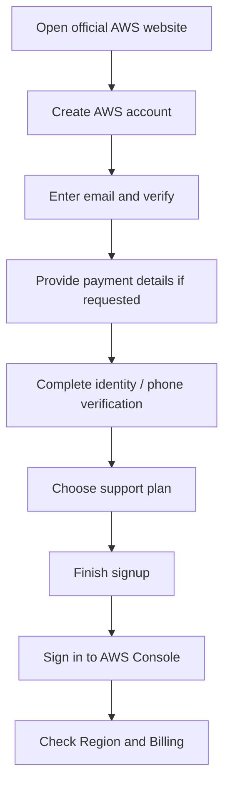
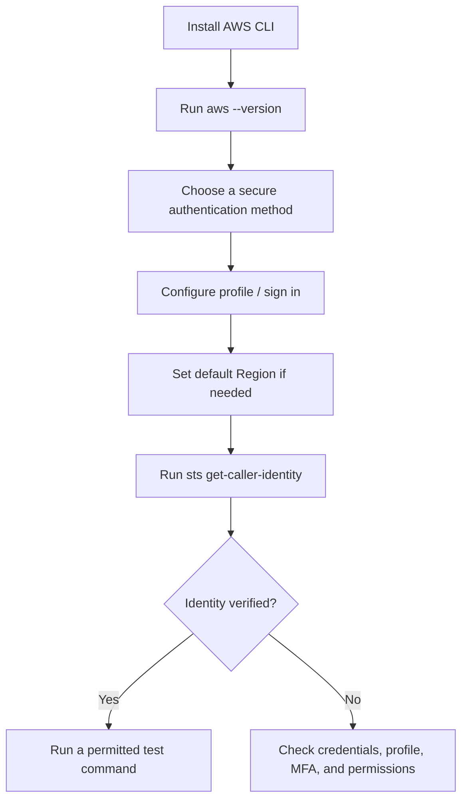
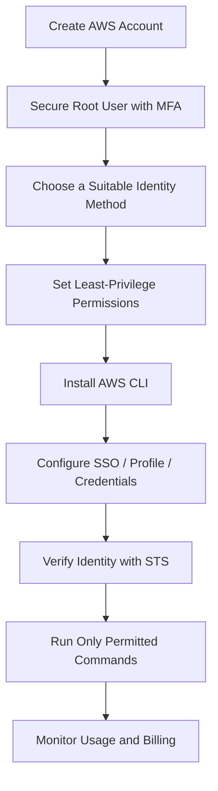

# AWS Zero-to-Hero — Part 2 (English)
## AWS Account Setup, IAM Service, and AWS CLI Configuration

> **Part 2 of 8 (planned).** This part covers Chapters 7–9 of the supplied source transcript. Appendix A preserves the exact transcript of these three chapters with timestamps.

## What you will learn

1. What information is needed to create an AWS account.
2. Basic use of the AWS Management Console and Region selector.
3. What the root user is and why IAM matters.
4. The purpose of IAM users, groups, and permissions.
5. The importance of MFA and account security.
6. What AWS CLI is, how it is installed, and how local terminals access AWS.
7. The role of credentials, access keys, default Region, and output format.

## 1. AWS Account Setup

### 1.1 Before creating an account

The transcript mentions the following items for account setup:

- Working email address — for email verification.
- Working mobile number — for identity/phone verification.
- Government-issued identity document — if required by the signup flow.
- Valid debit/credit card — for payment verification and charges for paid resources.
- Basic Support option — the instructor selects Basic Support for learning/testing.

**Important:** Exact signup steps, identity-document requirements, authorization amounts, refund timing, and free-tier offers can change by country, account type, and the current AWS signup flow. Do not treat a charge or free-tier limit shown in a video as a permanent guarantee. Verify the current signup screen and AWS pricing terms.

### 1.2 Account creation flow



General flow:
1. Open the official AWS website.
2. Start account creation/signup.
3. Complete email verification.
4. Complete payment details and identity/phone verification as requested by the signup flow.
5. Choose the support option and finish signup.
6. Sign in to the console.
7. Locate the Region selector and Billing/Cost and Usage area.

### 1.3 AWS Management Console

The console is a browser-based interface for finding, opening, and configuring AWS services.

Important areas:
- **Services/search:** Find services such as EC2, IAM, and S3.
- **Region selector:** Select the Region in which Region-scoped resources will be managed or created.
- **Billing/Cost and Usage:** Monitor usage and charges.
- **Recently visited services:** Quickly reopen services used before.

### 1.4 Region selection

A Region is a geographic AWS area. Selecting the correct Region matters when creating a Region-scoped resource. Changing the console's Region selector does not automatically move every service's data or configuration from one Region to another.

Consider:
- Latency to users.
- Required service availability in the Region.
- Data residency/compliance.
- Resilience architecture.
- Cost and data transfer.

### 1.5 Cost safety checklist

- Check the billing dashboard regularly.
- Consider configuring AWS Budgets/billing alerts.
- Do not start a service just because it is described as “free tier”; verify resource type, usage limits, and current eligibility.
- Terminate/delete test resources after a lab.
- Storage snapshots, public IPs, load balancers, NAT Gateways, and other resources can also incur costs.
- Secure root credentials and payment details.

## 2. AWS IAM — Identity and Access Management

### 2.1 What is IAM?

IAM is AWS's identity and access management service. It is used to manage identities and permissions—**who can authenticate and which AWS actions they can perform**.

IAM uses identities/roles and policies to configure access control. The transcript describes IAM as a global service; seeing “Global” instead of a Region in the console illustrates this concept.

### 2.2 Root user vs. IAM identity

| Identity | Meaning | Recommended usage |
|---|---|---|
| **Root user** | The original identity established when the account is created, with broad account-level privileges | Protect it; avoid routine daily tasks |
| **IAM user** | An identity in an AWS account for which credentials and permissions can be configured | Use according to legacy/workload requirements; apply least privilege |
| **IAM group** | A collection of IAM users to which shared permissions can be assigned | Give common permissions to users with similar job roles |
| **IAM role** | An identity assumed by a trusted principal, commonly using temporary credentials | Common for AWS services, federated users, and temporary access |

**Memory trick:** User = identity; Group = collection of users; Policy = permissions document; Role = assumable identity.

### 2.3 IAM policies and permissions

A policy is a JSON document defining which actions are allowed or denied on which resources, and under what conditions.

Conceptual policy fields include:
- `Effect`: `Allow` or `Deny`
- `Action`: which operation
- `Resource`: which resource
- `Condition`: optional conditions

Example — for concept illustration only, not a production-ready policy:

```json
{
  "Version": "2012-10-17",
  "Statement": [
    {
      "Effect": "Allow",
      "Action": ["s3:ListAllMyBuckets"],
      "Resource": "*"
    }
  ]
}
```

Restrict policies to the actual need. Do not grant `Resource: "*"` or broad administrative permissions without understanding the impact.

### 2.4 Why create users and groups?

If everyone on a team shares the root user, individual accountability and access control can be weakened. Separate identities can provide:
- An individual identity for each person.
- Permissions assigned according to job responsibilities.
- Easier access review and revocation.
- Easier association of actions with identities in audit logs.

Groups help organize IAM users with similar permissions. Role-based access and federation should also be considered.

### 2.5 MFA (Multi-Factor Authentication)

MFA requires an additional factor beyond a password. In the transcript, the IAM dashboard recommends enabling MFA for the root user.

Practical rules:
- Enable MFA for the root user.
- Follow MFA/federated sign-in policies for every human identity.
- Store MFA recovery options securely.
- Never share credentials.

### 2.6 IAM best practices

1. **Least privilege:** Grant only the actions/resources required.
2. **Protect the root user:** Enable MFA and avoid routine use.
3. **Avoid shared accounts:** Each user should have a traceable identity.
4. **Prefer temporary credentials:** Use roles/federation where possible.
5. **Review access regularly:** Remove unused identities, permissions, and keys.
6. **Protect secrets:** Never expose access keys, secret keys, or session tokens in code, screenshots, public repositories, or chat.

## 3. AWS CLI Configuration

### 3.1 What is AWS CLI?

AWS Command Line Interface (CLI) is a command-line tool for managing AWS services from a local terminal. Instead of clicking through the console, supported operations can be performed using commands.

CLI is useful for:
- Automating repetitive tasks.
- Scripts and deployment workflows.
- Calling AWS APIs from a local machine.
- Command-based administration alongside the console.

### 3.2 Installation overview

The transcript demonstrates downloading the AWS CLI installer on Windows and following the default installation steps. After installation, check it from Command Prompt/terminal:

```bash
aws --version
```

To view help/usage:

```bash
aws help
```

If the command is not recognized, check whether installation completed, whether the terminal should be reopened, and whether PATH configuration is correct.

> Installation methods vary by operating system. Follow the current official AWS CLI installation instructions for your OS.

### 3.3 Main parts of CLI configuration

For the CLI to send a request, it needs to know:
- **Credentials:** Which identity the request uses.
- **Default Region:** The default Region for Region-scoped calls.
- **Output format:** The format used to display CLI responses.

Common configuration command:

```bash
aws configure
```

This interactive prompt can request an access key ID, secret access key, default Region, and output format for a profile. The transcript demonstrates generating and configuring access keys; that is one possible method, but it is not the safest/recommended approach for every environment.

### 3.4 Credentials and access keys

An access-key pair commonly contains:
- **Access key ID**
- **Secret access key**

The secret access key may only be visible at creation time; preserve it securely in an appropriate secret manager/password manager. If it leaks, deactivate/delete that key, replace it, and follow incident-response procedures.

**Critical security note:** Do not create root-user access keys. Do not make long-lived IAM user access keys the default solution. Where possible, use AWS IAM Identity Center/SSO, role-based temporary credentials, instance/task roles, or supported federation.

### 3.5 CLI smoke tests

Check the version:

```bash
aws --version
```

Verify the configured identity:

```bash
aws sts get-caller-identity
```

List IAM users (only for an identity that has the required permission):

```bash
aws iam list-users
```

If `Unable to locate credentials` appears, the CLI does not have usable credentials configured/available. If `AccessDenied` appears, authentication may have succeeded, but the identity lacks permission for the requested action.

### 3.6 CLI setup flow



### 3.7 Common CLI errors

| Error/symptom | Likely meaning | What to check |
|---|---|---|
| `aws` command not found | CLI installation/PATH issue | Installation, terminal restart, PATH |
| `Unable to locate credentials` | CLI cannot find credentials | SSO/profile/role/credential configuration |
| `AccessDenied` | Identity lacks permission or an explicit deny applies | IAM policies, resource policy, permission boundary, organization controls |
| Wrong Region/resource not found | Request sent to an unexpected Region or resource ID is incorrect | `--region`, profile configuration, resource ID |
| Expired token | Temporary credentials expired | Re-authenticate/refresh the relevant session |

## 4. End-to-end learning flow



## 5. Quick revision table

| Concept | Remember this |
|---|---|
| AWS account | Billing/security boundary for AWS resources and services |
| Console | Browser-based AWS management interface |
| Region | Geographic area; many resources are Region-scoped |
| IAM | Controls identities and permissions |
| Root user | Original account identity with broad privileges; protect it and avoid routine use |
| IAM user | A named identity with configured credentials and permissions |
| IAM group | Collection of IAM users with shared permissions |
| IAM role | Assumable identity, commonly used for temporary credentials |
| Policy | Rules that allow/deny actions on resources under conditions |
| MFA | Additional authentication factor |
| AWS CLI | Command-line interface for AWS services |
| `aws configure` | Interactive configuration for a profile's credentials/Region/output |
| `aws sts get-caller-identity` | Shows the identity used for the request |

## 6. Common mistakes / gotchas

1. Using root credentials for everyday CLI work.
2. Sharing access keys between team members.
3. Committing access keys to source control or embedding them in code.
4. Assuming that installing the CLI automatically authenticates it.
5. Confusing `AccessDenied` with missing credentials.
6. Forgetting that resources may be Region-scoped.
7. Assuming free-tier status makes all created resources free.
8. Granting broad permissions instead of least privilege.
9. Assuming an access-key secret can always be retrieved later; save it securely at creation time.
10. Treating the video's signup steps, card authorization amount, or free-tier limits as permanent current facts.

## 7. Board-level answer

AWS account setup creates the account and enables console access after the required signup and verification steps. IAM manages identities and permissions through users, groups, roles, and policies. The root user has broad account privileges and should be protected with MFA and avoided for routine work. AWS CLI provides command-line access to AWS APIs, but it must use a valid authentication method, appropriate permissions, and the correct Region/profile. Prefer temporary role-based or federated credentials where possible, apply least privilege, protect secrets, and monitor billing.

## 8. No-Skip Checklist — Part 2

- [ ] Signup requirements mentioned in the transcript: email, phone, identity document, payment card
- [ ] Signup, verification, support selection, and console sign-in flow
- [ ] Console dashboard, Services search, Region selector, and Cost and Usage area
- [ ] IAM definition and purpose
- [ ] Root identity and its broad privileges
- [ ] IAM as a global service
- [ ] User/group concepts and permissions management
- [ ] MFA recommendation
- [ ] AWS CLI installation and terminal verification
- [ ] CLI configuration and credentials/Region/output concepts
- [ ] Access key ID and secret access key
- [ ] Credential visibility/security warning
- [ ] CLI user-listing example from the transcript
- [ ] Additional verification command and common error explanations
- [ ] Original Chapters 7–9 transcript preserved in Appendix A

## 9. Additional Points Added (separate from source)

These technical/security clarifications are additions, not verbatim transcript content:

- Prefer AWS IAM Identity Center/SSO or temporary role credentials over long-lived access keys when supported.
- Do not create root-user access keys for CLI use.
- Use named profiles when multiple AWS accounts/environments are involved, and verify the active identity before changing resources.
- Configure billing alerts/budgets and clean up lab resources.
- Follow current official AWS CLI installation and authentication guidance because supported methods and console flows evolve.

## Appendix A — Original Source Preserved

The exact source transcript for Chapters 7–9 follows below in its original order, with timestamps and original wording. Speech-to-text errors and unusual phrases are retained rather than silently rewritten.


```text
Chapter 7: AWS Account Setup
39:3339 minutes, 33 secondsदैट्ची की जरूरत है ठीक है एक तो पहला हो गया ईमेल एड्रेस और मोबाइल नंबर दोनों वर्किंग होना चाहिए आपके खुद के होना चाहिए क्योंकि वेरिफिकेशन होगा इसके बाद
39:4239 minutes, 42 secondsएक आपको कोई भी गवर्नमेंट का रिलेटेड आईडी ठीक है आईडी आपको चाहिए पड़ेगी जैसे कि वोटर आईडी अ आधार कार्ड या तो ड्राइविंग
39:5039 minutes, 50 secondsलाइसेंस एनीथिंग ठीक है तो एक आईडी की जरूरत पड़ेगी एंड इसके बाद डेबिट कार्ड या तो क्रेडिट कार्ड की आपको आवश्यकता पड़ेगी कार्ड डिटेल्स आप दोगे उस एंड वो भी आप
39:5939 minutes, 59 secondsकुछ भी ऐसे फेक नहीं दे सकते हो बिकॉज़ वो कार्ड का भी वेरिफिकेशन होता है ठीक है इनिशियली एक 22 कटेंगे जो कि बाद में
40:0740 minutes, 7 secondsरिफंड हो जाते हैं अ पेमेंट डिटेल्स इसलिए आपको देनी पड़ती है सो दैट कि आप लेट्स से कोई भी सर्विस जो कि पेड है या तो बहुत
40:1540 minutes, 15 secondsज्यादा रिसोर्स वाली अगर सर्विस यूज़ कर लो सो सो दैट दे कैन चार्ज यू चलिए अ इसके बाद आपको नेक्स्ट स्टेप क्या करना है सिंपली
40:2640 minutes, 26 secondsgoogleupdate.exe आपको यहां पे दिख जाएगा amazon.com इस पे आपको क्लिक करना है साइन
40:3440 minutes, 34 secondsअप फॉर अ फ्री a अकाउंट सो यह फ्री अकाउंट ठीक है क्रिएशन हो जाता है इसके बाद है एडब्ल्यू फ्री टियर ऑफकोर्स जो फर्स्ट
40:4140 minutes, 41 secondsटाइम आप जब साइन अप करते हो सो आपको काफी सारी फ्री टियर ठीक है सर्विसेस मिल जाती है क्रिएट अ फ्री अकाउंट इस पे आ जाते हैं
40:4940 minutes, 49 secondsएंड हेयर यू गो सो यहां पे आपको ईमेल एड्रेस वगैरह प्रोवाइड करना है ईमेल एड्रेस आप कोई भी फेक नहीं दे सकते हो उसपे आपका वेरिफिकेशन
40:5740 minutes, 57 secondsहोता है तो ईमेल वेरिफिकेशन हो जाता है इसके बाद आपको यह स्टेप दिखेगा क्रेडिट और डेबिट कार्ड आपको डिटेल्स यहां पर प्रोवाइड करनी है मैं जल्दी से प्रोवाइड
41:0541 minutes, 5 secondsकर देता हूं इसके बाद आगे बढ़ते हैं हम लोग ओके सो मैंने सक्सेसफुली कार्ड की डिटेल्स एंटर कर दी थी उसके बाद मेरे सिर्फ रप कटे हैं ठीक है तो ऑथराइज करके
41:1341 minutes, 13 secondsएंड इसके बाद ये पर्पस पूछ रहा है तो पर्पस हम लोग कर देते हैं पर्सनल यूज ओके ओके एंड इसके बाद आपका डॉक्यूमेंट टाइप जो
41:2141 minutes, 21 secondsहै वो आप सेलेक्ट कर सकते हो ठीक है जो भी आप कंफर्टेबल हो नंबर जैसे कि मैं भाई ड्राइविंग लाइस दे देता हूं राइट सो मेरे
41:2841 minutes, 28 secondsको वो इजी है तो मैं जल्दी से एंटर कर देता हूं ओके डॉक्यूमेंट वेरिफिकेशन के बाद ये लास्ट में मांग रहा है कंफर्म योर आइडेंटिटी तो इसके लिए फोन नंबर मांग रहा
41:3741 minutes, 37 secondsहै ऑफकोर्स सो मैं जल्दी से फोन नंबर डाल देता हूं एंड फोन नंबर वेरिफिकेशन के बाद सो अ हम बेसिक सपोर्ट पे जाते हैं क्योंकि
41:4441 minutes, 44 secondsहम लोग टेस्टिंग और लर्निंग पर्पस के लिए इसको यूज़ कर रहे हैं तो मैं यहां पे बेसिक सपोर्ट फ्री यूज़ करके कंप्लीट साइन अप कर देता हूं नाउ इट इज सेइंग
41:5241 minutes, 52 secondsकांग्रेचुलेशन कि भैया हमारा अकाउंट बन गया है एंड इसके बाद आपको कुछ इस तरह का ईमेल आ जाता है कि जहां पे आपको कंफर्मेशन
41:5941 minutes, 59 secondsमिल जाएगा कि वेब सर्विस इ रेडी एंड गेट स्टार्टेड नाउ कुछ डॉक्यूमेंटेशन वगैरह लिंक है जो स्टार्टिंग तो ठीक है यहां पे साइन इन टू कंसोल कर लेते हैं एंड एंड लॉग
42:0842 minutes, 8 secondsइन करने के बाद आपको कुछ एडब्ल्यू वेब सर्विसेस का इस टाइप का कंसोल दिखेगा जहां पे आपकी एक्टिविटी ट्रैक होती है अ जैसे
42:1542 minutes, 15 secondsकि रिसेंटली विजिट इड सो मैंने ऑलरेडी काफी यूज़ कर लिया है सो काफी सारी यहां पे दिखाई दे रही हैं सर्विसेस लद आपके केस में ये ब्लैंक होगी क्योंकि आप फर्स्ट
42:2342 minutes, 23 secondsटाइम आप कर रहे हो एंड रिगार्डिंग द पेमेंट्स एंड ऑल ठीक है तो जो भी आप सर्विसेस यूज करते हो अगर उसके रिलेटेड कुछ पेमेंट्स है एंड ऑल वो भी यहां पे
42:3042 minutes, 30 secondsअपडेट होती जाती है कोस्ट कॉस्ट एंड यूसेज वाले सेक्शन में सो आपके दिमाग में रहेगा आपके सामने रहेगा कि हां भाई कितना स्पेंड हो रहा है इसी के साथ-साथ डैशबोर्ड पे
42:3942 minutes, 39 secondsआपको यहां पे आपका जो करंट रीजन है जो ऑलरेडी सिलेक्टेड है बाय डिफॉल्ट वो मिल जाता है जो कि स्टॉक होम फॉर एग्जांपल जैसे कि मैं अभी यूरोप में हूं राइट सो
42:4742 minutes, 47 secondsमेरे जो नियर बाय जो भी डेटा सेंटर है तो स्टॉक होम सो वो ऑलरेडी रीजन सिलेक्टेड है लेट्स से इफ यू आर इन इंडिया सो मे बी
42:5542 minutes, 55 secondsशायद मुंबई या तो हैदराबाद सिलेक्टेड हो सकता है एंड लद आप चेंज भी कर सकते हो अपनी प्रेफरेंस के अलावा जैसे कि मैंने ऑलरेडी बताया था लेट्स से आपको कोई
43:0343 minutes, 3 secondsएप्लीकेशन यूएस में डिप्लॉयड है तो आप उस तरह से चेंज भी कर सकते हो अपने रीजन के अकॉर्डिंग इसके अलावा सर्विसेस हैं आप उसको एक्सप्लोर कर सकते हो सिंपली
43:1143 minutes, 11 secondsसर्विसेस पे आप क्लिक करो सो आपको यहां पे सारी सर्विसेस मिल जाएंगी या तो आप चाहो तो व्यू ऑल सर्विसेस में भी आप जा सकते हो सो आपको ये ओवरऑल एक ही ठीक है पेज पे
43:2043 minutes, 20 secondsआपको सारी इंफॉर्मेशन अ ऑफ सर्विसेस मिल जाएगी लेट्स से ec2 है एंड ऑल राइट सो
43:2743 minutes, 27 secondsसिंपल है ठीक है इसके बाद आप जा सकते हो एंड आपको अगर डार्क थीम चाहिए तो ऑफकोर्स यहां पे डार्क थीम भी हो जाएगी राइट सो इस
43:3443 minutes, 34 secondsतरह से ओके डार्क इज लुकिंग मच बेटर सो डार्क थीम पे चलो ये काम करेंगे आप सो दिस इज ऑल अबाउट दिस सेक्शन मिलते हैं अगले सेक्शन
Chapter 8: AWS IAM Service
43:4243 minutes, 42 secondsमें ऑलराइट सो चलिए सेक्शन में हम लोग शुरुआत करते हैं एडब्ल्यू की पहली सर्विस के साथ जो कि है आईएम आइडेंटिटी एंड
43:5043 minutes, 50 secondsएक्सेस मैनेजमेंट इस सर्विस की सहायता से हम लोग जो एडब्ल्यू एस अकाउंट है उसपे यूजर्स को मैनेज कर सकते हैं बिकॉज़ लेट्स
43:5843 minutes, 58 secondsसे अ कि आप एक ऑर्गेनाइजेशन में एक टीम में ग्रुप में काम कर रहे हो सो मल्टीपल यूजर्स के पास एक्सेस होना चाहिए सो उन
44:0544 minutes, 5 secondsयूजर्स का मैनेजमेंट क्रिएशन उनको क्या परमिशन देनी है तो ये सारी चीजें आप आईएएम की मदद से कर सकते हो दूसरी चीज अ इस
44:1444 minutes, 14 secondsसेक्शन में हम लोग ये भी कवर करेंगे सीएआई ठीक है कि एडब्ल्यू एस को हम लोग कितनी अलग-अलग तरीकों से एक्सेस कर सकते हैं
44:2044 minutes, 20 secondsइनकी सर्विसेस को कैसे कर सकते हैं दूसरी चीज जो अकाउंट या तो हम यूजर्स बनाते हैं उसको और कैसे ज्यादा सिक्योर कर सकते हैं
44:2944 minutes, 29 secondsसो दैट एक्सेस एक्सेसिबिलिटी में ठीक है ब्रीज ना हो ओके सिक्योर रहे एंड सो ऑन सो
44:3644 minutes, 36 secondsये कुछ अच्छी प्रैक्टिसेस हैं जो हमको फॉलो करने चाहिए तो चलिए शुरुआत करते हैं एंड आईएएम की एक शॉर्ट सी डेफिनेशन देख
44:4244 minutes, 42 secondsलेते हैं इट इज अ सर्विस दैट हेल्प्स यू सिक्योर कंट्रोल एक्सेस टू
44:5744 minutes, 57 secondsइसके अलावा मैनेज यूजर्स मतलब यूजर्स क्रिएट करना क्योंकि लेट्स से अगर हम ग्रुप में टीम में काम कर रहे हैं तो अलग-अलग यूजर्स बनाना उसको मैनेज करना
45:0645 minutes, 6 secondsउनको क्या परमिशन देनी है कितनी एक्सेसिबिलिटी देनी है एंड सो ऑन तो यह सारी चीजें हम आईएएम सर्विस के मदद से कर सकते हैं ओके इसके बाद आगे बढ़ते हैं इन
45:1545 minutes, 15 secondsजनरल थोड़ी सी बात करते हैं देखो अभी जो हम लोग ने इसके प्रीवियस सेक्शन में अकाउंट क्रिएशन किया था साइन अप किया था
45:2345 minutes, 23 secondsअकाउंट बनाया था उसमें हम लोग ने एक रूट यूज़ सर बनाया था रूट अकाउंट मतलब लेट्स से सबसे हाई लेवल अकाउंट जिसको सारी मतलब
45:3245 minutes, 32 secondsकाइंड ऑफ आप बोल सकते हो मालिक है मतलब ये इस अकाउंट का ठीक है एंड इसके पास सारे एक्सेस हैं सारे अथॉरिटीज हैं नाउ अभी हम
45:4045 minutes, 40 secondsचलते हैं डायरेक्ट कंसोल पे मैं ऑलरेडी लॉक्ड इन हूं ओके सबसे पहले तो हम लोग सर्विस पे चलते हैं थोड़ा सा एक्सप्लोर करते हैं तो थोड़ा सा ज्यादा इंटरेस्टिंग
45:4845 minutes, 48 secondsहमको फील होगा देखो यहां पे मैं ऑलरेडी यूज किया तो मुझे आईएएम यहां पे दिखाई दे रहा है लद आप सिंपल सर्च पे आईएएम यहां पे
45:5545 minutes, 55 secondsक्लिक करोगे तो आपको यहां पे सजेस्ट कर देगा आईएएम पर मैं क्लिक करता हूं सो इस तरह से आपको एक डैशबोर्ड दिखेगा इस
46:0346 minutes, 3 secondsडैशबोर्ड पर आके मॉनिटर भी कर सकते हो जैसे कि अगर कोई सिक्योरिटी रिस्क है जैसे कि यहां पे रिकमेंडेशन आ रहा है कि भाई
46:1046 minutes, 10 secondsयहां पे आप मल्टीफैक्टर ऑथेंटिकेशन इनेबल कर लो रूट यूजर के लिए ठीक है वो अभी हम लोग करेंगे देखेंगे चलिए इसके बाद आईम
46:1846 minutes, 18 secondsरिसोर्सेस पे आप देख सकते हो कि अभी तक आपने कितने यूजर्स क्रिएट किए हैं और ऑलरेडी है नहीं है एंड सो ऑन ठीक है चलिए
46:2746 minutes, 27 secondsतो यहां पे आपको सारी चीजें दिखाई दे देगी हम लोग आगे बढ़े इसके पहले मैं एक दो चीजें कवर कर देता हूं जो कि बहुत इंटरेस्टिंग है पहली चीज फ्री सर्विस ओके
46:3646 minutes, 36 secondsसो हम लोग ने बोला था कि भाई पे एज यू गो है 200 सर्विसेस हैं बट आईएम की बात करें तो इट इज अ फ्री सर्विस ठीक है सो नो
46:4446 minutes, 44 secondsएडिशनल कॉस्ट कोई इसमें कॉस्ट नहीं लगता है दिस इज द ग्लोबल सर्विस बहुत ध्यान देने वाली बात है ग्लोबल सर्विस तो आपको थोड़ा सा समझ भी आएगा कि यह चीजें काम
46:5346 minutes, 53 secondsकैसे करती हैं अब जैसे कि आपने शायद नोटिस कि किया हो नहीं किया हो जैसे ही हम लोग ने आईएम डैशबोर्ड खोला तो आप देखोगे रीजन
47:0147 minutes, 1 secondके जगह पे यहां पे ग्लोबल लिखा आ गया है ना राइट तो इसका मतलब क्या हुआ इसका मतलब
47:0847 minutes, 8 secondsयह है कि ये जो सर्विस है वो एक रीजन स्पेसिफिक नहीं है मतलब कि ऐसा बिल्कुल
47:1547 minutes, 15 secondsनहीं है कि आपने मान लो अगर अकाउंट यूरोप रीजन में बनाया तो वो इंडिया में नहीं चलेगा ऐसा नहीं होता है ग्लोबली काम करता
47:2447 minutes, 24 secondsहै यह इसका मतलब है आपने यूजर बनाया तो वह ऑल ओवर द वर्ल्ड किसी भी रीजन में आप काम कर रहे हो रिसोर्स बना रहे हो वह
47:3247 minutes, 32 secondsक्रेडेंशियल या तो वह जो यूजर्स हैं वह वहां पे वर्क करेंगे अ आगे आते हैं कि लेट्स से कि आप एक ही यूजर हो कि भाई आप
47:4047 minutes, 40 secondsटीम में काम नहीं कर रहे हो ऑर्गेनाइजेशन में काम नहीं कर रहे हो आपने अकाउंट क्रिएशन कर लिया अब मैं एज अ रूट यूजर भी तो काम कर सकता हूं मुझे यूजर बनाने की
47:5047 minutes, 50 secondsक्या जरूरत है सो इन दैट केस क्या मुझे आईएम की जरूरत है फिर भी सो मैं आपको कुछ चीजें बताता हूं रूट अकाउंट
47:5747 minutes, 57 secondsक्रिएटेडॉक्युमेंट्सफ्रैगमेंट
48:2648 minutes, 26 secondsक्यों यूजर बनाना चाहिए ओके अब बात करते हैं कि आईएम यूजर मतलब सॉरी जो सर्विस है इसमें आप क्या-क्या
48:3548 minutes, 35 secondsचीजें कर सकते हो ठीक है तो जो मेन मेन पॉइंट्स हैं उसके बारे में हम लोग एक ब्रीफ देख लेते हैं एंड उसके बाद प्रैक्टिकल भी देखेंगे क्रिएट यूजर क्रिएट
48:4348 minutes, 43 secondsग्रुप ओके एंड यूजर्स बनाना ग्रुप बनाना अब ये दोनों में क्या डिफरेंस है क्यों बनाना चाहिए थोड़ा सा जल्दी से बता देता
48:5048 minutes, 50 secondsहूं जैसे कि यूजर्स हैं अब जैसे कि दो यूजर्स हैं आपके टीममेट्स ला पॉल और एलेक्स तो यहां पे आपने यूजर्स बना दिए
48:5748 minutes, 57 secondsलेकिन ग्रुप का क्या रूल होता है जैसे कि मान लो कि पॉल है और एलेक्स है दोनों डेवलपमेंट टीम में है तो ऑपरेशन वाले टीम
49:0549 minutes, 5 secondsमें ओके दोनों यूज यूजर एक ही टीम में है ऑपरेशंस वाली दोनों को सेम टाइप की परमिशन देनी है तो आप दोनों को अलग-अलग परमिशन
49:1449 minutes, 14 secondsदेने की जगह आप क्या करो दोनों को एक ग्रुप में डाल दो जैसे कि मैंने ग्रुप बनाया एंड दोनों यूजर को एक ऑपरेशन वाले
49:2249 minutes, 22 secondsग्रुप में ठीक है मैंने फिट कर दिया या तो ऐड कर दिया एंड जो भी मैं परमिशन दूंगा मैं ग्रुप को दे दूंगा ो ओके सो इससे क्या
49:3049 minutes, 30 secondsहोगा बाय डिफॉल्ट उस ग्रुप में जितने भी यूजर्स हैं अभी तो मान लो दो हैं अगर ज्यादा यूजर्स है 10 है 20 है तो वो आपके
49:3749 minutes, 37 secondsलिए कॉम्प्लिकेशन मतलब ज्यादा सिंपलीफाई या तो इजी हो जाता है ओके सबसे पहले तो अभी हम लोग एक यूजर बना
49:4649 minutes, 46 secondsलेते हैं आईएम पे चलते हैं लेफ्ट साइड में आप यूजर्स पे क्लिक कर लो ठीक है सो अभी आप देख सकते हो कि कोई भी यूजर नहीं है तो
49:5449 minutes, 54 secondsसिंपली मैं क्रिएट यूजर कर लेता हूं इसका नाम दे देता हूं ठीक है तो एलेक्स का नाम का बना देता हूं प्रोवाइड एक्सेस टू
50:0050 minutesएडब्ल्यू एस कंसोल ओके एंड क्रिएट आईएम यूजर पे क्लिक कर लो इसके बाद इट इज आस्किंग फॉर कंसोल पासवर्ड तो कस्टम ही कर
50:0950 minutes, 9 secondsलेते हैं एक्चुअली क्रिएट अ न्यू पासवर्ड क्योंकि भाई हम लोग कस्टम यूज कर रहे हैं सो आई डोंट वांट टू क्रिएट इट अगेन पासवर्ड के यहां पे रूल भी है ठीक है तो
50:1850 minutes, 18 secondsएट अप टू एट कैरेक्टर्स और यहां पे आपको स्पेशल कैरेक्टर और मिक्स ऑफ ऐसे डिजिटल ये सब चीजें यूज करनी है एंड मैंने कस्टम
50:2550 minutes, 25 secondsपासवर्ड डाल दिया है है इसके बाद नेक्स्ट स्टेप पे आ रहा है सेट परमिश तो यह अभी से ही परमिशन के लिए पूछ रहा है ऐड यूजर टू अ
50:3350 minutes, 33 secondsग्रुप कॉपी परमिशन अटैच पॉलिसी डायरेक्टली तो आप परमिशन डायरेक्टली भी प्रोवाइड कर सकते हो या तो ग्रुप से भी कर सकते हो ओके
50:4250 minutes, 42 secondsसो यहां पे दो ऑप्शन देखोगे अटैच पॉलिसी डायरेक्टली कि आप सिर्फ ए यूजर को कोई परमिशन दे सकते हो या तो यूजर को ग्रुप
50:4950 minutes, 49 secondsमें ऐड कर दो मैं बोलता हूं ऐड यूजर टू ग्रुप अब लेकिन भाई ग्रुप होना भी चाहिए क्योंकि हम लोग फर्स्ट टाइम कर रहे हैं तो चलिए एक काम करते हैं हम लोग क्रिएट ग्रुप
50:5750 minutes, 57 secondsभी कर देते हैं ग्रुप का नाम हम लोग दे देते हैं एडमिन ओके एंड इसमें आपको क्या
51:0451 minutes, 4 secondsपरमिशन देनी है व भी है इसमें 956 जो परमिश है ऑलरेडी बना के दी हुई है जो कि
51:1151 minutes, 11 secondsलाइक जो सबसे ज्यादा कॉमन परमिशन है लेट्स से कि अभी हम लोग को एडमिन वाली परमिशन
51:1951 minutes, 19 secondsठीक है प्रोवाइड करनी है एलेक्स को सो आप यहां पर देख सकते हो एडमिनिस्ट्रेटर एक्सेस ओके तो यहां प एक दिया हुआ है आप
51:2751 minutes, 27 secondsइसके बारे में पढ़ भी सकते हो एंड इसके बाद डिस्क्रिप्शन में दिखेगा प्रोवाइड फुल एक्सेस टू ईडब्ल्यूएस सर्विसेस एंड
51:3451 minutes, 34 secondsरिसोर्स तो यहां पे आपको एक डिस्क्रिप्शन मिल गया कि एडब्ल्यू एस की सारी परमिश और सर्विसेस का इसके पास एक्सेस
51:4351 minutes, 43 secondsहोगा और यह जो भी परमिश है थोड़ा सा मैं इसको बता दूं कि यह जेसन फॉर्मेट में प्रोवाइड की जाती है ठीक है तो जेसन आप
51:5151 minutes, 51 secondsदेख सकते हो कॉपी जेसन ये एक इस टाइप का फॉर्मेट रहता है एंड इस फॉर्मेट के अंदर आप ठीक है जो भी परमिशन है वो डिफाइन करते
52:0052 minutesहो अब जैसे कि ये तो इनका वर्जन हो गया ठीक है स्टेटमेंट एंड इसके बाद अगर आप देखोगे इफेक्ट अलाउ अलाउ में क्या अलाउ
52:0752 minutes, 7 secondsकरना है तो एक्शन एंड रिसोर्स आप देखोगे सारे के सारे एक्शन स्टार मतलब सारे एक्शन रिसोर्स मतलब स्टार कि सारे रिसोर्स में
52:1552 minutes, 15 secondsसारे टाइप के एक्शन प्रोवाइड करने हैं ठीक है तो इसका मतलब ये हो गया और यह जेसन मैं आपको क्यों बता रहा हूं क्योंकि देखो अगर
52:2452 minutes, 24 secondsआप कस्टम भी बना सकते हो जैसे कि आप देखोगे एक ऑप्शन है यहां पे क्रिएट पॉलिसी मतलब ये 956 तो ये ऑलरेडी बने हुए हैं जो
52:3252 minutes, 32 secondsकॉमनली है आपको अपनी खुद की पॉलिसी डिजाइन करनी है तो आप क्रिएट पॉलिसी यूज करके
52:3952 minutes, 39 secondsजेसन फॉर्मेट में अगेन उसमें भी यूआई वाला वर्जन है आप अपनी पॉलिसी भी क्रिएट कर सकते हो जैसे चलिए देख ही लेते हैं मैं
52:4652 minutes, 46 secondsयहां पे अ क्रिएट पॉलिसी में आ गया हूं ठीक है अब यहां पे देखो दो ऑप्शन आपको देखते हैं जेसन क्योंकि अगर आपको जेसन
52:5452 minutes, 54 secondsलाइक ज्यादा कंफर्टेबल है कोडिंग अगर से आप वो हो तो आप इस टाइप से यूज कर सकते हो देखोगे इफेक्ट एक्शन रिसोर्स या तो मैं
53:0253 minutes, 2 secondsविजुअल में जा सकता हूं विजुअल में आपको पता है क्या करना है सिंपल चूज अ सर्विस कि आपको क्या सर्विस अलाउ करनी है लेट्स
53:0953 minutes, 9 secondsसे अ लेट्स से ईजी टू ठीक है अब एक्शन अलाउड अलाउ ऑल ईजी टू एक्शंस ठीक है तो
53:1653 minutes, 16 secondsमैं यहां पे क्लिक कर सकता हूं ठीक है तो इतनी सारी सर्विसेस हैं तो आप यहां से ठीक है देख भी सकते हो एंड ऑल फिर रिसोर्सेस
53:2353 minutes, 23 secondsमें क्या है ऑल लेट्स से मैं ऑल कर देता हूं नेक्स्ट करता हूं ओके सो यहां पे आपको पॉलिसी का नाम
53:3053 minutes, 30 secondsदेना है और डिस्क्रिप्शन पॉलिसी मतलब क्या-क्या परमिशन है ट सो जो अभी हम लोग ने देखो परमिशन बनाई ठीक है तो आडिट में
53:3953 minutes, 39 secondsजाता हूं आप जेसन में देखोगे तो अब आपको देखोगे कि वो चीज हो गई है ना सो इफेक्ट अलाउ एक्शन e2 एंड रिसोर्स में ऑल मतलब e2
53:4953 minutes, 49 secondsके रिलेटेड स्टार मतलब सब परमिशन एंड ऑ तो यहां पे मैंने यह चीज दिखा रहा हूं कि आपको को यह सोचने का या तो टेंशन लेने की
53:5953 minutes, 59 secondsजरूरत नहीं है कि भाई मुझे जेसन नहीं आता या तो मैं कहां से इसको देखूं रेफर करूं इन लोग ने काफी इजी बनाया हुआ है ठीक है
54:0754 minutes, 7 secondsनाउ अगर आप थोड़ा सा कंफ्यूज हो रहे होंगे कि कौन सी सर्विस ऐड करनी है क्या है सर्विस के नाम क्या है तो मैं आपको एक बात
54:1454 minutes, 14 secondsबता दूं दिस इज जस्ट अन ओवरव्यू कि आप यहां से क्या कर सकते हो ठीक है जैसे कि मतलब जब कोर्स में आप आगे बढ़ते जाओगे
54:2254 minutes, 22 secondsलेट्स से आप जब 10 सर्विसेस कवर कर चुके होंग तो आपको एक आईडिया आ जाएगा कि हां 10 सर्विसेस में इतनी इतनी चीजें होती हैं
54:2954 minutes, 29 secondsक्या-क्या परमिश है यह नाम आप खुद से फटाफट फटाफट सर्च कर पाओगे ओके सो चलिए अब मैं बैक टू चलता हूं इसमें अभी हमारा काम
54:3854 minutes, 38 secondsहै एडमिन एक्सेस पर क्लिक करना ठीक है एंड क्रिएट यूजर ग्रुप चलिए यूजर ग्रुप बना देता हूं मैं तो आप देख सकते हो कि यहां
54:4754 minutes, 47 secondsपे देखो एडमिन ग्रुप बन गया ठीक है सेट परमिशन बाउंड्री ओके लीव इट लाइक दिस इसके बाद नेक्स्ट पे हम चलते हैं एंड रिव्यू
54:5654 minutes, 56 secondsएंड क्रिएट ये बोल रहा है कि रिव्यू एक बार कर लो टैक्स टैक्स देखो यह ऑप्शनल है तो इतना काफी है एलेक्स और कस्टम पासवर्ड
55:0355 minutes, 3 secondsऔर मैं इसको कर देता हूं क्रिएट यूजर वेरी सिंपल हमारा यूजर यहां पे बनके हो गया तैयार यूजर का नाम है एलेक्स एंड यहां पे
55:1155 minutes, 11 secondsहै इसका पासवर्ड आप डाउनलोड ड सीएवी फाइल भी कर सकते हो क्योंकि आपके पास क्रेडेंशियल यहां पे ठीक है सेव रहेंगे
55:1855 minutes, 18 secondsठीक है अभी आई एम फिर से डैशबोर्ड हम चले गए नीचे देखेंगे तो यूजर ग्रुप क्योंकि एक ग्रुप बनाया एडमिन का एंड यूज र भी एक बना
55:2755 minutes, 27 secondsदिया जो कि है एलेक्स इस पर आप क्लिक करके देख सकते हो एलेक्स ठीक है नाउ इस यूजर पे आप क्लिक करते हो ठीक है तो आपको इसके
55:3655 minutes, 36 secondsबारे में और इंफॉर्मेशन मिलेगी जैसे कि कि इसके पास क्या-क्या परमिश है यह किस ग्रुप का पार्ट है ऐड यूजर ग्रुप ठीक है तो मैं
55:4555 minutes, 45 secondsएडमिन कर देता हूं ठीक है ड यूजर्स टू ग्रुप एक्चुअली पिछले बार अपन ने सिलेक्ट नहीं किया था सॉरी अबाउट दैट ठीक है सो आप
55:5355 minutes, 53 secondsदेख सकते हो कि यूजर जो हमारा एलेक्स है सो उस ग्रुप में अभी हम लोग ने एडमिन वाला ग्रुप को ऐड कर दिया ठीक है सो यहां से
56:0156 minutes, 1 secondआपको दिख भी रहा है कि भाई इसको क्या पॉलिसीज क्या अटैच है एडमिनिस्ट्रेटर एक्सेस ओके तो इसको एक्सेस है अभी इसके
56:0856 minutes, 8 secondsबाद जैसे ही ग्रुप हम लोग ने ऐड किया तो परमिश में भी आप देख सकते हो कि एडमिनिस्ट्रेटर एक्सेस इस यूजर के पास है
56:1656 minutes, 16 secondsचलिए अभी हमारा यूजर बन तो गया अब इसको हम लोग चेक कैसे करें कि हम लोग इसको एक्सेस कर सकते हैं कि नहीं अभी जो ए यूजर है
56:2456 minutes, 24 secondsदेखो नीचे आओगे ना सिक्योरिटी क्रेडिट इल्स अब इस पे आओगे तो यहां पे एक देखोगे कंसोल साइन इन लिंक मैं इसको कॉपी कर लेता
56:3156 minutes, 31 secondsहूं एंड इसके बाद डायरेक्टली मैं एक नया कंसोल ओपन करके ये लिंक को कॉपी करता हूं सॉरी पेस्ट करता हूं एंड अगर आप देखोगे तो
56:4056 minutes, 40 secondsमैंने ये वाली अगर लिंक यूज करी तो आप देखोगे ये 12 डिजिट का जो नंबर है वो ऑटोमेटिक आ गया इसके बाद हम लोग यहां पे यूजर नेम और पासवर्ड डाल सकते ओके सो इसके
56:4856 minutes, 48 secondsबाद मैंने यूजर नेम पासवर्ड यहां पे एंटर कर दिया मैं यहां पे साइन इन करता हूं एंड लेट्स सी कि वी कैन एक्सेस और नॉट ओके सो
56:5656 minutes, 56 secondsयहां पे यू कैन सी कि भाई हमारा पहला यूजर भी बन गया और हमने उस यूजर से यहां पर सक्सेसफुली हम लोग ने लॉग इन भी कर लिया
57:0557 minutes, 5 secondsओके इसको भी हम लोग यहां पे डार्क मोड कर देते हैं बिकॉज आंखों में चुप रहा है चलिए ये हो गया लेकिन आप थोड़ा सा यहां पे डिफरेंस देखोगे कि मैं यहां पे नीचे आता
57:1457 minutes, 14 secondsहूं तो आप देखोगे कॉस्ट एंड यूसेज तो आप देखोगे कि यहां पे एक्सेस डिनाइड एक्सेस डिनाइड ठीक है सो आप यहां पे डिफरेंस देख
57:2057 minutes, 20 secondsसकते हो कि इस यूजर को हम लोग ने एडमिन एक्सेस दिया था राइट एडमिन एक्सेस होने के बाद भी इसको मतलब इस
57:2957 minutes, 29 secondsयूजर को यह चीजों का एक्सेस नहीं है लाइक कॉस्ट हो गया यूसेज हो गया तो लाइक एक हायर लेवल पे आपका अकाउंट फिर भी सेफ रह
57:3857 minutes, 38 secondsसकता कुछ चीजें आपको दिखाता हूं जैसे कि फॉर एग्जांपल मैं यहां पे अ आईएएम पे जाता हूं ठीक है ओके सो इफ यू कैन सी कि मैं
57:4657 minutes, 46 secondsआईएएम डैशबोर्ड को एक्सेस कर सकता हूं ठीक है मैं यहां पे यूजर्स पे जा सकता हूं ठीक है एंड मैं ग्रुप्स पे जा सकता हूं एंड सो
57:5557 minutes, 55 secondsऑन अभी हम लोग आ ते हैं रूट अकाउंट में जो कि हमारा पॉल फिप रूट अकाउंट है राइट सो एले का जो यूजर है और मैं क्या करता हूं
58:0458 minutes, 4 secondsयह जो अ ग्रुप है ठीक है इसको मैं यहां से रिमूव कर देता
58:1058 minutes, 10 secondsहूं ओके सो मैंने क्या किया यह जो एलेक्स यूजर है ओके सो इसकी परमिश मैंने यहां से
58:1758 minutes, 17 secondsरिमूव कर दी ठीक है अभी मैं फिर से ए वाले जो लॉगइन वहां पर जाता हूं और मैं इसको रिफ्रेश करता हूं सो आप डिफरेंस देखना कि
58:2558 minutes, 25 secondsयहां पे क्या होता है सी आप यहां पे क्लियर देख सकते हो कि कितने अच्छे से यह और इतने फास्टली यह मैनेज करता है ओके ये
58:3358 minutes, 33 secondsवहां पे हम लोग ने कुछ चेंजेज किया और यहां पे एक्सेस डिनाइड आ गया सो मैं फिर से यह ग्रुप ऐड कर देता हूं क्योंकि हम लोग को यह ऐड रखना है तो आप देख सकते हो
58:4258 minutes, 42 secondsकि परमिशन मैंने फिर से ऐड कर दी है और यह मैं रूट यूजर से हूं ठीक है अब मैं फिर से जाता हूं ए वाले यूजर पे और मैं यहां पे
58:4958 minutes, 49 secondsरिफ्रेश करता हूं सो आप देख सकते हो कि यहां पे फिर से रिवाइव हो गया है ओके सो इस तरह से आप परमिशन को मैनेज कर सकते हो
58:5658 minutes, 56 secondsचलिए अब आ जाते हैं बैक टू हमारी हमारा प्रेजेंटेशन स्लाइड शोके क्रिएट यूजर क्रिएट ग्रुप ये दोनों चीज हम लोग ने देख
59:0359 minutes, 3 secondsली असाइन परमिश परमिश कैसे असाइन करना था वो भी हम लोग ने देख लिया ओके एंड इसके
59:1059 minutes, 10 secondsबाद देखो डिफाइन पॉलिसीज यू कैन क्रिएट एंड अटैच कस्टम पॉलिसीज वो पार्ट भी हम लोग ने देख लिया कि कस्टम पॉलिसीज बनाना
59:1859 minutes, 18 secondsऔर परमिश बनाना भी कितना आसान है आप गई बेस्ड भी कर सकते हो या तो जीएन फॉर्मेट में भी प्रोवाइड कर सकते हो काफी आसान कर
59:2559 minutes, 25 secondsदिया है डब्स ने इसके अलावा है क्रिएट रोल्स ठीक है तो आप रोल्स भी यहां पर बना सकते हो और इसके अलावा है मैनेज फेडरेटेड
59:3359 minutes, 33 secondsएक्सेस लाइक आई एम अलाउ इंटीग्रेटिंग विद एक्सटर्नल आइडेंटिटी प्रोवाइडर लाइक एक्टिव डायरेक्टरी फॉर सेंट्रलाइजिंग मैनेजमेंट ठीक है कुछ ऑर्गेनाइजेशन एक्टिव
59:4259 minutes, 42 secondsडायरेक्टरी जैसे सेंट्रलाइज्ड अ यूजर मैनेजमेंट ठीक है मेथड यूज करते हैं सो वो चीज भी इसमें पॉसिबल है अगर आप उसको
59:5059 minutes, 50 secondsएक्सटेंड करना चाहते हो इट्स फाइन इसके अलावा है क्रिएट रोल्स क्योंकि परमिश देख ली हम लोग ने अभी बात करते हैं रोल्स यह
59:5959 minutes, 59 secondsथोड़ा सा बेसिक डिफरेंस है बट अभी आपको टाइम टू टाइम समझ में आ जाएगा सो इन शॉर्ट जो रूल्स होते हैं अ इट इज यूजफुल फॉर द
1:00:081 hour, 8 secondsप्रोवाइड द टेंपरेरी एक्सेस एंड विद इन द रिसोर्सेस अब जैसे कि मान लो आपके एडब्ल्यूएम में ही दो रिसोर्सेस हैं लेट्स
1:00:161 hour, 16 secondsसे कोई एप्लीकेशन है कोई डेटाबेस है राइट अब इस एप्लीकेशन को इस डेटाबेस को एक्सेस करना है राइट तो उसको भी तो एक वो एक्सेस
1:00:241 hour, 24 secondsचाहिए राइट तो उस टाइप के एक्सेस भी आप रोल्स की मदद से मैनेज कर सकते हो चलिए आगे बढ़ते हैं अब बात करते हैं
1:00:331 hour, 33 secondsएमएफए के बारे में कि जब हम लोग ने आईएम डैशबोर्ड को एक्सेस किया था फर्स्ट टाइम सो यहां पे आपने देखा था एक रिकमेंडेशन में आ रहा था एमएफए अ मतलब ऐड एमएफए फॉर
1:00:421 hour, 42 secondsरूट यूजर ठीक है तो यहां पे मतलब यह वॉर्निंग है या तो रिकमेंडेशन है तो मतलब यह बहुत इंपॉर्टेंट पार्ट है तो चलिए इसके
1:00:501 hour, 50 secondsबारे में जल्दी से बात करते हैं कि मल्टीफैक्टर ऑथेंटिकेशन एमएफए क्या होता है ये एक एक्स्ट्रा लेयर होती है सिक्योरिटी की जहां पे आपको दो या तो दो
1:00:591 hour, 59 secondsसे ज्यादा फॉर्म में आपके अकाउंट को वेरीफाई करना पड़ता है ठीक है तो सिंपली मैं अगर बात करूं कि देखो अभी जो हम लोग
1:01:071 hour, 1 minute, 7 secondsने कक्स यूजर बनाया उससे उसको हम लोग ने एक्सेस कैसे किया यूजर नेम पासवर्ड डाल दिया
1:01:241 hour, 1 minute, 24 secondsदैट्ची सिक्योरिटी कोड आपको प्रोवाइड करना पड़ेगा अ ये सिक्योरिटी कोड कहां से मिलेगा चलिए इसके बारे में बात करते हैं
1:01:311 hour, 1 minute, 31 secondsयह एक्चुअली जो सिक्योरिटी कोड है वो आपके एक पर्सनल डिवाइस पे आता है जैसे कि मोबाइल फोन हो गया ठीक है जिसमें भी आप ऐप यूज कर सकते हो तो वहां पे हो सकता है ठीक
1:01:401 hour, 1 minute, 40 secondsहै अ अब एक काम करते हैं कि यहां पे रिकमेंडेशन आ ही रहा है तो हम लोग क्या करते हैं एमएफए फॉर रूट यूजर एक यूजर के लिए हम लोग इसको इनेबल करते हैं आप सीख
1:01:491 hour, 1 minute, 49 secondsजाओगे तो आप मल्टीपल यूजर के लिए भी कर सकते हो लद रूट को करना सबसे ज्यादा इंपॉर्टेंट है तो ऐड एमएफए कर लेते हैं क्योंकि रूट यूजर है चलिए ओके सो डिवाइस
1:01:571 hour, 1 minute, 57 secondsनेम डिवाइस नेम आप कोई भी डेमो डिवाइस नेम दे सकते हो जैसे कि मेरा मोबाइल फोन है अ
1:02:041 hour, 2 minutes, 4 secondsठीक है सो लाक लेट्स से अ जैसे कि h24 मैं इस तरह से दे देता हूं तो आपको ध्यान आएगा कौन से डिवाइस पे आएगा ये डिवाइस नेम डाल
1:02:121 hour, 2 minutes, 12 secondsदिया इसके बाद आप एमएफए जो डिवाइस है उसको कैसे यूज करना चाहते हो ठीक है मतलब जो
1:02:201 hour, 2 minutes, 20 secondsएडिशनल सिक्योरिटी वो कैसे यूज करना चाहते हो यहां पे अलग-अलग ऑप्श है पास की और सिक्योरिटी की ओके ऑथेंटिकेटर ऐप या तो
1:02:291 hour, 2 minutes, 29 secondsहार्डवेयर टीओटीपी टोकन ठीक है सो ये थोड़े से अलग-अलग लेवल के ही चीजें हैं ओके एंड जैसे कि फिंगरप्रिंट फेस स्क्रीन
1:02:371 hour, 2 minutes, 37 secondsलॉक ठीक है सो यह काफी अलग-अलग टाइप की चीजें सपोर्ट करता है अगर कुछ ज्यादा ही सेंसिटिव या तो आपको ज्यादा से ज्यादा
1:02:441 hour, 2 minutes, 44 secondsसिक्योर करना है बट अभी के लिए हमारे लिए काफी रहेगा ऑथेंटिकेटर ऐप को यूज करके ठीक
1:02:501 hour, 2 minutes, 50 secondsहै एंड इसके बाद मैं नेक्स्ट कर देता हूं अब यह बोल रहा है कि सेट अप अ डिवाइस अब सेटअप अ डिवाइस में आपको क्या करना है चलिए बताते हैं यह बोल रहा है कि भाई आप
1:02:591 hour, 2 minutes, 59 secondsअपने डिवाइस कंप्यूटर या मोबाइल में कोई भी एक एप्लीकेशन इंस्टॉल कर लो अब इसमें इन्होंने ऑप्शन दिए जैसे कि
1:03:061 hour, 3 minutes, 6 secondsgooglethalli.com
1:03:251 hour, 3 minutes, 25 secondsमोबाइल ये वाली एप्लीकेशन है आप डाउनलोड कर लेना ठीक है तो जब एक बार जब आपका एप्लीकेशन जो ड मोबाइल ठीक है इंस्टॉल हो जाएगा ना तो यहां पे आप देखोगे राइट साइड
1:03:341 hour, 3 minutes, 34 secondsमें ऐड का बटन दिया होगा वहां पे क्यूआर स्कैन आएगा है ना तो उसके बाद यहां पे जो क्यूआर कोड यहां पे दिखाई देगा उसको स्कैन कर लेना तो चलिए मैं जल्दी से कर लेता हूं
1:03:421 hour, 3 minutes, 42 secondsएंड स्कैन करने के बाद वो जो कोड पहली बार जो कोड आएगा उसको 30 सेकंड वेट करने के बाद एक और कोड आएगा तो दो बार आपको कोड
1:03:501 hour, 3 minutes, 50 secondsडालना है और उसके बाद ऐड एमएफए हो जाएगा ठीक है तो मैं जल्दी से कर लेता हूं आप अपने में कर लो तब तक ओके सो यहां पे सक्सेसफुली मैंने एमएफए को ऐड कर लिया है
1:04:001 hour, 4 minutesएंड अगर मैं यहां पे देखूं तो यहां पे देखोगे मल्टीफैक्टर ऑथेंटिकेशन एमएफए वन ठीक है सो वन और यहां पे आप देखोगे ये
1:04:081 hour, 4 minutes, 8 secondsयहां पे दिखाई दे रहा है android's 24 सो ये चीज यहां पे हो चुकी है ओके सो क्रिएटेडटेड कैसे करेंगे मैं सिंपली क्या
1:04:161 hour, 4 minutes, 16 secondsकरता हूं साइन आउट एंड इसके बाद फिर से साइन इन करता हूं एंड इस बार आपको मैं दिखाऊंगा कि साइन इन विथ यूजर य रूट यूजर
1:04:241 hour, 4 minutes, 24 secondsएक्चुअली ठीक है नेक्स्ट करता हूं पासवर्ड डालता हूं एंड इसके बाद देखोगे यूजर नेम पासवर्ड डालने के बाद यह एमएफए कोड बोल
1:04:311 hour, 4 minutes, 31 secondsरहा है ठीक है अपने अकाउंट में जाऊंगा सो यहां प फोन में मेरे एक कोड दिखाई दे रहा है तो मैं यहां पे कोड डाल देता हूं ठीक है ड मोबाइल में ठीक है सो ये मैंने जैसे
1:04:401 hour, 4 minutes, 40 secondsही कोड डाला एंड सबमिट करता हूं एंड लेट्स सी सो हेयर यू गो सो यहां पे हमारे सक्सेसफुली लॉग इन हो गया है सो आपने देखा
1:04:491 hour, 4 minutes, 49 secondsकि एमएफए इनेबल के बाद जो हमारा लेवल ऑफ सिक्योरिटी है वो ज्यादा इनेबल है क्योंकि इन केस पासवर्ड कंप्रोमाइज हो जाता है हैक
1:04:571 hour, 4 minutes, 57 secondsहो जाता है तो इवन दो ठीक है जो हैकर है भाई उसके पास डिवाइस डिवाइस नहीं है सो उसके लिए बहुत मुश्किल है कि वह ठीक है
1:05:061 hour, 5 minutes, 6 secondsइसको यूज कर पाए चलिए अब आगे बढ़ते हैं बात करते हैं वेस ऑफ एक्सेसिंग एडब्ल्यूएल
1:05:131 hour, 5 minutes, 13 secondsअलग तरीके से हम अपने
1:05:171 hour, 5 minutes, 17 seconds[संगीत]
1:05:211 hour, 5 minutes, 21 secondsएडब्ल्यूएसयम लोग ने देखा जो कि है हमारा कंसोल ठीक है यह जो हमारा डैशबोर्ड है मेन तो
1:05:281 hour, 5 minutes, 28 secondsइसको यूज करके हम लोग सारे एक्शन अपने परफॉर्म कर सकते हैं ठीक है तो यह तो हो गया हमारा नॉर्मल तरीका गुई मोड पे इसके
1:05:351 hour, 5 minutes, 35 secondsअलावा हम लोग के पास एक एक दो तरीके और हैं जैसे कि एडब्ल्यू मैनेजमेंट कंसोल में आपके पास एक पावर शेल भी मिलता है सो आपने
1:05:451 hour, 5 minutes, 45 secondsनोटिस किया होगा शायद कि यहां पे देखोगे एक टर्मिनल का बटन या फ एक लोगो दिखाई दे रहा है क्लाउड शेल जिसको बोलते हैं एंड इस
1:05:521 hour, 5 minutes, 52 secondsपे मैं क्लिक करता हूं सो आप यहां पे आपको एक टर्मिनल मिल जाता है जिसको यूज करके आप कोड या तो टर्मिनल अ मतलब यू नो कमांड को
1:06:021 hour, 6 minutes, 2 secondsयूज करके अ एक्शन परफॉर्म कर सकते हो लद अभी हम लोग का जो अकाउंट बना है वो नया है सो इसमें लिखा हुआ दिस मे टेक अप टू टू
1:06:111 hour, 6 minutes, 11 secondsडेज फॉर न्यू अकाउंट ठीक है तो इसको इनेबल होने में शायद थोड़ा टाइम लगेगा ये जो टर्मिनल का जो एक्सेस होता है वो आपके
1:06:181 hour, 6 minutes, 18 secondsलॉगइन होने के बाद होता है सो इसमें आपको कोई भी क्रेडेंशियल या तो अ लॉगइन इंफॉर्मेशन या तो कन क फि ग्रेशन करने की
1:06:261 hour, 6 minutes, 26 secondsजरूरत नहीं पड़ती है चलिए यह तो होगा दो तरीके लेकिन यह दोनों ही तरीके में आपको
1:06:331 hour, 6 minutes, 33 secondsमतलब ब्राउजर को यूज करके एक डैशबोर्ड या तो इनकी वेबसाइट को एक्सेस करना पड़ता है ओके दूसरा तरीका है डब्ल्यू सल आई कमांड
1:06:421 hour, 6 minutes, 42 secondsलाइन इंटरफेस व्हिच प्रोवाइड्स अ कमांड लाइन स्क्रिप्टिंग अप्रोच ठीक है जैसे कि हम लोग भैया
1:06:551 hour, 6 minutes, 55 secondsब्राउजर को हटा देते हैं लोकल सिस्टम पे सिर्फ टर्मिनल को यूज करके कमांड बेसिस पर कुछ एक्शन परफॉर्म करना हो देन यू कैन यूज
1:07:051 hour, 7 minutes, 5 secondsद सीएल आई मोड ओके सो इसके बाद हम लोग सीएल आई जल्दी से सेटअप कर लेंगे मैं विज मैक ठीक है मैं दोनों ही दोनों ही कवर कर
1:07:131 hour, 7 minutes, 13 secondsदूंगा सो सल आई अगर आप एज अ बिगनर हो और इफ यू आर थिंकिंग कि भाई इतना अच्छा हमारे पास डैशबोर्ड है हम लोग सब यहां से देख के
1:07:231 hour, 7 minutes, 23 secondsकर सकते हैं सो एंड इवन दो चलो कमांड के लिए भी हमारे पास यहां पे क्लाउड शेल है सो हम ठीक है सील आई का यूज़ क्यों करें
1:07:311 hour, 7 minutes, 31 secondsमैं सिंपल एक चीज बताता हूं देखो स एआई इज वेरी यूज़फुल क्योंकि देखो आप ये जो मैनेजमेंट कंसोल यूज़ करते हो यू हैव टू बी मैनुअली प्रेजेंट आप अपने हाथ से ही
1:07:401 hour, 7 minutes, 40 secondsकरोगे ना अब रात को मान लो 2 बजे कोई एक्शन परफॉर्म करना है राइट सो यू हैव टू बी देयर बट सीएआई की मदद से आप क्या कर
1:07:481 hour, 7 minutes, 48 secondsसकते हो कमांड लाइन से क्या कर सकते हो आप काफी सारे टास्क या तो रिपिटेटिव टास्क मेंटेनेंस से रिलेटेड टास्क आप ऑटोमेट कर
1:07:561 hour, 7 minutes, 56 secondsसकते हो ठीक है सो दैट्ची के लिए सीआई इज वेरी यूज़फुल ठीक
1:08:031 hour, 8 minutes, 3 secondsहै सो इसलिए सीआ यूज़फुल है इसके अलावा एक दो तरीके और हैं जो कि एचडीके एंड एपीआई आप एक एप्लीकेशन डेवलप कर रहे हो लेट्स से
1:08:121 hour, 8 minutes, 12 secondsइन python's ठीक है आप कोई एप्लीकेशन डेवलप कर रहे हो जिसका इंटीग्रेशन होना चाहिए एए
1:08:191 hour, 8 minutes, 19 secondsसर्विसेस से आप एड एडी केस एडी के यूज़ कर सकते हो ठीक है इंटीग्रेट विद द पर्टिकुलर
1:08:271 hour, 8 minutes, 27 secondsआप जो भी प्रोग्रामिंग लैंग्वेज में आप उसको अ ठीक है कोड कर रहे हो एंड उसमें आप इंटीग्रेट कर सकते हो एंड ऑफकोर्स सिंपली
1:08:351 hour, 8 minutes, 35 secondsये एपीआई बेस्ड अप्रोच ही यूज करता है टू यूज द एडब्ल्यू सर्विसेस ओके सो ये थोड़ा सा आउट ऑफ स्कोप है फॉर नाउ हमारे लिए बट
1:08:441 hour, 8 minutes, 44 secondsसीएआई हम लोग डेफिनेटली थोड़ा सा कवर अप करेंगे तो चलिए हम लोग जल्दी से सीएआई सेटअप कर लेते हैं
1:08:551 hour, 8 minutes, 55 secondsपर्टिकुलर यूजर को ठीक है हमारे सील आई
Chapter 9: AWS CLI Configuration
1:09:011 hour, 9 minutes, 1 secondपे एड स इंस्टॉल करने के लिए सिंपल
1:09:111 hour, 9 minutes, 11 secondsgoogle.com c इस पे आप क्लिक कर लो ये इस टाइप से आपको ऑप्शन मिलता है एंड राइट साइड में
1:09:201 hour, 9 minutes, 20 secondsws4 बिट को डाउनलोड कर लेते हैं तो एक इंस्टॉल डाउनलोड होता है सिंपली डबल क्लिक करो एंड एंड इसमें जितने भी डिफॉल्ट
1:09:271 hour, 9 minutes, 27 secondsसेटिंग्स है सिंपली नेक्स्ट नेक्स्ट करते जाओ टर्म्स एंड कंडीशन एक्सेप्ट कर लो एंड ट्स इट एंड नेक्स्ट नेक्स्ट
1:09:361 hour, 9 minutes, 36 secondsइंस्टॉल यहां पे इंस्टॉलेशन हो गया कंप्लीट एंड इस प फिनिश पे क्लिक करता हूं सीएमडी ओपन करके सिंपली आप एडब्ल्यू एस कमांड आप टाइप करोगे ना तो आपको इस इस
1:09:441 hour, 9 minutes, 44 secondsटाइप से उसका यूसेज मिलेगा दैट मींस आपकी जो एडब्ल्यू एस की कमांड्स है अब वर्क कर रही हैं ठीक है लद इसके साथ काफी सारे
1:09:521 hour, 9 minutes, 52 secondsऑप्शंस आपको प्रोवाइड करना पड़ेगा बट एटलीस्ट हमारे पास एक इंटरफेस है जिसको यूज करके हम लोग एडब क्लाउड प्लेटफॉर्म को
1:09:591 hour, 9 minutes, 59 secondsएक्सेस कर सकते हैं अपने लोकल एनवायरमेंट से एंड आप जल्दी से देख लेते हैं
1:10:241 hour, 10 minutes, 24 secondsmawsynram-shillong सीएआई हो गया सक्सेसफुली कंप्लीटेड मैं यहां पे क्लियर कर देता हूं एंड सिंपली एडब्ल्यू की कोई कमांड आप एग्जीक्यूट करोगे सो इस तरह से
1:10:321 hour, 10 minutes, 32 secondsआपको रिजल्ट मिलता है कि यहां पे यूसेज इस तरह से दैट मींस एडब्ल्यू ए की जो कमांड्स है इट इज वर्किंग नाउ सो या
1:10:441 hour, 10 minutes, 44 secondsदैट्ची आई सेटअप हो गया होगा देखो आप चाहे तो
1:10:551 hour, 10 minutes, 55 secondsसेम है अब जैसे कि मैं मैक पे यूज़ कर रहा हूं इट डंट मीन अब एड हान आन वर्जन ठीक है तो आप
1:11:251 hour, 11 minutes, 25 secondsशुरू होती है ओके मैं सिंपल बोलता हूं आईएएम मतलब मैं कौन सी सर्विस यूज कर रहा हूं एंड इसके बाद मुझे क्या एक्शन परफॉर्म
1:11:311 hour, 11 minutes, 31 secondsकरना है लिस्ट यूजर्स ओके सो मैं जैसे ही यह करूंगा सो देखते हैं कि इसके बाद हमको
1:11:381 hour, 11 minutes, 38 secondsक्या रिजल्ट मिलता है सी अनेबल टू लोकेट क्रेडेंशियल ओके क्योंकि देखो हम लोग ने यह तो बोल दिया सील आई को कि भाई यूजर्स को लिस्ट कर
1:11:471 hour, 11 minutes, 47 secondsदो लेकिन कौन से अकाउंट को करो राइट सो उसको कैसे पता चलेगा चलिए उसके लिए कुछ चीजें होती हैं अभी मैं पॉल फिलिप मतलब
1:11:561 hour, 11 minutes, 56 secondsहमारे रूट वाले एक्सेस पे हूं अभी हम लोग आ जाते हैं यूजर पे हमारे पास एक ही यूजर है एलेक्स ठीक है तो हम लोग उसी का प्रयोग
1:12:041 hour, 12 minutes, 4 secondsइस्तेमाल यूज करने वाले हैं एलेक्स पे चलते हैं एलेक्स पे चलते हैं सिक्योरिटी
1:12:111 hour, 12 minutes, 11 secondsक्रेडेंशियल पे चलते हैं एंड इसमें अब नीचे आते हैं तो आप देखोगे एक्सेस की ओके
1:12:181 hour, 12 minutes, 18 secondsसो एक्सेस की आप थोड़ा सा डिस्क्रिप्शन भी देख सकते हो टू सेंड प्रोग्रामेटिकली कॉल टू एडब्ल्यू फ्रॉम एडब्ल्यू सीएल आई तो अगर आप सीआई यूज कर रहे हो पावर शेल यूज
1:12:271 hour, 12 minutes, 27 secondsकर रहे हो ये देखो एचडी के मतलब एपीआई कुछ भी यूज कर रहे हो तो ये एक्सेस की आपको यूजफुल होने वाली ठीक है तो हम लोग एक
1:12:361 hour, 12 minutes, 36 secondsक्रिएट एक्सेस की बना लेते हैं ठीक है चलिए अब जैसे ही एक्सेस की बनाते हैं तो वो पूछता है कि आपको किस पर्पस के लिए
1:12:431 hour, 12 minutes, 43 secondsबनाना है तो अभी हम लोग सीआई यूज करने वाले हैं ठीक है तो सीआई पे चलते हैं एंड ठीक है और देखो इसके पहले इसने एक चीज
1:12:511 hour, 12 minutes, 51 secondsबोली कि यूज अल्टरनेटिव मेथड्स कि भाई एक्सेस की थोड़ा सा कमप हो सकती है चांसेस है तो वो बोल रहा है कि भाई दूसरी चीजें
1:12:581 hour, 12 minutes, 58 secondsयूज कर लो आप लेकिन आई एम आई आई एम सेइंग कि नहीं भाई आई अंडरस्टैंड कि मैं क्या कर रहा हूं मैं सिंपल कंफर्म कंफर्म करके
1:13:051 hour, 13 minutes, 5 secondsनेक्स्ट करता हूं ओके मैं जैसे ही क क्रिएट एक्सेस की करता हूं सो आप देखोगे यहां पे एक्सेस की और यहां पे सीक्रेट
1:13:131 hour, 13 minutes, 13 secondsएक्सेस की मतलब ये यू मतलब एक की हो गई और पासवर्ड तो मेरे को ये दो चीजों मिल गई कॉमिनेशन ओके एंड अगेन जब भी आपको
1:13:231 hour, 13 minutes, 23 secondsक्रेडेंशियल बनते हैं तो आप देखोगे डाउनलोड cb5 तो मैं यहां पे सिंपल फाइल डाउनलोड कर लेता हूं रीजन यह है कि यह जो
1:13:311 hour, 13 minutes, 31 secondsयह जो पासवर्ड और यह जो चीज देख रहे हो ना दो इसमें लिखा हुआ है देखो कि यू कैन नॉट रिट्रीव इट मतलब आप इसको डन करते हो इसके
1:13:391 hour, 13 minutes, 39 secondsबाद आप उसको एक्सेस नहीं कर सकते दोबारा ठीक है सो या तो अभी से ही कॉपी करके आप कहीं से पेस्ट कर लो या तो यह डाउनलोड
1:13:461 hour, 13 minutes, 46 secondsसीएवी फाइल तो आपके पास ये प्रिजर्व रहेंगे कॉपी किया ओके अभी आ जाते हैं हम लोग अपने टर्मिनल पे सिंपली आपको एक कमांड
1:13:561 hour, 13 minutes, 56 secondsयूज करनी है एडब एस कॉन्फिन वेरी सिंपल ओके इट इज आस्किंग
1:14:031 hour, 14 minutes, 3 secondsफॉर एडब्ल्यू एस एक्सेस की आईडी ठीक है तो मैं यहां पे कॉपी कर पेस्ट कर देता हूं अब नाउ इट इज आस्किंग फॉर द सीक्रेट की ओके
1:14:111 hour, 14 minutes, 11 secondsसो मैं यह सीक्रेट की कॉपी कर देता हूं एंड इसके बाद पेस्ट एंड इसके बाद डिफॉल्ट
1:14:181 hour, 14 minutes, 18 secondsरीजन रीजन मतलब क्योंकि देखो आप किसी तो रीजन में काम कर रहे होंगे तो सिंपली यहां पे डन कर देता हूं क्योंकि हमारा काम हो गया है एंड हम आप सिंपल डब्ल्यू में जाओगे
1:14:281 hour, 14 minutes, 28 secondsतो आपको देखोगे यहां पे स्टॉक होम लेकिन स्टॉक होम नहीं लेट्स से जैसे कि देखो स्टॉक होम है तो स्टॉक होम का रीजन क्या
1:14:341 hour, 14 minutes, 34 secondsहै य हान नथ 1 ओके सो इस टाइप से आपको देना है तो मैं सिंपली यहां पे बोल देता
1:14:401 hour, 14 minutes, 40 secondsहूं य नॉथ व लद ये डिफॉल्ट है आप इसको चेंज कर सकते हो एनी टाइम ठीक है इसको मैं
1:14:481 hour, 14 minutes, 48 secondsकर देता हूं दिस एंड नन कर देते हैं वेरी सिंपल ठीक है सो आप देखोगे एडब्ल्यू कॉन्फिन के बाद हम लोग ने यह कॉन्फ़िगर कर
1:14:571 hour, 14 minutes, 57 secondsलिया ओके नाउ अभी हम लोग ने सीआई को बता दिया कि कौन से अकाउंट को एक्सेस करना है
1:15:041 hour, 15 minutes, 4 secondsअभी मैं सिंपल एक कमांड यूज करता हूं आईएम लिस्ट यूजर्स एंड एंटर करता हूं सो इस बार हमको रिजल्ट मिलना चाहिए एंड ऑफकोर्स वी
1:15:121 hour, 15 minutes, 12 secondsगॉट इट तो आप देखोगे ए एंड इसकी यूजर आईडी ठीक है एंड जो जो इसका यूजर जो आईडी नंबर
1:15:191 hour, 15 minutes, 19 secondsथा एंड वो वो भी यूज़ हो गया थोड़ी सी इंफॉर्मेशन की कब क्रिएट हुआ था और यह पा लास्ट डूड मतलब यह कब लास्ट टाइम यह
1:15:271 hour, 15 minutes, 27 secondsएक्सेस हुआ था या तो यूज हुआ था चलिए सेक्शन के एंड में हम लोग आइडेंटिटी एंड एक्सेस मैनेजमेंट की कुछ
1:15:361 hour, 15 minutes, 36 secondsबेस्ट प्रैक्टिसेस पे एक समरी देख लेते हैं अवॉइड यूजिंग रूट अकाउंट एक्सेप्ट फॉर अकाउंट सेटअप ठीक है तो रूट अकाउंट को
1:15:441 hour, 15 minutes, 44 secondsरिसोर्स मैनेजमेंट और ये सब चीजों के लिए अवॉइड करना चाहिए जो कि हम लोग ने ऑलरेडी किया ऐड यूजर टू अ ग्रुप एंड असाइन परमिशन
1:15:511 hour, 15 minutes, 51 secondsटू अ ग्रुप तो यह भी हम लोग ने देख लिया कि एक ग्रुप कैसे क्रिएट करना है उसमें कैसे परमिशन या तो पॉलिसी हम लोग अटैच
1:15:581 hour, 15 minutes, 58 secondsकरते हैं कैसे कस्टम पॉलिसी बना सकते हैं उसमें अपने कस्टमाइज एक सर्विस या तो एक
1:16:051 hour, 16 minutes, 5 secondsबिल्कुल लिमिटेड उसमें भी ठीक है परमिश प्रोवाइड कर सकते हैं यूज पासवर्ड पॉलिसी
1:16:111 hour, 16 minutes, 11 secondsऔर एमएफए ठीक है सो एक्चुअली इसमें दो चीजें हैं या तो हम एमएफए इनेबल कर ले या तो पासवर्ड पॉलिसी मतलब पासवर्ड पॉलिसी हम
1:16:201 hour, 16 minutes, 20 secondsलोग कस्टमाइज कर सकते हैं अपने अकॉर्डिंग सो अभी हम लोग आईएएम कंसोल पे है डैशबोर्ड पे है लेफ्ट साइड में आप देखोगे कि आपको
1:16:281 hour, 16 minutes, 28 secondsएक अकाउंट सेटिंग्स का एक ऑप्शन दिखेगा अकाउंट सेटिंग्स में आप देखो पासवर्ड पॉलिसी तो पासवर्ड पॉलिसी को आप अपने
1:16:361 hour, 16 minutes, 36 secondsअकॉर्डिंग ठीक है मॉडिफाई कर सकते हो फॉर द डिफरेंट यूजर सो अभी जो बाय डिफॉल्ट है वो कितनी है जैसे कि एट कैरेक्टर्स हैं
1:16:431 hour, 16 minutes, 43 secondsइसमें क्या-क्या चीजें होनी चाहिए और कुछ बेसिक चीजें जो अच्छी नहीं है इसमें जैसे कि नेवर एक्सपायर पासवर्ड ये आप इसको चेंज
1:16:521 hour, 16 minutes, 52 secondsकर सकते हो जैसे सिंपली क्या है एडिट कर लो एंड अपने अकॉर्डिंग इसको कर सकते हो आईएम डिफॉल्ट है एंड इसको कस्टमाइज भी कर सकते हो कस्टमाइज प चलते हैं एंड आप
1:17:001 hour, 17 minutesदेखोगे कि भाई कैरेक्टर मतलब पासवर्ड की लेंथ अगर आपको बढ़ानी है और कॉम्प्लिकेटेड करनी है तो आप यहां चेंज कर सकते हो ओके एंड इसमें क्या-क्या चीजें की जरूरत है
1:17:091 hour, 17 minutes, 9 secondsइसके बाद टर्न ऑन पासवर्ड
1:17:191 hour, 17 minutes, 19 secondsएक्सपाइरेट्री वह एक यूजर खुद से रिसेट ना कर सके प्रिवेंट पासवर्ड यूज एंड सो ऑन
1:17:261 hour, 17 minutes, 26 secondsठीक है तो इस तरह से आप अपने यूजर को और अपने अकाउंट को और ज्यादा सिक्योर कर सकते हो इसके बाद बात करते हैं यूज एक्सेस कीज
1:17:351 hour, 17 minutes, 35 secondsफॉर सीएल आई और एचटी के एक्सेस की हम लोग कैसे जनरेट कर सकते हैं कैसे यूज करना वो भी हम लोग ने देख लिया और नेवर शेयर
1:17:441 hour, 17 minutes, 44 secondsएक्सेस कीज और पासवर्ड ठीक है ये तो वेरी कॉमन सेंस है और एथिकल है जो हमको भाई फॉलो करना चाहिए कभी भी अपनी एक्सेस की तो
1:17:521 hour, 17 minutes, 52 secondsभाई गलती से ना कभी कहीं कमिट मत कर देना किसी रेपो में कहीं पे शेयर मत कर देना कहीं पे सेव मत कर देना मतलब एक शेयर्ड
1:18:011 hour, 18 minutes, 1 secondप्लेटफार्म पे ऑडिट द परमिशन यूजिंग द आईएएम क्रेडेंशियल रिपोर्ट क्योंकि अगर आप एज अ रूट यूजर अपने यूजर्स को मैनेज कर
1:18:091 hour, 18 minutes, 9 secondsरहे हो सो टाइम टू टाइम ऑडिट जरूर कर लो चेक कर लो कि उन ठीक है कि जो भी यूजर्स हैं उनको प्रॉपर परमिश हैं नहीं हैं कितनी
1:18:191 hour, 18 minutes, 19 secondsयूज़ कर रहे हैं एंड सो ऑन जैसे कि इसके लिए भी हमारे पास एक टूल है चलिए मैं इसको कैंसिल कर देता हूं अभी इसकी जरूरत नहीं है आईएम डैशबोर्ड है एंड लेफ्ट साइड में
1:18:281 hour, 18 minutes, 28 secondsआप देखोगे नीचे तो क्रेडेंशियल रिपोर्ट एक आपको यहां पे दिखेगा एक्सेस एनालाइजर भी है क्रेडेंशियल रिपोर्ट पे हम आते हैं सो
1:18:361 hour, 18 minutes, 36 secondsआप देखोगे डाउनलोड क्रेडेंशियल रिपोर्ट चलिए इसको भी ट्राई करके दिखा देते हैं सो ये जो फाइल अभी हम लोग ने डाउनलोड करी है जो रिपोर्ट भी है तो कुछ इस टाइप की
1:18:451 hour, 18 minutes, 45 secondsरिपोर्ट दिखती है ठीक है इसमें आपको डिफरेंट जितने भी यूजर्स हैं उसके रिलेटेड इंफॉर्मेशन एआर एन जी के यूजर के अ
1:18:531 hour, 18 minutes, 53 secondsरिलेटेड इंफॉर्मेशन पासवर्ड क्रिएट है कि नहीं है इनेबल्ड है कि नहीं पासवर्ड कब लास्ट यूज्ड हुआ था
1:19:001 hour, 19 minutesचेंज हुआ है कि नहीं नेक्स्ट रोटेशन एमएफए एक्टिव है कि नहीं किस यूजर के लिए सो एक य अच्छी रिपोर्ट है जिसमें आपको एक ही
1:19:081 hour, 19 minutes, 8 secondsमतलब एक ही डॉक्यूमेंट में इतनी सारी इंफॉर्मेशन मिल जाती है जैसे कि देखो एक्सेस की ठीक है यूज हुई है नहीं हुई है
1:19:171 hour, 19 minutes, 17 secondsतो आप देख सकते हो कि अभी ए के लिए हम लोग ने यूज़ करी थी तो आप देखोगे लास्ट रोटेटेड लास्ट यूज्ड डेट सो आज के डेट में हम लोग ने यूज करी थी एंड कहां पर यूज हुई
1:19:271 hour, 19 minutes, 27 secondsथी लास्ट यूज्ड रीजन ठीक है सो यूएस ईस्ट बता रहा है आई डोंट नो व्हाई ठीक है सो आई एम के लिए यूज किया था हम लोग ने एंड ऑल
1:19:351 hour, 19 minutes, 35 secondsसो ठीक है सो सिंपल एक चीज है कि आप इस टाइप के रिपोर्ट्स का यूज कर सकते हो टू टाइम टू टाइम ऑडिट करने के लिए चेक करने
1:19:441 hour, 19 minutes, 44 secondsके लिए कि किन यूजर्स को क्या परमिशन है क्या नहीं है कुछ चेंजेज की जरूरत हो तो आप तुरंत कर सकते हो एंड इसी के साथ-साथ
1:19:521 hour, 19 minutes, 52 secondsएक पर्टिकुलर यूजर्स के के बारे में भी आप देख सकते हो जैसे कि अभी अभी हम लोग ने एलेक्स यूजर बनाया इसमें नीचे जाते हैं
1:19:591 hour, 19 minutes, 59 secondsलास्ट एक्सेस्ड आप ये टैब प क्लिक करोगे सो आप देखोगे अलाउड सर्विसेस मतलब 403 सर्विसेस अलाउड है इसको बिकॉज हम लोग ने
1:20:081 hour, 20 minutes, 8 secondsएडमिन एक्सेस दिया था ऑफकोर्स राइट सो अगर इतने एक्सेस दे रहे हैं हम राइट सो
1:20:151 hour, 20 minutes, 15 secondsआप देखोगे कि लास्ट एक्सेस ठीक है कब हो गया था टुडे सो 403 में से हम लोग ने इतनी
1:20:221 hour, 20 minutes, 22 secondsसर्विस आज यूज करी है तो य यहां से भी आप चीजें एक्सेस कर सकते हो या तो देख सकते हो ऑलराइट सो दिस इज़ ऑल अबाउट दिस सेक्शन
1:20:311 hour, 20 minutes, 31 secondsऑन आईएएम एंड मिलते हैं नेक्स्ट सेक्शन में एक और टॉपिक के साथ ऑलराइट सो इस सेक्शन में हम लोग बात
```
