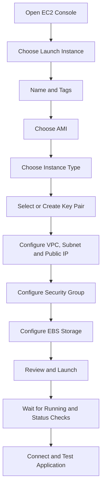
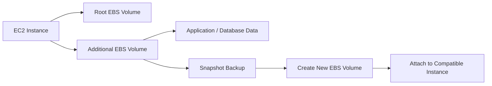
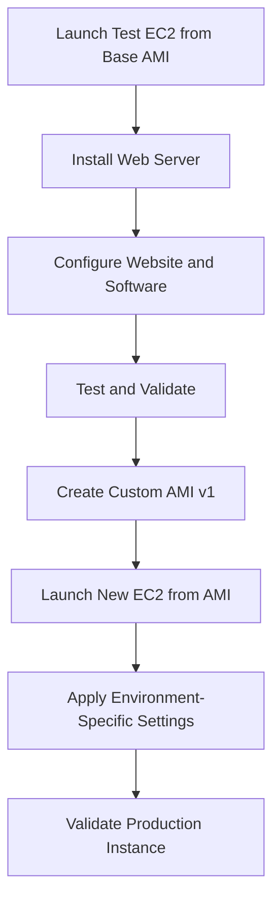
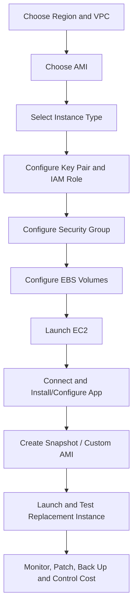

# AWS Zero-to-Hero — Part 3 (English)
## EC2, EBS, and AMI — Compute, Storage, and Reusable Server Images

> **Part 3 of 8 (planned).** This part covers Chapters 10–12 of the original transcript. Appendix A preserves the exact source transcript in order, with timestamps and original wording.

## What you will learn

- Launching an EC2 virtual server and understanding its basic configuration.
- AMIs, instance types, key pairs, security groups, networking, and storage settings.
- EC2 instance lifecycle and Region awareness.
- Understanding EBS as a virtual disk and attaching/detaching volumes.
- EBS volume types, resizing, encryption, and snapshots.
- Creating an AMI, launching an instance from it, and understanding image sharing/copying.
- Promoting consistent server configuration from testing to production.

## 1. AWS EC2 — Elastic Compute Cloud

### 1.1 What is EC2?

**EC2 is an AWS compute service that provides resizable virtual servers.** These virtual servers are called *instances*. You can run an operating system and your application/website on an instance.

Instead of buying and maintaining a physical server, you can provision an EC2 instance and use capacity as needed. Pricing can depend on the selected instance, operating state, storage, network usage, and other options.

### 1.2 EC2 instance launch flow



### 1.3 Important EC2 launch settings

| Setting | Meaning | Decision point |
|---|---|---|
| **Name/Tags** | Labels used to identify and organize the instance | Use meaningful names for environment, owner, and application |
| **AMI** | OS/software/configuration template used to boot the instance | Required OS, architecture, and software |
| **Instance type** | Combination of CPU, memory, and networking capacity | Workload requirements, performance, and cost |
| **Key pair** | Cryptographic credentials for instance login with supported connection methods | Store securely and use with the correct OS/user |
| **VPC/Subnet** | Virtual network and subnet placement | Public/private placement, routes, availability needs |
| **Security group** | Instance-level virtual firewall rules | Allow only required inbound/outbound traffic |
| **EBS storage** | Persistent block storage volumes | Size, volume type, encryption, performance |
| **IAM role** | Permissions for the instance to call AWS APIs | Minimum permissions required by the application |
| **User data** | First-boot initialization scripts, where supported | Test and version-control bootstrap tasks safely |
| **Public/Elastic IP** | Public-address options for internet reachability | Plan exposure and address lifecycle carefully |

### 1.4 Region and Availability Zone

EC2 instances are Region-scoped resources. If an instance was created in one Region, it normally will not appear in the instance list after switching the console to another Region. A global view, if available, can help with cross-Region visibility, but it does not automatically migrate Region-scoped resources.

Instance and attached EBS volume placement also matters: EBS volumes normally reside in a specific Availability Zone and cannot be directly attached to an instance in another AZ. Moving across AZs may require steps such as creating a new volume from a snapshot/copy.

### 1.5 Choosing an instance type and AMI

- Instance type defines CPU, RAM, and networking capacity.
- An AMI provides the base operating-system image and launch-time image configuration.
- Free-tier eligibility depends on account, date, instance family/size, Region, and current usage terms. Do not assume that an instance shown in a video will always be free.
- For production workloads, test performance, security updates, architecture compatibility, and cost.

### 1.6 Key pairs and safe remote access

A key pair can be used to connect securely to an EC2 instance. At launch, you may create a new key pair or select an existing one, depending on the launch method.

- Store the private-key file securely.
- Never share the private key through email, chat, screenshots, or public repositories.
- Recovery after key loss depends on the OS, instance configuration, and available management mechanisms.
- SSH for Linux and RDP for Windows are common access patterns, but the exact method depends on the AMI and setup.

### 1.7 Security groups — firewall basics

A security group defines network traffic rules. A web server may need HTTP/HTTPS, but opening SSH/RDP to every internet IP is risky.

| Traffic | Common port | Safer starting principle |
|---|---:|---|
| HTTP | 80 | Allow only when a plain HTTP endpoint is required |
| HTTPS | 443 | Allow from required sources for secure web access |
| SSH | 22 | Restrict to trusted sources such as an admin IP/VPN/bastion |
| RDP | 3389 | Restrict to trusted admin sources |

These ports are examples. Select actual rules based on the application and architecture. Security groups are stateful; return traffic normally does not need a separate rule.

### 1.8 EC2 lifecycle, monitoring, and scaling

Typical lifecycle states include:
- **Pending:** The instance is launching.
- **Running:** The instance is running; billing implications depend on instance type/OS/pricing.
- **Stopping/Stopped:** The instance is being stopped or is stopped. EBS storage and some other resources may continue to incur charges.
- **Rebooting:** The operating system restarts.
- **Terminated:** The instance has been permanently terminated; recoverability depends on related resources and configuration.

Monitor instance status checks, CPU/network metrics, application health, and logs. Scaling can be vertical (a larger instance type) or horizontal (multiple instances plus a load balancer/Auto Scaling). Auto Scaling is covered in a later planned part.

## 2. AWS EBS — Elastic Block Store

### 2.1 What is EBS?

**Amazon EBS provides block storage for EC2**, similar to a virtual hard drive. An EBS volume provides block-device storage to an instance's operating system and applications.

The transcript example uses an 8 GB EBS volume attached to an EC2 instance. Whether data survives instance replacement/termination depends on the volume and the instance's delete-on-termination settings—do not assume every volume is automatically preserved.

### 2.2 Relationship between EBS and EC2



### 2.3 Important EBS characteristics

- **Persistent block storage:** EBS volumes can be managed separately from an instance's lifecycle.
- **AZ-scoped:** A volume and its attached instance need compatible Availability Zone placement.
- **Multiple volumes:** Multiple EBS volumes can be attached to an instance, subject to instance limits.
- **Encryption:** Supported configurations allow volumes and snapshots to be encrypted.
- **Snapshots:** Point-in-time backup mechanism; snapshots can be used in recovery/copy workflows.
- **Resize:** Supported volumes can be modified for size/selected performance settings, but the guest OS may also need its partition/filesystem expanded.

### 2.4 EBS volume types

The transcript discusses examples such as gp2, gp3, and a high-IOPS type. Verify current AWS offerings, type names, capabilities, and pricing.

| Category/example | General idea | Typical consideration |
|---|---|---|
| **General Purpose SSD (gp2/gp3)** | Common balanced workloads | Cost, IOPS, throughput, and capacity |
| **Provisioned IOPS SSD (e.g. io1/io2 family)** | I/O-intensive workloads | Required IOPS, latency, durability, and cost |
| **Throughput-oriented HDD / cold HDD families** | Supported sequential or lower-cost workloads | Access pattern and performance requirements |

Exact availability and feature limits depend on Region, volume type, and current AWS documentation. Higher performance configurations can increase cost.

### 2.5 Create and attach an EBS volume

General workflow:
1. Open the EBS Volumes section in the EC2 console.
2. Choose **Create volume**.
3. Select the required Availability Zone; it must match the instance's AZ.
4. Configure size, volume type, encryption, and required performance settings.
5. After the volume is created, attach it to a compatible instance.
6. Identify the device in the guest OS.
7. For a new empty disk, create/mount a filesystem using OS-specific steps. Do not format an existing data volume.

### 2.6 Detach and reattach

Before detaching, stop/flush application writes and safely unmount the filesystem where necessary. After detachment, the same volume may be reattached to a compatible instance, subject to state and attachment rules.

**Warning:** Detaching a mounted or actively used database/filesystem without safe shutdown/unmounting can risk corruption or data loss. Root-volume handling may differ from data-volume handling.

### 2.7 Resize EBS

High-level steps:
1. Modify the EBS volume to increase a supported size/performance setting.
2. Wait for the modification to complete.
3. Expand the partition/filesystem inside the instance OS as required.
4. Verify filesystem size and application health.

Resizing the volume and expanding the filesystem inside the OS may be two separate steps. Exact commands depend on the OS/filesystem.

### 2.8 EBS snapshots and recovery

An EBS snapshot is a point-in-time backup of a volume. Typical workflow:
1. Select the volume.
2. Create a snapshot and add a meaningful description/tags.
3. Wait for the snapshot status to complete.
4. Create a new volume from the snapshot for recovery/testing.
5. Attach it in a compatible AZ and verify the data.

Snapshots are a useful part of backup strategy, but **a backup is useful only if restoration has been tested**. Plan retention, encryption keys, cross-Region recovery, and application-consistent backup requirements.

## 3. AWS AMI — Amazon Machine Image

### 3.1 What is an AMI?

**An AMI is an image/template that provides the information needed to launch an EC2 instance.** It can include an operating-system image and elements of configured software/setup. It provides a repeatable, consistent starting point for instances.

An AMI is more than just an “operating system.” It can be used as a launch blueprint, but options such as instance type, network, security group, IAM role, and launch settings may still need to be configured separately.

### 3.2 Why is an AMI useful?

The transcript's practical example:
1. Launch a test instance.
2. Install/configure web-server software.
3. Deploy a custom static website.
4. Test that the configuration works.
5. Create an AMI from the instance.
6. Launch a new production instance from the AMI.
7. Reuse the same base setup, reducing the need to repeat manual setup.



### 3.3 Create a custom AMI

1. Select the EC2 instance with the desired configuration.
2. Use a console path such as Actions → Image and templates → Create image; exact UI labels may change.
3. Name/version the image, e.g. `web-server-v1`.
4. Review the reboot/consistency option carefully. Decide based on filesystem/application consistency requirements; do not make a blind choice for production data.
5. Review included volumes and relevant options.
6. Choose Create image.
7. Wait for the AMI to move from `pending` to `available`.
8. Launch a new instance from the AMI and validate it.

### 3.4 AMI categories: public, private, paid

The transcript distinguishes public, private, and paid AMIs:

- **Public AMI:** The owner made it publicly available; verify the source/publisher and trustworthiness.
- **Private AMI:** Controlled by a specific owner/account; it can be shared with authorized accounts through sharing permissions.
- **Paid AMI:** Marketplace/vendor licensing or usage charges may apply.

Understand license terms and extra charges before using a paid AMI. Public availability does not automatically mean safe or trusted.

### 3.5 AMI sharing and cross-Region copy

- AMI sharing can allow authorized AWS accounts to use an AMI, subject to permissions and image configuration.
- Cross-Region use may require copying the AMI into the target Region.
- When copying an encrypted AMI/snapshot, check KMS key permissions and encryption constraints.
- Plan costs, retention, and ownership for AMIs and associated snapshots.
- Do not leave baked-in secrets, passwords, private keys, tokens, or personal data in an AMI.

### 3.6 AMI versioning and lifecycle

Use meaningful names such as `web-server-v1` and `web-server-v2`. Test before promoting an updated image. Maintain a retention/deletion policy for older images, and understand snapshot/dependency impacts before deregistering an AMI.

## 4. EC2 vs EBS vs AMI — quick comparison

| Service/concept | Main question it answers | Simple analogy |
|---|---|---|
| **EC2** | Where does the application compute/run? | Computer/server |
| **EBS** | Where is block data stored? | Attachable hard drive |
| **AMI** | How can I launch a repeatable preconfigured server? | Reusable system image/blueprint |
| **EBS Snapshot** | How can I capture a point-in-time volume backup? | Backup point from which a volume can be restored |

**Memory trick:** **Compute = EC2, Disk = EBS, Blueprint = AMI, Backup = Snapshot.**

## 5. Practical end-to-end architecture flow



## 6. Common mistakes / gotchas

1. Looking for an EC2 instance in the wrong Region.
2. Opening SSH/RDP to all IP addresses without a real need.
3. Losing or exposing a private key.
4. Assuming every EC2 instance or storage configuration is free.
5. Assuming EBS volumes can be attached directly across any Availability Zones.
6. Assuming all EBS data is automatically retained after instance termination; check delete-on-termination.
7. Detaching a mounted/data-active volume without safe application/filesystem handling.
8. Creating a snapshot but never testing restore.
9. Resizing EBS and forgetting the guest OS filesystem expansion step.
10. Launching from an AMI before its status is `available`.
11. Assuming an AMI automatically copies every external dependency or secret.
12. Sharing/copying encrypted AMIs without checking KMS permissions and Region constraints.

## 7. Board-level answer

EC2 provides resizable virtual compute instances. During launch, the operator chooses an AMI, instance type, key pair, network placement, security group, IAM role, and storage configuration. EBS provides persistent block storage for EC2 and supports volume management, encryption, and point-in-time snapshots. An AMI is a reusable image/template for launching consistently configured instances. A common deployment pattern is to configure and test a server, create a custom AMI, launch replacement or production instances from that image, and validate them. Secure networking, credential protection, backup/restore testing, monitoring, and cost control remain essential.

## 8. No-Skip Checklist — Part 3

- [ ] EC2 definition and virtual-server use case
- [ ] EC2 console launch flow
- [ ] Region-specific instance visibility
- [ ] AMI, instance type, CPU/memory, key pair, and security group
- [ ] Network settings, IAM role, user data, and public IP concepts
- [ ] Instance lifecycle, monitoring, and scaling overview
- [ ] EBS as virtual block storage
- [ ] Data survival and delete-on-termination caveat
- [ ] EBS Availability Zone relationship
- [ ] Volume types and performance/cost trade-off
- [ ] Encryption, resize, attach/detach, and snapshots
- [ ] AMI as a reusable preconfigured image
- [ ] Test-to-production AMI workflow
- [ ] Public, private, and paid AMIs
- [ ] Sharing/copying AMIs and cross-Region considerations
- [ ] Original Chapters 10–12 transcript preserved in Appendix A

## 9. Additional Points Added (separate from source)

These practical clarifications are additions to the transcript:

- For production, prefer repeatable infrastructure deployment and patched, trusted base images; document image build/versioning.
- Use Systems Manager Session Manager or another approved access mechanism where appropriate, instead of exposing SSH/RDP broadly.
- Apply least-privilege IAM roles to EC2 workloads; do not place long-lived AWS access keys inside AMIs.
- Define RPO/RTO, backup retention, restore tests, and cross-Region recovery requirements for critical data.
- Check current AWS documentation for current instance families, EBS types, pricing, quotas, and console labels before executing the lab.

## Appendix A — Original Source Preserved

The exact source transcript for Chapters 10–12 follows in original order, with timestamps and wording retained. Speech-to-text errors and unusual phrases are preserved rather than silently corrected.


```text
Chapter 10: AWS EC2 Service
1:20:391 hour, 20 minutes, 39 secondsकरेंगे एडब्ल्यू के ईट सर्विस के बारे में जो कि है इलास्टिक क्लाउड कंप्यूट एक सिंपल सी डेफिनेशन इट इज़ अ क्लाउड सर्विस
1:20:471 hour, 20 minutes, 47 secondsदैट प्रोवाइड्स रि साइजेबल वर्चुअल सर्वर्स जिनको हम इंस्टेंस बोल सकते हैं अब इसको विजुलाइज करो जैसे कि मान लो लो
1:20:541 hour, 20 minutes, 54 secondsएक आपका एक कंप्यूटर हो गया या तो एक सर्वर हो गया इसको हम लोग वर्चुअल सर्वर इसलिए बोल रहे हैं क्योंकि आपके सामने नहीं है वो ओवर द इंटरनेट आप उसको यूज़ कर
1:21:021 hour, 21 minutes, 2 secondsरहे हो इसलिए वर्चुअल सर्वर ओके एंड इन सर्वर्स को या तो इन कंप्यूटर्स को आप अपने अकॉर्डिंग मैनेज कर सकते हो कंट्रोल
1:21:101 hour, 21 minutes, 10 secondsकर सकते हो जैसे कि आप अपने पर्सनल कंप्यूटर करते हो उसी तरीके से एंड उसपे अपने अकॉर्डिंग आपको म मतलब अपने मन
1:21:171 hour, 21 minutes, 17 secondsमुताबिक एप्लीकेशन वेबसाइट कुछ भी आप उसको होस्ट कर सकते हो एक सिंपल सा यूज केस देखते हैं इमेजिन यू आर रनिंग अ बिजनेस
1:21:251 hour, 21 minutes, 25 secondsएंड नीड अ सर्वर टू होस्ट योर वेबसाइट और एप्लीकेशन आपने एक वेबसाइट बनाई अब उसको होस्ट करने के लिए आपको एक सर्वर चाहिए एक
1:21:321 hour, 21 minutes, 32 secondsतरीका तो यह है कि आप अपने खुद के फिजिकल सर्वर खरीद लो राइट बट अगेन ज्यादा कॉस्टली है उसको मैनेज करना थोड़ा सा हैकटिक है एंड सो ऑन सो बेटर है मतलब उसका
1:21:411 hour, 21 minutes, 41 secondsएक अल्टरनेटिव है कि आप एडब्ल्यू का e2 सर्विस यूज कर सकते हो जो एक्चुअली में क्या है रेंटिंग वर्चुअल सर्वर इन द
1:21:501 hour, 21 minutes, 50 secondsक्लाउड सो आपको एक कंप्यूटर क्लाउड पे मिल जाता है ऑन अ रेंट बेसिस रेंट मतलब यही है आप जितना यूज करोगे इस हिसाब से आपको पे
1:21:581 hour, 21 minutes, 58 secondsकरना है ओके सो आपको इमीडिएट बहुत ज्यादा कॉस्टिंग नहीं आएगी जैसे कि हम लोग ने स्टार्टिंग में ही देखा था कि इलास्टिक क्लाउड कंप्यूटिंग मतलब आपको यहां पे
1:22:061 hour, 22 minutes, 6 secondsफ्लेक्सिबल मिलती है जैसे ही एक सर्वर है तो कंप्यूटर है उसमें काफी सारी चीजें होती हैं तो आप उसको अपने हिसाब से कॉन्फिन कर सकते हो जैसे कि ऑपरेटिंग
1:22:151 hour, 22 minutes, 15 secondsसिस्टम कौन सा यूज करना है आपके लिए ज्यादा इंपोर्टेंट है डिस्क
1:22:261 hour, 22 minutes, 26 secondsस्पेस कितनी चाहिए लेट्स से कि अगर आपकी एप्लीकेशन में अ आप कुछ डाटा स्टोर कर रहे हो तो आपको ऑफकोर्स स्पेस ज्यादा चाहिए
1:22:341 hour, 22 minutes, 34 secondsहोगा फिर उसके बाद छोटी-छोटी चीजें अब क्योंकि देखो यह आप वर्चुअली आप यूज़ करने वाले हो तो नेटवर्क फायरवॉल एक्सेट्रा
1:22:411 hour, 22 minutes, 41 secondsकितनी परमिशन देनी है आप उस सर्वर को अपने मतलब आपका वर्चुअल कंप्यूटर है ना तो आप उसको एक्सेस कैसे करोगे सो ये सारी चीजें
1:22:491 hour, 22 minutes, 49 secondsआप कंट्रोल कर सकते हो मैनेज कर सकते हो एंड ये जो भी ऑप्शंस अभी हम लोग ने देखे जो कि हम कॉन्फिन कर सकते हैं उसके रिलेटेड आपको ये टर्म्स देखने को मिलेगी
1:22:581 hour, 22 minutes, 58 secondsजब आप खुद एडब्ल्यू में अ अपने सर्वर को कॉन्फिडो जैसे कि इंस्टेंस टाइप इंस्टेंस
1:23:041 hour, 23 minutes, 4 secondsटाइप में आप सीपीयू एंड मेमोरी कॉन्फिन करते हो इसके अलावा आपको एमआई दिखेगा
1:23:241 hour, 23 minutes, 24 secondsअ सिक्योरिटी ग्रुप से आप फायरवॉल रूल्स को ठीक है मैनेज करते हो इसमें थोड़ा सा और डिटेल में जाएंगे की पेयर मतलब आपको
1:23:311 hour, 23 minutes, 31 secondsसर्वर को एक्सेस कैसे करना है रिमोट नेटवर्क सेटिंग्स आईएम रोल यूजर डाटा इलास्टिक आईपी एंड सो ऑन ठीक है सो
1:23:391 hour, 23 minutes, 39 secondsडायरेक्टली चलते हैं अभी हम लोग प्रैक्टिकल देखते हैं तो थोड़ा सा ज्यादा इंटरेस्ट आएगा यह आ गया हूं मैं एडब्ल्यू के डैशबोर्ड पे एंड जो भी यूजर फर्स्ट
1:23:461 hour, 23 minutes, 46 secondsटाइम यह वीडियो देख रहे हैं तो आपको सिंपली क्या करना है aws.com यह वेबसाइट पे जाना है इस टाइप से वेबसाइट देखेगी सिंपल क्रिएट एंड एडब्ल्यू
1:23:541 hour, 23 minutes, 54 secondsअकाउंट यहां पे क्रिएट अकाउंट क्रिएट कर लेना है एंड इसमें आपको दो-चार चीजें लगेंगी जैसे कि ईमेल फोन नंबर एक आपको एक जो भी गवर्नमेंट की एक आईडी होती है वो
1:24:031 hour, 24 minutes, 3 secondsदेना है वेरिफिकेशन के लिए एंड इसके बाद आपको डेबिट कार्ड या तो क्रेडिट कार्ड की डिटेल्स क्योंकि यह पेड सर्विस है लद आज के जो सेक्शन में हम लोग फ्री टियर सर्विस
1:24:121 hour, 24 minutes, 12 secondsही यूज करने वाले हैं सो इस यह तो फ्री रहेगी बट अकाउंट क्रिएट करने के लिए आपको उसकी जरूरत पड़ती है तो सो आप जब फर्स्ट टाइम लॉग इन कर
1:24:221 hour, 24 minutes, 22 secondsलेते हो यूजर वगैरह बना लेते हो सो इस टाइप से आपको कंसोल मिलता है आप यह प्लेलिस्ट में ठीक है इसके प्रीवियस वाले वीडियोस भी देख सकते हो फॉर मोर
1:24:291 hour, 24 minutes, 29 secondsइंफॉर्मेशन इसके बा डायरेक्टली हम लोग यहां पर सर्च पे चलते हैं एंड ec2 आप यहां पे टाइप कर लो e2 पे चलते हैं वर्चुअल सर्वर इन द क्लाउड इस पे हम क्लिक करेंगे
1:24:381 hour, 24 minutes, 38 secondsउसके बाद आपको e2 डैशबोर्ड इस तरह से दिखाई देता है सर्वर बनाने के लिए आपको लॉन्च इंस्टेंस पे क्लिक करना है उसके
1:24:471 hour, 24 minutes, 47 secondsपहले एक सिंपल सा आपको नोट करा देता हूं कि जो e2 सर्विस होती है वो रीजन स्पेसिफिक होती है इस का मतलब क्या है कि
1:24:551 hour, 24 minutes, 55 secondsअभी जैसे मेरे रीजन स्टॉक होम सिलेक्टेड है तो जो भी मैं सर्वर बनाऊंगा वर्चुअल कंप्यूटर वर्चुअल मशीन वो स्टॉक होम के
1:25:031 hour, 25 minutes, 3 secondsडटा सेंटर पे बनेगा और यहीं पे प्रेजेंट होगा सो मतलब इसलिए मैं बता रहा हूं कल को मान लो आप कल को फिर से लॉग इन करते हो और
1:25:111 hour, 25 minutes, 11 secondsआपका यहां पे रीजन कुछ और सिलेक्टेड है लेट्स से यूएस हो या तो मुंबई तो आपको वो इंस्टेंस दिखाई नहीं देगा तो ये चीज आपको
1:25:191 hour, 25 minutes, 19 secondsध्यान रखना है ऑल दो उसकी फैसिलिटी के लिए यहां पे इन्होंने ग्लोबल व्यू भी दिया है तो मतलब ओवरऑल वर्ल्ड में मान लो अलग-अलग जगह आपके इंस्टेंसस है तो आप एक बार में
1:25:281 hour, 25 minutes, 28 secondsदेख सकते हो लॉन्च इंस्टेंस पे क्लिक करते हैं एंड शुरुआत करते हैं अपने सर्वर बनाने की सबसे पहले एक नाम देना है तो मैं माय अ
1:25:361 hour, 25 minutes, 36 secondsवेब सर्वर एक सिंपल सा नाम दे देता हूं इसके बाद है एप्लीकेशन एंड ओस इमेज ओके तो आप नाम भी देख सकते हो क्या है ये
1:25:441 hour, 25 minutes, 44 secondsamazononline.in टू विज रेड हैड तो मतलब जितने पॉपुलर
1:25:561 hour, 25 minutes, 56 secondsऑपरेटिंग सिस्टम्स है वो आपको यहां पर दिखाई दे देंगे कुछ स्पेसिफिक रिक्वायरमेंट है तो आप ब्राउज मोर एमआई आप
1:26:031 hour, 26 minutes, 3 secondsब्राउज कर सकते हो लद आई थिंक अभी के लिए हम लोग
1:26:191 hour, 26 minutes, 19 secondsamazon's के लिए यह फ्री टियर है मतलब यहां फ्री है अभी हमारे यूज़ करने के लिए लेट्स से अगर मैं
1:26:531 hour, 26 minutes, 53 secondsmath.mod एंड लार्ज यह डिपेंड अपॉन आपकी जो रिसोर्सेस होते हैं बट इसमें आपको एक समरी मिल जाएगी जैसे कि वर्चुअल सीपीयू
1:27:021 hour, 27 minutes, 2 secondsकितनी टू दिखाई दे रहा है यहां पे 1 गिग्स ऑफ मेमोरी मतलब 1gb रम आपको मिल जाएगी तो सीपीयू और रम ये दो चीजें यहां पे
1:27:091 hour, 27 minutes, 9 secondsसिलेक्टेड है लर्निंग फेस में तो फ्री टियर क्योंकि आप अ और अलग ऑप्शन भी देख सकते हो बट शायद अगर कुछ और सिलेक्टेड हो
1:27:161 hour, 27 minutes, 16 secondsतो उसमें आपको फ्री टियर ना मिले अगर आप दूसरे यूज करते हो तो कॉस्ट हो सकता है अब आगे बढ़ते हैं की पेयर लॉगइन अब देखो आपका
1:27:261 hour, 27 minutes, 26 secondsएक वर्चुअल कंप्यूटर बन तो रहा है आप उसको एक्सेस कैसे करोगे आपका कंप मतलब आपका जो जैसे मान लो लैपटॉप है वो तो आपके सामने
1:27:331 hour, 27 minutes, 33 secondsरहता है बट ये क्लाउड वाला आप कैसे एक्सेस करोगे सो उसके लिए की पेयर्स इन्होंने यहां पे प्रोवाइड की है अ टू कनेक्ट टू
1:27:411 hour, 27 minutes, 41 secondsयोर इंस्टेंस मतलब आप अपने लेट्स से पर्सनल लैपटॉप से ये वर्चुअल कंप्यूटर को एक्सेस करना चाहते हो सो उसके लिए की पेयर
1:27:481 hour, 27 minutes, 48 secondsप्रोवाइडेड है सो अभी यहां पे नहीं है तो क्रिएट की पेयर आप बना सकते हो जो भी आपका सर्वर का नाम है लेट्स से माय वेब सर्वर
1:27:571 hour, 27 minutes, 57 secondsऔर इसके बाद की तो इस टाइप से नाम दे देते तो हमको याद भी रहेगा माय वेब सर्वर की की है आरएस एड प बाकी चीजें हम क्रिएट की
1:28:051 hour, 28 minutes, 5 secondsपेयर कर लेते हैं एंड जब आप क्रिएट की पेयर करते हो आपने एक चीज नोटिस करी कि जैसे ही मैंने क्रिएट किया तो वह डाउनलोड हुई तो एक फाइल आपके पास डाउनलोड हो जाती
1:28:141 hour, 28 minutes, 14 secondsहै मैं आपको यहां ऊपर दिखा भी देता हूं अगर आप डाउनलोड में देखोगे माय वेब सर्वर h key.pem सो यह फाइल आपके पास डाउनलोड हो
1:28:221 hour, 28 minutes, 22 secondsजाती है आगे बढ़ते हैं नेट नेटवर्क सेटिंग्स तो कुछ चीजें आप कंट्रोल कर सकते हो कि कौन-कौन सी सर्विस आपको अलाउ करनी
1:28:291 hour, 28 minutes, 29 secondsहै कि आपके सर्वर पर एक्सेसिबल हो जैसे कि आप देखोगे कुछ बेसिक चीजें हैं इन लोग स्मार्ट होते हैं तो बेसिक चीजें जैसे कि
1:28:371 hour, 28 minutes, 37 secondsफायरवॉल देखोगे रूल्स अलाउ एसएसए ट्रैफिक फ्रॉम एनीवे मतलब कि आपके सर्वर को एसएसए
1:28:451 hour, 28 minutes, 45 secondsके माध्यम से एसएसए को यूज करके एक्सेस किया जा सकता है किसी भी सोर्स आईपी से एनीवे मतलब किसी भी सर्वर से मोस्ट ये
1:28:541 hour, 28 minutes, 54 secondsसर्वर्स यूज करते हैं वेबसाइट वगैरह होस्ट करने के लिए सो उसमें एचटीटीपीएस की जरूरत पड़ेगी ओके सो मैं बोलता हूं एचटीटीपी
1:29:011 hour, 29 minutes, 1 secondट्रैफिक क्योंकि अभी ना हम लोग यह जो सर्वर बना रहे हैं इस पे एक वेब सर्वर भी इंस्टॉल करके देखेंगे ओके वेब सर्वर को
1:29:091 hour, 29 minutes, 9 secondsआपको एक्सेस करने के लिए एचटीटीपी इनेबल होना चाहिए ओके चलिए आगे बढ़ते हैं और देखो यह थोड़ा सा आपको सिक्योरिटी
1:29:171 hour, 29 minutes, 17 secondsवार्निंग्स भी दे देता है जैसे कि यहां पे एनी वेयर लिखा हुआ है तो ये ज्यादा थोड़ा सा रिस्की है रदर देन आप एक लर आईपी से
1:29:251 hour, 29 minutes, 25 secondsअलाव करो सो इसने यह वार्निंग दी है कि भाई आप थोड़ा सा ध्यान रखो इसके बाद आते हैं स्टोरेज एंड 8gb एंड
1:29:331 hour, 29 minutes, 33 secondsइसमें और भी इंफॉर्मेशन है जैसे कि फ्री टियर में अप टू 30gb तक हम इसको यूज कर
1:29:391 hour, 29 minutes, 39 secondsसकते हैं ओके ई बीएस और जनरल पर्पस एसएसडी एसएसडी आपको मिल जाती है 30 अप टू 30gb आप यूज कर सकते हो ऑल दो 8gb अभी सफिशिएंट है
1:29:481 hour, 29 minutes, 48 secondsएडिशनल डिटेल्स नंबर ऑफ इंस्टेंस अ कि आपको एक बार में मल्टीपल बनाना ना हो तो लेकिन हमारे लिए एक काफी है
1:29:571 hour, 29 minutes, 57 secondsओके इसके बाद हमारे पास एडिशनल डिटेल्स मतलब ये ऑप्शनल है कुछ चीजें आप कंट्रोल करना चाहते हो नहीं करना चाहते हो देखो
1:30:061 hour, 30 minutes, 6 secondsअभी जब हमारा पहली बार जो एक मतलब एक सर्वर बनेगा वो तो खाली रहेगा कुछ होगा ही नहीं उसमें प्लेन होगा मैं चाहता हूं कि
1:30:131 hour, 30 minutes, 13 secondsसर्वर बनने के साथ-साथ उसके ऊपर कुछ टास्क परफॉर्म कर दे राइट क्यों तो कितना आसान होगा ना हमारा काम आसान हो जाएगा यस यू
1:30:221 hour, 30 minutes, 22 secondsकैन डू दैट इस इसके लिए हम लोग ने यहां पे मैंने बताया भी था स्लाइड में यूजर डाटा ऐड स्क्रिप्ट टू बी एग्जीक्यूटेड व्हेन द
1:30:291 hour, 30 minutes, 29 secondsइंस्टेंस रन तो आप यहां पे स्क्रिप्ट बेसिस पे कुछ टास्क ऑटोमेट कर सकते हो ड्यूरिंग द स्टार्टअप सो एडवांस पे आते
1:30:371 hour, 30 minutes, 37 secondsडिटेल्स में ओके सो डायरेक्टली मैं सबसे नीचे चले जाता हूं तो आप देखोगे यहां पे एक विंडो दिखेगा जहां पे आप अपने टास्क या
1:30:441 hour, 30 minutes, 44 secondsतो स्क्रिप्ट के स्टेप्स दे सकते हो या तो आपकी स्क्रिप्ट बनी बनाई हो तो आप फाइल भी अपलोड कर सकते हो तो यहां पे मेरे पास एक
1:30:521 hour, 30 minutes, 52 secondsऑलरेडी बहुत सिंपल सी स्क्रिप्ट बनी हुई है ठीक है अ तो ये स्लाइड में भी आप चाहो तो यूज़ कर लो अब स्टेप्स बहुत इजी है बैश स्क्रिप्ट है तो देखोगे बिन बैश वेरी
1:31:011 hour, 31 minutes, 1 secondसिंपल तो सबसे पहला स्टेप क्या कर रहे हैं सोयम अपडेट तो हम लोग पूरा अपडेट कर रहे हैं सिस्टम को इसके बाद हम लोग कर रहे हैं
1:31:081 hour, 31 minutes, 8 secondsअचे वेब सर्वर को इंस्टॉल ओके कमांड क्या है सोयम इंस्टॉल हान y
1:31:231 hour, 31 minutes, 23 secondsलास्ट जो स्टेप है इसमें हम लोग क्या कर रहे हैं इको तो मतलब हम लोग एक सिंपल सी index.htm फाइल बना रहे हैं आप देख सकते
1:31:311 hour, 31 minutes, 31 secondsहो एंड इसको हम लोग कहां पे कॉपी कर रहे हैं वा
1:31:531 hour, 31 minutes, 53 secondsओ सो इतनी छोटी सी स्क्रिप्ट है सो इस स्क्रिप्ट के बाद क्या होगा जैसे ही हमारा सर्वर बनेगा एक वेब सर्वर इंस्टॉल होगा उस परे एक फाइल बन जाएगी और हमारी एक छोटी सी
1:32:021 hour, 32 minutes, 2 secondsस्टैटिक वेबसाइट भी लॉन्च हो जाएगी दिस इज सो ऑसम राइट एंड ऑलमोस्ट हमारा सब हो गया है एंड इसमें एक छोटी सी डिटेल मैं थोड़ा
1:32:101 hour, 32 minutes, 10 secondsसा नोट करा दूं जैसे कि आप देख सकते हो कि आपकी जैसे मान लो यह जो स्टैटिक वेबसाइट है सिंपल सी वो आपको एक्सेस करने के लिए
1:32:191 hour, 32 minutes, 19 secondsआपकी जो मतलब जो सर्वर की आईपी पब्लिक होनी चाहिए राइट पब्लिक आईपी हो चाहिए तभी तो आप एक्सेस कर पाओगे सो आप देखोगे नेटवर्क सेटिंग्स में यहां पे असाइन
1:32:291 hour, 32 minutes, 29 secondsपब्लिक आईपी यहां पे इनेबल है अब मैं लास्ट स्टेप पे आ जाता हूं समरी पे आप एक बार और फाइनल देख सकते हो कि भाई हम लोग क्या-क्या यूज़ कर रहे हैं एंड इसके बाद
1:32:361 hour, 32 minutes, 36 secondsसिंपली मैं लॉन्च इंस्टेंस यूज़ करता हूं ये विद इन अ सेकंड बहुत फास्ट सर्विस है इनकी विद इन अ सेकंड सी यहां पे मैंने
1:32:441 hour, 32 minutes, 44 secondsक्लिक किया और हमारा इंस्टेंस बन गया आपकी एक इंस्टेंस की आईडी बन जाती है ओके तो मैं यहां पे क्लिक करता हूं ऑल दो आप
1:32:511 hour, 32 minutes, 51 secondsसिंपली ट पे जाओगे चलो मैं वही दिखाता हूं क्योंकि आप सिंपल e2 पे भी जाओगे इसके बाद सो आपका एक e2 डैशबोर्ड खुलता है ठीक
1:32:591 hour, 32 minutes, 59 secondsहै अब इसमें डिफरेंस आएगा कि इंस्टेंस रनिंग में आपको यहां पे वन दिखाई दे रहा है मैं इस पे क्लिक करता हूं ओके सो यह माय वेब सर्वर जो हमारा नाम था मतलब
1:33:081 hour, 33 minutes, 8 secondsइंस्टेंस का नाम इसकी आईडी एंड सो ऑन इसके बारे में जब ज्यादा इंफॉर्मेशन चाहिए आप सिंपली आईडी पे क्लिक करोगे एंड इस सर्वर
1:33:161 hour, 33 minutes, 16 secondsके बारे में बहुत सारी इंफॉर्मेशन आपको मिलेगी पब्लिक आईपी आपको यहां पे मिल गई है प्राइवेट आईपी जो इंटरनल यूज के लिए
1:33:241 hour, 33 minutes, 24 secondsहोती है एंड सो ऑन चलिए इंस्टेंस बंद तो गया अप एंड रनिंग है बट अभी जो हम लोग ने एक स्क्रिप्ट रन करी थी उसका क्या हुआ ठीक
1:33:321 hour, 33 minutes, 32 secondsहै तो वो चीज शो करेगी कि हमारा जो इंस्टेंस प्रॉपर्ली रनिंग है कि नहीं हमारा टास्क हुआ कि नहीं उसके लिए सिंपली क्या करो ये जो पब्लिक आईपी है ना इसको
1:33:401 hour, 33 minutes, 40 secondsमैं कॉपी कर लेता हूं कॉपी एंड हम लोग एक नए टैब पे चलते हैं एंड यहां पे मैं पेस्ट कर देता हूं यह मैंने अपनी आईपी डाली एंड
1:33:491 hour, 33 minutes, 49 secondsएंटर करता हूं एंड हेयर यू गो सी वेलकम टू अचे वेब सर्वर ऑन
1:34:131 hour, 34 minutes, 13 secondsamazon2 क्यों सिक्योरिटी ग्रुप क्या करता है इट इज लाइक अ नेटवर्क रूल या तो फायरवॉल रूल यह फायरवॉल जैसा वर्क करता है
1:34:221 hour, 34 minutes, 22 secondsजो आप मैनेज कर सकते हो दैट कंट्रोल्स द इन बाउंड एंड आउट बाउंड ट्रैफिक फॉर योर इंस्टेंस ओके सो मतलब क्या है देखो यह
1:34:301 hour, 34 minutes, 30 secondsआपका इजी टू इंस्टेंस है एक वर्चुअल सर्वर है यह आपका सर्वर है यह आपकी रिस्पांसिबिलिटी है ओके अब इस पे आपको कौन
1:34:381 hour, 34 minutes, 38 secondsसी सर्विसेस अलाउ करना है नहीं करना है वह आपके हाथ में है अब वह कंट्रोल कैसे करोगे वह कंट्रोल करते हैं हम यूजिंग द
1:34:461 hour, 34 minutes, 46 secondsसिक्योरिटी ग्रुप्स अभी हम लोग ने ऑलरेडी एक इसका एग्जांपल देख चुका है जैसे कि सर्वर बनाया उसपे एक सर्वर इंस्टॉल किया
1:34:551 hour, 34 minutes, 55 secondsउसको हम लोग ने एक्सेस भी किया राइट बाहर से मतलब पब्लिकली एक्सेस किया तो वो हो भी गया लेकिन ये वर्क कैसे कर रहा है चलिए
1:35:021 hour, 35 minutes, 2 secondsउसके बारे में बात करते हैं फिर से हम आ जाते हैं इजी टू डैशबोर्ड पे यहां पे इंस्टेंस रनिंग एक ही है सो इस पे मैं क्लिक करता हूं एंड इंस्टेंस आईडी पे
1:35:111 hour, 35 minutes, 11 secondsक्लिक करता हूं इसको हम चेक कैसे करते हैं सिंपली आप नीचे आ जाओ सिक्योरिटी में चले जाओ सिक्योरिटी में आप देखोगे यहां पे
1:35:191 hour, 35 minutes, 19 secondsसिक्योरिटी ग्रुप्स के अंदर आपको यहां पे देखोगे एक आईडी दिखाई देगी इसमें आप जाते हो इन बाउंड रूल्स एंड आउट बाउंड रूल्स
1:35:261 hour, 35 minutes, 26 secondsओके क्योंकि हम लोग ने क्या बोला यह इन बाउंड एंड आउट बाउंड ट्रैफिक आप कंट्रोल कर सकते हो ठीक है सो ये दोनों रूल्स
1:35:331 hour, 35 minutes, 33 secondsदिखेंगे आउट बाउंड में ठीक है यह देख सकते हो यह सारी मतलब यह सब आईपीस मतलब ऑल को
1:35:411 hour, 35 minutes, 41 secondsहम लोग ने अलाउ किया हुआ है इन बाउंड रूल्स अब देखो इन बाउंड रूल्स मतलब क्या है आपके सर्वर पे एक वेबसाइट डिप्लॉयड है
1:35:491 hour, 35 minutes, 49 secondsहम लोग ने अपने वेब सर्वर से रिक्वेस्ट करी अपने टू इंस्टेंस पे कि भाई वो वेबसाइट वेबसाइट को एक्सेस करना है तो
1:35:571 hour, 35 minutes, 57 secondsमतलब क्या हुआ हमारे सर्वर पे मतलब टू इंस्टेंस पे बाहर से मतलब कोई ब्राउजर से रिक्वेस्ट आ रही है तो वो हो गई इन बाउंड
1:36:051 hour, 36 minutes, 5 secondsरिक्वेस्ट वो रिक्वेस्ट को हम लोग कंट्रोल करते हैं इन बाउंड रूल से सो अभी आप देखोगे सो यहां पे इन बाउंड रूल्स में दो
1:36:111 hour, 36 minutes, 11 secondsरूल्स दिख रहे हैं पोर्ट पोर्ट आप देख सकते हो 80 एंड 22 80 पोर्ट किसके लिए होता है यूज होता है एचटीटीपी सर्विस के
1:36:201 hour, 36 minutes, 20 secondsलिए ओके एंड 22 होता है एसएसए के लिए अब जैसे कि यहां पे 80 दिखाई दे रहा है है ना तो 80 का मतलब है कि इस वेबस मतलब आपकी e2
1:36:301 hour, 36 minutes, 30 secondsसर्वर पे कोई भी एचटीटीपी रिक्वेस्ट आती है तो हम उसको अलाउ कर देंगे अब ये काम कैसे करता है मैं आपको तुरंत बताता हूं
1:36:381 hour, 36 minutes, 38 secondsदेखो ये हमारी वेबसाइट थी ठीक है मैं इसको रिफ्रेश भी करता हूं सो इट इज वर्किंग अब हम लोग इंस्टेंस पे चलते हैं क्योंकि ये
1:36:451 hour, 36 minutes, 45 seconds80 पोर्ट हम लोग ने इनेबल करके रखा है और सारी वेबसाइट से मतलब इस दुनिया में कोई भी ब्राउजर से आप इसको एक्सेस करोगे तो हो
1:36:541 hour, 36 minutes, 54 secondsजाएगा चलिए क्या हम इसको चेंज कर सकते हैं कर सकते हैं यह जो सिक्योरिटी ग्रुप है उससे आप करते हो यह देखो एक आईडी दिख रही है ना इस आईडी पे क्लिक कर दो चलिए अब आते
1:37:031 hour, 37 minutes, 3 secondsहैं इनबाता रूल्स आप इसको चेंज कर सकते हो इन बाउंड एंड आउट बाउंड ये देखो दोनों है इन
1:37:101 hour, 37 minutes, 10 secondsबाउंड है मैं एडिट करता हूं एंड मैं क्या बोलता हूं यह जो एचटीटीपी है सर्विस हम
1:37:171 hour, 37 minutes, 17 secondsमैं बोलता हूं इसको मैं डिलीट कर देता हूं सिंपल सेव रूल किया मैंने दैट्ची सो आप
1:37:241 hour, 37 minutes, 24 secondsदेखोगे इन बाउंड में अब सिर्फ एसएसए एंड 22 पोर्ट इनेबल है एंड अब मैं सिंपली यहां पे पब्लिक आईपी कॉपी करता हूं एंड यहां पे
1:37:331 hour, 37 minutes, 33 secondsमैंने एक नया टैब खोल लेता हूं एंड यहां पे मैं आईपी को एक्सेस करता हूं सो यू कैन सी कि यहां पे लोड हो रहा है एंड इट इज
1:37:411 hour, 37 minutes, 41 secondsनॉट गिविंग एक्सेस मतलब यह एक्सेसिबल नहीं है सो आप यहां पे इंस्टेंट देख सकते हो कि वहां पे हम लोग ने रूल चेंज किया और यहां
1:37:491 hour, 37 minutes, 49 secondsपे हमारी वेबसाइट एक्सेस होना बंद हो गई ठीक है चलिए इसको मैं अब फिर से हम लोग क्या करते हैं उसको इनेबल करके देखते हैं
1:37:561 hour, 37 minutes, 56 secondsओके सिंपल आप क्या है सिक्योरिटी में चले जाओ एंड उस क्या सिक्योरिटी ग्रुप्स एंड
1:38:031 hour, 38 minutes, 3 secondsउसको क्या है इन बाउंड रूल्स है जो एडिट इन बाउंड रूल्स कर लो ओके ऐड रूल क्योंकि हम लोग एक नया रूल ऐड कर रहे हैं कस्टम
1:38:101 hour, 38 minutes, 10 secondsटीसीपी ओके सो ये कस्टमाइज करने के लिए लद ये कुछ जो मोस्ट कॉमनली यूज्ड सर्विसेस हैं तो वो आपको यहां पे मिल जाएंगी जैसे
1:38:191 hour, 38 minutes, 19 secondsकि एचटीटीपी ठीक है एचटीटीपी एंड आपको देखो यह इनेबल तो है 80 पोट इनेबल है एंड
1:38:261 hour, 38 minutes, 26 secondsसोर्स आपको मतलब कहां से इसको एक्सेस करना है सो एनी वेयर ठीक है सो आप इस तरह से कर
1:38:331 hour, 38 minutes, 33 secondsसकते हो तो आप देखोगे 0.0 यह फॉर्मेट तो मतलब सब सेव रूल्स ओके सिक्योरिटी ग्रुप्स हम लोग ने ऐड कर दिया है अब आप नीचे
1:38:421 hour, 38 minutes, 42 secondsदेखोगे कि इन बाउंड रूज में हम लोग ने एचटीटीपी फिर से इनेबल कर दिया राइट वेरी सिंपल अभी मैंने मतलब जो आईपी मेरी ऑलरेडी
1:38:491 hour, 38 minutes, 49 secondsकॉपी थी यह देखो मेरे को करना भी नहीं पड़ा कुछ ओके सो मैं फिर से एक बार ट्राई
1:38:551 hour, 38 minutes, 55 secondsकरता हूं पेस्ट करता हूं सी वेलकम टू
1:39:231 hour, 39 minutes, 23 secondsओनली अलाउ रूल बट नो डिनायर सो आप किसी चीज को स्टॉप नहीं कर सकते हो सिक्योरिटी ग्रुप को यूज करके आप
1:39:321 hour, 39 minutes, 32 secondsसिर्फ अलाउ कर सकते हो अभी हम लोग ने क्या अलाउ किया एसएसएस सर्विस एंड एचटीटीपी सर्विस ओके ऑल इन बाउंड ट्रैफिक ब्लॉक्ड
1:39:401 hour, 39 minutes, 40 secondsएंड आउट बाउड आउट बाउंड अलाउड बाय डिफॉल्ट सो बाय डिफॉल्ट इन बाउंड सब कुछ ब्लॉक्ड होता है एंड आउट बाउंड अलाउड होता है अब
1:39:491 hour, 39 minutes, 49 secondsआप कंफ्यूज हो रहे होंगे कि आउट बाउंड का मतलब क्या है एंड ये अलाउड क्यों है आउट बंड मतलब देखो जैसे मान लो एक सर्विस है
1:39:561 hour, 39 minutes, 56 secondsअब हम लोग ने एक ही एक चीज करी थी कि सर्वर बनाने के बाद एक जो एचटीटीपीडी सर्विस है उसको इंस्टॉल किया था अभी
1:40:041 hour, 40 minutes, 4 secondsइंस्टॉलेशन होता कहां से इंटरनेट से ना सो इंटरनेट पे वो जाएगा वहां से कुछ डाउनलोड करेगा इंस्टॉल करेगा सो उसके लिए आउट
1:40:111 hour, 40 minutes, 11 secondsबाउंड सर्विस अलाउ भी तो होनी चाहिए राइट इसके अलावा किस टाइप की चीजें को अलाउ कर सकते हो कंट्रोल कर सकते हो जैसे कि
1:40:191 hour, 40 minutes, 19 secondsप्रोटोकॉल्स एटीटीपी एचटीटीपीएस एसएसए ये सर्विसेस आप इनेबल कर सकते हो पोर्ट नंबर
1:40:261 hour, 40 minutes, 26 secondsआप स्पेसिफिक पोर्ट नंबर अलाउ कर सकते हो जैसे कि 84 एटीटीपी यह बाय डिफॉल्ट ये कवर कर लेता है अपन ने एक चीज देखी कि
1:40:351 hour, 40 minutes, 35 secondsकस्टमाइज भी आप कर सकते हो ओके आईपी एड्रेसस और रेंज दैट इज अलाउ ट्रैफिक ओनली फ्रॉम अ स्पेसिफिक आईपी और रेंज आईपी सो
1:40:431 hour, 40 minutes, 43 secondsयहां पे एक जनरल इंफॉर्मेशन मैंने ऐड कर दी है जैसे कि कुछ मतलब ये जो कुछ कॉमन पोर्ट्स हैं आप लोग के लिए जो कि शायद आपको यूज़फुल रहेगी जैसे कि एचटीटीपी
1:40:521 hour, 40 minutes, 52 secondsएचटीटीपीएस एएच एफटीपी एंड डीएनएस मा स्ल सो मतलब अगर आप इन सर्विसेस के साथ मतलब
1:40:591 hour, 40 minutes, 59 secondsडील कर रहे हो तो इन पोर्ट्स की आपको शायद जरूरत पड़ेगी जिसको आप सिंपली कैसे इनेबल कर सकते हो वो हम लोग ने ऑलरेडी डेमो देख चुका है ओके इसके अलावा एक चीज और ऐड
1:41:081 hour, 41 minutes, 8 secondsकरूंगा सिक्योरिटी ग्रुप्स के रिगार्डिंग देखो ये अभी हम लोग का देखो माय बव सवर इंस्टेंस बना इसमें आपने देखा कि
1:41:151 hour, 41 minutes, 15 secondsसिक्योरिटी ग्रुप है यह ऑटोमेटिक बना था हमारे इंस्टेंस के साथ एंड वो अटैच हो गया
1:41:231 hour, 41 minutes, 23 secondsअब जैसे कि नीचे आते हैं सिक्योरिटी में जाते हैं यह देखो सिक्योरिटी ग्रुप है ओके एंड यहां पे जो सिक्योरिटी आईडी आप देख रहे हो लच विजार्ड 4 इस टाइप से इसका नाम
1:41:321 hour, 41 minutes, 32 secondsहै मैं इस पे क्लिक करता हूं सो यह एक सिक्योरिटी ग्रुप बट आप अपने खुद के सिक्योरिटी ग्रुप्स बना सकते हो एंड अटैच
1:41:401 hour, 41 minutes, 40 secondsकर सकते हो कैसे अब देखोगे यह जो e2 डैशबोर्ड है ना इसमें आप लेफ्ट साइड में देखोगे सिक्योरिटी के अंदर आपको दिखेगा नेटवर्क एंग सिक्योरिटी एंड इसमें आप
1:41:481 hour, 41 minutes, 48 secondsदेखोगे सिक्योरिटी ग्रुप्स मैं यहां पे क्लिक करता हूं सो आप देखोगे कुछ ऑलरेडी बने हुए हैं क्रिएट कट सिक्योरिटी ग्रुप्स आप अपने ग्रुप्स बना सकते हो अब जैसे कि
1:41:561 hour, 41 minutes, 56 secondsमान लो आप इस तरह से आपने बनाया सिक्योरिटी ग्रुप इसका आप नाम वगैरह दे दो ठीक है डिस्क्रिप्शन कि आप इसको यूज करके
1:42:041 hour, 42 minutes, 4 secondsक्या करना चाह रहे हो एंड सिमिलरली सेम चीज है इन बाउंड रूल्स एंड आउट बाउंड रूल्स ठीक है तो आप यहां पे ऐड रूल वगैरह करके ये सिक्योरिटी ग्रुप्स बना सकते हो
1:42:121 hour, 42 minutes, 12 secondsओके सो ये आपका कस्टमाइज बन जाएगा अपने तरीके से वेरी इंटरेस्टिंग थिंग कि जब आप नए इंस्टेंस बनाते हो जैसे कि आपने एक नया
1:42:201 hour, 42 minutes, 20 secondsइंस्टेंस एक नया टू इंस्टेंस बना रहे हो आप जो पुराना अपना सिक्योरिटी ग्रुप है आप उसको यूटिलाइज कर सकते हो अब जैसे कि अभी
1:42:291 hour, 42 minutes, 29 secondsहम लोग अपने इंस्टेंस पर चलते हैं ठीक है ये तो ये इंस्टेंस ऑलरेडी सिलेक्टेड है इसमें आप काफी सारे एक्शन परफॉर्म कर सकते
1:42:361 hour, 42 minutes, 36 secondsहो जैसे कि एक्शन पे आए ओके सो ये लेट्स से मुझे फायरवॉल रूल इसमें चेंज करने है तो वो किससे रिलेटेड है सिक्योरिटी अब मैं
1:42:441 hour, 42 minutes, 44 secondsसिक्योरिटी पे आता हूं आपको एक ऑप्शन मिलेगा चेंज सिक्योरिटी ग्रुप्स क्योंकि अभी तो जो आया था वो डिफॉल्ट था अब इसमें
1:42:511 hour, 42 minutes, 51 secondsदेखो सिलेक्ट सिक्योरिटी ग्रुप्स तो आपका ग्रुप पहले बना होना चाहिए ओके सो लेट्स से ये माय एचज एक सिक्योरिटी ग्रुप है ऐड
1:42:581 hour, 42 minutes, 58 secondsसिक्योरिटी ग्रुप ठीक है
1:43:101 hour, 43 minutes, 10 secondsदैट्ची है तो मैं सिंपल कैंसिल कर देता हूं अभी जरूरत नहीं है तो दिस इज हाउ आप सिक्योरिटी ग्रुप्स यूज़ करते हो और मैनेज करते
1:43:181 hour, 43 minutes, 18 secondsहो चलिए अब बात करते हैं कि जो हमारा ट इंस्टेंस बना था आप उसको रिमोट कैसे एक्सेस कर सकते हो तो कंट्रोल कैसे कर
1:43:261 hour, 43 minutes, 26 secondsसकते हो लेट्स से आपका एक सर्वर है वो एक कंप्यूटर जैसा ही है उस परे जाके आपको कुछ एक्शन परफॉर्म करना हो कोई एक नई एप्लीकेशन इंस्टॉल करना हो तो कैसे करोगे
1:43:341 hour, 43 minutes, 34 secondsरिमोट आप उसको एक्सेस कर सकते हो इसका एक और तरीका भी अभी हम लोग देखेंगे ओके सो पहला तरीका तो मैं आपको दिखा देता हूं इंस्टेंसस है माय वेब सर्वर यह सिलेक्टेड
1:43:431 hour, 43 minutes, 43 secondsहै ओके ये इजी टू डैशबोर्ड में ही हम लोग इसके बाद आपको एक कनेक्ट का बटन दिखेगा ठीक है इस पर हम क्लिक करते हैं टू
1:43:501 hour, 43 minutes, 50 secondsइंस्टेंस कनेक्ट ओके यूजर नेम हमारा क्या है ec2 h फन यूजर यह बना हुआ है इसको हम सिंपली यहां पे कनेक्ट करते हैं एंड आपको
1:43:591 hour, 43 minutes, 59 secondsएक नया विंडो ओपन हो जाएगा हेयर यू गो सी इट इज सो सिंपल एंड फास्ट कि जो आपका ई टू इंस्टेंस था ये देखो ये आपके पास ये जो
1:44:321 hour, 44 minutes, 32 secondshtml.com टू अचे वेब सर्वर है मुझे छोटा सा चेंज करना है लेट्स से मैं यहां पे आई करके न्यू कर देता हूं अचे वे सर्वर न्यू
1:44:411 hour, 44 minutes, 41 secondsओके एंड इसको सिंपली कॉलन w क सेव
1:44:501 hour, 44 minutes, 50 secondsदैट्ची वेबसाइट एंड मैं सिंपली यहां पे रिफ्रेश कर करूंगा अभी देखो amazononline.in
1:45:231 hour, 45 minutes, 23 secondsका कि ठीक है आप यहां पे कनेक्ट करके टू इंस्टेंस पे जा सकते हो दूसरा यह है कि आपको अगर मान लो रिमोट मतलब आपके लैपटॉप
1:45:311 hour, 45 minutes, 31 secondsसे इस सर्वर को एक्सेस करना है तो कैसे करोगे सिंपली एक ऑप्शन यहां पे एसएसए क्लाइंट चलिए अब देखते हैं कि विंडोज से
1:45:401 hour, 45 minutes, 40 secondsहम अपने इजी टू इंस्टेंस को वाया एसएसए कैसे एक्सेस कर सकते हैं एसएसए क्लाइंट पे आए तो यहां पे हमें स्टेप्स तो दिखाई दे
1:45:481 hour, 45 minutes, 48 secondsरहे हैं ऑल दो मैं आपको डायरेक्ट फॉरवर्ड बताता हूं देखो हमको सबसे पहले एक एएच क्लाइंट की जरूरत है तो हम सिंपली पुटी का यूज़ करते हैं जो कि सबसे मोस्ट पॉपुलर
1:45:571 hour, 45 minutes, 57 secondsटूल है सिंपली google2 है ठीक है सो डाउनलोड पुटी पे आप
1:46:041 hour, 46 minutes, 4 secondsचले जाना ओके इसके बाद आपके पास जो हम लोग ने इंस्टेंस बनाते टाइम एक फाइल डाउनलोड हुई थी ड प इफ यू रिमेंबर जिसका नाम था
1:46:121 hour, 46 minutes, 12 secondsमाय वेब सवर h की तो ये की मेरे पास ऑलरेडी है ये की होना चाहिए राइट यह वन टाइम ही डाउनलोड होती है सो सबसे पहला तो
1:46:201 hour, 46 minutes, 20 secondsस्टेप हमारा यह है कि डॉ पए जो फॉर्मेट है इसका फॉर्मेट चेंज करना है तो सिंपली आप देखो जब आप पुटी डाउनलोड करते हो इसके बाद
1:46:271 hour, 46 minutes, 27 secondsआपके पुटी की जेन भी आता है ठीक है सिंपली मैं यहां पे पुटी करता हूं सो आप देखोगे पुटी की जन ओके पुटी जन एक्चुअली सो पुटी
1:46:361 hour, 46 minutes, 36 secondsजनरेट करता है ठीक है तो सिंपली यहां पे लोड करो जहां भी फाइल है उस लोकेशन प चले जाओ फाइल नहीं दिखेगी तो आप सिंपली क्या करो यहां पे आप ऑल फाइल्स में चले जाओ
1:46:441 hour, 46 minutes, 44 secondsयहां पे दिखेगी है ना इसको आपको लोड कर लेना है ठीक है मतलब ये लोड हो गई इसके बाद आप सिंपली क्या करो सेव प्राइवेट फाइल
1:46:521 hour, 46 minutes, 52 secondsओके सेव प्रा फाइल कर लो ओके यस एंड यहां एडब्ल्यू एस में कर लेते हैं डॉट पपी के फॉर्मेट में सो मैं सिंपली क्या करता हूं
1:47:001 hour, 47 minutesमाय वेब सर्वर हा हान की ओके हाइन की लेकिन यह फॉर्मेट चेंज हो गया पीपी के में
1:47:071 hour, 47 minutes, 7 secondsहो गया ठीक है मैं सेव कर देता हूं सिंपल एंड इसको मैं कर देता हूं क्लोज सो आप यहां देखोगे माय वेब सर्वर ठीक है और यह
1:47:141 hour, 47 minutes, 14 secondsपीपी के फॉर्मेट में आ गई है ओके इसके बा सिंपली य करो यहां प पुटी आप यह जो मेन हमारा जो टर्मिनल था एक्चुअली एसएसए
1:47:241 hour, 47 minutes, 24 secondsक्लाइंट उसको ओपन किया ओके इसके बाद इट इज आस्किंग फॉर द होस्ट नेम और आईपी एड्रेस ओके सो सिंपली आप क्या करो इंस्टेंस कनेक्ट पे जैसे जाते हो ना तो इसमें आपको
1:47:321 hour, 47 minutes, 32 secondsयहां पे दिखेगी आईपी मतलब ये हमारी जो पब्लिक आईपी है वो उसका आप यूज कर सकते हो चलिए तो ये आईपी यूज़ कर ली हम लोग ने जो
1:47:411 hour, 47 minutes, 41 secondsपब्लिक आईपी इसके बाद पोर्ट 22 अगर ये डिफॉल्ट पोर्ट है और इसको हम लोग ने इनेबल भी किया था सिक्योरिटी ग्रुप में राइट एंड
1:47:501 hour, 47 minutes, 50 secondsइसके बाद एसएसए में जाओ ऑथ में एंड ऑथ में आप जाओगे क्रेडेंशियल इसमें आप देखोगे प्राइवेट की फाइल फॉर ऑथेंटिकेशन इसको आप
1:47:591 hour, 47 minutes, 59 secondsब्राउज करो और जो अभी हम लोग ने फाइल बनाई थी मा
1:48:121 hour, 48 minutes, 12 secondsweb.py वेब सर्वर ठीक है तो मैं इसको सेव कर देता हूं सो आप नेक्स्ट टाइम इसको यहीं से ओपन कर पाओगे ठीक है मैंने इसको क्लिक कर लिया
1:48:211 hour, 48 minutes, 21 secondsअब मैं सिंपली ओपन करता हूं तो ओके ये देखो ये पहली बार ये बोलेगा एक्सेप्ट करने के लिए एक्सेप्ट कर लेना लॉग इन एज सबसे
1:48:281 hour, 48 minutes, 28 secondsपहले ये आपको यूजर नेम मांगेगा तो टू हान यूजर ये यूजर होगा हेयर यू गो सी क्योंकि देखो इसमें
1:48:361 hour, 48 minutes, 36 secondsपासवर्ड नहीं मांगा क्योंकि की बेस्ड ऑथेंटिकेशन है राइट सो आपने इस तरह से एक्सेस कर लिया और ये हमको यही सेम विंडो मिलता है जो हम लोग ने ब्राउजर से एक्सेस
1:48:451 hour, 48 minutes, 45 secondsकिया था राइट लेट्स से कि मैं इसको क्लोज कर देता हूं चलिए मैं इसको क्लोज कर देता हूं नेक्स्ट टाइम आपको फिर से अगर ओपन करना है तो आप सिंपली पुटी पे जाओ यहां पर
1:48:531 hour, 48 minutes, 53 secondsदेखोगे माय वेब सर्वर यहां पर सेव हो चुका है अब मैं फिर से ओपन करूंगा ओके यह यह एक्चुअली हर बार यह मांगता है ठीक है यूजर
1:49:011 hour, 49 minutes, 1 secondनेम ठीक है तो इसमें आप क्या कर सकते हो चलो मैं इसका एक वो आईडिया बताता हूं पुटी पे जाओ माय वेब सर्वर ठीक है मैं इसको लोड
1:49:101 hour, 49 minutes, 10 secondsकरता हूं एक्चुअली और जब लोड है ना तो यह जो आपका पहले होस्ट नेम है इसके सामने क्या करो टू हाइन यूजर और रेट इतना कर दो
1:49:211 hour, 49 minutes, 21 secondsएंड इसको सेव कर लो ठीक है तो अब माय वेब सर्वर आप जैसे ही ओपन करोगे आपसे यूजर नेम नहीं मांगेगा डायरेक्टली लॉग इन हो
1:49:291 hour, 49 minutes, 29 secondsजाएगा सो वि पे तो देख लिया हम लोग ने कि ट को कैसे एक्सेस करना है बट
1:49:521 hour, 49 minutes, 52 secondsमाय वेब सर्वा की मेरे पास ऑलरेडी प्रेजेंट है ठीक है तो मतलब ये प्रेजेंट लोकेशन में मेरे पास ये फाइल है अभी इसके
1:50:001 hour, 50 minutesबाद क्या है सीच मोड और यह पहले तो फाइल परमिशन चेंज कर दो ठीक है हम लोग कर देते
1:50:071 hour, 50 minutes, 7 secondsहैं ट्स इट तो ये फाइल परमिशन चेंज हो गई एंड इसके बाद यहां पे यह देखो यह एग्जांपल
1:50:151 hour, 50 minutes, 15 secondsहै नीचे एसएसए और ये वाली कमांड मैंने एग्जीक्यूट करी एंड हेयर यू गो ट्स इट सो
1:50:231 hour, 50 minutes, 23 secondsएंड इट इज आस्किंग फॉर द परमिशन यस करते हैं एंड या इट्स वेरी सिंपल यार मतलब मैक एंड
1:50:521 hour, 50 minutes, 52 secondsकिया था सिक्योरिटी ग्रुप सभी हम लोग कवर कर चुके हैं एंड सो ऑन ठीक है एंड वन मोर चीज जैसे कि मैंने बताया था कि ये रीजन
1:50:591 hour, 50 minutes, 59 secondsस्पेसिफिक है अभी स्टॉक होम है तो यहां पे इंस्टेंस रनिंग वन दिखाई दे रहा है मान लो मैं कोई भी चेंज करता हूं जैसे कि मान लो
1:51:061 hour, 51 minutes, 6 secondsअ यूएस अगर मैं चेंज कर देता हूं सो आप देखोगे इंस्टेंस रनिंग यहां पे ज़ीरो है ठीक है सो दैट शोज कि ये रीजन स्पेसिफिक
1:51:131 hour, 51 minutes, 13 secondsहै चलिए हम लोग फिर से चलते हैं स्टॉक होम में एंड ऑल दो अ कि देखो रीजन बहुत अलग-अलग है आप एक-एक करके चेक करो उससे
1:51:201 hour, 51 minutes, 20 secondsअच्छा आप ईजी टू ग्लोबल व्यू यू कर सकते हो तो ग्लोबल व्यू में आपको एक ओवरऑल पूरा स्टेटस यह तो समरी मॉनिटरिंग मिल जाती है
1:51:281 hour, 51 minutes, 28 secondsकि कितने अलग-अलग जगह पर आपके इंस्टेंसस है तो वन इन वन ठीक है तो मैं इसमें क्लिक भी करता हूं आप देखोगे यू नॉर्थ वन में एक
1:51:361 hour, 51 minutes, 36 secondsइंस्टेंस बना हुआ है ओके सो यहां से आपको हेल्प मिलती है कि आप जो भी रिसोर्सेस बना रहे हो उसको अच्छे से मॉनिटर कर सको चलिए
1:51:431 hour, 51 minutes, 43 secondsअभी फिर से हम लोग टू में चलते हैं तो यहां पे देखो इंस्टेंस रनिंग अभी हमारे पास वन है सो यह मैं एक चीज बताना चाह रहा
1:51:501 hour, 51 minutes, 50 secondsथा कि देखो यहां पे हम लोग अ फ्री टीय सर्विस यूज़ कर रहे हैं एंड बच उसकी भी कुछ लिमिटेशंस होती हैं 750 आवर्स है बट
1:51:591 hour, 51 minutes, 59 secondsआई वुड से और रिकमेंड कि देखो जब आप टेस्टिंग परपस के लिए ये सीख रहे हो अभी हम लोग ने जैसे कि ट बनाना सीख लिया ओके
1:52:061 hour, 52 minutes, 6 secondsसो अगर आपका काम खत्म हो गया है सो बेटर है कि आप अपना जो इंस्टेंस है उसको टर्मिनेट कर दो ओके सो यहां पे आप सिंपल
1:52:151 hour, 52 minutes, 15 secondsयहां पे सेलेक्ट किया इसके बाद इंस्टेंस स्टेट पे जाके आप देखो आपके पास अलग-अलग यहां पे चीजें हैं जैसे फॉर एनी रीजन आपको
1:52:231 hour, 52 minutes, 23 secondsरिबूट करना हो अपने इंस्टेंस आप कर सकते हो स्टॉप करना हो क्योंकि देखो अभी लाइव है रनिंग है स्टॉप करना हो तो इट्स लाइक द
1:52:301 hour, 52 minutes, 30 secondsशटडाउन एंड टर्मिनेट मतलब आपका जो डिलीट है मतलब इंस्टेंस है वो डिलीट हो जाएगा मतलब इसकी
1:52:391 hour, 52 minutes, 39 secondsएसिस्टेंसिया ही चाहिए रिसोर्स क्योंकि ऐसा होगा कि आप
1:52:471 hour, 52 minutes, 47 secondsचीजें बनाते जाओगे बनाते जाओगे बनाते जाओगे शायद कभी आप भूल जाओ बना के राइट उसको ट्रैक ना कर पाओ एंड कहीं आपकी
1:52:551 hour, 52 minutes, 55 secondsबिलिंग ना आ जाए ठीक है तो बेटर है कि आप टर्मिनेट कर दो तो मैं देखो मैं तो अभी टर्मिनेट कर रहा हूं टर्मिनेट डिलीट एंड ट्स इट सो इफ यू कैन सी कि सक्सेसफुली
1:53:041 hour, 53 minutes, 4 secondsइनिशिएटिव रिमूव हो जाएगा रिमूव मतलब डिलीट सो उसकी
1:53:121 hour, 53 minutes, 12 secondsकोई एक्जिस्टेंस नहीं है ओके एंड वन मोर थिंग कि जैसे अगर आप लोग इस बारे में सोच रहे होगे कॉस्टिंग
1:53:191 hour, 53 minutes, 19 secondsकॉस्टिंग है तो देखो बहुत ज्यादा नहीं लगती है फिर भी मैं आपको बताऊं सो यहां पे सिंपल सर्च पे जाके आप बिलिंग इस तरह से
1:53:271 hour, 53 minutes, 27 secondsसर्च कर सकते हो अ बिलिंग एंड कॉस्ट मैनेजमेंट ठीक है तो इसमें एक डैशबोर्ड मिलता है उस परे आप जा सकते हो मैं अपना
1:53:351 hour, 53 minutes, 35 secondsभी दिखा दे रहा हूं सो आप देखोगे मंथ टू डेट कॉस्ट और यहां पे 00 ये और यहां पे फोरकास्ट है कि मतलब इस मंथ में मुझे
1:53:431 hour, 53 minutes, 43 secondsकितना फोरकास्ट जा सकता है जिस हिसाब से मेरा यूसेज है तो आप देख सकते हो 0.03 क्योंकि लाइक बहुत मिनिमम है राइट
1:53:521 hour, 53 minutes, 52 secondsराइट सो बट हम फिर भी कोशिश करें कि बाय एक्सीडेंट या बाय चांस भी हमारी बि बिल्स ना
1:54:011 hour, 54 minutes, 1 secondआए ओके सो सेक्शन के एंड में हम लोग थोड़ी सी कुछ बेसिक चीजें कवर कर लेते हैं क्योंकि जब आप इन टर्म्स ऑफ एज एडमिन या
1:54:081 hour, 54 minutes, 8 secondsतो एडमिनिस्ट्रेटर रोल में रहते हो सो ये काफी चीजें आपको हेल्पफुल रहेंगी जैसे कि इंस्टेंस टाइप उसके बारे में बात कर लेते
1:54:161 hour, 54 minutes, 16 secondse2 केयह आपको लिंक मिल जाएगी ठीक है आप इस पर क्लिक करोगे लिंक है एंड यहां पर आप आ जाओगे c2 इंस्टेंस टाइप क्योंकि जैसे कि जब हम
1:54:251 hour, 54 minutes, 25 secondsलोग ने इंस्टेंस बनाया था तो वहां आपने देखा था कि t2 माइक्रो t3 माइक्रो इस टाइप से हम लोग ने कुछ तो देखा था अब उनका मतलब
1:54:331 hour, 54 minutes, 33 secondsक्या होता है ठीक है सो यहां पे जब आप इंस्टेंस टाइप देखते हो तो आपको बहुत सारे अलग-अलग पर्पसस देखते हैं जैसे कि देखो
1:54:411 hour, 54 minutes, 41 secondsजनरल पर्पस कंप्यूट ऑप्टिमाइज्ड मेमोरी ऑप्टिमाइज्ड एक्सीलरेटेड कंप्यूटिंग एंड सो मेनी थिंग्स ठीक है एंड इसमें भी
1:54:491 hour, 54 minutes, 49 secondsअलग-अलग इन्होंने टाइप्स है जैसे कि जनरल पर्पस मतलब ल यूसेज के लिए हमारा अगर आपको बनाना है इंस्टेंस तो उसके लिए एंड लेट्स
1:54:571 hour, 54 minutes, 57 secondsसे t3 सो t3 में आप देखोगे बहुत सारे हैं t3 नन t3 माइक्रो t3 स्मॉल और यहां से आप कंपैरिजन भी देख सकते हो कि कितना वर्चुअल
1:55:051 hour, 55 minutes, 5 secondsसीपीयू मिलता है आपको एंड ठीक है ईएस ओनली एंड सो ऑन एंड मेमोरी कितनी मिल जाती है जैसे कि फॉर एग्जांपल 2x लार्ज में आप
1:55:141 hour, 55 minutes, 14 secondsदेखोगे सो अ 32gb की रम एंड एट वर्चुअल सीपीयूज आपको मिल जाते हैं सो आप अपने
1:55:211 hour, 55 minutes, 21 secondsपर्पस के अकॉर्डिंग यहां पे इंस्टेंसस कंपेयर कर सकते हो देख सकते हो क्योंकि देखो जब भी आप ऐसे नॉर्मली बिजनेस पर्पस
1:55:281 hour, 55 minutes, 28 secondsके लिए यह सर्विसेस यूज करते हो सो आप प्रॉपर प्लानिंग करते हो जैसे कि यहां पे मैंने आप लोग के लिए दो-तीन यूज केसेस
1:55:361 hour, 55 minutes, 36 secondsआपके लिए दे भी दिए हैं प्रोवाइड भी कर दिए हैं सो आपको एक थोड़ा सा आईडिया जाएगा जैसे कि स्मॉल वेबसाइट और ब्लॉग सिंपल है बहुत ज्यादा लोड नहीं है सिंपल एक स्टैटिक
1:55:441 hour, 55 minutes, 44 secondsवेबसाइट है तो ब्लॉगिंग है और बहुत सिंपल सी है मतलब ठीक है सो सूटेबल टाइप क्या है t3 माइ t3 आप जनरल पर्पस है एक तो क्योंकि
1:55:531 hour, 55 minutes, 53 secondsये एक नॉर्मल वेबसाइट है सो आप वो यूज कर सकते हो इसके बाद आते है ई-कॉमर्स एप्लीकेशन ओके ये दिस इज आल्सो कम अंडर द
1:56:011 hour, 56 minutes, 1 secondजनरल पर्पस बट अगर आप यहां पे देखोगे तो m5x लार्ज हम लोग ने यूज किया है राइट और या तो लार्ज यूज किया है
1:56:101 hour, 56 minutes, 10 secondsओके एंड लद आई मीन इट्स आल्सो डिपेंड्स अगर आपकी रिक्वायरमेंट अलग है तो क्योंकि देखो ई-कॉमर्स वेबसाइट ट्रैफिक बहुत
1:56:171 hour, 56 minutes, 17 secondsज्यादा आ रहा है लेकिन उन लोग नॉर्मली चीज कर रहे हैं ना कि जैसे ऑर्डर प्लेस करेंगे कार्ट में करेंगे इट्स अ वेरी नॉर्मल थिंग इसके बाद जैसे कि केस थ्री हो गया रियल
1:56:261 hour, 56 minutes, 26 secondsटाइम वीडियो रेंडरिंग एंड स्ट्रीमिंग अब वीडियो स्ट्रीमिंग एंड य इससे रिलेटेड एप्लीकेशन यू आल्सो नो कि भाई ये बहुत
1:56:331 hour, 56 minutes, 33 secondsज्यादा लोड इनको चाहिए होता है ओके सो इसके लिए आप देखोगे तो इसमें हम लोग ने क्या यूज़ किया है एक्सीलरेटेड कंप्यूटिंग क्योंकि वहां पे हमको कंप्यूटिंग पावर एंड
1:56:421 hour, 56 minutes, 42 secondsपरफॉर्मेंस की जरूरत पड़ेगी स इसलिए हम लोग ने g512 एक लार्ज 24x लार्ज इस टाइप के जीपीयू बेस्ड हम लोग ने वो किए हैं अब
1:56:511 hour, 56 minutes, 51 secondsआप देखो कि जी यहां पे दिया तो ओके सो लेट्स से कि हम लोग एक्सीलरेटेड कंप्यूटिंग में जाते हैं ओके सो आपको यह
1:56:591 hour, 56 minutes, 59 secondsदेखो य g5 ये वाली सीरीज मिल जाएंगी ओके बहुत सारी है लद आपको थोड़ा सा टाइम स्पेंड करना पड़ेगा एंड इसमें आपको क्या
1:57:061 hour, 57 minutes, 6 secondsचीजें मिल रही है ये भी है जैसे कि थर्ड जनरेशन एडी कौन सा प्रोसेसर है एविया ठीक है ये आपको जीपीयू मिल जाते हैं दैट इज
1:57:141 hour, 57 minutes, 14 secondsआल्सो लाइक आपको जी सीरीज मिल जाती है यहां पे लेट्स से यहां पे g5 जाते हो सो यहां पे आप देखोगे ए एविया का a1g टेंसर
1:57:231 hour, 57 minutes, 23 secondsकोर जीपीयू मिल जाते हैं सो इस तरह से आपको थोड़ा सा प्लान करना पड़ता है ओके एक और केस है इन मेमोरी डेटाबेस फॉर रियल
1:57:321 hour, 57 minutes, 32 secondsटाइम एनालिटिक्स कोई ऐसी एप्लीकेशन जो कि रियल टाइम एनालिटिक्स आपको शो करती है तो उसके लिए आपको मेमोरी ऑप्टिमाइज्ड बेस्ड
1:57:391 hour, 57 minutes, 39 secondsइंफ्रास्ट्रक्चर की जरूरत है सो आप उसके लिए r6 जी जैसे कि मेमोरी ऑप्टिमाइज्ड की अगर बात करें सो यहां पे देखोगे मेमोरी
1:57:461 hour, 57 minutes, 46 secondsऑप्टिमाइज्ड ओके सो यहां पे बहुत सारी जनरेशन है लद आपको एक थोड़ा सा आईडिया मिल जाएगा अब जैसे कि मैंने r4 यहां पे किया
1:57:541 hour, 57 minutes, 54 secondsहै हम लोग ने यहां पे क्या लिखा था r6 अ लिखा है सो यहां पे r6 जी ओके एंड इसके बाद क्या-क्या चीजें इसमें फीचर्स मिल
1:58:021 hour, 58 minutes, 2 secondsजाएंगे एंड इसके अलग-अलग साइजेस आप यहां पे अ कंपेयर कर सकते हो ठीक है सो एक इंस्टेंस टाइप का थोड़ा सा आईडिया आ गया
1:58:101 hour, 58 minutes, 10 secondsइसके बाद परचेसिंग ऑप्शंस आल्सो क्योंकि भाई देखो आप ऐसा नहीं है कि कंपनी में काम कर रहे हो तो बिल्कुल आपके पास अनलिमिटेड
1:58:181 hour, 58 minutes, 18 secondsपैसा है हो सकता है शायद आपके पास बजटिंग हो या तो आपके पास टारगेट हो कि भाई भा इतने के अंदर ही काम करना है या तो आपको क्लाइंट कंसल्टेंसी देना है कि आपके लिए
1:58:261 hour, 58 minutes, 26 secondsकौन सा ऑप्शन बेस्ट होगा या तो आप किसी के लिए कंसल्टेंसी या तो यू नो ऐसे काम कर रहे हो सो उसके लिए आपको थोड़ा बहुत
1:58:331 hour, 58 minutes, 33 secondsआईडिया होना चाहिए सो जो एडब्ल्यू एस है अलग-अलग टाइप के परचेसिंग ऑप्शंस आपको प्रोवाइड करता है बेस्ड ऑन यर यूसेज जैसे
1:58:421 hour, 58 minutes, 42 secondsकि ऑन डिमांड ये कैटेगरी है है ना परचेसिंग की परचेसिंग ऑप्शन जैसे कि ऑन डिमांड किस पर्पस के लिए है शॉर्ट टर्म
1:58:501 hour, 58 minutes, 50 secondsअनप्रिडिक्टेबल वर्कलोड्स शॉर्ट टर्म मतलब जैसे कि हम लोग अभी टेस्टिंग कर रहे हैं राइट तो हम लोग ऑन डिमांड यूज कर रहे हैं कॉस्ट इसकी हाई है
1:58:581 hour, 58 minutes, 58 secondsकमिटमेंट कुछ भी नहीं है फ्लेक्सिबल बहुत ज्यादा हाई है ओके रिजर्व्ड इंस्टेंस रिजर्व्ड इंस्टेंसस का क्या फायदा है कि
1:59:051 hour, 59 minutes, 5 secondsदिस इज फॉर द लंगर टर्म स्टेडी वर्क लोड मुझे पता है कि भाई इससे ज्यादा लोड नहीं होगा यह कांस्टेंट इतना ही आसपास चलेगा
1:59:131 hour, 59 minutes, 13 secondsमीडियम टू लो इसकी कॉस्टिंग होती है अप टू 75 ऑफ मतलब इसमें डिस्काउंट्स आपको मिल जाते हैं तो एडब्ल्यू कुछ सर्विसेस पर
1:59:201 hour, 59 minutes, 20 secondsआपको डिस्काउंट्स भी देती है इट इज लाइक द जिम मेंबरशिप है ना कि आप एक साल का लेते हो तो ज्यादा डिस्काउंट मिल जाता है वैसे ही है तो वन और थ्री इयर्स की कमिटमेंट
1:59:281 hour, 59 minutes, 28 secondsआपको देनी पड़ती है कि भाई मैं एक साल के लिए यह सर्विस लूंगा ओके फ्लेक्सिबल लेकिन इसमें लो होती है इसी तरह से स्पॉट
1:59:361 hour, 59 minutes, 36 secondsइंस्टेंसस सेविंग्स प्लांस डेडिकेटेड होस्ट डेडिकेटेड इंस्टेंसस एंड सो मेनी थिंग जैसे कि डेडिकेटेड होस्ट में देखोगे
1:59:431 hour, 59 minutes, 43 secondsवर्क लोड रिक्वायर कंप्लीट हार्डवेयर कंट्रोल ओके सो टोटल हार्डवेयर प ज्यादा कंट्रोल चाहिए तो हाई वन टू और थ इयर्स
1:59:501 hour, 59 minutes, 50 secondsएंड मीडियम अ फ्लेक्सिबल एंड सो ऑन ठीक है तो इस तरह से आप परचेसिंग ऑप्शंस भी ऑप्ट कर सकते हो लद आप सिंपली सेल सर्विसेस से
1:59:581 hour, 59 minutes, 58 secondsजुड़ सकते हो ठीक है डब् से और दे कैन आल्सो अ आपको रिकमेंड कर सकते हैं ठीक है तो आई थिंक दैट इज़ आल्सो गुड ऑप्शन
2:00:062 hours, 6 secondsऑलराइट सो दिस इज़ ऑल अबाउट द एडब e टू सर्विसेस मिलते हैं नेक्स्ट सेक्शन में एक और न्यू टॉपिक के
Chapter 11: AWS EBS Service
2:00:132 hours, 13 secondsसाथ ऑलराइट सो इस सेक्शन में हम लोग एडब्ल्यू की ईएस सर्विस के बारे में बात करेंगे इलास्टिक ब्लॉग स्टोर एंड काफी इंटरेस्टिंग होने वाला है यह सेक्शन बिकॉज
2:00:222 hours, 22 secondsइसमें हम लोग देखेंगे कि एक ईसी टू इंस्टेंस में आप स्टोरेज कैसे ऐड करते हो उस अगर आपको उस स्टोरेज का साइज इंक्रीज
2:00:292 hours, 29 secondsकरना है तो वो कैसे कर सकते हो एडिशनल ठीक है डिस्क आपको ऐड करनी है
2:00:522 hours, 52 secondsकरना है तो बहुत ही इंफॉर्मेशन ये सेक्शन होने वाला है तो प्लीज ध्यान से जरूर देखना बहुत काम का है एंड बहुत ज्यादा प्रैक्टिकल काम करेंगे तो ज्यादा बोरिंग
2:00:592 hours, 59 secondsभी नहीं है तो चलिए शुरुआत करते हैं इसके प्रीवियस सेक्शन में हम लोग ने e2 इंस्टेंस के बारे में बात किया था वह जरूर कवर कर लेना बिकॉज़ यह उससे ही रिलेटेड है
2:01:082 hours, 1 minute, 8 secondsक्योंकि जब हम टू इंस्टेंस बनाते हैं राइट जैसे कि लॉन्च एन इंस्टेंस एंड इसमें जो स्टोरेज हम लोग अटैच करते हैं ऐड करते हैं
2:01:162 hours, 1 minute, 16 secondsजैसे कि मैं लास्ट में आ जाता हूं डायरेक्ट कॉन्फ़िगर स्टोरेज सो जो स्टोरेज हम लोग ऐड कर रहे हैं लेट्स से यहां पे 8gb जनरल परपस व होती है इन द फॉर्म ऑफ
2:01:262 hours, 1 minute, 26 secondsइलास्टिक ब्लॉग स्टोर जैसे कि आप यहां पे मैं सिंपल एडवांस पे भी क्लिक करता हूं सो यू विल सीईबीएस वॉल्यूम्स इलास्टिक ब्लॉक
2:01:332 hours, 1 minute, 33 secondsस्टोर वॉल्यूम्स सो इसी के बारे में हम लोग थोड़ा सा और डिटेल में बात करेंगे सबसे पहले देख लेते हैं कि एबीएस है क्या एक शॉर्ट सी डेफिनेशन इट इज अ क्लाउड
2:01:412 hours, 1 minute, 41 secondsबेस्ड स्टोरेज सर्विस एक स्टोरेज सर्विस है जो कि ट इंस्टेंस के साथ काम करती है यह हम ऑलरेडी देख चुके हैं अब क्वेश्चन यह
2:01:492 hours, 1 minute, 49 secondsआता है कि यह काम कैसे करता है इट वर्क्स लाइक अ वर्चुअल हार्ड ड्राइव इसको आप रियल लाइफ में कंपेयर कर सकते हो जैसे कि हमारे पास पोर्टेबल हार्ड ड्राइव्स नहीं होती या
2:01:582 hours, 1 minute, 58 secondsतो पेन ड्राइव उसको यूज करना कितना आसान है राइट जैसे कि लेट्स से आप एक लैपटॉप पे काम कर रहे हो आप अपना पूरा काम उसमें सेव कर सकते हो एंड एट द सेम टाइम उसको आप
2:02:062 hours, 2 minutes, 6 secondsडिटैच करके दूसरे लैपटॉप पे अपना वर्क कंटिन्यू कर सकते हो उसी टाइप से ईएस काम करता है हमारी ट इंस्टेंस के साथ जैसे कि
2:02:132 hours, 2 minutes, 13 secondsदेखो हम लोग ने ec1 मतलब लाइक ईट इंस्टेंस बनाया एंड एक ये पहला इंस्टेंस था और जिसमें ईवीएस हम लोग ने ऑफकोर्स लेट्स से
2:02:212 hours, 2 minutes, 21 seconds8gb का इसमें कॉन्फ़िगर कर दिया मान लो कि e1 जो इंस्टेंस है हमारा यह टर्मिनेट हो गया मतलब हम लोग ने इसको डिस्ट्रॉय कर
2:02:282 hours, 2 minutes, 28 secondsदिया लेकिन अभी भी जो डाटा है हमारा वो तो यहां पे ईवीएस में प्रेजेंट है ओके सो अगर हमको फिर से एक्सेस करना है कंटिन्यू करना है काम तो हम लोग सिंपली क्या एक और
2:02:362 hours, 2 minutes, 36 secondsइंस्टेंस बना सकते हैं यूजिंग दिस ईबी एस सर्विस एंड इस तरह से हमारा जो भी डाटा होता है वो सेफ रहता है एंड जिस तरह से हम
2:02:452 hours, 2 minutes, 45 secondsलोग एक लैपटॉप में मल्टीपल ऐसे हार्ड ड्राइव्स ऐड कर सकते हैं उसी तरीके से हम लोग एक ईसीड इंस्टेंस में मल्टीपल ईबी एस
2:02:532 hours, 2 minutes, 53 secondsअ अटैच कर सकते हैं यूज़ कर सकते हैं चलिए इसका एक यूज़ केस भी देख लेते हैं मान लीजिए कि जैसे कि आपको एक डेटाबेस होस्ट
2:03:012 hours, 3 minutes, 1 secondकरना है जैसे कि माल एंड पोस्टग्रेस एक्सेट्रा एंड उसके लिए आपको रिलायबल हाई परफॉर्मेंस स्टोरेज चाहिए सो ईएस कुड बी अ
2:03:092 hours, 3 minutes, 9 secondsगुड चॉइस एंड इसी के साथ-साथ यह हमें डाटा सेफ्टी भी प्रोवाइड करता है क्योंकि अगर हमारा ट इंस्टेंस मान लो क्रैश हो गया
2:03:162 hours, 3 minutes, 16 secondsटर्मिनेट हो गया इवन दो हमारा डाटा तो सेफ है ईवीएस में राइट एंड इसके अलावा हम लोग इसके बैकअप ले सकते हैं डटा रिडंडेंसी भी
2:03:232 hours, 3 minutes, 23 secondsअलाव करता है एंड उसके बारे में हम लोग जानेंगे चलिए आगे बढ़ते हैं और ईवीएस के बारे में कुछ इंपॉर्टेंट पॉइंट्स डिस्कस कर लेते
2:03:322 hours, 3 minutes, 32 secondsहैं पहला पॉइंट है कि यह जो सर्विस है व रीजन एंड एजी मतलब अवेलेबिलिटी जन स्पेसिफिक है इसका मतलब क्या हुआ जैसे कि
2:03:412 hours, 3 minutes, 41 secondsमान लीजिए आपका रीजन हो गया मुंबई इसमें तीन डेटा सेंटर ए बी सी जिसको हम जनस बोलते हैं अवेलेबिलिटी जन मान लीजिए आपका जो ईवीएस है वह आपने बनाया या अवेलेबिलिटी
2:03:502 hours, 3 minutes, 50 secondsजन ए पे मतलब जन पे बनाया सो क्या होगा अगर आप नेक्स्ट टाइम मान लीजिए आपका जो ईसी टू इंस्टेंस है वह अगर बी जोन पर अगर
2:03:582 hours, 3 minutes, 58 secondsबनाते हो तो वो आपका इजी टू इंस्टेंस इस वाली ईबी एस को यूज नहीं कर पाएगा ओके तो ये छोटी-छोटी बारीक चीजें हैं जो आपको
2:04:062 hours, 4 minutes, 6 secondsध्यान रखनी है तो आप ट्रबल शूट अच्छे से कर पाओगे तो काम अच्छे से कर पाओगे बिल्ट इन रिडंडेंसी जिस भी ए पे आपका ईवीएस बना
2:04:142 hours, 4 minutes, 14 secondsहुआ है जो आपका डेटा होता है वह रेप्ड होता है मतलब एक स्टोरेज ब्लॉक अगर मान लो फेल हो गया तो भी आपका डटा सेफ रहे मतलब
2:04:222 hours, 4 minutes, 22 secondsडाटा सेफ्टी का य यह प्रॉपर ध्यान रखते हैं लेकिन इसका मतलब क्या हुआ फिर भी मैं बता दे रहा हूं विद इन द जोन अगर कोई
2:04:312 hours, 4 minutes, 31 secondsब्लॉक स्टोरेज ब्लॉक खराब हो रहा है देन आपका डाटा सेफ रहेगा फिर भी क्योंकि रिडंडेंसी है लेकिन अगर ये पूरा का पूरा
2:04:382 hours, 4 minutes, 38 secondsजोन ठीक है फेल हो गया तब आपका डाटा डेफिनेटली लूज हो जाएगा ओके बट उसके लिए भी बैकअप वगैरह के ऑप्शंस है तो वो आप
2:04:462 hours, 4 minutes, 46 secondsऑप्ट कर सकते हो उसके बारे में बात करेंगे इसके बाद देखते हैं डिफरेंट टाइप वॉल्यूम या तो स्टोरेज आपको यहां पे मिल जाते हैं
2:04:552 hours, 4 minutes, 55 secondsठीक है क्योंकि स्टोरेज भी इट्स नॉट वेरी सिंपल जैसे कि आपने एडीडी मतलब पहले चलता था एसएसडी हो गया यह तो देखा होगा लेकिन
2:05:032 hours, 5 minutes, 3 secondsइसमें भी अलग-अलग टाइप्स के आते हैं जैसे कि gp2 3 i12 जैसे कि अगर अभी हम चलते हैं
2:05:092 hours, 5 minutes, 9 secondsइजी टू कंसोल पे कॉन्फिन पे गए 8gb और इसके सामने आप देखोगे gp3 मतलब जनरल पर्पस
2:05:172 hours, 5 minutes, 17 secondsके लिए तो इसके अलावा है प्रोविजन आईओएस इनपुट आउटपुट पर सेकंड ठीक है सो अलग-अलग परपस के लिए अलग-अलग टाइप भी यहां पे
2:05:252 hours, 5 minutes, 25 secondsप्रोवाइड की है ऑफकोर्स आप ज्यादा परफॉर्मेंस के साथ जाते हो ऑफकोर्स उसकी कॉस्टिंग ज्यादा होगी तो यह तो आपको ध्यान में रखना है जैसे कि मैं छोटा सा एक चीज
2:05:332 hours, 5 minutes, 33 secondsबता देता हूं हाई परफॉर्मेंस आपको चाहिए जैसे कि मान लो बहुत सारे इनपुट आउटपुट ऑपरेशन चल रहे हैं तो उसके लिए i12 ये एक अच्छी आइडियल सिचुएशन होगी आपके लिए या तो
2:05:422 hours, 5 minutes, 42 secondsआपका नॉर्मल ऑपरेशन है तो g23 भी आप यूज कर सकते हो इसके अलावा इट अलाउ द इंक्रिप्शन एंड स्नैपशॉट फॉर बैकअप मान
2:05:502 hours, 5 minutes, 50 secondsलीजिए ईएस है है आपका आपको टाइम टू टाइम बैकअप रखना है अपने डाटा का वो प्रोविजन भी इसमें अलाउड होता है क्योंकि जैसे कि
2:05:582 hours, 5 minutes, 58 secondsमान लो एक बार स्नैपशॉट ले लेते हो उस snap7 से आप एक और ईवीएस बना सकते हो ओके एंड इसके अलावा इंक्रिप्शन इंक्रिप्शन
2:06:052 hours, 6 minutes, 5 secondsमतलब आपका डाटा का सिक्योरिटी के लिए यह यूज़ करते हैं अब जैसे कि कॉन्फ़िगर स्टोरेज में एडवांस पे मैं क्लिक करता हूं एंड इसके बाद इसको एक्सपेंड करता हूं सो
2:06:142 hours, 6 minutes, 14 secondsयू विल सी सम मोर ऑप्शन अबाउट इट जैसे कि यहां पे देखोगे इंक्रिप्टेड का ऑप्शन है तो इंक्रिप्टेड अन नॉट इंक्रिप्टेड सो मैं नॉन मतलब यहां से आप सेलेक्ट कर सकते हो
2:06:222 hours, 6 minutes, 22 secondsकि आपको इंक्रिप्शन चाहिए या नहीं चाहिए अगर मान लो बाय डिफॉल्ट नॉट इंक्रिप्टेड रहता है चाहो तो आप इंक्रिप्टेड कर सकते
2:06:302 hours, 6 minutes, 30 secondsहो इसके अलावा स्केलेबल जो कि हमको फ्लेक्सिबल देता है कि वॉल्यूम्स को आप रिसाइम मतलब रिसाइट कर सकते हो अब जैसे कि
2:06:372 hours, 6 minutes, 37 secondsमान लो 8gb का हम लोग ने ठीक है स्टोरेज स्टोरेज अटैच कर दिया आपको चेंज करना हो बढ़ाना हो ऑफकोर्स आप कर सकते हो इसमें भी
2:06:452 hours, 6 minutes, 45 secondsआपको दो पॉइंट मैंने इंक्लूड किए जैसे कि नो डेटा लॉस विल ऑकर ड्यूरिंग द रिसाइम आपका डेटा लॉस नहीं होता है यह
2:06:522 hours, 6 minutes, 52 secondsइसकी श्यर इन लोग देते हैं नो नीड टू रीस्टार्ट द इी टू इंस्टेंस यह तो सबसे बेस्ट चीज है आपको भाई रीस्टार्ट वगैरह करने की जरूरत नहीं है ी टू इंस्टेंस आप
2:07:002 hours, 7 minutesउसके बिना भी इसको यूज कर सकते हो चलिए आपको जल्दी से कुछ प्रैक्टिकल देखते हैं थोड़ा सा करके सो दैट थोड़ा सा इंटरेस्ट
2:07:062 hours, 7 minutes, 6 secondsआएगा हमारा ट डैशबोर्ड पे हैं करंट रीजन में मेरा अभी एक भी इंस्टेंस रनिंग नहीं है सो लेफ्ट साइड में आता हूं एंड इसी
2:07:142 hours, 7 minutes, 14 secondsआपको ट डैशबोर्ड में आप देखोगे लास्टिक ब्लॉक स्टोर जो कि आज का हमारा टॉपिक है एंड इसमें आप वॉल्यूम्स पर क्लिक करोगे एंड यू कैन सी यू करेंटली हैव नो
2:07:222 hours, 7 minutes, 22 secondsवॉल्यूम्स इन दिस रीजन सो हम लोग क्या करते हैं लद आप यहां से डायरेक्ट क्रिएट कर सकते हो लेकिन मैं थोड़ा सा आपको बेसिक से स्टार्ट करता हूं अब जैसे कि देखो टू
2:07:312 hours, 7 minutes, 31 secondsइंस्टेंस एक भी नहीं है मैं सिंपल एक इंस्टेंस बना लेता हूं फॉर यू अब जैसे कि इसका नाम दे देते हैं बाय माय वेब सर्वर
2:07:382 hours, 7 minutes, 38 secondsबाकी बाकी सारी चीजें हम लोग डिफॉल्ट रखते हैं तो अभी तो हमारा जल्दी बन जाएगा ओके नेटवर्क सेटिंग्स स्टोरेज देखो 8gb है एंड
2:07:452 hours, 7 minutes, 45 secondsgp3 एंड ऑल ठीक है लॉन्च इंस्टेंस कर देते हैं सो चलो इसके साथ ही कर देते हैं लच इंस्टेंस ए एंड अभी हमारा इंस्टेंस बनने
2:07:532 hours, 7 minutes, 53 secondsलग रहा है ठीक है एंड बन भी गया है ईसीड डैशबोर्ड प चलते हैं इंस्टेंस पर चलते हैं सो यू कैन सी कि हमारा यहां पर इंस्टेंस
2:08:002 hours, 8 minutesहो गया बन गया है रनिंग स्टेज में लेफ्ट साइड में आते हैं अब इंस्टेंस बनने के बाद हम आते हैं वॉल्यूम्स पे ओके अभी दिखा
2:08:102 hours, 8 minutes, 10 secondsनहीं रहा है लेकिन आप रिफ्रेश कर लो ईवीएस वॉल्यूम हमारा क्रिएट हो गया इसकी आईडी है थोड़ी सी इंफॉर्मेशन और मिल जाएगी gp3 जो
2:08:172 hours, 8 minutes, 17 secondsइसका टाइप है कितना साइज है आईयूपीएस मतलब इसमें कितनी इनपुट आउटपुट पर सेकंड स्पीड आपको मिल जाती है थ्रो पोट कितना है एंड
2:08:252 hours, 8 minutes, 25 secondsसो ऑन एंड जो चीज मैंने आपको बताई थी ठीक है रिलेटेड टू द इंपॉर्टेंट पॉइंट्स कि ये रीजन और अवेलेबिलिटी जन स्पेसिफिक है अब
2:08:332 hours, 8 minutes, 33 secondsहमको पता कैसे चलेगा ये बईबीएस कौन से रीजन में कौन से एजी में बना है देखो रीजन तो हमारा स्टॉक होम है लेकिन उसमें आप
2:08:402 hours, 8 minutes, 40 secondsदेखोगे य नथ व बी ओके ए बीसी होगा लेकिन व बी में यह हमारा जो ईवीएस है वो बना हुआ
2:08:482 hours, 8 minutes, 48 secondsहै ओके सो यहां से आपको आईडिया मिल जाएगा ठीक है अब आप सब सब चीजें ना ऐसे इ आप थोड़ा सा वो रिलेट कर पाओगे अब यह तो
2:08:572 hours, 8 minutes, 57 secondsहमारा वॉल्यूम बन गया चलिए इसके बाद हम लोग डैशबोर्ड में चलते हैं मैं मुझे सिर्फ इंस्टेंस दिखाना है यह हमारा इंस्टेंस बना
2:09:042 hours, 9 minutes, 4 secondsहुआ है अभी आप यहां पे क्लियर देख सकते हो कि जो हमारा इंस्टेंस बना है वो भी कहां बना है य नथ 1 बी तो इसका मतलब क्या है
2:09:112 hours, 9 minutes, 11 secondsआपका ट इंस्टेंस एंड ई बीएस दोनों सेम एी पे अवेलेबिलिटी जोन में होना चाहिए ओके और यह प्रूफ यहां से दिख भी रहा है कि वहीं
2:09:202 hours, 9 minutes, 20 secondsपे है सो अब बात करते हैं एक ऑप्शन की जो कि है टर्मिनेशन ऑन डिलीट यह बहुत ही इंपॉर्टेंट
2:09:282 hours, 9 minutes, 28 secondsहै समझना क्योंकि जैसे कि देखो अभी हम लोग ने जो इंस्टेंस बनाया ओके यह था हमारा इंस्टेंस राइट मैं इस पे क्लिक करता हूं
2:09:352 hours, 9 minutes, 35 secondsएंड इसके बाद आप स्टोरेज पे जाते हो ओके सो स्टोरेज पे तो आपको ईवीएस दिख जाएगा एंड जब ईवीएस में मैं और ऑप्शन देखता हूं
2:09:422 hours, 9 minutes, 42 secondsसो आप एक चीज नोटिस करोगे अ कि लास्ट में आप देखोगे डिलीट ऑन टर्मिनेशन यस यहां पे दिया हुआ है ओके सिंपल है और किसके सामने
2:09:512 hours, 9 minutes, 51 secondsदिया है ई बीएस के सामने तो इसका मतलब यह होता है कि जैसे ही आपका इंस्टेंस डिलीट होगा टर्मिनेट होगा आपका ईवीएस भी डिलीट
2:10:002 hours, 10 minutesहो जाएगा मतलब आपका डाटा और स्टोरेज भी डिलीट हो जाएगा ओके ये बाय डिफॉल्ट होता है ये ऑप्शन क्लिक होता है अब जैसे कि चलो
2:10:082 hours, 10 minutes, 8 secondsमैं करके दिखा देता हूं ओके सो फॉर एग्जांपल वॉल्यूम्स में चलते हैं रिफ्रेश करता हूं सो अभी भी वॉल्यूम तो दिखाई दे
2:10:152 hours, 10 minutes, 15 secondsरहा है ठीक है अभी इंस्टेंसस में चलते हैं और इंस्टेंस स्टेट टर्मिनेट और डिलीट इंस्टेंस कर देते हैं ओके सो यू कैन सी कि
2:10:222 hours, 10 minutes, 22 secondsअभी हम लोग ने इसको टर्मिनेशन इनिशिएटिव मस पे चलते हैं एंड इसको मैं रिफ्रेश करता
2:10:302 hours, 10 minutes, 30 secondsहूं सो यस हेयर यू गो ठीक है तो आप देख सकते हो कि वहां पे इंस्टेंस हम लोग टर्मिनेट कर रहे हैं तो यहां पे जो आपका ईवीएस वॉल्यूम है वो ठीक है वो भी डिलीट
2:10:392 hours, 10 minutes, 39 secondsहो गया चलिए ये चीज तो आप समझ गए है ना लेकिन ये ये वाला जो आपका फंक्शन है वो कहां रहता है चलिए मैं करता हूं ये देखो टर्मिनेटेड आ गया एनीवे अभी लॉन्च
2:10:482 hours, 10 minutes, 48 secondsइंस्टेंस पे हम लोग फिर से चलते हैं ओके एंड लेट्स से यहां पे टेस्ट टेस्ट वन कर देता हूं एंड सारी चीजें हम लोग ठीक है
2:10:562 hours, 10 minutes, 56 secondsडिफॉल्ट रखेंगे लेकिन इसमें आपको क्या करना है जो कॉन्फिन स्टोरेज में आते हो आप है ना इसमें आप चले जाओ एडवांस पे ओके
2:11:042 hours, 11 minutes, 4 secondsएडवांस एंड इसके बाद इसको एक्सपेंड कर दो इसमें आपको देखो एक ऑप्शन मिल जाएगा सी डिलीट ऑन टर्मिनेशन ये बाय डिफॉल्ट ऑन है
2:11:102 hours, 11 minutes, 10 secondsआप इसको ऑफ नो कर सकते हो कि भाई आप चाहते हो कि इंस्टेंस के डिलीट होने के बाद आपका स्टोरेज सेफ रहे तो आप ये चीज ठीक है आप
2:11:192 hours, 11 minutes, 19 secondsचेंज कर सकते हो ठीक है सिंपली लॉन्च इंस्टेंस करते हैं और ये की मांग रहा है तो हम लोग एजिस्ट कर र लॉन्च इंस्टेंस कर
2:11:272 hours, 11 minutes, 27 secondsदेते हैं एंड लेट्स सी ओके सो इट इज क्रिएटेडटेड शबड्स एंड रिफ्रेश सो सी
2:11:362 hours, 11 minutes, 36 secondsहमारा एक इंस्टेंस बन गया टेस्ट वन और इट इज अप एंड रनिंग ओके एंड इसमें भी आप एक बार वेरीफाई कर सकते हो अब जैसे कि मान लो
2:11:452 hours, 11 minutes, 45 secondsस्टोरेज पे चलते हैं हम एंड स्टोरेज में अब देखोगे डिलीट ऑन टर्मिनेशन नो है तो इस बार अगर अगर आप अपना इंस्टेंस को ठीक है
2:11:532 hours, 11 minutes, 53 secondsडिलीट करोगे टर्मिनेट करोगे तो आपका ई बीएस यहां पे सेफ रहेगा इसके बाद एक प्रैक्टिकल टास्क देख
2:12:012 hours, 12 minutes, 1 secondलेते हैं इसमें अपन को क्या करना है एक ईवीएस बनाना है अभी तो हम लोग इंस्टेंस के साथ ईवीएस क्रिएट हुआ था अभी हम लोग खुद
2:12:082 hours, 12 minutes, 8 secondsकी ईवीएस बनाते हैं एंड उसको टू इंस्टेंस के साथ अटैच करते हैं चलिए ये टास्क है अभी करके देखते हैं चलिए लेकिन इसके पहले
2:12:162 hours, 12 minutes, 16 secondsना एक इंटरेस्टिंग चीज करते हैं देखो यह हमारा इंस्टेंस है यह रनिंग वाला ओके इस पर क्लिक करता हूं ल दो वैसे ऑलरेडी क्लिक
2:12:252 hours, 12 minutes, 25 secondsथा कनेक्ट पर जाते हैं हम लोग एंड उसके बाद टू इंस्टेंस कनेक्ट पर जाते हैं एंड कनेक्ट करते हैं ओके सो यह हमारा जो
2:12:332 hours, 12 minutes, 33 secondsटर्मिनल है वह सक्सेसफुली लोड हो गया है एल एस बी एल के ओके सो इस तरह से आप देख
2:12:402 hours, 12 minutes, 40 secondsसकते हो पार्टीशंस एंड ऑल ठीक है सो आप देखोगे 8 जीब यहां पर मिल रहा है ओके अभी हम लोग फिर से चलते हैं इंस्टेंस प इसके
2:12:492 hours, 12 minutes, 49 secondsबाद वॉल्यूम्स पर जाके वॉल्यूम एक ईवीएस हम लोग क्रिएट करते हैं यह देखो यह ऑलरेडी है जो रिफ्रेश करके यह डिफॉल्ट है यह बना
2:12:572 hours, 12 minutes, 57 secondsहुआ व बी पे ओके सो हम लोग 1 बी प ही बनाएंगे चलिए यहां पे मैं 5gb कर लेता
2:13:042 hours, 13 minutes, 4 secondsहूं ये देखो 1a सिलेक्टेड ऑलरेडी लेकिन व बी पे हमको बनाना है एंड बाकी और कुछ नहीं
2:13:122 hours, 13 minutes, 12 secondsहै इट्स वेरी सिंपल चलिए अब मैं क्रिएट वॉल्यूम कर लिया रिफ्रेश करता हूं ये देखो ये 5gb वाला यह जो हमारा सेकंड या तो
2:13:202 hours, 13 minutes, 20 secondsदूसरा जो ईवीएस जो अभी हम लोग ने बनाया इसको एक्शन में करके अटैच वॉल्यूम कर सकते हैं ठीक है कि भाई कहां पे अटैच करना है
2:13:282 hours, 13 minutes, 28 secondsतो जब अटैच करोगे तो देखोगे ये अवेलेबिलिटी जन व बी एंड इसके बाद आपको इंस्टेंस आपको दिखाई दे देगा यह वाला टेस्ट वन सी टेस्ट वन जो अभी हम लोग ने
2:13:372 hours, 13 minutes, 37 secondsबनाया था ओके सो डिवाइस नेम इट इज आस्किंग सो इसको हम लोग क्या नाम दे सकते हैं एडीबी कर देते हैं फॉर नाउ ओके एंड यहां
2:13:462 hours, 13 minutes, 46 secondsपे मैंने डिवाइस का नाम दे दिया कि कौन से डिवाइस पे वो अटैच होगा एंड उसके बाद हम लोग कर देते हैं अटैच वॉल्यूम लेकिन अब
2:13:532 hours, 13 minutes, 53 secondsइसके बाद हम लोग क्या कैसे चेक करेंगे चलिए अब इंस्टेंस पे चलते हैं यह जो टेस्ट जो हमारा रनिंग इंस्टेंस है उसको हम क्लिक
2:14:012 hours, 14 minutes, 1 secondकरते हैं एंड इसके बाद स्टोरेज पे जाते हैं सो यहां पे आप देख सकते हो सी यहां पे
2:14:082 hours, 14 minutes, 8 secondsअभी दो आपको ई बीएस दिखेंगे है ना ब्लॉक स्टोर सी x वडी एंड x dbgirls.org
2:14:212 hours, 14 minutes, 21 secondsसाथ कनेक्टेड है हम लोग अपने यह आर टर्मिनल पे एलएस बीएल की करते हैं सो सी
2:14:292 hours, 14 minutes, 29 secondsराइट नाउ मैंने आपको ऑन स्पॉट यह चीज दिखा दी और यह चीज देखोगे कि जो
2:14:512 hours, 14 minutes, 51 secondsअभी स्कोप में नहीं है अभी हम लोग इसमें नहीं कर रहे हैं ठीक है लद अगर आप बोलो तो मैं एक और छोटा सा पार्ट बना दूंगा कैसे करना है ओके बट मैंने आपको एक चीज दिखाई
2:15:002 hours, 15 minutesकि इट इज सो सिंपल राइट एंड आपने एक चीज क्या नोटिस करी कि हम लोग ने एक स्टोरेज अटैच किया हमको रीस्टार्ट कुछ भी
2:15:082 hours, 15 minutes, 8 secondsरीस्टार्ट करने की जरूरत नहीं पड़ी है ना सो दिस इज सो सिंपल इसके बाद देखो यह तो रहा कि मल्टीपल
2:15:162 hours, 15 minutes, 16 secondsआप ईबी एस कैसे अटैच कर सकते हो इसके बाद हम लोग वॉल्यूम्स में फिर से जाते हैं ओके लेट्स से यह 5gb था राइट मैं इसको क्लिक
2:15:252 hours, 15 minutes, 25 secondsकिया मैंने एंड इसके बाद एक्शन पे जाते हैं एंड आप यहां पे मॉडिफाई कर सकते हो जैसे कि मैंने बोला था ना रिसाइट कर सकते
2:15:322 hours, 15 minutes, 32 secondsहो चलिए इसको मॉडिफाई करते हैं ओके कैन ओनली बी इंक्रीजड ऑफ कोर्स तो चलो मैं 5 से 6gb कर लेता हूं ओके फॉर नाउ मॉडिफाई
2:15:412 hours, 15 minutes, 41 secondsकिया ओके मॉडिफाई ओके अभी भी 5gb दिखा रहा है रिफ्रेश करते हैं यह हो गया 6gb ओके तो
2:15:482 hours, 15 minutes, 48 secondsयहां पे ईएस हमारा हो गया रिसाइट चलिए अब फिर से टर्मिनल पे चलते हैं एंड लेट्स सी कि इस बार यहां पर चेंज हुआ है कि नहीं
2:15:552 hours, 15 minutes, 55 secondsओके हेयर य गो कि कितना फास्ट है यहां पे हम लोग ने वहां पे रिसाइट किया यहां पे आप देखोगे 6gb इसने डिटेक्ट कर लिया सो दिस
2:16:032 hours, 16 minutes, 3 secondsइज रियली वेरी फास्ट ट टू डू ऑल दिस थिंग्स लद अगर आपको इस मूवमेंट के बाद इसको स्टोर करना है तो आप एलवीएम यूज कर
2:16:112 hours, 16 minutes, 11 secondsसकते हो लॉजिकल वॉल्यूम मैनेजर एंड उसपे एक डेडिकेटेड वीडियो है ऑन
2:16:202 hours, 16 minutes, 20 secondsतो ये एक बहुत अच्छा यूज केस देख लिया चलिए अब एक काम करते हैं ये जो हमारा
2:16:282 hours, 16 minutes, 28 secondsये था 6gb वाला ओके सो इसको हम लोग एक्शन में जाके डिलीट कर लेते हैं ओके
2:16:392 hours, 16 minutes, 39 secondsसो सो अभी तो आप लोग ये देखो इसको डिटैच कर लेते हैं ओके सो ये हमारा हो गया डिटैच ओके तो इसके बाद सिंपली रिफ्रेश कर लो कि
2:16:472 hours, 16 minutes, 47 secondsइसके स्टेट रिफ्रेश हो जाए 6gb वाला है ना ए इस एक्शन प जाके आप देख सकते हो य डिलीट वॉल्यूम का ऑप्शन आ गया डिलीट वॉल्यूम कर
2:16:542 hours, 16 minutes, 54 secondsदो ओके द डाटा इज परमानेंटली डिलीटेड ओके सो आपको सिर्फ कंफर्म करना पड़ता है मैं सिंपल डिलीट यहां पर टाइप करूंगा डिलीट सो
2:17:032 hours, 17 minutes, 3 secondsया हेयर य गो एंड जैसे कि डिटैच कर दिया डिलीट कर दिया एंड इसके बाद हम लोग फिर से टर्मिनल प जाके एलएस बीएल के में यूज करता
2:17:102 hours, 17 minutes, 10 secondsहूं सो आप देखोगे वो 6gb वाला अब वो पार्ट वो आपको डिवाइस नेम नहीं दिखाई दे रहा ओके सो इट इज वेरी फास्ट यार बहुत अच्छा मुझे
2:17:192 hours, 17 minutes, 19 secondsलगा चलिए अब बात करते हैं ईएस के स्नैपशॉट के बारे में इसका सिंपल सा एक पर्पस होता है
2:17:272 hours, 17 minutes, 27 secondsकि जो हमारा ईएस वॉल्यूम है जो स्टोरेज है उसका बैकअप लेना ओके बैकअप का क्या यूज है लेट्स से कि बैकअप हमने लेके रखा है और
2:17:352 hours, 17 minutes, 35 secondsहमारा ईवीएस जो हमारा वॉल्यूम है स्टोरेज है वह करप्ट हो गया डिलीट हो गया फॉर सम रीजन हम अपने बैकअप से अपने ईवीएस वॉल्यूम
2:17:442 hours, 17 minutes, 44 secondsका फिर से रिट्रीव कर सकते हैं इसका एडवांटेज और इस जो इसकी फंक्शनैलिटी है इसका यूज हम हम लोग दूसरे केसेस में भी कर
2:17:522 hours, 17 minutes, 52 secondsसकते हैं जैसे कि इफ वी वांट टू कॉपी अवर डाटा टू न्यू एजी या तो न्यू रीजन ओके ये
2:18:002 hours, 18 minutesदिस इज अ वेरी गुड क्वेश्चन इंटरव्यू पॉइंट ऑफ व्यू से या तो एग्जाम परपस से ओके बहुत ही अच्छा क्वेश्चन है फ्लो समझ
2:18:062 hours, 18 minutes, 6 secondsजाओगे तो आपको समझ में आएगा जैसे कि मुंबई रीजन है ए जोन पे हमारा ईवीएस बना हुआ है
2:18:132 hours, 18 minutes, 13 secondsअब मुझे सी जोन पे ओके सी जोन पे एक ट इंस्टेंस बनाना है यूजिंग द सेम डेट
2:18:212 hours, 18 minutes, 21 secondsओके सो आप समझ पा रहे हो क्या हो रहा है ओके सो उस केस में हम लोग क्या कर सकते हैं देखो ईवीएस का पहले तो बैकअप ले लें
2:18:292 hours, 18 minutes, 29 secondsस्नैपशॉट ले ले मतलब स्नैपशॉट हमारे पास एक फाइल आ गई ओके उस स्नैपशॉट को यूज करके हम लोग एक और ईवीएस बना सकते हैं लेकिन वो
2:18:372 hours, 18 minutes, 37 secondsबनाएंगे हम लोग सी वाले जोन पे एंड उसको यूज करके हम लोग अपना ड इंटेंस बना सकते हैं वेरी सिंपल ठीक है चलिए इसका
2:18:452 hours, 18 minutes, 45 secondsप्रैक्टिकल करके देखते हैं ठीक है तो सबसे पहले तो हम लोग कंसोल पे आ गए ओके एंड इस पे ना जैसे कि एलएस है तो अभी यहां पे मतलब जो हमारा होम डायरेक्टरी है
2:18:542 hours, 18 minutes, 54 secondsपीडब्ल्यूडी करके देख लेते हैं इजी टू यूजर में यहां पे कोई फाइल नहीं है ओके सो हम लोग क्या करते हैं एक फाइल बना लेते हैं लेट्स से एक हम लोग डायरेक्टरी बना
2:19:012 hours, 19 minutes, 1 secondलेते हैं माय फोल्डर एलएस करते हैं एक फोल्डर बना लिया माय फोल्डर के अंदर हम लोग टच एक माय फाइल बना लेते हैं एंड
2:19:092 hours, 19 minutes, 9 secondsइसमें इ को अ हेलो और यह हम लोग माय फाइल में कर देते हैं इसको रीड करके देखते हैं
2:19:162 hours, 19 minutes, 16 secondsठीक है तो एक फोल्डर एक फाइल और उसमें थोड़ा सा कुछ तो प्रिंट कर दिया लेट्स से कि यही हमारा डाटा है चलिए जी अब आती है
2:19:252 hours, 19 minutes, 25 secondsबात स्नैपशॉट को कैसे यूज करना है ओके वॉल्यूम्स पे आ गए ओके यह तो हमारा वॉल्यूम बना हुआ है मतलब जिस पे हमारा
2:19:332 hours, 19 minutes, 33 secondsडाटा स्टोर हो रहा है ठीक है मैं इसको रिफ्रेश कर देता हूं लद अगर कुछ होगा तो इसको यूज भी करते हैं चलिए मॉनिटरिंग करके देखते हैं क्योंकि अभी हम लोग ने कुछ
2:19:412 hours, 19 minutes, 41 secondsटास्क किया है ना तो देखते हैं सी आपको कुछ यहां पे दिखेगा अभी आपको यहां पर कुछ एक्टिविटीज भी दिखने लगेगी मॉनिटर में ठीक है तो आप किस तरह से यूज़ कर रहे हो एंड
2:19:502 hours, 19 minutes, 50 secondsऑल एक्से इसको सिलेक्टेड है यह वाला वॉल्यूम्स एक्शन पे जाएंगे क्रिएट
2:19:572 hours, 19 minutes, 57 secondsस्नैपशॉट सिंपल है अवेलेबिलिटी जन यू नथ 1 बी लद वो अभी हम लोग उसको कवर करेंगे डिस्क्रिप्शन आप देख सकते हो जैसे कि
2:20:052 hours, 20 minutes, 5 secondsटेस्ट स्नैपशॉट ओके क्रिएट स्नैपशॉट इट्स बहुत सिंपल था लेफ्ट साइड
2:20:132 hours, 20 minutes, 13 secondsमें आते हैं स्नैपशॉट पे आते हैं सो आप देखोगे एक स्नैपशॉट बन गया वेरी सिंपल और टेस्ट स्नैपशॉट अपने डिस्क्रिप्शन से आपको
2:20:202 hours, 20 minutes, 20 secondsदिख जाएगा ठीक है सो देखो यह स्नैपशॉट पे आए ठीक है पहली चीज कि जो स्नैपशॉट का स्टेटस है वोह कंप्लीटेड होना चाहिए कि
2:20:272 hours, 20 minutes, 27 secondsमतलब प्रॉपर्ली बैकअप हो गया ओके तो ऐसा नहीं है कि इन प्रोग्रेस हो इसको आप रिफ्रेश भी कर लो एक बार कंप्लीटेड दिखाना चाहिए इसके बाद आपने इसको सेलेक्ट किया
2:20:362 hours, 20 minutes, 36 secondsआपके स्नैपशॉट को ठीक है एंड इसके बाद आप जाओगे एक्शन पे और आपको यहां पर ऑप्शन मिल जाएगा कि क्रिएट वॉल्यूम फ्रॉम
2:20:452 hours, 20 minutes, 45 secondsस्नैपशॉट ठीक है चलिए तो हम लोग पहले वॉल्यूम बना देते हैं वॉल्यूम अभी हमारा क्रिएट हो रहा है है ना जनरल पर्पस और सब
2:20:542 hours, 20 minutes, 54 secondsकुछ है चलिए और यह अपना स्नैपशॉट से बनेगा स ओके लेकिन यह जो जोन है वो हमको चेंज
2:21:032 hours, 21 minutes, 3 secondsकरना हमको सी जोन पे चाहिए था ठीक है सी जोन पे बना लेते हैं ओके क्रिएट वॉल्यूम फिर से चलते हैं वॉल्यूम्स पे यह व बी पे
2:21:122 hours, 21 minutes, 12 secondsथा जिसका हम लोग ने स्नैपशॉट लिया और उसी वॉल्यूम या तो सॉरी बैकअप को लेके एक और
2:21:192 hours, 21 minutes, 19 secondsस्टोरेज बनाया व सी पे मतलब एक दूसरे डेटा सेंटर पर हमारा वॉल्यूम बन गया ओके सो ये हम लोग समझ गए कि एक दूसरे रीजन पे या तो
2:21:272 hours, 21 minutes, 27 secondsदूसरे डेटा सेंटर प कैसे बना सकते हो जोन पे एंड इसके बाद चलिए हम लोग चलते हैं इंस्टेंसस पर डायरेक्टली ओके आई थिंक यह पहले वाला होगा कुछ तो क्योंकि हम लोग ने
2:21:362 hours, 21 minutes, 36 secondsवॉल्यूम डिलीट भी किए ओके इसको रिफ्रेश करते हैं तो हमारा इंस्टेंस तो चल रहा है बढ़िया प्रॉपर अब लोग हम लोग क्या करते
2:21:442 hours, 21 minutes, 44 secondsहैं सीधे लच इंस्टेंस करते हैं और यह हमारा बन जाएगा टू अप ओके सो ये हम लोग ने दे दिया इंस्टेंस
2:21:532 hours, 21 minutes, 53 secondsका नाम एंड इसके बाद एक चीज का हमको ध्यान रखना है कि यह जो इंस्टेंस है वो वन सी मतलब जोन सी में बनना चाहिए ओके सो वो
2:22:012 hours, 22 minutes, 1 secondकैसे आप चेंज करोगे वो उसकी जो सेटिंग है वो रहती है नेटवर्किंग में नेटवर्किंग में वैसे तो ये डिफॉल्ट है लेकिन हमको एडिट
2:22:102 hours, 22 minutes, 10 secondsकरना पड़ेगा सिंपल क्योंकि ये जो इंस्टेंसस है वो सबनेट्स में बनते हैं तो आप सबनेट आपको दिखाई देगा सबनेट तो आप
2:22:172 hours, 22 minutes, 17 secondsदेखोगे यहां पे आपको ऑप्शन मिल जाएगा सी ओके लाइक दिस अवेलेबिलिटी जोन वन सी स य
2:22:242 hours, 22 minutes, 24 secondsपर आप इसको सेलेक्ट कर सकते हो ठीक है तो ये वन सी में बन जाएगा बाकी चीजें सब डिफॉल्ट रहेंगी कॉन्फिडो 8gb एंड ऑल सब
2:22:312 hours, 22 minutes, 31 secondsकुछ सेम रहेगा एंड चलिए इसको लंच कर देते हैं अभी अगर आपको क्वेश्चन होगा कि वो हम लोग पुराना वाला ईवीएस कैसे यूज करेंगे यह
2:22:392 hours, 22 minutes, 39 secondsइंस्टेंस बनने के बाद हम उसको अटैच कर सकते हैं ठीक है लच इंस्टेंस करते हैं पेयर ओके एसिस्टिंग पेयर यूज कर लेते की
2:22:472 hours, 22 minutes, 47 secondsपेयर इट्स फाइन ओके सो यह हमारा बन गया इंस्टेंस इसके बाद हम लोग चलते हैं ी टू इंस्टेंसस पे
2:22:552 hours, 22 minutes, 55 secondsरिफ्रेश करते हैं सो ये ी टू बैकअप जो हमारा इंस्टेंस है वह बन गया है ऑल दो स्टेटस हमेशा देखते रहना ठीक है इट शुड बी
2:23:052 hours, 23 minutes, 5 secondsप्रॉपर ऑल दो यह जो ट है बैकअप ठीक है इस पर हम लोग चलते हैं इसको कनेक्ट करते हैं ट इंस्टेंस
2:23:142 hours, 23 minutes, 14 secondsकनेक्ट ओके सो यह हमारा न्यू इंस्टेंस हमारा लॉग इन हो गया है एलएस करोगे तो अभी यहां पर कुछ नहीं है मैं आपको थोड़ा सा
2:23:212 hours, 23 minutes, 21 secondsडिफरेंस भी आपको दिखा देता हूं कि यह था हमारा पहले वाला इंस्टेंस ओके सो इसके होस्ट नेंग में आप देख सकते हो 146 था यह
2:23:292 hours, 23 minutes, 29 secondsपुराना वाला यह हमारा नया वाला इंस्टेंस है जिसका होस्ट नेम है 252 तो 252 नया है
2:23:362 hours, 23 minutes, 36 secondsओके एलएस करते हैं तो यहां पर अभी कोई फाइल फोल्डर वगैरह कुछ नहीं है एलएस बीएल के करते हैं सो आप देखोगे सो ये 8gb एंड
2:23:432 hours, 23 minutes, 43 secondsऑल एवरीथिंग इ सेम इसके बाद आपको क्या करना है वो तो पता ही है है ना चलिए डायरेक्टली हम लोग चलते हैं वॉल्यूम्स पे
2:23:502 hours, 23 minutes, 50 secondsरिफ्रेश करते हैं एंड इसमें जो एक वॉल्यूम्स में ही है ना ओके सो यह आप
2:23:572 hours, 23 minutes, 57 secondsदेखोगे अवेलेबल तो ये अभी यूज नहीं हुआ है और ये वन सी में है ओके तो मैं इसको सेलेक्ट कर लिया मैंने एक्शन पे जाके अटैच
2:24:052 hours, 24 minutes, 5 secondsवॉल्यूम इंस्टेंस इट इज आस्किंग फॉर सो इंस्टेंस आप देखोगे जो वन सी पे है वही आपको दिखाई देगा जो कि इजी टू बैक अप ओके
2:24:132 hours, 24 minutes, 13 secondsडिवाइस नेम अ लेट्स से एचडीबी हम लोग कर देते हैं क्योंकि हम लोग कर चुके हैं एक्चुअली अटैच वॉल्यूम ओके एंड रिफ्रेश
2:24:222 hours, 24 minutes, 22 secondsएंड इसका आप अभी हम लोग ने अटैच कर दिया और इसके बाद एलएस बीएल के करते हैं ओके सो यहां पे आप देख सकते हो कि यह जो एनवी ए
2:24:312 hours, 24 minutes, 31 secondsठीक है 0 एंड व तो पहले था हमारे पास और वन एंड व यहां पे आ गया है सो और ये 8gb क्यों है क्योंकि हम लोग ने वो 8gb जो
2:24:382 hours, 24 minutes, 38 secondsडिफॉल्ट था उसका बैकअप लिया है तो 8gb इट इज यू नो लाइक शोइंग फाइन यह जो नया डिस्क
2:24:462 hours, 24 minutes, 46 secondsस्पेस है जो 8gb आप देख रहे हो ना इसी में हमारा वह पुराना वाला डाटा छुपा हुआ है ओके अब इसको भाई एक्सेस कैसे करें दैट इज अ टास्क ओके सो यहां पे एलएसबीए की में आप
2:24:552 hours, 24 minutes, 55 secondsदेख सकते हो कि यह जो पार्टीशन है यह वाला है ना पार्टीशन p1 यहां पे 8gb है राइट इसके साथ सिंपली आपको एक कमांड यूज़ करनी
2:25:022 hours, 25 minutes, 2 secondsहै सुडो फाइल h s फाइल मतलब आपको यहां पे समझ में आ जाएगा ये कमांड हम लोग इसलिए यूज़ कर रहे हैं देखो डिवाइस मतलब क्योंकि
2:25:102 hours, 25 minutes, 10 secondsएक एक्सटर्नल डिवाइस स्टोरेज हम लोग ऐड कर रहे हैं एंड इसको मैं जैसे ही एक्सटेंड करता हूं सो आप यू विल सी कि एक्सएफएस यहां पे फाइल सिस्टम दिखाई दे रहा है दैट
2:25:172 hours, 25 minutes, 17 secondsमींस फाइल सिस्टम इज अटैच अब इसको सिर्फ माउंट करने का काम हमारे पास है राइट सो हम लोग को कोई एक ऐसी
2:25:242 hours, 25 minutes, 24 secondsडायरेक्ट्रीएंट्री क्या करते हैं सुडो मेक डायरेक्टरी
2:25:322 hours, 25 minutes, 32 secondsअ माउंट और इसके बाद आप कोई भी रैंडम नाम दे सकते हो जैसे कि अ माय बैकअप ठीक है
2:25:402 hours, 25 minutes, 40 secondsमाय बैकअप इस इस टाइप से इसके बाद आपको सिंपली करना है सुडो माउंट ओके एंड माउंट
2:25:472 hours, 25 minutes, 47 secondsआप किसको और कहां कर रहे हो ठीक है तो मैं सिंपल बोलता डेव एंड एनवी
2:25:542 hours, 25 minutes, 54 secondsएमई ठीक है तो यह जो हम लोग ने देखा था सेम यहीं पर मैंने दिया है ओके यह डिस्क को मुझे माउंट करना है कहां पे करना है जो
2:26:022 hours, 26 minutes, 2 secondsअभी हम लोग ने बनाया एक फोल्डर सॉरी माउंट और यहां पे माय बैकअप ओके
2:26:122 hours, 26 minutes, 12 secondsदैट्ची करी है ठीक है तो मैं आपको ट्रांसपेरेंट होके बता देता हूं ठीक है रॉन्ग टाइप एफएस टाइप बैड ठीक है सुपर लॉक
2:26:192 hours, 26 minutes, 19 secondsसो इसमें इन्होंने एक ऑप्शन है कि हम यूज कर सकते हैं एक एडिशनल ऑप्शन जो कि है हान
2:26:242 hours, 26 minutes, 24 secondsओ सी यह वाला नो ययू आईडी बिकॉज यूनिवर्सल यूनिक आईडी जो है वह उसका क्लैश हो सकता है इसीलिए इसको यूज करते हैं ठीक है तो
2:26:332 hours, 26 minutes, 33 secondsमैं सेम कमांड यूज करता हूं एंड माउंट के सामने मैं सिंपली यूज करूंगा हान ओ ओके नो
2:26:412 hours, 26 minutes, 41 secondsययू आईडी वेरी सिंपल और मैं इसको ट्राई करता हूं ओके सो इट वर्क्ड फॉर मी इसके बाद हम लोग चेक कैसे करेंगे डीएफ हान एच
2:26:482 hours, 26 minutes, 48 secondsआप सिंपली करोगे आप एक चीज नोटिस करोगे माउंट बैकअप जो कि हमारा एक माउंट पॉइंट है वहां पर 6.4 जीब का अभी अभी हम लोग ने
2:26:582 hours, 26 minutes, 58 secondsअटैच कर दिया मतलब लेट्स से कि ये अभी हमारी हार्ड ड्राइव या तो जो हमारी यूएसबी स्टिक थी जिसमें हमारा पुराना डाटा था वो
2:27:062 hours, 27 minutes, 6 secondsअटैच हो गया अब इसको हम लोग रीड कर सकते हैं अपना पुराना डाटा अब जैसे कि मैं सिंपल माउंट एंड माय बैकअप में जाता हूं एलएस आप
2:27:152 hours, 27 minutes, 15 secondsदेखोगे ये सारी फोल्डर्स आ गए हैं इसमें अगर होम में जाते हैं और टू यूजर ओके एंड एलएस करते हैं सो आप देख सकते हो यहां पे
2:27:232 hours, 27 minutes, 23 secondsजो माय फोल्डर था जो हमने बनाया था इट इज स्टिल प्रेजेंट अ सीडी के अंदर माय फोल्डर के अंदर जाते हैं सीडी करके एलस करते हैं
2:27:312 hours, 27 minutes, 31 secondsमाय फाइल है कैट माय फाइल करके दिखा देता हूं आपको हेलो यहां पे प्रिंट हो गया ओके एंड स्टिल आई यू कैन सी कि ये 252 मतलब ये
2:27:402 hours, 27 minutes, 40 secondsनया डिवाइस और सॉरी एक्चुअली अ नया ईट इंस्टेंस है और यह हमारा पुराना वाला था यह 146 जिस पे ऑलरेडी मतलब वो तो फोल्डर
2:27:502 hours, 27 minutes, 50 secondsबना हुआ है ठीक है मैं फिर से रीस्टैब्लिश कनेक्शन करके दिखा देता हूं यह स्टक हो जाता है और वो सिक्योरिटी परपस के लिए
2:27:562 hours, 27 minutes, 56 secondsइट्स फाइन देखो यह 146 वाला है दूसरा एलएस करता हूं सो सी यहां पे पीडब्ल्यूडी में
2:28:032 hours, 28 minutes, 3 secondsएलएस करता हूं सो माय फोल्डर ओके एंड यहां पर माय फाइल बनी हुई है
2:28:102 hours, 28 minutes, 10 secondsओके ओके सो टिल दिस पॉइंट यह तो हम लोग ने देख लिया कि एक ईवीएस वॉल्यूम चाहे वो नया ई बीएस हो या तो हमारा बैकअप से लिया हुआ
2:28:192 hours, 28 minutes, 19 secondsनो मैटर उसको माउंट कैसे करना है यूज कैसे करना है है ना तो ये दोनों एग्जांपल कवर हो गए मान लो इसके बाद आपका काम खत्म हो
2:28:272 hours, 28 minutes, 27 secondsगया ठीक है यहां से आपने बैकअप ले लिया अपने सिस्टम पे मतलब कॉपी कर लिया अब इसकी जरूरत नहीं है सो व्हाट इज द नेक्स्ट
2:28:362 hours, 28 minutes, 36 secondsस्टेप क्योंकि आप देखो ज्यादा जितना भी आप स्टोरेज यूज करोगे ऑफकोर्स यू हैव टू पे इट सो क्या कर सकते हो आप सिंपली क्या करो
2:28:432 hours, 28 minutes, 43 secondsइसके बाद अनमाउंट कर दो सुडो य माउंट कमांड हम लोग यूज कर लेंगे किसको ठीक है
2:28:502 hours, 28 minutes, 50 secondsकरना है तो माउंट माय बैकअप ओके सो इट इज सेइंग कि टारगेट इज बिजी सो क्योंकि मे बी
2:28:582 hours, 28 minutes, 58 secondsकोई प्रोसेस इसको यूज़ कर रहा हो बट अभी तो हम नहीं कर रहे तो इट्स फाइन तो अभी हम लोग क्या कर सकते हैं य माउंट एंड हान l ऑप्शन यूज़ कर लेंगे यहां पे हम लोग सो डन
2:29:072 hours, 29 minutes, 7 secondsवेरी सिंपल और सिंपल इसके बाद हम लोग डीएफ हान एच करते हैं सो आप देखोगे कि यह वाला जो माउंट पॉइंट था यह यहां से रिमूव हो
2:29:152 hours, 29 minutes, 15 secondsगया सिंपल तो एक बार जब यहां से यू माउंट या तो अनमाउंट हो गया इसके बाद हम फिर से जा सकते हैं वॉल्यूम में एंड इसको मैं
2:29:252 hours, 29 minutes, 25 secondsरिफ्रेश करता हूं ओके सो ये देखो वन सी ये वाला था इसका मैंने थोड़ा सा नाम चेंज कर दिया था बैकड बैकड अप वाले में सो दैट
2:29:342 hours, 29 minutes, 34 secondsकंफ्यूजन ना हो और हां जैसे कि आप इस यहां पे नाम ठीक है इस तरह से चेंज कर सकते हो तो इट्स बेटर कि आप जब भी बनाओ ना तो नाम
2:29:422 hours, 29 minutes, 42 secondsयहां पे इंसर्ट कर दो इट्स गुड चलिए अभी तो बैकअप वाले पे हमको काम करना है बैकअप पे जाके आपको इसके बाद स्टेप पता ही है
2:29:492 hours, 29 minutes, 49 secondsडिटैच वॉल्यूम ओके तो पहले तो हम लोग डिटैच करेंगे सो एक बार जब डिटैच हो जाएगा रिफ्रेश करके देख लेता हूं ओके सो ये
2:29:562 hours, 29 minutes, 56 secondsअवेलेबल है इट इज नॉट इन यूज सो इसके बाद मैं सिंपली इसको क्लिक करके यहां से डिलीट कर सकता हूं डिलीट
2:30:042 hours, 30 minutes, 4 secondsवॉल्यूम क्योंकि अब मुझे उसकी जरूरत नहीं है ओके या
2:30:182 hours, 30 minutes, 18 secondsदैट्ची करता जो ी टू बैकअप वाला जो ऑप्शन है उसको मैं टर्मिनेट कर देता हूं ओ सॉरी इंस्टेंट स्टेट
2:30:272 hours, 30 minutes, 27 secondsटर्मिनेट ओके सो यहां पर इंस्टेंस हमारा हो गया टर्मिनेटेड इसके बाद हम लोग वॉल्यूम भी चेक कर लेते हैं वॉल्यूम्स एंड
2:30:362 hours, 30 minutes, 36 secondsइसको रिफ्रेश करते हैं सो यहां पर एक ही वॉल्यूम बचा है क्योंकि वहां पर हम लोग ने टर्मिनेट औरन डिलीट ठीक है चेंज नहीं किया
2:30:432 hours, 30 minutes, 43 secondsथा सो या आई थिंक हमारा सब क्लीन अप भी हो गया है चलिए एक और यूज़ केस कवर कर लेते हैं
2:30:512 hours, 30 minutes, 51 secondssnap7 की कॉपी को रिलेटेड क्योंकि एक केस हम लोग ने कवर कर लिया है क्या विद इन अ
2:30:582 hours, 30 minutes, 58 secondsरीजन एक अवेलेबिलिटी जन से दूसरे में कैसे ईवीएस बनाना है वह हम लोग ने देख लिया वह
2:31:042 hours, 31 minutes, 4 secondsआसान था अभी मैं बोलता हूं कि मुझे दूसरे रीजन में जैसे कि मान लो मैं स्टॉकहोम में हूं ओके मेरे को यह सेम ईवीएस मुझे लाइक
2:31:122 hours, 31 minutes, 12 secondsमुंबई रीजन में यूज़ करना है सो हाउ आई कैन डू इट ओके सो दैट इज़ द क्वेश्चन सो अब सिंपल क्या करो देखो मैं ले लेफ्ट मैं
2:31:202 hours, 31 minutes, 20 secondsस्नैपशॉट पे आ गया हूं ठीक है सो ये मेरे पास ऑलरेडी एक स्नैपशॉट है सिंपल उसको क्लिक मतलब ऑफकोर्स सेलेक्ट कर लो और एक्शन में आपके पास एक ऑप्शन आएगा कॉपी
2:31:292 hours, 31 minutes, 29 secondsस्नैपशॉट अब जैसे ही कॉपी स्नैपशॉट पे आते हो सो यू विल सी यह क्या है कॉपी स्नैपशॉट फ्रॉम वन रीजन टू अनदर ओके सो यह आपको
2:31:382 hours, 31 minutes, 38 secondsफंक्शनैलिटी प्रोवाइड करता है लेट्स से मैं बोल देता हूं डेस्टिनेशन रीजन है मेरा मुंबई के लिए कौन सा है मुंबई के लिए है
2:31:462 hours, 31 minutes, 46 secondsएपी साउथ वन तो चलिए वही ट्राई कर लेते हैं एपी साउथ वन देखो ये आ गया तो यह हो गया मुंबई रीजन ओके डेस्टिनेशन रीजन ये है
2:31:552 hours, 31 minutes, 55 secondsएंड कॉपी स्नैपशॉट मैं कर देता हूं ओके इट इज कॉपिंग कॉपी हो गया है वेरी सिंपल ओके अब मुझे सिंपल मैं उसको चेक कैसे करूं अब
2:32:042 hours, 32 minutes, 4 secondsजैसे कि स्टॉक होम है तो मैं रीजन यहां पे चेंज करके अ मुंबई कर लेता हूं एंड लेट्स सी ओके सो नाउ यू कैन सी कि देखो मैं
2:32:122 hours, 32 minutes, 12 secondsमुंबई रीजन में हूं तो यहां पे स्नैपशॉट में मुझे स्नैपशॉट दिखाई दे रहा है ओके सो मतलब यहां पे हो गया और चलो मैं आपको प्रूफ भी दिखा देता हूं बिकॉज अगर मैं
2:32:202 hours, 32 minutes, 20 secondsइसके अलावा कुछ और लेट्स से मैं सिंगापुर रीजन पे चेंज करता हूं सो इस रीजन पे मुझे स्नैपशॉट नहीं दिखेगा क्योंकि मैंने सिर्फ
2:32:282 hours, 32 minutes, 28 secondsमुंबई पे ही उसको कॉपी किया था राइट सो आप देखोगे सिंगापुर में यहां पे कोई भी स्नैपशॉट नहीं है सो इस तरह से अलग-अलग
2:32:362 hours, 32 minutes, 36 secondsरीजन ठीक है काम करते हैं एंड एक बार जब आपका स्नैपशॉट लेट्स से मुंबई रीजन पे आ गया उसके बाद तो आपको जो स्टेप्स है वो
2:32:442 hours, 32 minutes, 44 secondsपता ही है कि स्नैपशॉट से कैसे ईवीएस बनाना है ईवीएस से कैसे अटैच करना है माउंट करना है है अ ठीक है डिटैच करना है
2:32:512 hours, 32 minutes, 51 secondsतो बाकी प्रोसेस तो सिंपल एक नजर डाल लेते हैं कि जो ईवीएस इंक्रिप्शन है वो कैसे काम करता है ओके सो
2:33:002 hours, 33 minutesसिंपल है कि देखो आपके डाटा को और ज्यादा सिक्योर रखना है तो उसको इंक्रिप्ट कर सकते हैं तो ज्यादा सिक्योरिटी प्रोवाइड करना ओके एंड उसके बारे में थोड़ा सा आप
2:33:092 hours, 33 minutes, 9 secondsपढ़ सकते हो ये ऑफिशियल डॉक्यूमेंटेशन है इसी से मैं कुछ की पॉइंट्स आपको बता देता हूं कि इंक्रिप्शन काम कैसे करता है देखो
2:33:152 hours, 33 minutes, 15 secondsजब आपका डाटा रेस्ट है मतलब अ स्टोर्ड है ओवर द वॉल्यूम तब इंक्रिप्टेड है जब डाटा
2:33:232 hours, 33 minutes, 23 secondsट्रांसफर कर रहा है मूव कर रहा है बिटवीन द वॉल्यूम एंड द इंस्टेंस तब भी इट इज एनक्रिप्टेड क्योंकि देखो मैंने
2:33:322 hours, 33 minutes, 32 secondsस्टार्टिंग में बोला था बईबीएस इज अ वर्चुअल हार्ड ड्राइव बट हार्ड ड्राइव इज लॉक इट्स नॉट लाइक द एक्चुअल हार्ड ड्राइव य नो आपके कनेक्टेड ईट से कनेक्टेड नहीं
2:33:412 hours, 33 minutes, 41 secondsहोता है वो ड्राइव कहीं तो और होगी राइट और आपकी ई टूल से वो वाय नेटवर्क कनेक्टेड होगा वह स्टोरेज ओके सो यह नेटवर्क डिवाइस
2:33:502 hours, 33 minutes, 50 secondsजैसे काम करता है सो इनके बीच में जब भी डाटा ट्रांसफर होगा सो वो भी इंक्रिप्टेड होगा वॉल्यूम से जब हम स्नैपशॉट बनाते हैं
2:33:582 hours, 33 minutes, 58 secondsवो भी इंक्रिप्टेड होगा और उस स्नैपशॉट से फिर से ईवीएस वॉल्यूम बनाते हैं वो भी इंक्रिप्टेड होगा और यह अभी अ लेटर पार्ट
2:34:062 hours, 34 minutes, 6 secondsमें अभी कवर करेंगे स्नैपशॉट और वॉल्यूम एंड ऑल ओके एंड ये क्या मैकेनिज्म यूज़ करता है ए 256 डाटा इंक्रिप्शन ठीक है बाय
2:34:162 hours, 34 minutes, 16 secondsडिफॉल्ट यह अपनी खुद की जो कीज होती हैं इनकी अ उसको यूज करके यह देखो एडब्ल्यू एस
2:34:222 hours, 34 minutes, 22 secondsके एमएस ठीक है इन लोग यूज करते हैं फॉर द इंक्रिप्शन ठीक है लद आप इसके बारे में और पढ़ना चाहो तो इसके ठीक है ऑफिशियल
2:34:312 hours, 34 minutes, 31 secondsडॉक्यूमेंटेशन में देख सकते हो ठीक है एडब्ल्यू एस डॉक्यूमेंटेशन एंड इसके बाद अलग-अलग सर्विसेस की डॉक्यूमेंटेशन भी आपको मिल
2:34:402 hours, 34 minutes, 40 secondsजाएगी चलिए सेक्शन के एंड में एक जो टॉपिक लेफ्ट था उसके बारे में बात करते हैं जो कि है लाइफ साइकिल मैनेजर ये ईबी एस के
2:34:482 hours, 34 minutes, 48 secondsअंदर ही आप देखोगे लाइफ साइकल मैनेजर है ठीक है तो मैंने ओपन कर लिया तो आपको कुछ इस टाइप का विंडो दिखता है थोड़ा सा डिस्क्रिप्शन एंड सिंपल शॉर्ट लिखा है
2:34:552 hours, 34 minutes, 55 secondsऑटोमेट द क्रिएशन रिटेंशन कॉपी एंड डीलीशन ऑफ स्नैपशॉट स्नैपशॉट क्या होता है कैसे
2:35:022 hours, 35 minutes, 2 secondsलेना है और क्या इसका पर्पस है बहुत अच्छे से हम लोग समझ चुके हैं प्रैक्टिकल देख लिया है लेकिन जब रियल लाइफ यूज केस के बारे में बात करते हैं तो snap7 इज समथिंग
2:35:112 hours, 35 minutes, 11 secondsलाइक कि आपको फ्रीक्वेंसी कि मान लो बहुत ही इंपॉर्टेंट डाटा है तो
2:35:182 hours, 35 minutes, 18 secondsमे बी शायद आपको डेली बेसिस पे बैकअप लेना हो या तो वीकली बेसिस प लेना हो तो क्या आपको मैनुअली यह सब करना पड़ेगा नो इट्स
2:35:252 hours, 35 minutes, 25 secondsनॉट नेसेसरी आप यह लाइफ साइकल मैनेजर यूज कर सकते हो सबसे पहले तो प्राइसिंग की बात कर लेते हैं देयर इज नो चार्ज फॉर यूजिंग
2:35:332 hours, 35 minutes, 33 secondsदिस सर्विस ठीक है तो इसका कोई एडिशनल चार्ज नहीं है सिंपल है दिस इज जस्ट अ पॉलिसी जो ऑटोमेट करके देगा काम सो यहां
2:35:402 hours, 35 minutes, 40 secondsपे है कस्टम पॉलिसी क् हम अपने हिसाब से डिजाइन कर सकते हैं डिफॉल्ट इज वेरी अ मतलब काफी बिल्कुल क्लियर है लद हम लोग
2:35:492 hours, 35 minutes, 49 secondsकस्टम पॉलिसी भी चलते हैं नेक्स्ट स्टेप करते हैं सो ओके एंड रिसोर्स टाइप वॉल्यूम सबसे पहले ये क्या है की वैल्यू मांग रहा है क्योंकि इसको पता कैसे चलेगा कि जो
2:35:572 hours, 35 minutes, 57 secondsपॉलिसी है किस पे एप्लीकेबल है ओके सो हम लोग एक स्टेप मैं पीछे चलता हूं मैं सिंपल वॉल्यूम पे जाता हूं सो एक ही वॉल्यूम है
2:36:052 hours, 36 minutes, 5 secondsइस पे क्लिक करता हूं टैक्स पे जाते हैं एंड मैनेज टैक्स तो आप इस पे टैक्स ऐड कर सकते हो तो मैं ऐड टैग कर देता हूं जैसे
2:36:132 hours, 36 minutes, 13 secondsकि लेट्स से देखो यह रीजन है ये रीजन में हो सकता है कि आप अलग-अलग परपस के लिए
2:36:192 hours, 36 minutes, 19 secondsबनाओ ओके तो मैं जैसे कि बोल देता हूं की हो गया ंडवी और वैल्यू हो गई मेरी यूटी या
2:36:282 hours, 36 minutes, 28 secondsतो मैं सिंपल टेस्ट कर देता हूं इन मैं बता रहा हूं कि जो वॉल्यूम है इसका एनवायरमेंट टेस्ट ई एनवी टेस्ट ओके सो
2:36:352 hours, 36 minutes, 35 secondsमैंने यहां पर टैग ऐड कर दिए चेक भी कर सकते हैं टैग्स में सो सी नवी टेस्ट ठीक है फिर से हम लोग लाइफ साइकल मैनेजर पर
2:36:422 hours, 36 minutes, 42 secondsचलते हैं कस्टम पॉलिसी नेक्स्ट स्टेप एंड यहां पर मैं लिख देता हूं नबी एंड टेस्ट सी यहां पर य ने खुद ही रिकॉग्नाइज कर
2:36:502 hours, 36 minutes, 50 secondsदिया एंड इसके बाद जब की वैल्यू है तो सिंपली आप ऐड कर दो सो दैट ये इसके पास इस तरह से ठीक है ऐड हो जाएगा एंड इसके बाद
2:36:582 hours, 36 minutes, 58 secondsडिस्क्रिप्शन में सिंपली आप लिख सकते हो जैसे कि अ पॉलिसी फॉर माय अ टेस्ट
2:37:062 hours, 37 minutes, 6 secondsएनवायरमेंट ई बीएस ओके वेरी सिंपल एंड इसके बाद बाकी चीजें डिफॉल्ट है सब कुछ डिफॉल्ट है टैग्स आप ऐड कर सकते हो इनेबल्ड है एंड इसके नेक्स्ट चलते हैं
2:37:142 hours, 37 minutes, 14 secondsजैसे कि शेड्यूल वन एक तो नाम है फ्रीक्वेंसी कि डेली तो आप डेली बेसिस पे यह ठीक स्नैपशॉट लेगा एवरी 12 आवर्स
2:37:222 hours, 37 minutes, 22 secondsस्टार्टिंग एट दिस एंड इसमें आपको ऑप्शन मिल जाता है रिटेंशन टाइप जैसे कि काउंट है नंबर ऑफ नंबर ऑफ काउंट के बेसिस पे या
2:37:292 hours, 37 minutes, 29 secondsतो एज के बेसिस पे ओके सो स्टैंडर्ड सी एक्सपायर फ्रॉम स्टैंडर्ड यर और डेज कितने दिन में कितने वीक में सी अलग-अलग ऑप्शंस
2:37:372 hours, 37 minutes, 37 secondsहै मंथ इयर्स एंड ऑल जैसे एक साल एक की कुछ वीक्स एंड ऑल इसके बाद जो कुछ बेसिक चीजें जो हमको शायद जरूरत पड़ेगी जैसे कि
2:37:462 hours, 37 minutes, 46 secondsक्रॉस रीजन कॉपी कि स्नैपशॉट लेने के साथ-साथ भाई रीजन दूसरे रीजन पे कॉपी भी करते जाना है ओके सो यह भी आप अ कर सकते
2:37:542 hours, 37 minutes, 54 secondsहो ठीक है इनेबल क्रॉस रीजन कॉपी ठीक है एडिशनल चार्जेस हैं ऑफकोर्स तो इन इन चीजों का ध्यान रखो कौन से रीजन पे आपको
2:38:022 hours, 38 minutes, 2 secondsकॉपी करना है वो और उसका क्या पर्पस है ये सब चीजें देख सकते हैं है ना तो आई थिंक सो यह काफी इजी टू स्ट्रेट फॉरवर्ड गाइड है सो आई थिंक आप लोग कर सकते हो एंड इसके
2:38:102 hours, 38 minutes, 10 secondsबाद आप रिव्यू पॉलिसी कर सकते हो अ जैसे कि मैं अ लेट्स से 10 डेज कर देता हूं एंड रिव्यू पॉलिसी पे चलते हैं सो आप देख सकते
2:38:182 hours, 38 minutes, 18 secondsहो कि इसमें जाएगा सी शेड्यूल वन है एवरी 12 आवर्स स्टार्टिंग एट दिस एंड 10 डेज आफ्टर क्रिएशन इसका रिटेंशन पॉलिसी है
2:38:252 hours, 38 minutes, 25 secondsमतलब जैसे कि आज स्नैपशॉट हुआ 10 दिन के बाद वो डिलीट हो जाएगा 10 दिन तक हम लोग रिटेंशन रखेंगे एंड सो ऑन आर्काइव कर सकते हो एंड सो ऑन एंड इसके बाद क्रिएट पॉलिसी
2:38:342 hours, 38 minutes, 34 secondsआप बना सकते हो लद मैंने आपको दिखा दिया आई एम नॉट गोइंग अहेड एंड इसके बाद सिर्फ एक सिंपल सी चीज मैं आपको बताना चाहूंगा
2:38:422 hours, 38 minutes, 42 secondsएक तो हो गया आपका मेन स्टोरेज उसके बाद जो दूसरा इंपॉर्टेंट चीज है वो है आपका स्नैपशॉट जो कि हो गया बैकअप अब ये जो
2:38:502 hours, 38 minutes, 50 secondsबैकअप है लेट्स से ये डिलीट हो जाता है आपके ठीक है पास से गलती से सो व्हाट इज द
2:38:572 hours, 38 minutes, 57 secondsथिंग या तो अगर डिलीट हो जाता है और आपको रिट्रीव करना है देन व्हाट इज द ऑप्शन फॉर एग्जांपल देखो ये स्नैपशॉट है मेरे पास
2:39:062 hours, 39 minutes, 6 secondsमैं इसको क्लिक करता हूं सो देयर इज अ काइंड अ एक कांसेप्ट ऑफ रिसाइकल बन ठीक है रिसाइकल बन जाते हैं प्रोटेक्ट योर
2:39:142 hours, 39 minutes, 14 secondsamazon's शॉट अ फ्रॉम एक्सीडेंटल डिलीट इट्स लाइक द सिमिलर जैसे साइकल बिन हमारे यू नो डेस्कटॉप वर्कर में काम करता है
2:39:212 hours, 39 minutes, 21 secondsगलती से एक कोई फाइल डिलीट हो गई हमको फिर से रिस्टोर करना है सो दिस इज अ सॉल्यूशन
2:39:282 hours, 39 minutes, 28 secondsप्राइसिंग की बात करें अ जैसे कि ईवी एस स्नैपशॉट एंड ऑल थोड़ा सा प्राइसिंग वगर इंक्लूडेड है इसमें ठीक है एंड नॉर्मल
2:39:372 hours, 39 minutes, 37 secondsरिसाइकल बिन जैसे करता है रिटेंशन रूल कि मतलब कब कितने दिन तक क्योंकि रिसाइकल बिन में कितने दिन तक आपकी वो फाइल पड़ी रहेगी
2:39:452 hours, 39 minutes, 45 secondsया तो बैक अप तो आप वो यह रूल बना सकते हो इट्स लाइक द सिमिलर पॉलिसी सो दिस इज ऑल अबाउट द ईएस इन दिस सेक्शन मिलते हैं
2:39:542 hours, 39 minutes, 54 secondsनेक्स्ट सेक्शन में एक और नए टॉपिक के साथ ऑलराइट सो चलिए इस सेक्शन में हम लोग एडब के एमआई सर्विस के बारे में बात
Chapter 12: AWS AMI
2:40:022 hours, 40 minutes, 2 secondsकरेंगे amazon2 इंस्टेंस बनाते हैं जैसे कि मान
2:40:142 hours, 40 minutes, 14 secondsलो लॉन्च इंस्टेंस करते हैं राइट वहां पे हम लोग ने एमआई देखा हुआ था अ जैसे कि यहां पे ठीक ठीक है
2:40:272 hours, 40 minutes, 27 secondsamazon2 एंड ऑल ठीक है सो ये इट वाज सिंपलर बट इससे ज्यादा ये चीजें प्रोवाइड करता है कैसे चलिए उसके बारे में बात करते
2:40:352 hours, 40 minutes, 35 secondsहैं थोड़ा सा एक एक ओवरव्यू उसके बाद हम लोग डायरेक्ट प्रैक्टिकल देखेंगे एमआई इज अ प्री कॉन्फिडेंट दैट प्रोवाइड्स द नेसेसरी
2:40:422 hours, 40 minutes, 42 secondsइंफॉर्मेशन टू लच एंड इजी टू इंस्टेंस अ ये एक सिर्फ ऑपरेटिंग सिस्टम नहीं है ये एक इमेज हो होती है जिसको आप टेंप्लेट या
2:40:512 hours, 40 minutes, 51 secondsतो एक ब्लूप्रिंट बोल सकते हो सो आपको फर्स्ट टाइम जब आप बूट कर रहे हो एक टू इंस्ट जो भी आपकी नेसेसरी चीजें हैं जरूरी अ यू नो पैकेजेस हैं सॉफ्टवेयर हैं
2:41:002 hours, 41 minutesकॉन्फ़िगरेशन है वो पहले से ही वहां पे मौजूद होती है सो आपका टाइम बच जाता है और एक कंसिस्टेंसी मेंटेन हो जाती है अब देखो
2:41:082 hours, 41 minutes, 8 secondsये इमेज के अंदर होता क्या है इसमें देखो एक बेस ऑपरेटिंग सिस्टम होता है कि किस ओ को यूज़ करके आपको ये सारी चीजें यूज़
2:41:152 hours, 41 minutes, 15 secondsकरनी है जैसे कि अब उस ओ के ऊपर आपको कौन सी एप्लीकेशन चाहिए जैसे कि सॉफ्टवेयर एप्लीकेशन जैसे
2:41:232 hours, 41 minutes, 23 secondsकि आपको वेब सर्वर चाहिए या तो एसक्यूएल चाहिए डेटाबेस चाहिए एंड ऑल राइट इसके प्री इंस्टॉल सॉफ्टवेयर एंड कॉन्फ़िगरेशन सो आप आपकी कॉन्फ़िगरेशन भी मेंटेन कर
2:41:322 hours, 41 minutes, 32 secondsसकते हो डायरेक्टली चलते हैं एडब्ल्यू के डैशबोर्ड पे टू डैशबोर्ड पे एक्चुअली एंड इस पे मैं पहले आप सेटअप देख सकते हो कि
2:41:402 hours, 41 minutes, 40 secondsदेखो मैंने पहले टू इंस्टेंस बनाया उसके बाद एक एचटीटीपीडी या तो अचे वेब सर्वर इंस्टॉल किया उसके बाद एक अपनी अ कस्टमाइज
2:41:492 hours, 41 minutes, 49 secondsस्टैटिक वेबसाइट जो इस तरह की कुछ दिखती है मैंने वहां पर सेटअप करी ओके सो आप देखोगे कि ी टू बनाने के बाद भी मैंने कुछ
2:41:562 hours, 41 minutes, 56 secondsकस्टमाइजेशन और कुछ कॉन्फिन करी हुई है एक इसका रियल लाइफ ठीक है एक फ्लो समझते हैं जब भी आप लेट्स से कोई एक एप्लीकेशन या तो
2:42:052 hours, 42 minutes, 5 secondsकिसी वेबसाइट को डिप्लॉयड लेट्स से ये जो टेस्टिंग ट जो बनाया है वो टेस्टिंग एनवायरमेंट है हमारी
2:42:132 hours, 42 minutes, 13 secondsटेस्टिंग हो गई है देखो ये वेबसाइट बढ़िया चल रही है सब कुछ हो गया इसके बाद मुझे प्रोडक्शन प इसको मूव करना है तो प्रोडक्शन पे एक्चुअली क्या चीजें होनी
2:42:202 hours, 42 minutes, 20 secondsचाहिए राइट अब ओस हो गया या तो उसके बाद जो अचे वेब सर्वर का वर्जन हो गया इसके बाद जो कॉन्फिन हो गई वेब सर्वर की जो
2:42:292 hours, 42 minutes, 29 secondsस्टैटिक वेबसाइट कस्टमाइज वेबसाइट है सबको सेम होना चाहिए कंसिस्टेंट होना चाहिए उसके लिए हमारे पास एक बहुत अच्छा तरीका है हम क्या कर सकते हैं देखो यह ी टू
2:42:382 hours, 42 minutes, 38 secondsइंस्टेंस मेरा सिलेक्टेड है इसके बाद आप सिंपली आ जाओ एक्शन में इमेज एंड टेंपलेट्स एंड क्रिएट इमेज कर लो ओके चलिए
2:42:452 hours, 42 minutes, 45 secondsइमेज पे आते हैं इमेज का नाम देना है इमेज का नाम अब आप एशन जैसे जो भी आपका नाम हो उस तरह से दे सकते हो जैसे कि मैं सिंपल
2:42:522 hours, 42 minutes, 52 secondsअभी वेब सर्वर यहां पे v1 कर देता हूं v1 मतलब वर्जन वन क्यों क्योंकि आने वाले समय में कुछ चेंजेज होंगे राइट सो वह इमेज भी
2:43:012 hours, 43 minutes, 1 secondदूसरी अपनी अपग्रेड होती जाएगी इसीलिए ओके इसके बाद रिबूट इंस्टेंस कि क्या आपको रिबूट करना है यह रिकमेंड बोलता है करने
2:43:082 hours, 43 minutes, 8 secondsके लिए कि इंश्योर द डेटा कंसिस्टेंसी अदर वाइज इसको हम लोग रिमूव भी कर सकते हैं चलिए मैं रिमूव कर देता हूं इसके बाद आपको
2:43:162 hours, 43 minutes, 16 secondsइंस्टेंस का जो वॉल्यूम है वो कितना रखना है तो दैट इज अ थिंग और आप ऐड वॉल्यूम भी कर सकते हो टैक्स ऐड कर सकते हो ऑप्शनल है
2:43:232 hours, 43 minutes, 23 secondsएंड मैं सिंपली क्रिएट इमेज फॉर नाउ कर देता हूं लेफ्ट साइड में आते हैं और अगर आप देखोगे जो इमेजेस का एक ऑप्शंस है एंड
2:43:312 hours, 43 minutes, 31 secondsउसमें एमआई है उसके अंदर आते हैं तो आप देखोगे वेब सर्वर हान v1 वर्जन व एक हमारी इमेज बनके रेडी हो गई इसका कितना आसान
2:43:402 hours, 43 minutes, 40 secondsतरीका है अब जैसे कि देखो हमारा वो जो वेबसाइट था ना उसकी टेस्टिंग हमारी कंप्लीट हो गई उसके बाद मुझे प्रोडक्शन पे एक ट बनाना है मैं सिंपल इस इमेज पे क्लिक
2:43:482 hours, 43 minutes, 48 secondsकरूंगा लॉन्च इंस्टेंस फ्रॉम ए
2:43:592 hours, 43 minutes, 59 secondsदैट्ची है नाम दे देते हैं इसको अ वेब
2:44:062 hours, 44 minutes, 6 secondsसर्वर प्रॉड ठीक है कि मतलब प्रोडक्शन के लिए है एंड इसके बाद आप जो कॉन्फिन है ऑफकोर्स क्योंकि प्रोडक्शन पे आपकी जो
2:44:142 hours, 44 minutes, 14 secondsकॉन्फिन वगैरह हायर लेवल पे होगी तो वो आप सेलेक्ट कर सकते हो जैसे 3 माइक्रो आप लार्ज वगैरह प जा सकते हो ठीक है व वो सब
2:44:212 hours, 44 minutes, 21 secondsतो नॉर्मल है और यहां पे मैं की यूज कर लेता हूं नेटवर्क सेटिंग अ एचटीटीपीडी हमारी वेबसाइट को एक्सेस करना है इसलिए
2:44:292 hours, 44 minutes, 29 secondsमैं एचटीटीपीडी ट्रैफिक यहां पे इनेबल करूंगा आपके में एचटीटीपीएस करना हो तो आप चाहे तो कर सकते हो एंड इसके बाद वेरी
2:44:372 hours, 44 minutes, 37 secondsसिंपल इसके बाद हम लोग सिंपली लॉच इंस्टेंस कर देते हैं चलो यहां पे एक फेल आ गया है क्यों आया है क्योंकि इट इज सेइंग कि जो एमआई हम लोग ने इमेज बनाई थी
2:44:462 hours, 44 minutes, 46 secondsइट इज स्टिल इन पेंडिंग स्टेट और अ मतलब इन प्रोग्रेस चलिए एक उसको थोड़ा सा टाइम
2:44:532 hours, 44 minutes, 53 secondsलगता है इसलिए तो हम लोग रिट्राईंग हैं ओके सो यहां पे हो गया इसके बाद क्या कर सकते हैं चलिए हम फिर से चलते हैं और इसको
2:45:012 hours, 45 minutes, 1 secondरिफ्रेश स इंस्टेंस रनिंग हो ग दो इस पे मैं आता हूं सो अब देखो कि टेस्टिंग था अब इसके बाद आ गया हमारे पास वेब सर्वर प्रॉड
2:45:092 hours, 45 minutes, 9 secondsचलिए अब इसको टेस्टिंग को हटा के प्रॉड पे हम लोग इसको सेलेक्ट करते हैं एंड इसके बाद मैं पब्लिक जो आईपी है इसको कॉपी करता हूं ठीक है आप बिल्कुल ध्यान से देखना वेब
2:45:182 hours, 45 minutes, 18 secondsसर्वर वाला ही पब्लिक आईपी मैंने कॉपी किया इस पे आ गया हूं मैं एक और नया विंडो ओपन करता हूं एंड सिंपल इसकी आईपी पेस्ट
2:45:272 hours, 45 minutes, 27 secondsकरके रिफ्रेश करता हूं हेयर यू गो सो यहां पे हमारी क्या-क्या चीजें बच गई देखो इजी टू बना उसके बाद हमको कुछ एसटीटीपी या तो
2:45:352 hours, 45 minutes, 35 secondsवेब सर्वर इंस्टॉल नहीं करना पड़ा हमको कुछ कॉन्फिन नहीं करनी पड़ी हमें जो अपनी वेबसाइट थी यह वाली जो कस्टमाइज वेबसाइट
2:45:422 hours, 45 minutes, 42 secondsउसको हमको ठीक है डिप्लॉयड हमको सारी जो चीजें हैं वो वन शॉट में एक बार मेंही हमको ठीक स्टार्टिंग में इनिशियल फेज में
2:45:502 hours, 45 minutes, 50 secondsमिल गई सो यह एक एक बहुत अच्छा यूज केस होता है एमआई का यू कैन लच न्यू ी टू इंस्टेंस विद अ कंसिस्टेंट प्री डिफाइंड
2:45:582 hours, 45 minutes, 58 secondsकॉन्फिन तो मतलब जैसे कि जो आपने टेस्टिंग किया वही चीजें अब आपको प्रोडक्शन में मिलेंगी चलिए अब बात कर लेते हैं टाइप्स
2:46:052 hours, 46 minutes, 5 secondsऑफ एमआई की ओके तीन कैटेगरी में डिवाइड होती हैं पब्लिक प्राइवेट एंड पेड इसको आप सिंपली आप यहां से भी देख सकते हो
2:46:122 hours, 46 minutes, 12 secondsडैशबोर्ड में और इजी टू डैशबोर्ड में आप जाओगे लेफ्ट साइड में इमेजेस के अंदर एमआई कैटलॉग ओके इस टाइप का कैटलॉग दिखता है
2:46:212 hours, 46 minutes, 21 secondsक्विक स्टार्ट ईएमआई आपको यह मिल जाती है दैट इज अ पब्लिक ईएमआई एंड मोस्टली यह एडब्ल्यू ऑफर करता है फॉर अ क्विक स्टार्ट
2:46:302 hours, 46 minutes, 30 secondsयह बेसिक या तो प्लेन ऑपरेटिंग सिस्टम्स होते हैं मतलब ठीक है कि एक जैसे कि आपका फर्स्ट टाइम कंप्यूटर होता है ना बिल्कुल
2:46:362 hours, 46 minutes, 36 secondsसिंपल एक ओएस हो गया दैट्ची क्या हो गई प्राइवेट एमआई एंड जो
2:46:432 hours, 46 minutes, 43 secondsपब्लिक है इट्स नॉट नेसेसरी कि इसमें सब फ्री टियर हो सो काफी सारे हैं बट जैसे की मैक है दैट इज नॉट एंड ठीक है तो इसका कुछ
2:46:502 hours, 46 minutes, 50 secondsएडिशनल चार्जेस है तो आप प्लीज चेक आउट जरूर कर लेना इसके बाद बात करते हैं प्राइवेट एमआई प्राइवेट मतलब जो अभी हम लोग ने बनाई तो वो प्राइवेट रहेगी मेरे तक
2:46:592 hours, 46 minutes, 59 secondsही ठीक है तो मेरे मेरा अकाउंट या तो जैसे कि मान लो मेरे टीम में अ कुछ टीम मेंबर्स काम कर रहा है तो मैं उनको शेयर भी कर सकता हूं ओके एंड जैसे कि यहां पे देखोगे
2:47:082 hours, 47 minutes, 8 secondsमाय एमआई ओके सो दैट इज प्राइवेट टू मी क्रिएटेडटेड एमआई या तो मार्केट प्लेस एमआई मार्केट प्लेस मतलब देखो ऐसा होता है
2:47:172 hours, 47 minutes, 17 secondsकि जैसे एक थर्ड पार्टी जो भी कोई इंस्टीट्यूट है या तो कोई पर्सन है ऑर्गेनाइजेशन है वो यहां पे इमेजेस सेल कर
2:47:242 hours, 47 minutes, 24 secondsसकते हैं या तो ऑफर कर सकते हैं चलिए इसका एक यूज केस देख लेते हैं कि पेड एमआई हमारे लिए कैसे और कहां हेल्पफुल हो सकती
2:47:322 hours, 47 minutes, 32 secondsहै एक बहुत ही यनो यूज केस रियल लाइफ यूज़ केस दिखा रहा हूं प्रोडक्शन के हिसाब से बता रहा हूं मान लीजिए आपने एक लैंप बेस्ड
2:47:392 hours, 47 minutes, 39 secondsएक एप्लीकेशन बनाई है लैंप मतलब लैंप स्टैक जिसको बोलते हैं मन स्टैक चलता है लैंप स्टैक भी होता है इसमें इवॉल्वड होता है
2:47:482 hours, 47 minutes, 48 secondsसो आपकी एप्लीकेशन ठीक है लैंप स्टैक प बेस्ड है ओके एंड आपको लेट्स से बहुत सारी चीजें आपको कॉन्फिन करनी है प्रोडक्शन यूज
2:47:562 hours, 47 minutes, 56 secondsकरना है तो आप एक चीज नोटिस करोगे कि अगर आप खुद से करते हो मैनुअली तो क्या आपको कैसे करना पड़ेगा ट इंस्टेंस बनाया अचे मा
2:48:042 hours, 48 minutes, 4 secondsस्ल पीएचपी एंड एवरीथिंग आपको खुद से सेट अप करने पड़ेगा लेकिन मैं आपको दिखाता हूं मार्केट प्लेस का जादू देखो मार्केट प्लेस
2:48:112 hours, 48 minutes, 11 secondsप आप आ गए एड्स मार्केट प्लेस मतलब यहां प ऑफकोर्स पेड हम लोग उसकी बात कर रहे हैं अ इमेजेस की ओके सो पेड इमेजेस के बारे में
2:48:202 hours, 48 minutes, 20 secondsबात करते हैं मैं यहां पर सिंपल जो भी मेरी रिक्वायरमेंट है उसको सर्च करता हूं जैसे कि मैं सिंपल लैंप यहां पर सर्च करता हूं ठीक है एंड देखते हैं कि रिजल्ट आता
2:48:282 hours, 48 minutes, 28 secondsहै कि नहीं ओके कुछ रिजल्ट्स हमको मिले हैं जैसे कि देखोगे लैंप स्टैक्स सेट 0 सेट से के लिए से 2s 8 के लिए ओके तो आपको
2:48:372 hours, 48 minutes, 37 secondsयह अलग-अलग amazon2 मी और बेनामी पैकेजेस फॉर लैम ओके
2:48:502 hours, 48 minutes, 50 secondsइसके जैसे कि प्रोडक्ट डिटेल्स में आप देखोगे सो यह आपको स्टार्टिंग में क्या-क्या ऑफर कर देता है आप देखोगे यहां
2:48:582 hours, 48 minutes, 58 secondsपे लेटेस्ट रिलीज ऑफ पीएपी अचे ठीक है माया डीब ऑन
2:49:182 hours, 49 minutes, 18 secondsरहा है मल्टी प्रोसेसिंग मॉड्यूल एंड सो ऑन सो आप देखोगे कि इस एप्लीकेशन को यूज
2:49:262 hours, 49 minutes, 26 secondsकरने के लिए डिप्लॉयड इंग्रेडिएंट्स
2:49:362 hours, 49 minutes, 36 secondsइजली प्रोडक्शन एनवायरमेंट के लिए सी दिस इमेज इज कॉन्फिडो प्रोडक्शन एनवायरमेंट सो वहां पे आपकी बहुत सारी जो हेडेक है जो
2:49:452 hours, 49 minutes, 45 secondsआपका काम है वह बच जाता है ऑफकोर्स इन लोग भी बेस्ट प्रैक्टिसेस यूज़ करते हैं ंड ऑल एंड प्राइसिंग वगैरह लिखी है सिंपली आपको
2:49:522 hours, 49 minutes, 52 secondsसब्सक्राइब करके आप इसको यूज कर सकते हो इसके बारे में कुछ-कुछ इंफॉर्मेशन है आप एग्रीमेंट्स वगैरह पढ़ सकते हो फॉर सपोर्ट
2:50:002 hours, 50 minutesएंड ऑल ओके चलिए आगे बढ़ते हैं और यहां पे मेरे सामने है एक क्लीन अप स्क्रिप्ट और यह क्या पर्पस है इसका क्यों यूज़ किया
2:50:082 hours, 50 minutes, 8 secondsमैं चलो इसका एक जल्दी से एक ओवरव्यू दे देता हूं अभी जो हम लोग ने एक एग्जांपल देखा था प्रैक्टिकल कि टेस्टिंग एनवायरमेंट से हम लोग ने एम एमआई बनाई
2:50:172 hours, 50 minutes, 17 secondsइमेज बनाई एंड उसी को यूज करके हम लोग ने प्रोडक्शन बना दिया ओके लेकिन रियल लाइफ में आपको ऐसा नहीं करना है क्यों छोटी-छोटी चीजों का ध्यान भी रखना है
2:50:242 hours, 50 minutes, 24 secondsक्योंकि सिक्योरिटी सेफ्टी ये आपके हाथ में क्योंकि एज अ आप एडमिन आप काम कर रहे हो ना थोड़ा सा ही आपको इस चीजों का ध्यान रखना है जैसे कि टेस्टिंग एनवायरमेंट में
2:50:332 hours, 50 minutes, 33 secondsआप टेस्टिंग करते हो तो कैजुअल होते हो जैसे कि मान लो आपने ठीक है मल्टीपल यूजर्स को एक्सेस देके रखा है आप लोग ने
2:50:402 hours, 50 minutes, 40 secondsउनको एडिशनल परमिशन देके रखी है ओके एंड सो सो मेनी थिंग लेकिन प्रोडक्शन पे ये चीजें आपको अवॉइड करनी है ओके अननेसेसरी
2:50:502 hours, 50 minutes, 50 secondsअननेसेसरी जो परमिश हैं यूजर्स हैं यह सब चीजें आपको रिमूव करनी होती है उस परपस के लिए क्लीनअप स्क्रिप्ट मैंने दे दिया है ऑल दो ये सिर्फ आपको एक आईडिया दे रहा हूं
2:50:592 hours, 50 minutes, 59 secondsकि जब आप इस तरह से आप ठीक है टेस्टिंग से प्रोडक्शन पे जाते हो तो आपको ये चीजों का ध्यान रखना है ओके चलिए अब आगे आ जाते हैं
2:51:082 hours, 51 minutes, 8 secondsछोटा सा टॉपिक है अ बहुत जल्दी काम का भी है उसको कवर कर लेते हैं क्रिएट इमेज वर्सेस क्रिएट लॉच टेंप्लेट क्या डिफरेंस
2:51:152 hours, 51 minutes, 15 secondsहै और क्या बोलना चाहता हूं बता रहा हूं इंस्टेंस पे आ जाते हैं ठीक है इसपे सेलेक्ट करता हूं एक्शन पे जाता हूं इमेज
2:51:232 hours, 51 minutes, 23 secondsएंड टेंपलेट्स सो यहां पे दो ऑप्शंस है क्रिएट इमेज एंड क्रिएट टेंप्लेट फ्रॉम इंस्टेंस क्रिएट इमेज का एग्जांपल देख लिया हम लोग ने कि आपका जो एप्लीकेशंस है
2:51:322 hours, 51 minutes, 32 secondsकॉन्फ़िगरेशन है सब आपका एक बार में आ जाता है अब टेंप्लेट का मतलब क्या होता है देखो टेंप्लेट का सिंपल सा मतलब है कि जो
2:51:402 hours, 51 minutes, 40 secondsकॉन्फ़िगरेशन है ईटू इंस्टेंस की वो आ जाती हैं मतलब स्पेसिफिकेशन चलिए इसको बना के देखते हैं क्रिएट टेंप्लेट फ्रॉम इंस्टेंस करते हैं अब मैं आपको उसका वो
2:51:482 hours, 51 minutes, 48 secondsबताता हूं अब जैसे कि मैं सिंपल इसका नाम दे देता हूं माय टेंप्लेट ओके नाम दे दिया
2:51:552 hours, 51 minutes, 55 secondsकि ए कौन सा यूज करना है लेट्स से मैं बोलता हूं माय ए जो मेरी जो बनाई है वेब सर्वर v1 ओके एक ही है इसके सा इंस्टेंस
2:52:042 hours, 52 minutes, 4 secondsटाइप कौन सा यूज करना है की पेयर चलिए ठीक है यहां पे मैं सेलेक्ट कर लेता हूं ल दो नेटवर्क सेटिंग्स आप ठीक है कर सकते हो
2:52:122 hours, 52 minutes, 12 secondsसिक्योरिटी ग्रुप एंड ऑल नहीं तो इसने यह ऑलरेडी ठीक है जो प्री डिफाइंड मतलब जो यूज कर रहा है वो उसने रेफर कर लिया ईवीएस
2:52:202 hours, 52 minutes, 20 secondsवॉल्यूम एंड ऑल एंड इसके बाद हम लोग करते हैं लॉन्च टेंप्लेट टेंप्लेट बन गया चलिए ec2 ड बोर्ड प फिर से चलते हैं लेफ्ट साइड
2:52:282 hours, 52 minutes, 28 secondsमें आप देखोगे एक ऑप्शन है इंस्टेंस टाइप ओ सॉरी नॉट टाइप लच टेंपलेट्स टेंपलेट्स पे चलते हैं हमारा जो टेंप्लेट है माय
2:52:362 hours, 52 minutes, 36 secondsटेंप्लेट बनके रेडी हो गया है उस परे मैंने क्लिक कर दिया थोड़ी बहुत इंफॉर्मेशन है इसका सबसे बड़ा बेनिफिट क्या है टेंप्लेट मैंने सेलेक्ट किया है
2:52:442 hours, 52 minutes, 44 secondsएक्शन पे गया लच इंस्टेंस फ्रॉम टेंप्लेट तो आपने माय टेंप्लेट अभी सिलेक्टेड है एंड इसके बाद मैं लॉन्च इंस्टेंस कर देता
2:52:512 hours, 52 minutes, 51 secondsहूं एंड सिंपल इंस्टेंस बन गया मेरा एंड मैं इजी टू पे चलता हूं रिफ्रेश करता हूं इंस्टेंस रनिंग तीन हो गए हैं एक्चुअली अब
2:52:592 hours, 52 minutes, 59 secondsआप देखोगे तो ये जो इनिशियल इंग हो रहा है इसका नाम एक्चुअली सेम रख दिया है बट इसकी आईडी आपको यहां पे डिफरेंस दिखेगा ठीक है
2:53:072 hours, 53 minutes, 7 secondsतो मैं इसका यहां पे टेस्टिंग वन कर देता हूं अब मैं इसका भी चलो लेट्स से मैं इसका पब्लिक आईपी कॉपी करता हूं एक नया टैब ओपन
2:53:142 hours, 53 minutes, 14 secondsकरता हूं पेस्ट करता हूं लेट्स सी कि इट वर्क्स सी इट इज वर्किंग और चाहो तो आप
2:53:212 hours, 53 minutes, 21 secondsक्रिएट लच टेंप्लेट बना भी सकते हो सो टेंप्लेट बनाने का फायदा क्या है देखो आप लेट्स से कि आपको 20 30 40 50 मान
2:53:312 hours, 53 minutes, 31 secondsलो इतने इजी टू इंस्टेंस बनाने हैं या तो आप बनाते रहते हो बार-बार और आप एक चीज नोटिस करते हो कि आप मैक्सिमम टाइम लाइक
2:53:382 hours, 53 minutes, 38 seconds80 पर टाइम आप जो ईट इंस्टेंस बनाते हो उसमें जो स्पेसिफिकेशंस है ओस हो गया इंस्टेंस टाइप हो गया सब सेम ही रखते हो
2:53:462 hours, 53 minutes, 46 secondsसो आपको बार-बार कंफिट पपलेट बना दिया उससे बनाओ तो आपका टाइम वहां पे बचता है सो दैट इज अ ओनली वे
2:53:552 hours, 53 minutes, 55 secondsठीक है अब जैसे कि टेंप्लेट हम बना रहे हैं ओके सिक्योरिटी ग्रुप कौन सा चाहिए उसमें क्या-क्या रूल्स चाहिए नेटवर्क सेटिंग स्टोरेज कौन सा चाहिए एंड ऑल सब आप
2:54:032 hours, 54 minutes, 3 secondsएक टेंप्लेट बना दो और जब भी आप उसको लॉन्च करोगे आपका टाइम वहां पे बच जाएगा उस इतना ही है यहां पे मैंने की डिफरेंसेस
2:54:102 hours, 54 minutes, 10 secondsभी मैंने यहां पे ऐड ऑन कर दिए हैं ज्यादा इंफॉर्मेशन के लिए पढ़ सकते हो लद एक जो बेसिक यूज केस है वो हम लोग ने समझ लिया
2:54:192 hours, 54 minutes, 19 secondsहै ठीक है अब आगे आ जाते हैं समरी पे क्योंकि जो एमआई अभी हम लोग ने पढ़ा है उसके बारे में छोटी-छोटी चीजें क्योंकि
2:54:262 hours, 54 minutes, 26 secondsशायद आपके दिमाग में क्वेश्चन आ रहा होगा कि भाई देखो वेब सर्वर हम लोग ने देखा स्टैटिक वेबसाइट हो गई पर इसके अलावा
2:54:342 hours, 54 minutes, 34 secondsक्या-क्या चीजें ये इंक्लूड करता है एमआई ठीक है तो यहां पे मैंने समरी में इंक्लूड कर दिया है इंस्टॉल्ड एप्लीकेशन कॉन्फिन
2:54:412 hours, 54 minutes, 41 secondsसेटिंग्स एनवायरमेंट वेरिएबल नेटवर्क कॉन्फिन डीएनएस सेटिंग्स यूजर्स फायरवॉल सेटिंग्स मतलब ऑलमोस्ट एवरीथिंग जो एक एक
2:54:502 hours, 54 minutes, 50 secondsआपका जिस चीज़ों से एनवायरमेंट बना हुआ है वह पूरा रेप्ट हो जाता है जैसे कि लिखा है ना लास्ट में यह एग्जैक्ट क्लोन आपका जो
2:54:582 hours, 54 minutes, 58 secondsओरिजिनल जो बना था स2 इंस्टेंस उसका क्लोन वर्जन यहां पे बना के वह आपको दे देता है चलिए सेक्शन के एंड में एक छोटा सा टॉपिक
2:55:052 hours, 55 minutes, 5 secondsहै इजी टू इमेज बिल्डर अ इसका एक ओवरव्यू मैं आपको दे देता हूं क्या होता है यह इज टू डैशबोर्ड में चलते हैं लेफ्ट साइड में
2:55:122 hours, 55 minutes, 12 secondsइमेजेस के अंदर ए इसमें आपको दिखेगा ईजी टू इमेज बिल्डर इस पे आप क्लिक करो लेकिन लेकिन ये इमेज बिल्डर करता क्या है जैसे
2:55:192 hours, 55 minutes, 19 secondsकि नाम सजेस्ट कर र है इमेज बिल्डर तो इमेज बिल्ड करेगा लेकिन जब हम मैनुअली क्रिएट कर सकते हैं तो यह नया क्या कर रहा
2:55:262 hours, 55 minutes, 26 secondsहै इसके बारे में बात करते हैं ये जो इमेज बिल्डर है यह ऑटोमेट कर देता है आपके टास्क को जैसे कि क्रिएशन टेस्टिंग एंड
2:55:352 hours, 55 minutes, 35 secondsडिप्लॉयड ऑफ एमआई दिस इज द बेस्ट थिंग राइट क्योंकि आप क्रिएट तो इजली कर सकते हो पर टेस्टिंग एंड डिप्लॉयड क्योंकि ये
2:55:432 hours, 55 minutes, 43 secondsवर्क करता है एज अ पाइपलाइन ओके सो ये पूरी पाइपलाइन होती है बिल्डिंग टेस्ट डिप्लॉयड राइट सो इस तरह से काम करता है
2:55:512 hours, 55 minutes, 51 secondsआप सिंपल बेस इमेज दे देते हो उसके बाद कस्टमाइज सॉफ्टवेयर इंस्टॉल्ड जो भी सॉफ्टवेयर इंस्टॉलेशन है कस्टमाइजेशन है वो करके देता है इसके बाद सिक्योरिटी का
2:56:012 hours, 56 minutes, 1 secondध्यान रखता है इसके बाद वैलिडेट करता है टेस्टिंग कि इट इज प्रॉपर्ली वर्किंग रनिंग और नॉट एंड इसके बाद अलग-अलग
2:56:082 hours, 56 minutes, 8 secondsक्योंकि आप अलग-अलग रीजन में काम कर सकते हो तो यह डिस्ट्रीब्यूटर देता है सो इतने सारे जो फंक्शंस हैं यह हमको इमेज बिल्डर
2:56:152 hours, 56 minutes, 15 secondsकरके दे देता है पाइपलाइन के बेसिस पर चलता है इसको आप शेड्यूल कर सकते हो और ये सर्विस फ्री ऑफ कॉस्ट है ऑ कोस जो
2:56:222 hours, 56 minutes, 22 secondsअंडरलाइन रिसोर्स आप यूज करते हो उसका ही पैसा लगता है सो यह इसका एक बेनिफिट होता
2:56:282 hours, 56 minutes, 28 secondsहै मतलब कि आप जैसे कि देखो यह लिखा भी है यूज केस में कि आप डायरेक्टली प्रोडक्शन
2:56:352 hours, 56 minutes, 35 secondsमें यूज करो उसके पहले जो भी इसमें रिलेटेड एरर्स हैं उसको आप कैच कर सकते हो उसको फिक्स कर सकते हो तो यह कुछ बेनिफिट्स हैं जो हमको यह इमेज बिल्डर
2:56:432 hours, 56 minutes, 43 secondsप्रोवाइड करता है ऑलराइट सो इस सेक्शन में हम लोग एडब्ल्यू एस के लबी सर्विस के बारे में बात करेंगे जो कि है इलास्टिक लोड
```
