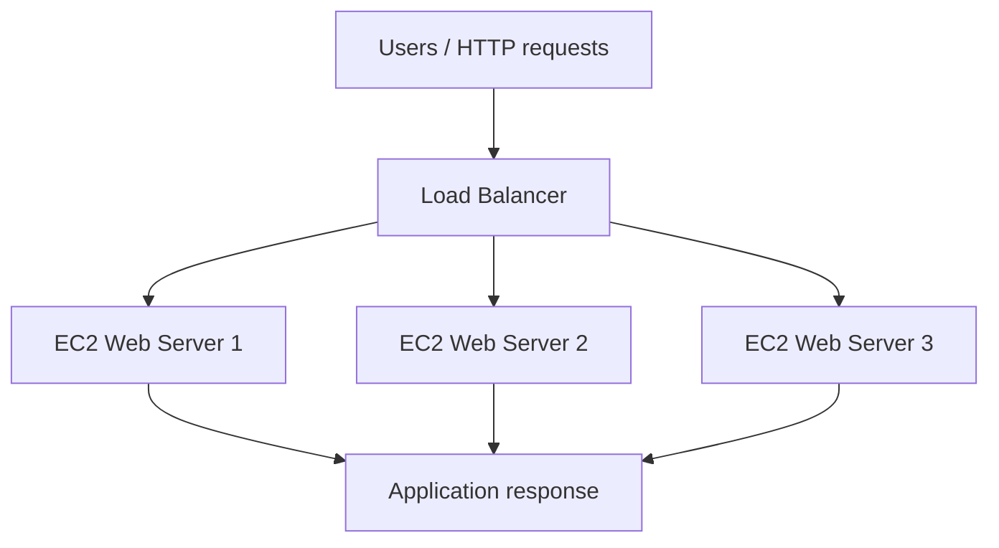
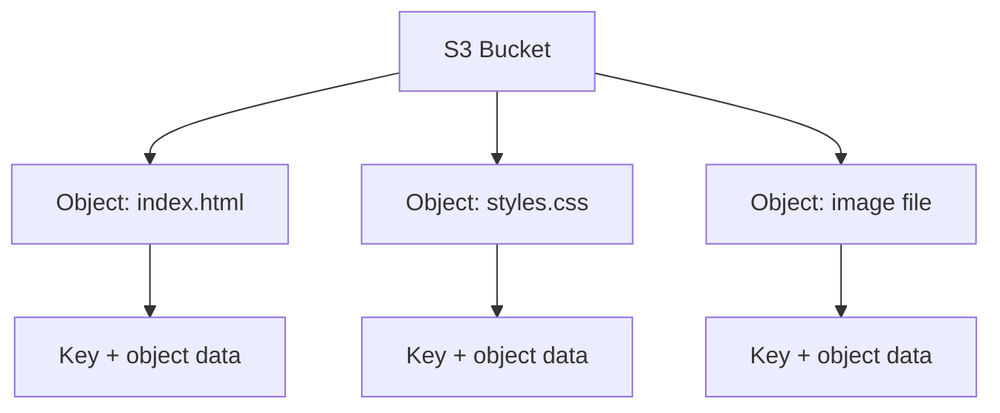

# AWS Zero to Hero — Part 4 (English)
## Chapters 13–14: AWS ELB & ASG, AWS S3

> **Source-preservation rule:** Appendix A contains the original transcript for Chapters 13–14 in the same order, including timestamps and transcript wording. The learning notes before the appendix are organized study notes; added clarifications are explicitly marked.

## Chapter 13 — AWS ELB & ASG Service

### 1. Topics covered
- Load balancing and types of Load Balancers
- Auto Scaling Groups (ASG)
- Scalability, High Availability, and Elasticity
- Distributing traffic across multiple EC2 instances
- A practical workflow using web-server instances

### 2. Core concepts

| Concept | Explanation | Example / purpose |
|---|---|---|
| Scalability | The ability to increase system capacity as demand grows | Increase resources when website traffic rises |
| Vertical scaling / Scale up | Increase CPU, RAM, or compute capacity of one instance | Move from a smaller to a larger instance type |
| Horizontal scaling / Scale out | Add more instances instead of relying on one instance | Use 2–4 servers instead of one |
| High Availability (HA) | Design the service to remain available despite failures | Place resources across multiple Availability Zones |
| Elasticity | Automatically increase or reduce capacity as demand changes | Scale out during busy periods and scale in when demand drops |
| Load Balancer (LB) | Distribute incoming requests across configured targets | Route users to different web servers |
| Auto Scaling Group (ASG) | Manage an EC2 instance fleet and maintain desired capacity | Add or remove instances according to scaling configuration |

### 3. Vertical vs. horizontal scaling

| Point | Vertical scaling | Horizontal scaling |
|---|---|---|
| What changes? | Capacity/size of an existing instance | Number of instances |
| Common phrase | Scale up / scale down | Scale out / scale in |
| Example | Change to a larger instance type | Run multiple EC2 instances |
| Benefit | Straightforward capacity increase | Distributes traffic and can support redundancy |
| Consideration | Instance-size limits and possible interruption during changes | The application must work correctly across multiple instances |

### 4. Load Balancer flow



A Load Balancer acts as a front door. Users send requests, and the load balancer routes them to configured targets. If targets are deployed across multiple Availability Zones, the design can improve availability. The transcript's practical demonstrates deploying the same simple website on two EC2 instances and using the hostname to identify which server returned a response.

### 5. Distinguish High Availability, Elasticity, and Scalability
- **High Availability:** a design goal of keeping a service available despite failures.
- **Elasticity:** automatically adjusting capacity as demand changes.
- **Scalability:** the ability to increase system capacity.
- These concepts are related, but they are not interchangeable.

### 6. Practical workflow described in the transcript
1. Open the EC2 dashboard and launch instances.
2. Select a suitable instance/AMI for the web server.
3. Configure the relevant security-group rule to allow required HTTP traffic.
4. Use a user-data script to install/enable the web server and create a simple webpage.
5. Launch two instances and use the hostname in the page to verify which server responded.
6. Configure a Load Balancer to distribute incoming traffic across targets.
7. Test target health and request responses.
8. Understand how an ASG can be configured with desired/minimum/maximum capacity and scaling policies.

> **Security note:** Limit public HTTP access to the required ports and source ranges. For production, evaluate HTTPS, health checks, least privilege, and multi-AZ deployment.

### 7. Common gotchas / exam reminders
- A Load Balancer distributes traffic; it does not create application capacity by itself.
- ASG and Load Balancer have different responsibilities: the ASG manages/scales the instance fleet, while the LB routes requests.
- Multiple instances in one Availability Zone do not automatically provide multi-AZ High Availability.
- Check local-session and local-file assumptions when running an application on multiple instances.
- Failed health checks can cause a target to be marked unhealthy; ensure the health-check path and port are correct.
- Manual scaling and automatic scaling are not the same.

## Chapter 14 — AWS S3 Service

### 1. What is S3?
Amazon S3 (Simple Storage Service) is a cloud-based object-storage service. It can store, manage, and retrieve files, images, videos, backups, and other objects.

### 2. Buckets and objects

| Term | Meaning |
|---|---|
| Bucket | A container that holds objects |
| Object | A data/file item stored in S3 |
| Object key | The name/path-like key used to identify an object |
| Object value/data | The actual content of the object |
| Region | The AWS Region selected when creating the bucket |

The transcript demonstrates creating a bucket, uploading files, viewing file properties, downloading/opening a text file, and opening an image.

### 3. Important S3 points
- Data is stored as **objects**.
- A bucket name must be globally unique.
- A bucket is created in a selected AWS Region.
- Buckets contain objects.
- S3 can be used for images, videos, backups, and static website assets.
- In the upload workflow, files can be selected and reviewed before upload. Object properties may provide open/download actions depending on permissions and file type.

### 4. S3 object model



### 5. S3 topics listed in the lesson
The section introduction names these topics:
- Versioning
- Application / bucket policies
- Storage classes
- Snow family
- Static website hosting

These are listed as topics to explore in this course section. The original transcript is preserved in Appendix A.

### 6. Basic S3 practical
1. Open S3 in the AWS Management Console.
2. Choose Create bucket.
3. Choose a unique bucket name and the required Region.
4. Review the other settings for your use case; do not accept defaults blindly in production.
5. Open the bucket and upload files.
6. Review file names, sizes, and destination before uploading.
7. Check available actions in object properties.
8. Carefully control access using bucket policies, IAM permissions, and public-access settings.

### 7. S3 security and usage gotchas
- **Bucket name:** remember the global uniqueness requirement.
- **Region:** align the bucket's Region with architecture and data requirements.
- **Public access:** storing a file in S3 does not automatically make it public. Enable public access only when intentionally required.
- **Permissions:** configure IAM and bucket policies using least privilege.
- **Sensitive data:** evaluate encryption, access logging/monitoring, and appropriate retention controls.
- **Static website hosting:** it serves static content; a dynamic backend application does not run on S3 alone.
- **Cost:** in addition to storage, requests, retrieval, data transfer, and selected features may incur charges.

## Quick revision table

| Question | Short answer |
|---|---|
| What is vertical scaling? | Increasing the capacity of an existing compute resource |
| What is horizontal scaling? | Adding more instances |
| What does a Load Balancer do? | Distributes incoming requests across targets |
| What does an ASG do? | Maintains/scales the capacity of an EC2 instance group |
| What is the goal of HA? | Keep a service available during failures |
| What does elasticity mean? | Automatically adjust capacity as demand changes |
| What is an S3 bucket? | A container for objects |
| What is an S3 object? | A stored file/data item |
| What is the key bucket-naming rule? | The name must be globally unique |
| Which storage model does S3 use? | Object storage |

## Board-Level Answer

**Roles of ELB, ASG, and S3:** A Load Balancer distributes incoming requests across multiple targets. An Auto Scaling Group maintains desired EC2 fleet capacity and can add or remove instances according to demand and its scaling configuration. Together, they help build a scalable and resilient web architecture. Amazon S3 is object storage in which objects are stored inside buckets. A secure implementation should consider health checks, multi-AZ placement, least-privilege access, encryption, public-access controls, and cost monitoring.

## No-Skip Checklist

- [ ] Definition of scalability
- [ ] Vertical scaling / scale up
- [ ] Horizontal scaling / scale out
- [ ] High Availability
- [ ] Elasticity
- [ ] Role of a Load Balancer
- [ ] Multiple EC2 instances running the same website
- [ ] Web-server setup using user data
- [ ] Role of an Auto Scaling Group
- [ ] S3 introduction and use cases
- [ ] Bucket, object, key/value concepts
- [ ] Global uniqueness of bucket names
- [ ] Region-specific bucket creation
- [ ] Upload, object properties, open/download demonstration
- [ ] Listed topics: versioning, policies, storage classes, Snow family, static website hosting
- [ ] Original transcript preserved in Appendix A

## Additional Points Added (separate from the original transcript)

1. ELB, ASG, and S3 responsibilities are explicitly distinguished.
2. Health-check configuration, multi-AZ design, least privilege, encryption, public-access controls, and cost factors are added as revision guidance.
3. The difference between static website hosting and a dynamic backend is clarified.
4. AWS limits, prices, and console screens can change over time; live AWS documentation verification is not included in this file.

## Appendix A — Original Source — Preserved

The transcript for Chapters 13–14 is reproduced below in its original wording, timestamp sequence, and order as the source record.

```text
Chapter 13: AWS ELB & ASG Service
2:56:522 hours, 56 minutes, 52 secondsबैलेंसिंग एंड इसमें हम लोग इसके अंडर कवर करेंगे लबी और उसके टाइप्स एंड इसके अलावा एसजी जो कि है ऑटो स्केलिंग ग्रुप ओके
2:57:002 hours, 57 minutesइसका प्रैक्टिकल देखेंगे बहुत ही इंटरेस्टिंग टॉपिक है आगे बढ़ने से पहले ये जो दो टर्म है स्केलेबिलिटी एंड हाई अवेलेबिलिटी उसको समझना जरूरी है क्या
2:57:082 hours, 57 minutes, 8 secondsहोते हैं और क्या एक बेसिक डिफरेंस है दोनों के बीच में स्केलेबिलिटी का मतलब है एक यूज केस सेही समझते हैं इसको जैसे कि
2:57:152 hours, 57 minutes, 15 secondsमान लीजिए ट इंस्टेंस है इस पे आपने एक वेब साइट को डिप्लॉयडी आपकी वेबसाइट रनिंग है एकदम से आपके पास बहुत ज्यादा ट्रैफिक
2:57:232 hours, 57 minutes, 23 secondsआ जाता है ओके बहुत ज्यादा लोड आ जाता है आपकी वेबसाइट पे तो आप उसको कैसे मैनेज करोगे इसके लिए एडब्ल्यू एस हमको एक
2:57:312 hours, 57 minutes, 31 secondsफैसिलिटी प्रोवाइड करती है कि आप अपने जो रिसोर्सेस हैं या तो अपनी वेबसाइट को इसको स्केल कर सकते हो ओके स्केल करने से आप यह
2:57:392 hours, 57 minutes, 39 secondsजो हैवी ट्रैफिक है उसको आप मैनेज कर सकते हो हैंडल कर सकते हो अब यह काम कैसे करता है चलिए बात करते हैं इसमें हम लोग
2:57:462 hours, 57 minutes, 46 secondsस्केलेबिलिटी के दोनों टाइप की बा बात करेंगे पहले होता है वर्टिकल स्केलिंग जिसको हम स्केलिंग अप भी बोलते हैं देखो जो हम लोग रिसोर्स बनाते हैं उसमें टाइप्स
2:57:542 hours, 57 minutes, 54 secondsदेते हैं जैसे कि आपको सीपीय कितनी चाहिए रम कितनी चाहिए राइट सो आप उसको बूस्ट कर सकते हो जैसे कि आप देख सकते हो यहां पे
2:58:012 hours, 58 minutes, 1 secondकि मान लीजिए हम लोग t2 माइक्रो से हम लोग ने शुरुआत करी थी ज्यादा लोड आ रहा है तो हम लोग उसको क्या है m5 लार्ज पे चेंज कर
2:58:092 hours, 58 minutes, 9 secondsदें सो दैट कंप्यूटिंग पावर बहुत बढ़ जाएगी एंड ज्यादा जो रिक्वेस्ट आ रही है ट्रैफिक है उसको हम लोग यह तो हमारी
2:58:172 hours, 58 minutes, 17 secondsवेबसाइट साइड हैंडल कर सकती वेरी सिंपल वर्टिकल स्केलिंग जिसमें हम लोग रिसोर्स को बढ़ा रहे हैं उसकी कंप्यूटिंग पावर
2:58:242 hours, 58 minutes, 24 secondsबढ़ा रहे हैं ओके एक दूसरा तरीका है जो कि है हॉरिजॉन्टल स्केलिंग जो कि होता है स्केलिंग आउट हॉरिजॉन्टल स्केलिंग मींस
2:58:332 hours, 58 minutes, 33 secondsएडिंग मोर इंस्टेंसस तो मतलब क्या है जैसे कि देखो एक आपका इजी टू इंस्टेंस है उसपे बहुत लोड आ रहा है तो अब क्या है एक की
2:58:402 hours, 58 minutes, 40 secondsजगह दो तीन चार इंस्टेंसस कर दो तो चारों जब मिलके मतलब एज अ टीम आपके काम करेंगे
2:58:472 hours, 58 minutes, 47 secondsऔर तो क्या है लोड आपका डिस्ट्रीब्यूटर्स तरीका हो सकता है इसके
2:58:542 hours, 58 minutes, 54 secondsबाद आते हैं हाई अवेलेबिलिटी क्या होता है उसके बारे में बात करते हैं एच मींस कीपिंग यूअर सर्विस अप एंड रनिंग विद
2:59:022 hours, 59 minutes, 2 secondsमिनिमल डाउन टाइम सो इट्स ऑलवेज एक्सेसिबल टू द यूजर इसका मतलब क्या है जैसे कि मान लीजिए आपने अपना वेबसाइट ठीक डिप्लॉयडी स2
2:59:112 hours, 59 minutes, 11 secondsइंस्टेंस पे मान लीजिए कि जो एडब्ल्यू का जो डेटा सेंटर है उस डेटा सेंटर में कुछ प्रॉब्लम आ गई कुछ फॉल्ट आ गया तो क्या होगा आपकी
2:59:202 hours, 59 minutes, 20 secondsवेबसाइट तो डाउन हो जाएगी उसके लिए हाई अवेलेबिलिटी काम आता है जैसे कि एक क्या कर सकते हो रनिंग रिसोर्सेस इन मल्टीपल
2:59:292 hours, 59 minutes, 29 secondsअवेलेबिलिटी जनस तो एक जोन में मान लो कोई प्रॉब्लम आती है दूसरा जोन आपका आप रहेगा फिर भी राइट सो उसको हम लोग हाई अवेलेबिलिटी या तो एच सेटअप बोलते हैं
2:59:372 hours, 59 minutes, 37 secondsवेरी सिंपल चलिए इसके बाद एक और टर्म आता है इलास्टिसिटी एबिलिटी टू ऑटोमेटिक एडजस्ट रिसोर्स कि मतलब जब भी हाई ट्रैफिक
2:59:452 hours, 59 minutes, 45 secondsआए आपकी वेबसाइट पे तो ऑटोमेटिक ली रिसोर्स बढ़ जाए और जब नॉर्मल है तो कम हो जाए ऑटोमेट कर रहे हुए ना ये चीजें उसको
2:59:542 hours, 59 minutes, 54 secondsहम लोग इलास्टिसिटी कहते हैं एंड उस उसके लिए हमारे पास एक है एक जो तरीका है वो है एसजी जो कि ऑटो स्केलिंग ग्रुप सो बेसिकली
3:00:023 hours, 2 secondsहम लोग ये जितने भी टॉपिक्स अभी हम लोग ने देखे हैं उसको हम लोग कवर करेंगे यूजिंग द ए लबी एंड एसजे चलिए थोड़ा सा मैं आपको और
3:00:103 hours, 10 secondsमतलब विजुलाइज एक्सप्लेन कर देता हूं कि लोड बैलेंसिंग कैसे काम करता है अ जैसे कि देखो अभी तक मान लीजिए ये आपका राइट साइड
3:00:173 hours, 17 secondsमें स टू इंस्टेंस और एक वेबसाइट आपने डिप्लॉयडी है लेकिन जैसे ही आप मल्टीपल इंस्टेंसस ऐड कर देते हो जैसे कि यहां पे
3:00:243 hours, 24 secondsदेखोगे 1 2 3 यहां पे तीन ईट इंस्टेंस है तीनों पे सेम वेबसाइट अ डिप्लॉयड है और ये रेप्ट कैसे कर सकते हो यूजिंग द इमेज एमआई
3:00:343 hours, 34 secondsजो कि प्रीवियस सेक्शन में हम लोग ने कवर किया है ओके नाउ वही क्वेश्चन आता होगा शायद आपके कि जैसे कि मान लो तीन-तीन है तो इस मतलब कौन सी रिक्वेस्ट किस पे मतलब
3:00:433 hours, 43 secondsजानी चाहिए कौन से सर्वर पे ये कौन डिसाइड करता है ये एक लोड बैलेंसर मैनेज करता है सो लोड बैलेंसर एक्चुअली है क्या ये एक
3:00:523 hours, 52 secondsएडिशनल सर्वर जैसा ही है जिसका काम होता है फ्रंट में रहके अ जो यूजर की रिक्वेस्ट
3:00:593 hours, 59 secondsको एक्सेप्ट करना और उसको डिस्ट्रीब्यूटर अलग-अलग इंस्टेंसस पे अब जैसे कि मान लो यहां पे तीन यूजर हैं तो
3:01:063 hours, 1 minute, 6 secondsलोड आया तो वो ये लोड बैलेंसर क्या करेगा एक-एक रिक्वेस्ट एक-एक इंस्टेंसस को इस तरह से भेज देगा तो डिस्ट्रीब्यूटर दिया
3:01:133 hours, 1 minute, 13 secondsतो एक समय पे आपके पास ज्यादा लोड नहीं आएगा एंड इसी के आगे हम हम लोग ने एक और चीज बोली थी कि देखो ये जो इंस्टेंसस है
3:01:213 hours, 1 minute, 21 secondsआप एक ही जन में मल्टीपल इंस्टेंसस बना सकते हो तो यहां पे आपका लोड तो बैलेंस हो गया लेकिन इसको आप थोड़ा सा ट्विक कर सकते
3:01:293 hours, 1 minute, 29 secondsहो जैसे कि ये जो अलग-अलग इंस्टेंसस हैं आप अलग-अलग जन में भी बना सकते हो जैसे कि मुंबई एक रीजन है ए बी सी तीन जन है तीनों
3:01:383 hours, 1 minute, 38 secondsजन में अलग-अलग जन में आप इस तरह से अपने इंस्टेंसस सेट अप कर लो तो इससे एक फायदा क्या होगा देखो यहां पे दो फायदे हो
3:01:453 hours, 1 minute, 45 secondsजाएंगे कि लोड बैलेंसर है ओके इसके बाद आपका लोड भी डिस्ट्रीब्यूटर है दूसरी चीज हाई अवेलेबिलिटी भी मिल जा रही है राइट
3:01:543 hours, 1 minute, 54 secondsक्योंकि मान लो कि आपका एक ईट इंस्टेंस मान लो अ फॉल्ट हो गया या तो ठीक है बंद हो गया तो भाई ये जो लोड बैलेंसर है वो
3:02:013 hours, 2 minutes, 1 secondबाकी दो जो इंस्टेंसस है उससे काम चला लेगा राइट तो स्टिल आपकी जो वेबसाइट है वो अप एंड रनिंग रहेगी चलिए तो अब एक काम
3:02:093 hours, 2 minutes, 9 secondsकरते हैं ये जितना भी अभी हम लोग ने समझा उसको हम लोग प्रैक्टिकल करके देखते हैं और मैं दिखाता हूं कि लोड बैलेंसर काम कैसे करता है तो लोड बैलेंसर को समझ ने के लिए
3:02:183 hours, 2 minutes, 18 secondsप्रैक्टिकल भी आपको कम से कम मिनिमम दो इंस्टेंसस तो चाहिए तभी तो लोड डिस्ट्रीब्यूटर है ना तो कम दो ईसी टू
3:02:263 hours, 2 minutes, 26 secondsइंस्टेंस चाहिए उसमें आपकी एक सिंपल सी वेबसाइट वेब सर्वर के थ्रू हम लोग उसको इंस्टॉल करेंगे ओके एंड इसके बाद चलिए
3:02:353 hours, 2 minutes, 35 secondsकरते हैं और जो वेबसाइट है उसके लिए हम लोग ये यूजर डाटा की स्क्रिप्ट यूज करेंगे सो दैट हमारा काम ऑटोमेट हो जाए जल्दी हो
3:02:423 hours, 2 minutes, 42 secondsजाए ठीक है यह स्लाइड पर मिल जाएगी आप चाहो तो इसको यूज कर सकते हो चलिए तो अभी मैं आ गया हूं टू डैशबोर्ड पे लॉन्च
3:02:493 hours, 2 minutes, 49 secondsइंस्टेंसस पे चलते हैं और एक जल्दी से हम लोग एक अपने इंस्टेंसस बना लेते हैं ओके तो ये इंस्टेंस का नाम माय वेब सर्वा दे देता हूं
3:02:593 hours, 2 minutes, 59 secondsam3 माइक्रो फ्री टियर ओके एंड ठीक है रिक्वायर्ड है तो मैं जो ऑलरेडी बनाया था
3:03:073 hours, 3 minutes, 7 secondsकी वैसे की आप विदाउट की भी जा सकते हो इट्स फाइन क्योंकि हम लोग ठीक है अ वेब बेस्ड गवी ही यूज़ करेंगे इसके बाद
3:03:153 hours, 3 minutes, 15 secondsनेटवर्क सेटिंग्स में आ जाओ नेटवर्क सेटिंग्स में यास ये जो एचटीटीपी है हम सेलेक्ट कर लेना क्योंकि हम लोग वेबसाइट है ओके सो यहां पे 8gb है ठीक है डिफॉल्ट
3:03:233 hours, 3 minutes, 23 secondsहै नंबर ऑफ इंस्टेंस कितने इंस्टेंस चाहिए देख तो हम लोग क्या करते हैं डायरेक्टली यहां पे दो कर देते हैं ओके क्योंकि दो इंस्टेंस एक ही बार में दो इंस्टेंस बन
3:03:323 hours, 3 minutes, 32 secondsजाएंगे चलिए एंड इसके बाद हमको क्या है भाई वो स्क्रिप्ट भी चलानी थी तो हम लोग एडवांस डिटेल्स में आ जाते हैं सबसे लास्ट में आपको मिलेगा यूजर डाटा सी तो यूजर
3:03:423 hours, 3 minutes, 42 secondsडाटा में मैं स्क्रिप्ट ये ऐड कर देता हूं सिंपल सी स्क्रिप्ट है यह अपडेट करेगा इसके बाद टीपीडी वेब सर्वर इंस्टॉल करेगा
3:03:493 hours, 3 minutes, 49 secondsइनेबल करेगा और एक ये सिंपल सी वेबसाइट को ये मतलब ये बना देगा वेब पेज इसमें आप एक चीज नोटिस करोगे डॉलर होस्ट नेम मैंने
3:03:583 hours, 3 minutes, 58 secondsयहां पे ऐड किया है क्योंकि यहां पे दो इंस्टेंसस हैं दोनों के होस्ट नेम अलग होंगे तो हम लोग वेरीफाई कर सकें कि जो भी
3:04:053 hours, 4 minutes, 5 secondsवेबसाइट हम लोग एक्सेस कर रहे हैं वो किस अ सर्वर से आ रही है ओके सो ये यूजर डाटा हो गया इसके बाद हम लोग सिंपली लॉन्च
3:04:133 hours, 4 minutes, 13 secondsइंस्टेंस ओके सो यहां पे हमारे दो इंस्टेंस एक बार में बन जाएंगे और दोनों पे वेब सर्वर हमारा लॉन्च हो जाएगा ठीक है
3:04:203 hours, 4 minutes, 20 secondsचलिए अ स2 डैशबोर्ड हम लोग डायरेक्टली चलते हैं एंड इसको मैं रिफ्रेश करता हूं स यहां पे तीन इंस्टेंस रनिंग है चलिए देखते
3:04:273 hours, 4 minutes, 27 secondsहैं यहां पे देखोगे माय वेब सर्वर माय वेब सर्वर ये दो बन गए हैं चलो इसका मैं वो भी देख लेता हूं क्या बोलते हैं इसको
3:04:343 hours, 4 minutes, 34 secondsअवेलेबिलिटी जन सो आप देखोगे ए जो है दोनों वनवी पे ही बन गए क्योंकि हम लोग ने डिफॉल्ट छोड़ा था आप उसको कस्टमाइज कर
3:04:433 hours, 4 minutes, 43 secondsसकते हो हम लोग लेट्स से वन कर देते हैं यहां टू कर देते हैं ठीक है तो थोड़ा सा हमको थोड़ा सा समझ में आएगा राइट चलिए
3:04:523 hours, 4 minutes, 52 secondsभाई टेस्टिंग भी कर ले कि हमारी जो वेब सर्वर है वो ठीक है इसकी पब्लिक आईपी मैं कॉपी कर रहा हूं और सिंपल मैं
3:05:003 hours, 5 minuteschrome's सी ओके सो हियर यू गो ठीक है तो एक वेबसाइट ये है मेरी ठीक है वेलकम टू अचे वेब सवर
3:05:173 hours, 5 minutes, 17 secondsचलिए अब इसको भी ट्राई कर लेते हैं ये इसकी पब्लिक आईपी कॉपी करी और इसके बाद एक और नया टैब ओपन करके इसको एक्सेस करते हैं
3:05:273 hours, 5 minutes, 27 secondsसो हेयर य गो तो दोनों ही हमारी जो वेबसाइट है वो एक्सेसब्सप्लॉट
3:05:473 hours, 5 minutes, 47 secondsडायरेक्टली आते हैं लोड बैलेंसर पे सो लेफ्ट साइड में आप देखो ट डैशबोर्ड के ऑप्शन में लेफ्ट साइड में सबसे लास्ट में देखोगे लोड बैलेंसिंग एक ऑप्शन है राइट
3:05:553 hours, 5 minutes, 55 secondsएंड लोड बैलेंसर एक ऑप्शन है चलिए लोड बैलेंसर पे आ जाते हैं अभी ऑलरेडी बाय डिफॉल्ट कुछ है नहीं तो हम लोग क्रिएट लोड बैलेंसर यहां से या तो यहां से क्लिक कर
3:06:043 hours, 6 minutes, 4 secondsलेते हैं अभी जैसे ही आप लोड बैलेंसर बनाते हो यह अलग-अलग टाइप के आपको यहां पे दिखाई देंगे ओके सो यहां पे तीन टाइप
3:06:143 hours, 6 minutes, 14 secondsदिखाई दे रहे हैं और एक पुराना है जो कि क्लासिक लोड बंस है जो प्रीवियस जनरेशन में यूज होता था अब यहां पे आपको देखो जो
3:06:223 hours, 6 minutes, 22 secondsडायग्राम है इससे ही थोड़ा सा एक अंडरस्टैंडिंग मिल जाएगी एक है एप्लीकेशन लोड बैलेंसर जिसको एलबी भी बोलते हैं
3:06:313 hours, 6 minutes, 31 secondsनेटवर्क लोड बैलेंसर एनएलबी एंड गेटवे लोड बैलेंसर अब जैसे कि आपकी नॉर्मल टीसीपी बेस्ड एप्लीकेशन है टीसीपी यूडीपी बेस्ड
3:06:403 hours, 6 minutes, 40 secondsटी एलएस बेस्ड सो नेटवर्क लोज बैलेंसर इज वेरी गुड बट अगर आप एटीटीपी एचटीटीपीएस कर रहे हो तो आप यहां से भी देख सकते हो सी
3:06:473 hours, 6 minutes, 47 secondsएटीटीपी के लिए ये एप्लीकेशन लोड बैलेंसर इज गुड ऑप्शन चलिए तो अभी हम लोग ये वाले क्रिएट करते हैं एप्लीकेशन वाला है ना ए
3:06:553 hours, 6 minutes, 55 secondsएल बी लोड बैलेंसर का नाम माय वेब सर्वर और इसमें मैं एलबी नाम दे देता हूं लोड बैलेंसर क्योंकि माय वेब सर्वर का लोड
3:07:033 hours, 7 minutes, 3 secondsबैलेंसर है ओके इंटरनेट फेसिंग चाहिए ओके क्योंकि इंटरनल मतलब इंटरनेट से एक्सेस
3:07:093 hours, 7 minutes, 9 secondsहोगा राइट आईपीवी फ मतलब टाइप ऑफ आईपी रिक्वेस्ट ओके इट विल बी फाइन नेटवर्क मैपिंग
3:07:173 hours, 7 minutes, 17 secondsओके सो नेटवर्क मैपिंग में मतलब आपको कितनी चीजें कवर करनी है राइट क्योंकि देखो अगर आप एच वाला कवर करते हो सो यू
3:07:263 hours, 7 minutes, 26 secondsहैव टू यू नो सेलेक्ट ऑल क्योंकि अभी तो बी में है बट हम लोग ना यहां पे तीनों सेलेक्ट कर लेते हैं ठीक है क्योंकि हम
3:07:343 hours, 7 minutes, 34 secondsलोग तीनों जोन को कवर कर पाए ओके सिक्योरिटी ग्रुप में जैसे कि अब डायग्राम से समझना अभी जो इसके प्रीवियस में जब ट
3:07:423 hours, 7 minutes, 42 secondsबनाया था हम लोग डायरेक्ट ट ये वाली जो वेबसाइट है उसको ठीक है एक्सेस कर रहे थे वहां पे हम लोग ने एचटीटीपी ऑलरेडी इनेबल
3:07:503 hours, 7 minutes, 50 secondsकिया था लेकिन जब हम लोड बैलेंसर यूज करेंगे तो जो भी यूजर एक्सेस करेगा वेबसाइट वो लोड बैलेंसर पे सबसे पहले
3:07:593 hours, 7 minutes, 59 secondsरिक्वेस्ट जाएगी तो इसका मतलब क्या हुआ लोड बैलेंसर वाले सर्विस है या तो सर्वर है इस पे आपको एचटीटीपी या तो 80 पोर्ट
3:08:073 hours, 8 minutes, 7 secondsइनेबल करना पड़ेगा राइट और इनेबल कैसे करते हैं सिक्योरिटी ग्रुप को सो आपको एक क्या करना है सिक्योरिटी ग्रुप एक न्यू बना लेते हैं है ना ओके सो एक न्यू ग्रुप
3:08:173 hours, 8 minutes, 17 secondsबना ले ते हैं सो हमको चाहिए इन बाउंड रूल तो इन बाउंड रूल में ऐड रूल कर लो एंड इसमें हम लोग को क्या करना है एचटीटीपी
3:08:243 hours, 8 minutes, 24 secondsएचटीटीपी व 80 पोट इनेबल और सोर्स ठीक है सोर्स हम लोग यहां पे कर देते हैं जो कि है एनी वेयर क्योंकि हम लोग को इसको
3:08:323 hours, 8 minutes, 32 secondsपब्लिक रखना है एंड आउन रूल इट्स गुड जल्दी से नाम दे देता हूं जैसे कि माय और एलबी और एजी मैं बोल रहा हूं माय वेब
3:08:403 hours, 8 minutes, 40 secondsसर्वर के लोड बैलेंसर का सिक्योरिटी ग्रो ओके तो थोड़ा सा नाम नेमिन कन्वेंशन आप यूज कर सकते हो ओके
3:08:483 hours, 8 minutes, 48 secondsसिक्योरिटी ग्रोप फॉर एलबी ठीक है लोड बैलेंसर एंड मैंने डिटेल्स दे दी है इन बाउंड रूल में मैंने एचटीटीपी इनेबल कर
3:08:563 hours, 8 minutes, 56 secondsदिया इसके बाद में क्रिएट सिक्योरिटी ग्रुप कर देता हूं ओके ट्स इट यह बन गया हमारा सिक्योरिटी ग्रुप राइट एंड फिर से हम लोग वापस चलते हैं अब यहां पर देखोगे
3:09:053 hours, 9 minutes, 5 secondsइसको रिफ्रेश कर दो एंड आप देखोगे यह देखो माय वेब सर्वर एलबी एचज तो यह वाला हम लोग
3:09:133 hours, 9 minutes, 13 secondsठीक है सेलेक्ट कर लेते हैं ओके तो एचटीटीपी रिक्वेस्ट हमारी इनेबल हो जा मैं एक स्टेप वाइज स्टेप आपको समझाते भी जा
3:09:203 hours, 9 minutes, 20 secondsरहा हूं हर चीज अब इससे क्या होगा कि यह तो हमारी रिक्वेस्ट एक्सेप्ट कर लेगा कि एक्सेप्ट करके किसको भेजेगा तो यह पार्ट
3:09:283 hours, 9 minutes, 28 secondsबाकी है चलिए वो भी आएगा अभी लिनर एंड राउटिंग चलो यह राउटिंग आ गया है ना अब देखो इसने क्या बोला कि ये जो लोड बैलेंसर
3:09:373 hours, 9 minutes, 37 secondsहै वो एचटीटीपी 80 पोर्ट पे लिसन करेगा ओके वट इट इज आस्किंग कि भाई यूजर का यहां तक रिक्वेस्ट आ गया इसके बाद कहां पे
3:09:453 hours, 9 minutes, 45 secondsभेजना है क्या करना है उसके लिए आपको एक चीज करनी पड़ती है बनानी पड़ती है एडिशनल जो कि है टारगेट ग्रुप कि आप यहां से
3:09:533 hours, 9 minutes, 53 secondsकिसको टारगेट कर रहे हो ओके सो सिंपल है क्रिएट टारगेट ग्रुप कर लो ठीक है एक और आई थिंक विंडो खुलेगा राइट अब आपको किस
3:10:013 hours, 10 minutes, 1 secondचीज पर टारगेट करना है ठीक है तो अलग-अलग चीजें हैं तो मैं बोल रहा हूं इंस्टेंस क्योंकि हमारे इंस्टेंस बने हुए हैं राइट टारगेट ग्रुप नेम अभी इसमें हम लोग क्या
3:10:103 hours, 10 minutes, 10 secondsबोलते हैं माय वेब सर्वर एंड टीजी ठीक है टारगेट ग्रुप या तो आप सिंपल एलबी एलबी और
3:10:193 hours, 10 minutes, 19 secondsटीजी कर सकते हो कि लोड बैलेंसर का टारगेट ग्रुप ओके एंड एटीटीपी 80 पोर्ट पे लिसन कर रहे हैं ओके सो एंड नाउ इट इज आस्किंग
3:10:283 hours, 10 minutes, 28 secondsकि प्रोटोकॉल पोर्ट मतलब आपको कौन से प्रोटोकॉल या पोर्ट पे यू नो फॉरवर्ड करना है या तो टारगेट करना है सो हमारे जो ईट
3:10:363 hours, 10 minutes, 36 secondsइंस्टेंस है वो भी मतलब एचटीटीपी पे लेसन है राइट आईबीवी 4 इट्स फाइन एचटीटीपी वन
3:10:433 hours, 10 minutes, 43 secondsओके इट्स फाइन इसके बाद हेल्थ चेक एचटीटीपी ओके एंड बाकी नेक्स्ट कर देते हैं कौन सी इंस्टेंसस को आपको इंक्लूड
3:10:523 hours, 10 minutes, 52 secondsकरना है ओके अभी हमारे पास टोटल तीन अ इंस्टेंसस है बट माय वेब सर्वर वन एंड टू इन दोनों पे ही डिस्ट्रीब्यूटर है लोड ओके
3:11:013 hours, 11 minutes, 1 secondलोड किस पे डिस्ट्रीब्यूटर है ठीक है एंड इसके बाद ओके एंड इसके बाद कंटिन्यू ओके हेयर यू गो सो आप देख सकते
3:11:103 hours, 11 minutes, 10 secondsहो कि ये हमारा जो टारगेट ग्रुप है वो बनके रेडी हो गया है ओके अभी हम लोग फिर से चलते हैं तो यहां पे टारगेट ग्रुप बन
3:11:183 hours, 11 minutes, 18 secondsगया है इसको सिंपली रिफ्रेश करो तो आपको यहां पे दिख जाएगा माय वेब सवर का लोड बैलेंसर का टारगेट ग्रुप ठीक है यहां पे सिलेक्ट हो गया
3:11:273 hours, 11 minutes, 27 secondsदैट्ची है अब इसके बाद सिंपल हम लोग क्रिएट लोड बैलेंसर कर लेंगे एंड लेट्स सी ओके सो यहां पे स्टेटस हो गया हमारा ग्रीन
3:11:353 hours, 11 minutes, 35 secondsएंड सिंपली रिफ्रेश कर लेना तो यहां पे एक्टिव दिखना चाहिए ठीक है तो मतलब अपना लोड बैलेंस एक्टिव एंड रेडी टू यूज ओके सो इसके बाद एक बार ये एक्टिव दिख रहा है ठीक
3:11:433 hours, 11 minutes, 43 secondsहै तो सिंपली आपको क्या करना है इसमें जो डीएनएस नेम है ठीक है इसको कॉपी करना है एंड इसके बाद हम लोग चलेंगे ब्राउजर पे इसको मैं पेस्ट करता हूं यहां पे एंड
3:11:513 hours, 11 minutes, 51 secondsलेट्स सी कि हमारी वेबसाइट आती है कि नहीं ओके सो इट इज सेइंग कि टेंपररी अनअवेलेबल है ठीक है तो इट इज नॉट वर्किंग चलिए उसको
3:11:593 hours, 11 minutes, 59 secondsट्रबल शूट कर लेते हैं सिंपल इसके नीचे ना लिनर एंड रूल्स एंड रिसोर्स मैप पे आ जाना रिसोर्स मैप में आपको समझ में आएगा कि ओवरऑल फ्लो कैसे चल रहा है एचटीटीपी जीरो
3:12:083 hours, 12 minutes, 8 secondsपे गए इसके बाद ये क्या किया इसने टारगेट ग्रुप पे आया और यह टारगेट ग्रुप पे ठीक है इसने किया एंड टारगेट ग्रुप में आप
3:12:163 hours, 12 minutes, 16 secondsदेखोगे टारगेट प तो जीरो है यह कैसे हुआ अब पता नहीं चलिए एक काम करते हैं हम ये टारगेट ग्रुप पे क्लिक करते हैं एंड इसको थोड़ा सा समझते हैं ओके सो इसमें आप
3:12:253 hours, 12 minutes, 25 secondsदेखोगे टारगेट जीरो है सिंपल रजिस्टर टारगेट पे जाना है माय वेब सर्वर वनटू पे च चले जाना है अब नाउ इट इज आस्किंग फॉर
3:12:333 hours, 12 minutes, 33 secondsपोर्ट्स फॉर द सिलेक्टेड इंस्टेंसस ठीक है तो 80 इंक्लूड एस पेंडिंग बिलो ठीक है एंड रजिस्टर पेंडिंग टारगेट्स ओके सो नाउ यू
3:12:413 hours, 12 minutes, 41 secondsकैन सी कि यहां पे टू टारगेट्स यहां पे हमारे हो चुके राइट चलिए अभी हम लोग लोड बैलेंसर प चलते हैं सो आप देखोगे कि देखो
3:12:493 hours, 12 minutes, 49 secondsये माय वेब सर्वर जो लोड बैलेंसर है इसमें आपको यहां पर दो इंस्टेंसस दिखाई दे रहे हैं जो कि पोर्ट 80 पे लिसन है तो आपको यहां प पूरा फ्लो इस तरह से दिखेगा सो इट
3:12:583 hours, 12 minutes, 58 secondsइट इज इट मींस कि हां सब ठीक है और देखो यहां पे जो इंस्टेंसस आप देख रहे हो हेल्दी दिखाई दे रहा है चलिए इसके बाद हम लोग चलते हैं एंड इसको रिफ्रेश करते हैं
3:13:073 hours, 13 minutes, 7 secondsसो हेयर यू गो लेकिन अभी मेन चीज क्या दिखानी है कि देखो लोड बैलेंसर से हमारी जो वेबसाइट है वो एक्सेस तो हो रही है
3:13:153 hours, 13 minutes, 15 secondsलेकिन इसमें मैं आपको कुछ चीजें दिखाता हूं अभी 41 43 है ठीक है मैं इसको जितने बार रिफ्रेश करूंगा ना आपको एक अलग यहां
3:13:223 hours, 13 minutes, 22 secondsपे वो रिजल्ट मिलेगा जैसे मैं रिफ्रेश करता हूं सी 33.5 ठीक ये देखो ये देखो ये देखो मैं
3:13:303 hours, 13 minutes, 30 secondsजितनी बार रिफ्रेश करते जा रहा हूं यह चेंज होता जा रहा है मतलब क्या ये जैसे जो हमारा लोड बैलेंस है काम करना चाहिए एक बार इस इस इंस्टेंस पे जा रहा है एक बार
3:13:383 hours, 13 minutes, 38 secondsसेकंड इंस्टेंस पे तो मतलब वो डिस्ट्रीब्यूटर दे जा रहा है लोड है ना चलिए ी टू डैशबोर्ड प चलते हैं इंस्टेंस रनिंग प चलते हैं और लेट्स से जो माय वेब
3:13:473 hours, 13 minutes, 47 secondsसर्वर टू है ठीक है माय वेब सर्वर टू इस पे हम एक्शन पे जाते हैं सॉरी इंस्टेंस स्टेट एंड स्टॉप इंस्टेंस पे चलते हैं ठीक
3:13:563 hours, 13 minutes, 56 secondsहै तो अभी स्टॉप करके देखते हैं दिस इज अ स्टॉप राइट नाउ ठीक है इसके बाद हम लोग फिर से चलते हैं लोड बैलेंसर और ऑल दो आप
3:14:033 hours, 14 minutes, 3 secondsइस पे मॉनिटर कर सकते हो है ना इस पे मैंने क्लिक किया ऑल दो चलिए हम लोग ना इसको रिफ्रेश करते हैं अभी और देखते हैं मैं रिफ्रेश कर रहा हूं सो सिर्फ 4143 पे
3:14:133 hours, 14 minutes, 13 secondsही ये रिक्वेस्ट जा रही है क्यों क्योंकि ये मतलब वो जो दूसरा वाला है वो बंद है हमारा इंस्टेंस स्टॉप्ड स्टेट में है राइट
3:14:203 hours, 14 minutes, 20 secondsएंड इस पर भी चलते हैं और चलो यहां पे आप देख भी सकते हो चलो अभी इसने अपडेट किया कि अनहेल्दी रिक्वेस्ट टाइम डाउट मतलब आई
3:14:283 hours, 14 minutes, 28 secondsथिंक जब अपन ने ट्राई किया देन इट रिलाइज कि नहीं यार यह वाला अभी बंद है ओके सो इस तरह से यह रिकॉग्नाइज भी कर लेता है और
3:14:353 hours, 14 minutes, 35 secondsआपकी जो जितनी भी रिक्वेस्ट है वो दूसरे वाले हेल्दी वाले में ठीक है चले जाएगा ओके फिर से इंस्टेंस पर चलते हैं लेट्स से
3:14:423 hours, 14 minutes, 42 secondsआप उसको ट्रबल शूट कर लेते हो उसको मैं यहां पे स्टार्ट कर देता हूं स्टार्ट इंस्टेंस सो यहां पे देखो पेंडिंग स्टेट
3:14:503 hours, 14 minutes, 50 secondsमें है थोड़ी देर में यहां पे ये देखो रनिंग पे हो गई एंड इट इज रनिंग नाउ लोड बैलेंसर पे चलते हैं सो लोड बैलेंसर के रिसोर्स मैप में आप यहां से मॉनिटर कर
3:14:583 hours, 14 minutes, 58 secondsसकते हो कि कौन सा इंस्टेंस आपका हेल्दी है नहीं है सो जब हम लोग ने एक बार इजी टू इंस्टेंस फिर से आप स्टार्ट किया सो आप देख सकते हो कि ये जो सेकंड इंस्टेंस है
3:15:073 hours, 15 minutes, 7 secondsवो फिर से हेल्दी स्टेट में आ गया सी दोनों हेल्दी स्टेट में है और इसको हम फिर से यूज कर सकते ट्राई कर सकते हैं मैं
3:15:153 hours, 15 minutes, 15 secondsसिंपल देखो अभी 41 43 है मैं रिफ्रेश करता हूं लेट्स सी सी ये हमारा पुराना वाला जैसे इट इज स्टार्टेड वर्किंग सो आपने
3:15:233 hours, 15 minutes, 23 secondsदेखा कि यहां पे लोड डिस्ट्रीब्यूटर है दूसरी चीज फॉल्ट टॉलरेंस की मतलब ठीक है एक इंस्टेंस बंद भी हो रहा है तो दूसरा अप
3:15:313 hours, 15 minutes, 31 secondsहो जाता है ओके और थोड़ी बहुत हम लोग ने ट्रबल शूटिंग देख ली एंड वन मोर थिंग कि जो हम लोग इंस्टेंस को अप करते हैं थोड़ा टाइम लगता है तो मैंने ठीक है थोड़ा सा
3:15:393 hours, 15 minutes, 39 secondsस्टॉप पॉज करके वीडियो फिर से स्टार्ट किया है ठीक है तो थोड़ी देर लगती है इसको हेल्दी होने में पूरा पूरा रिचेक होता है एंड ऑल चलिए लबी का हम लोग ने प्रैक्टिकल
3:15:473 hours, 15 minutes, 47 secondsतो देख लिया इसके रिलेटेड कुछ पॉइंट्स भी देख लेते हैं एंड सराइज भी कर लेते हैं इट डिस्ट्रीब्यूटर ट्रैफिक ठीक है डिस्ट्रीब्यूटर होता है ट्रैफिक अलग-अलग
3:15:543 hours, 15 minutes, 54 secondsइंस्टेंसस में कि लोड डिस्ट्रीब्यूटर लोड ना हो इंप्रूव अवेलेबिलिटी जैसे अभी हम लोग ने देखा कि दो इंस्टेंसस थे एक
3:16:023 hours, 16 minutes, 2 secondsइंस्टेंस में लेट्स से किसी वजह से कोई प्रॉब्लम आ गई स्टॉप कर दिया तो भी दूसरा इंस्टेंस वाज रनिंग एंड वो सर्व कर रहा था
3:16:103 hours, 16 minutes, 10 secondsवेबसाइट को स्किल रिसोर्सेस इट हेल्प्स मैनेज हाई डिमांड बाय एडिंग मोर सर्वस ड्यूरिंग द पीक टाइम ठीक है सो जैसे कि
3:16:183 hours, 16 minutes, 18 secondsमान लो अभी तो दो इंस्टेंस थे और लोड बैलेंसिंग हम लोग ने कर दी इसी के साथ साथ लेट्स से कि आपको लगता है कि दो जो इंस्टेंसस है वो भी कम है तो आप एडिशनल
3:16:273 hours, 16 minutes, 27 secondsइंस्टेंसस बना के ठीक है इसी लोड बैलेंसर में ऐड ऑन कर सकते हो इसके अलावा सिंगल पॉइंट ऑफ एक्सेस नीड टू बी एक्सपोज ओके
3:16:343 hours, 16 minutes, 34 secondsपहले आप अलग-अलग ठीक है आप ईजी टू इंस्टेंस जो आपका मेन इंस्टेंस है आप उसको एक्सपोज कर रहे थे अभी के टाइम में आपका
3:16:413 hours, 16 minutes, 41 secondsसिर्फ जो लोड बैलेंसर है लबी वो एक्सपोज होता है इंटरनेट से हाई अवेलेबिलिटी अक्रॉस अवेलेबिलिटी जन कि हमारे केस में
3:16:493 hours, 16 minutes, 49 secondsतो चलो ये जो इंस्टेंस था वो सेम अवेलेबिलिटी जन पे था बट अब अलग-अलग जन पे भी क्रिएट करके आप और ज्यादा उसको एच या
3:16:583 hours, 16 minutes, 58 secondsतो फॉल्ट टॉलरेंस बना सकते हो ओके अ इसके बाद हम लोग ने जो जब हम लोग लबी या तो लोड
3:17:053 hours, 17 minutes, 5 secondsबैलेंसर बना रहे थे हम लोग ने देखा था तीन टाइप्स वहां पे देखे थे एक था एलबी जो कि एप्लीकेशन लोड बैलेंसर ये मोस्टली यूज़
3:17:133 hours, 17 minutes, 13 secondsहोता है एचटीटीपी एंड एचटीटीपीएस बेस्ड वेबसाइट वगैरह के लिए जो हम लोग ने इसका प्रैक्टिकल देखा एंड इसमें एडिशनल चीजें हैं जैसे कि एग्जाम पॉइंट ऑफ व्यू से शायद
3:17:223 hours, 17 minutes, 22 secondsयह यूजफुल हो सकता है कि यह जो ओ एसआई लेयर से पे वर्क करता है ठीक है एप्लीकेशन लेवल पे नेटवर्क लोड बैलेंसर ओके यह
3:17:313 hours, 17 minutes, 31 secondsटीसीपी यूडीपी और टी एलएस ठीक है यह प्रोटोकॉल लेवल पे यह डिस्ट्रीब्यूटर है सॉरी यह तो लोड बैलेंस करता है एंड
3:17:393 hours, 17 minutes, 39 secondsडिजाइंड फॉर हाई परफॉर्मेंस एंड लो लेटेंसी ठीक है एंड जैसे कि काफी सारे एप्लीकेशंस हो सकते हैं रिलेटेड टू द
3:17:473 hours, 17 minutes, 47 secondsगेमिंग फाइनेंशियल एप्लीकेशन जहां पे भाई टाइम बहुत क्रिटिकल है जैसे कि आप गेमिंग भी कर रहे हो ठीक है ऑनलाइन एंड ऑल सो एक
3:17:543 hours, 17 minutes, 54 secondsरियल टाइम गेमिंग एक्सपीरियंस के लिए लो लेटेंसी होना जरूरी है तो उन केसेस में हमारा एनएलबी जो कि नेटवर्क लोड बैलेंसर
3:18:023 hours, 18 minutes, 2 secondsवो काफी हेल्पफुल होता है और ये ओएआई लेवल लेयर फोर पे काम करता है ओके एंड एक जो
3:18:093 hours, 18 minutes, 9 secondsतीसरा आप देख सकते हो वो है गेटवे लोड बैलेंसर जो कि जीडब्ल्यू एलबी भी आप बोलते हो इट हेल्प्स
3:18:163 hours, 18 minutes, 16 secondsस्केल एंड मैनेज थर्ड पार्टी वर्चुअल अप्लायंसेज ओके सो आप थर्ड पार्टी अप्लायंसेज यूज़ करना चाहते हो सो इन
3:18:243 hours, 18 minutes, 24 secondsकेसेस में जैसे कि फायरवॉल एंड मॉनिटरिंग सॉल्यूशन ओके सो जैसे कि मान लो एक क्लाइंट है एक सर्वर है ये ये आपका क्या
3:18:323 hours, 18 minutes, 32 secondsहो गया दोनों क्लाइंट सर्वर आपका अ क्लाउड बेस्ड हो गया अब आप थर्ड पार्टी एक और एक ऐड करना चाहते हो बीच में लेट्स से
3:18:393 hours, 18 minutes, 39 secondsमॉनिटरिंग करना हो ठीक है अब जो भी बीच में कन्वर्सेशन चल रहा है मॉनिटरिंग करना हो या तो फायरवॉल करना हो रूल्स करना हो सो वो थर्ड पार्टी अप्लायंसेज आप गेटवे
3:18:483 hours, 18 minutes, 48 secondsलोड बैलेंसर की मदद से कर सकते हो ओके एंड ये जो हम लोग ने अ एक एग्जांपल ठीक है और
3:18:553 hours, 18 minutes, 55 secondsये जो डायग्राम हम लोग ने ऑलरेडी देखा हुआ है एंड रिगार्डिंग कि जो लबी कैसे बनाया जाता है क्योंकि हो सकता है इंटरव्यूज या
3:19:033 hours, 19 minutes, 3 secondsतो ठीक एग्जाम वगैरह में पूछा जा सकता है कि भाई क्या-क्या स्टेप्स जरूरी है सो ये स्टेप्स यहां पे लिखे हुए हैं लद अपन ने प्रैक्टिकल कर लिया तो आई एम श्यर कि आपको
3:19:113 hours, 19 minutes, 11 secondsवो चीजें क्लियर हो गई होगी कि एक तो ईसी ट इंस्टेंस बनना चाहिए टारगेट ग्रुप एंड सिक्योरिटी ग्रुप एंड अपना लोड बैलेंसिंग
3:19:183 hours, 19 minutes, 18 secondsयह कुछ चीजें आपको ध्यान में रखनी है चलिए अब आगे बढ़ते हैं एंड कवर करेंगे हम लोग ऑटो स्केलिंग ग्रुप जो कि एसजी बोलते हैं
3:19:273 hours, 19 minutes, 27 secondsऑटो स्केलिंग ग्रुप अभी जो हम लोग ने लोड बैलेंसिंग करी थी यू हैव सीन कि हम लोग ने जो एक स्केलिंग करी थी वह मैनुअली करी थी
3:19:363 hours, 19 minutes, 36 secondsराइट बट हम लोग कितनी बार मैनुअली करेंगे राइट कब किस टाइम पे आपके पास ट्रैफिक आ रहा है नहीं आ रहा आपको कैसे पता चलेगा आप
3:19:453 hours, 19 minutes, 45 secondsकितना मॉनिटर करोगे उस चीज को ईज बनाने के लिए हमारे पास है एसजी जो कि ऑटो स्केलिंग ग्रुप इसकी मदद से आप क्या कर सकते हो इट
3:19:533 hours, 19 minutes, 53 secondsइज अ सर्विस दैट ऑटोमेटिक ऐड और रिमूव इजी टू इंस्टेंस ठीक है बेस्ड ऑन द डिमांड टू इंश्योर योर एप्लीकेशन इज ऑलवेज अवेलेबल
3:20:013 hours, 20 minutes, 1 secondमतलब ये लोड या तो जो आपका लोड भी हो रहा है ना उसके बेसिस पे ये इंस्टेंस कम ज्यादा कर सकता है ये एसजी के पास ये एक
3:20:103 hours, 20 minutes, 10 secondsऑटोमेशन आप प्रोवाइड कर सकते हो इट हेल्स स्केल अप व्हेन मोर कैपेसिटी इज नीडेड मतलब ज्यादा कैपेसिटी चाहि तो ये य नए
3:20:183 hours, 20 minutes, 18 secondsइंस्टेंसस क्रिएट कर देगा ठीक है ऐड कर देगा और जब जरूरत नहीं है नॉर्मल है लोड नहीं है तो वह डाउन भी कर देगा कि आपका
3:20:263 hours, 20 minutes, 26 secondsपैसा सेव हो क्योंकि आपके 10 इंस्टेंसस है मान लो चार की जरूरत है तो वो छह हटा देगा सो आपकी कॉस्टिंग भी यहां पे कम हो
3:20:343 hours, 20 minutes, 34 secondsजाएगी अब इसके कुछ फंक्शंस के बारे में बात करते हैं क्योंकि आपको शायद क्वेश्चन आ रहा होगा कि ये वर्क कैसे करता है ी ओके
3:20:413 hours, 20 minutes, 41 secondsऑटोमेटिक स्केलिंग स्केल द नंबर ऑफ ईटू इंस्टेंस चलिए वो तो हम लोग समझ गए अप एंड डाउन कर सकता है रिप्लेस देखो मेंटेन इंस्टेंस हेल्थ
3:20:503 hours, 20 minutes, 50 secondsरिप्लेस अनहेल्दी इंस्टेंस ऑटोमेटिक टू इंश्योर रिलायबिलिटी ओके दिस इज द बेस्ट थिंग मान लो
3:20:573 hours, 20 minutes, 57 secondsकि आपको मिनिमम दो इंस्टेंसस चलाने ही हैं जैसे अभी हम लोग ने देखा तो दो इंस्टेंस थे लेकिन हमारी केस में क्या था एक
3:21:053 hours, 21 minutes, 5 secondsइंस्टेंस मान लो अगर बंद हुआ तो एक ही एक पे पूरा लोड आ गया लेकिन एसजी में ऐसा नहीं है अगर आप मिनिमम दो चाहते हो एक में
3:21:143 hours, 21 minutes, 14 secondsकोई प्रॉब्लम आ गई वो दूसरा ऐड कर देगा ओके सो दिस इज़ अ गुड थिंग तो यह आपको एक मेंटेन रखता है लोड यूज़ स्केलिंग पॉलिसीज
3:21:243 hours, 21 minutes, 24 secondsअब देखो स्केल किसके बेसिस पे करना है अब यह पॉलिसीज आप क्रिएट कर सकते हो जैसे कि सेट रूल्स फॉर स्केलिंग बेस्ड ऑन
3:21:303 hours, 21 minutes, 30 secondsमैट्रिक्स लाइक अगर आपको सीपीयू यूसेज और रिक्वेस्ट काउंट जैसे कि अगर आप चाहते हो कि रिक्वेस्ट काउंट कि मतलब जितने इनकमिंग
3:21:383 hours, 21 minutes, 38 secondsरिक्वेस्ट आ रहा है ट्रैफिक आ रहा है उसके बेसिस पे करना है या तो सीपीयू पे लोड या सीपीयू यूसेज के बेसिस पे करना है तो वह
3:21:453 hours, 21 minutes, 45 secondsआप डिसाइड कर सकते हो हो ना इंश्योर अवेलेबिलिटी ऑलवेज कीप अ डिफाइंड नंबर ऑफ इंस्टेंस रनिंग टू मीट एप्लीकेशन नीड जो
3:21:533 hours, 21 minutes, 53 secondsमैंने अभी आपको बता दिया था कि मिनिमम उतने इंस्टेंस वो रनिंग में रखेगा आपके लोड को बैलेंस करने के लिए शेड्यूल
3:22:023 hours, 22 minutes, 2 secondsस्केलिंग प्री कॉन्फिन स्केलिंग एक्टिविटीज फॉर स्पेसिफिक टाइम जैसे कि मान लो आपको पता है कि आपके वेबसाइट पे
3:22:093 hours, 22 minutes, 9 secondsमान लो रात के टाइम शाम के टाइम मतलब रात शाम के 6:00 से 12:00 बजे के बीच में रात में आपके ज्यादा ट्रैफिक आता है तो वह भी
3:22:183 hours, 22 minutes, 18 secondsआप शेड्यूल कर सकते हो कि भाई हां 6:00 बजे के बाद ठीक है इंस्टेंसस बढ़ा दो या दो रिसोर्सेस बढ़ा दो सो दैट इज आल्सो गुड थिंग इसके बाद बात करते हैं
3:22:253 hours, 22 minutes, 25 secondsडिस्ट्रीब्यूटर्स डिप्लॉयड अक्रॉस मल्टीपल अवेलेबिलिटी जन फॉर हाई अवेलेबिलिटी ओके सो अलग-अलग जन में हम कर सकते हैं
3:22:333 hours, 22 minutes, 33 secondsइंटीग्रेट विद लबी अटैच इंस्टेंसस टू एन अ लबी टू ऑटोमेटिक बैलेंस ट्रैफिक ओके सो ल
3:22:423 hours, 22 minutes, 42 secondsभी हम लोग ने ऑलरेडी किया था तो आप उसके साथ भी इंटीग्रेट कर सकते हो ऑप्टिमाइज कॉस्ट स्केल डाउन ड्यूरिंग लो डिमांड टू
3:22:493 hours, 22 minutes, 49 secondsसेव ऑन द इंफ्रास्ट्रक्चर कॉस्ट ओके एंड यहां पे एसजी कैसे काम करता है एक विजुअल डायग्राम से हम लोग समझ लेते हैं सो यहां
3:22:573 hours, 22 minutes, 57 secondsपे आप देख सकते हो जैसे कि ये जो छोटे-छोटे ब्लॉक हैं वो ट इंस्टेंस है आपके ओके जब आप एसजी बनाते हो सो आप एक डिजायर्ड अपनी एक्सपेक्टेशन सेट कर सकते
3:23:053 hours, 23 minutes, 5 secondsहो कि भाई मुझे अपने सेटअप में मिनिमम इतना एक इंस्टेंस रनिंग चाहिए डिजायर्ड स्टेट मतलब मिनिमम एक होना ही चाहिए लेकिन
3:23:133 hours, 23 minutes, 13 secondsडिजायर्ड मतलब नॉर्मल स्टेट में दो होना चाहिए ओके मैक्सिमम साइज मतलब अगर लोड बढ़ता है लेट्स से तो हम कितना उसको स्केल
3:23:223 hours, 23 minutes, 22 secondsकर सकते हैं ओके एंड मैं यहां पे एक चीज पॉइंट क्लियर कर दूं बहुत कंफ्यूजन होता है क्योंकि एसजी जो है स्केलिंग ग्रुप ये
3:23:303 hours, 23 minutes, 30 secondsसिर्फ नंबर ऑफ इंस्टेंसस को अ ठीक है मतलब मैनेज करता है कि मतलब आपको कितने
3:23:373 hours, 23 minutes, 37 secondsइंस्टेंस रखने हैं ऑटो स्केल मतलब आपको इंस्टेंस अगर बढ़ाने हैं कम करने हैं वो इसका काम है और इसमें जो पॉलिसीज है या तो
3:23:453 hours, 23 minutes, 45 secondsमतलब जो भी रूल्स है वो आप प्रोवाइड कर सकते हो रिगार्डिंग द लोड बैलेंसिंग वो चीज एसजी नहीं करता है तो आपको ईल भी
3:23:543 hours, 23 minutes, 54 secondsस्टिल यूज करना पड़ेगा तो जो अभी हम लोग ने लबी यूज किया है ना अभी हम उसी को यूटिलाइज कर लेंगे एंड उसी के यूज करके हम
3:24:013 hours, 24 minutes, 1 secondलोग प्रैक्टिकल देखेंगे चलिए अब एसजी बनाना कैसे है तो ये स्टेप्स लिखे हुए हैं लॉन्च टेंप्लेट ऑ कॉन्फिन ओके क्रिएट ऑटो
3:24:083 hours, 24 minutes, 8 secondsस्केलिंग ग्रुप एंड ऑल ठीक है सबसे पहले शुरुआत में आप थोड़ा सा विजुलाइज करो कि भाई देखो एजी काम कैसे करता है एजी में
3:24:153 hours, 24 minutes, 15 secondsअगर आप देखोगे मान लो लोड बढ़ा तो ये रियल टाइम में एक नया इंस्टेंस बना देगा खुद से
3:24:223 hours, 24 minutes, 22 secondsओके लेकिन आप एक चीज समझो कि भाई देखो इंस्टेंस बनाना बस तो है ना उस इंस्टेंस पे आपकी वेबसाइट भी होनी चाहिए होस्ट उस
3:24:303 hours, 24 minutes, 30 secondsवेबसाइट को एक्सेसिबल बनाना है सिक्योरिटी ग्रुप एचटीटीपी एक्सेस आपको देना है राइट तो आप एक चीज समझो कि ये चीज कैसे होगी
3:24:393 hours, 24 minutes, 39 secondsइसके प्रीवियस सेक्शन में प्लेलिस्ट में आप चले जाना एमआई हम लोग ने एक टॉपिक कवर किया है एमआई वाला टॉपिक आप जरूर देख लेना
3:24:463 hours, 24 minutes, 46 secondsओके क्योंकि इसका यूज़ अभी हम लोग करने वाले हैं सो लॉन्च टेंप्लेट होना चाहिए तो एआई और लॉन्च टेंप्लेट यह दोनों की हमें जरूरत पड़ेगी क्यों क्योंकि हमको सिर्फ
3:24:553 hours, 24 minutes, 55 secondsइंस्टेंस नहीं बनाना है हमको अपनी वेबसाइट भी वहां पे रनिंग स्टेट में चाहिए ओके चलिए तो सबसे पहले हम लोग शुरुआत करते हैं
3:25:033 hours, 25 minutes, 3 secondsभैया अपनी एमआई बनाने के साथ ओके तो सबसे पहले इंस्टेंसस पे चलते हैं अ पहले तो हम डिसाइड करते हैं कि भाई हमें कौन सी
3:25:103 hours, 25 minutes, 10 secondsवेबसाइट को यूज़ करना है इसके इस केस में तो हम लोग क्या कर द अ वेब सर्वर वन को ले ले ते हैं ठीक है तो इसको मैं सेलेक्ट
3:25:173 hours, 25 minutes, 17 secondsकरता हूं एक्शन में जाते हैं इमेज एंड टेंपलेट्स एंड क्रिएट
3:25:253 hours, 25 minutes, 25 secondsइमेज माय वेब सर्वर इमेज ठीक है एंड ये दिस इज ऑप्शनल एंड बाकी कुछ कुछ क्या-क्या चीजें हैं ठीक है दैट्ची
3:25:463 hours, 25 minutes, 46 secondsये इमेज कहां पे है एमआई इमेजेस के अंदर एमआई पे आप जाओगे सो माय वेब सर्वर इमेज ओके ये लेफ्ट साइड में आप देखोगे सबसे
3:25:543 hours, 25 minutes, 54 secondsलास्ट ऑप्शन ए एसजी ठीक है ऑटो स्केलिंग अभी क्या है इट हेल्प्स टू मेंटेन द अवेलेबिलिटी ऑफ द एप्लीकेशन वेरी सिंपल
3:26:023 hours, 26 minutes, 2 secondsठीक है क्रिएट ऑटोस्केलिंग ग्रुप करते हैं चलिए स्केलिंग अ ग्रुप का नाम यूज़ करना है तो हम लोग लिख देते हैं माय वेब सर्वर
3:26:103 hours, 26 minutes, 10 secondsएज इसके बाद है लॉन्च टेंप्लेट मतलब आप किस टेंप्लेट को यूज करके इंस्टेंस बनाओगे ओके सो यहां पे आप देखोगे क्रिएट अ लच
3:26:173 hours, 26 minutes, 17 secondsटेंप्लेट सो यहां पे एक ऑप्शन मिल जाता है चलिए उस पे चलते हैं सो ये टेंप्लेट का मैंने नाम दे दिया है माय वेब सवर हान टेंप्लेट नेमिन कन्वेंशन सेम इसका एक
3:26:263 hours, 26 minutes, 26 secondsडिस्क्रिप्शन दे दिया ओके ओके सो ये जो स2 इंस्टेंस बनेगा उसमें एमआई आपको कौन सी यूज़ करनी है तो जो एआई अभी हम लोग ने
3:26:333 hours, 26 minutes, 33 secondsबनाई ओंड बाय मी सो आप देखोगे माय वेब सर्वर इमेज ओके दिस वन तो यह सिलेक्टेड है ठीक है इंस्टेंस
3:26:413 hours, 26 minutes, 41 secondsटाइप इंस्टेंस टाइप में हम लोग भाई फ्री टियर एलिजिबल ठीक है यह यूज़ कर लेते हैं अब आ जाते हैं नेटवर्क सेटिंग्स में सो
3:26:483 hours, 26 minutes, 48 secondsइसमें एक चीज ध्यान रखनी है क्या आपको थोड़ा सा सोच के चलते चलना है जब आपका ी टू इंस्टेंस बनेगा उसमें आपको एचटीटीपी
3:26:563 hours, 26 minutes, 56 secondsइनेबल चाहिए राइट तो उसके लिए आपको क्या करना पड़ेगा या तो आप देखो एक क्रिएट न्यू सबनेट कर दो नहीं तो हमने जो एक लोड
3:27:043 hours, 27 minutes, 4 secondsबैलेंसर के लिए एक सिक्योरिटी ग्रुप बनाया था हम उसको भी यूज कर सकते हैं जैसे कि एसिस्टिंग ग्रुप है इसमें आप नीचे जाते
3:27:113 hours, 27 minutes, 11 secondsहैं आप देखोगे माय सर्वर माय वेब सर्वर एलबी मतलब लोड बैलेंस सिक्योरिटी ग्रुप तो इसमें हम लोग ने एचटीटीपी इनेबल किया था
3:27:193 hours, 27 minutes, 19 secondsसो वो चीज हम लोग ने यूज कर दी तो बेसिक सिंपल आईडिया यह है कि एचटीटीपी इनेबल होना चाहिए तो या तो आप क्रिएट कर दो एक नया सबनेट या तो एसिस्टिंग भी आप यूज कर
3:27:273 hours, 27 minutes, 27 secondsसकते हो क्रिएट लॉन्च टेंप्लेट करते हैं चलिए जी अपना टेंप्लेट बन गया वापस चलते हैं इसमें और इसको रिफ्रेश करो और यहां पे
3:27:363 hours, 27 minutes, 36 secondsआप देखोगे तो आपको टेंप्लेट दिख जाएगा सी माय वेब सर्वर टेंप्लेट ओके इसको सेलेक्ट किया अ वर्जन ओके सो वर्जन आप वन कर लो
3:27:453 hours, 27 minutes, 45 secondsठीक है वैसे भी डिफॉल्ट वन ही था एंड बाकी सब चीजें ठीक है एक बार आप देख सकते हो यहां पे इसके बाद हम लोग चलते हैं नेक्स्ट
3:27:533 hours, 27 minutes, 53 secondsओके सो इट इज आस्किंग फॉर कि जो लॉन्च होगा अपना इंस्टेंस उसके बारे में इंफॉर्मेशन जैसे कि इंस्टेंस टाइप हमको t3
3:28:003 hours, 28 minutesमाइक्रो ही यूज करना है ओके इसके बाद नेटवर्किंग में आ जाते हैं नेटवर्किंग में इसलिए है क्योंकि देखो वीपीसी तो डिफॉल्ट है आपका जो रीजन में आप जो काम कर रहे हो
3:28:093 hours, 28 minutes, 9 secondsइसके अलावा कितने जोन आपको कवर करने हैं इट इज लाइक द सिमिलर केस कि जो इंस्टेंसस बनाने हैं आपको वो कहां-कहां बनाना है ठीक
3:28:153 hours, 28 minutes, 15 secondsहै तो मैं यहां पे 1 ए b c ये ठीक है तीनों कवर कर लेना कि सारे जोन हमारे कवर हो जाने चाहिए ओके इसके बाद नेक्स्ट चलते
3:28:233 hours, 28 minutes, 23 secondsहैं क्या आपके एप्लीकेशन में लोड बैलेंसिंग की जरूरत है ऑफकोर्स वी नीड इट सो हम लोग क्या करते हैं अटैच टू अ एन
3:28:303 hours, 28 minutes, 30 secondsएसिस्टिंग लोड बैलेंसर जो अभी हम लोग ने बनाया हुआ है ओके लोड बैलेंसर में जो हमारा टारगेट ग्रुप था वो भी है टारगेट ग्रुप में आप देखोगे माय वेब सर्वर लोड
3:28:393 hours, 28 minutes, 39 secondsबैलेंसर टारगेट ग्रुप एचटीटीपी ओके सो ये हम लोग ने सेलेक्ट कर लिया अ वीपीसी लेटेस इंटीग्रेशन इसको अभी हम लोग स्किप करते
3:28:473 hours, 28 minutes, 47 secondsहैं हेल्थ चेक जिसको जो हम लोग क्या कर सकते हैं देखो रिकमेंड क्या कर रहा है कि इलास्टिक लोड बैलेंसिंग जो लबी हम लोग यूज़ कर रहे हैं ना उसी का हेल्थ चेक
3:28:563 hours, 28 minutes, 56 secondsक्योंकि यू आल्सो नो कि जब हम लोग लबी यूज़ कर रहे थे वो हेल्थ चेक कर रहा था ठीक है डाउन है अप है तो वो हम उसी को यूटिलाइज कर सकते हैं हेल्थ चेक का पीरियड
3:29:053 hours, 29 minutes, 5 secondsक्या है 300 सेकंड्स लद आप इसको कम ज्यादा कर सकते हो ठीक है क्योंकि व कितने देर में चेक करेगा एंड इसके बाद हम लोग कर
3:29:133 hours, 29 minutes, 13 secondsलेते हैं इसको नेक्स्ट ओके सो इसके बाद क्या आ गया है कॉन्फ़िगर ग्रुप साइजिंग ए स्केलिंग ठीक है तो यहां पर अपन साइजेस
3:29:213 hours, 29 minutes, 21 secondsबता सकते हैं मैं यहां पे बोल देता हूं टू डिजायर्ड कैपेसिटी मेरी दो है कि दो तो चलना ही चाहिए ओके स्केलिंग मिनिमम
3:29:293 hours, 29 minutes, 29 secondsडिजायर्ड कैपेसिटी वन एंड मैक्स डिजायर्ड कैपेसिटी लेट्स से मैं थ्री कर देता हूं ओके ज्यादा नहीं करते हैं ओके इसके बाद इट
3:29:363 hours, 29 minutes, 36 secondsइज आस्किंग फॉर टारगेट ट्रैकिंग पॉलिसी मतलब किसके बेसिस पे आपको ऑटोमेट करना है सो इसमें हम लोग यह टारगेट ट्रैकिंग
3:29:443 hours, 29 minutes, 44 secondsपॉलिसी भी ऐड कर सकते हैं जैसे कि देखोगे एवरेज सीपीयू यूटिलाइजेशन 50 ओके सो उसको आप चेंज कर सकते हो कि भाई सीपीयू के
3:29:523 hours, 29 minutes, 52 secondsबेस्ड पे अ यह मतलब वो चेक कर देगा है ना कि एप्लीकेशन लोड बैलेंसर रिक्वेस्ट टाइप कि मान लो अगर ज्यादा रिक्वेस्ट आ रही है
3:30:013 hours, 30 minutes, 1 secondना इसमें आप देखोगे टारगेट ग्रुप आपका कौन सा है एलबी टारगेट वैल्यू कि मतलब अगर अ 50 आपके पास रिक्वेस्ट आती है ठीक है तो
3:30:093 hours, 30 minutes, 9 secondsइसके बेसिस पे आप टारगेट अप डाउन कर सकते हो राइट सो दिस इज वेरी गुड थिंग कि आप सीपीयू यूटिलाइजेशन और नंबर ऑफ रिक्वेस्ट
3:30:153 hours, 30 minutes, 15 secondsजो आ रहा है है इसके बेसिस पे आप अ स्केलिंग कर सकते हो राइट ऑल दो हम अभी नो स्केलिंग कर देते हैं चलिए एंड इसके बाद
3:30:243 hours, 30 minutes, 24 secondsहम लोग नेक्स्ट करते हैं स्किप टू रिव्यू कर देते हैं क् नोटिफिकेशन जरूरत नहीं है लद इट्स गुड गुड प्रैक्टिस एंड यह रिव्यू है एंड सब कुछ आप एक बार चेक कर सकते हो
3:30:333 hours, 30 minutes, 33 secondsहेल चेक एंड ऑल एंड हेयर यू गो क्रिएट ऑटो स्केलिंग ग्रुप सो यह हमारा बन गया है एसजी एंड अपडेटिंग कैपेसिटी यहां पे हो
3:30:413 hours, 30 minutes, 41 secondsरहा है ठीक है उसको रिफ्रेश करते हैं तो थोड़ा देर में आपका स्टेटस यह यहां पे चेंज जाएगा ओके सो मैं यहां पे रिफ्रेश करता हूं एंड आई कैन सी कि मेरा जो एजी है
3:30:503 hours, 30 minutes, 50 secondsवो रेडी टू यूज़ है एंड इट्स वर्किंग एंड इसमें देखोगे आप दो इंस्टेंस यह मैनेज कर रहा है पहले तो हम लोग चलते हैं लोड
3:30:583 hours, 30 minutes, 58 secondsबैलेंसर पे ठीक है क्योंकि लोड बैलेंसर हम लोग का एजिस्टिफाई
3:31:113 hours, 31 minutes, 11 secondsब बहुत ही इंटरेस्टिंग फैक्ट देखोगे कि यहां पे टारगेट ग्रुप है और टारगेट ग्रुप में आप देखोगे यहां पे चार टारगेट ग्रुप
3:31:193 hours, 31 minutes, 19 secondsया तो चार इंस्टेंसस यहां पे आप देखने को मिल जाएंगे ओके और यहां पे आप देखोगे चार अलग-अलग यहां पे इंस्टेंसस बन गए अगेन आप
3:31:283 hours, 31 minutes, 28 secondsअगर कंफ्यूज हो रहे होंग या तो थोड़ा सा समझ नहीं पा रहे होंगे कि ये चार इंस्टेंसस क्यों बने क्योंकि हमारे डिजायर्ड तो दो थे और मैक्सिमम चार थे है
3:31:373 hours, 31 minutes, 37 secondsना तो ये इसने जब दो हमारे ऑलरेडी बने थे तो इसने दो और क्यों बनाए इसका एक रीजन है मैं आपको बताता हूं जब भी एसजी आप क्र
3:31:463 hours, 31 minutes, 46 secondsकरते हो एसजी क्रिएट करने से पहले जो भी आप ईजी टू इंस्टेंस बनाते हो उसको वह मैनेज नहीं करता है वो स्टार्टिंग से
3:31:543 hours, 31 minutes, 54 secondsइनिशियल मतलब यू नो स्क्रैच से वो चालू कर देगा सब ओके तो हम लोग फिर से चलते हैं ऑटो स्केलिंग ग्रुप में इसमें हम ठीक है क्लिक करते हैं चलिए इसको एक्चुअली सी पे
3:32:033 hours, 32 minutes, 3 secondsचले जाते हैं एंड इस पे आप इंस्टेंस मैनेजमेंट पे जाओगे कि कितने इंस्टेंसस मैनेज कर रहा है तो आप देखोगे यहां पे दो इंस्टेंसस है t3 माइक्रो एन ऑल एंड हेल्दी
3:32:123 hours, 32 minutes, 12 secondsस्टेट में है 1 एव बी अलग-अलग जन में इसने क्रिएट किए एंड इट इज मेंटे निंग द हाई अवेलेबिलिटी आल्सो ठीक है चलिए अब ना कुछ
3:32:223 hours, 32 minutes, 22 secondsथोड़ा सा अपन क्या करते हैं मैं इंस्टेंसस पर चलता हूं और यहां पर रनिंग पे देखोगे इतने सारे इंस्टेंस बना दिए यह देखो
3:32:303 hours, 32 minutes, 30 secondsब्लैंक वाले दो इंस्टेंस अभी बना दिए सो अभी हम लोग क्या करके देखते हैं यह जो दो इंस्टेंसस थे वन और टू जो हम लोग ने एजी
3:32:383 hours, 32 minutes, 38 secondsसे पहले बनाए थे हम इसको स्टॉप कर देते हैं ठीक है स्टॉप इंस्टेंस
3:32:463 hours, 32 minutes, 46 secondsठीक है सो यह अभी दोनों स्टॉप हो रहे हैं सो अभी करेंटली रनिंग स्टेट में हमारे पास सिर्फ यह दो हैं ओके जो यह जो ब्लैंक वाले
3:32:553 hours, 32 minutes, 55 secondsदेख रहे हो ना यह दो इंस्टेंस अभी एजी ने खुद से बनाए है ठीक है तो इस पर ध्यान रखो ओके और अभी हम लोड बैलेंसर प चलते हैं फिर
3:33:033 hours, 33 minutes, 3 secondsसे इसको वेरीफाई कर सकते हैं रिसोर्स मैप व्यू प जाके ओके सो यहां पर अभी भी चार दिख रहे हैं टारगेट प आप देखोगे सी यहां
3:33:113 hours, 33 minutes, 11 secondsपे सिर्फ दो ही अप है ओके दो हेल्दी स्टेज में है और दो अनयूज ड है मतलब इसको स्टॉप
3:33:193 hours, 33 minutes, 19 secondsहम लोग ने कर दिया ओके सबसे पहले तो ये चीज देखते हैं कि जो माय वेब सवर पहले वाले जो दो ईसी इंस्टेंस थे वो तो हम लोग
3:33:253 hours, 33 minutes, 25 secondsने बंद कर दिए अभी पहले तो सबसे पहले एक चीज चेक करते हैं कि भाई हमारी जो वेबसाइट है वो स्टिल रनिंग है कि नहीं ओके कैसे
3:33:333 hours, 33 minutes, 33 secondsकरना है यह जो हमारा लोड बैलेंसर है इस पे जो डीएनएस वाली जो लिंक है इस पर हम क्लिक
3:33:403 hours, 33 minutes, 40 secondsकरते एक नया विंडो मैं ओपन करता हूं यहां पे पेश करता हूं एंड यू विल सी कि हमारा जो अ वेबसाइट है स्टिल रनिंग ओके सो मैं
3:33:493 hours, 33 minutes, 49 secondsयहां पर रिफ्रेश करता हूं सो यू विल सी कि स्टिल इट इज रनिंग 4143 ही दिखाई देगा क्योंकि हम लोग ने इमेज क्रिएट करी थी तो
3:33:563 hours, 33 minutes, 56 secondsये कांस्टेंट स्टैटिक वेबसाइट बन गई 4143 के साथ सो दैट इज एक्सपेक्टेड बट हमारी वेबसाइट अभी भी चल रही है अब थोड़ा सा जो
3:34:053 hours, 34 minutes, 5 secondsहमारा एसजी का मेन टास्क है स्केलिंग करना ओके वो हम लोग चेक करते हैं सो अभी करेंटली रनिंग में कितने हैं दो हैं एसजी
3:34:133 hours, 34 minutes, 13 secondsवाले है ना मैं एक काम करता हूं इसको रनिंग जैसे कि इंस्टेंस स्टेट प जाके मैं इसको टर्मिनेट कर देता हूं फॉर सम
3:34:223 hours, 34 minutes, 22 secondsरीजन ठीक है टर्मिनेट कर दिया सो आप देखोगे यहां पे सिर्फ एक ही है अब देखने वाली बात यह है कि एसजी इस मतलब यह टास्क
3:34:313 hours, 34 minutes, 31 secondsपे कैसा परफॉर्म करता है हम लोग डायरेक्टली ऑटो स्केलिंग ग्रुप पे चलते हैं ओके एंड इस पे हम लोग ओके सो एसजी पे
3:34:403 hours, 34 minutes, 40 secondsहम जैसे गए और इंस्टेंस मैनेजमेंट पे देखते हैं सो यू विल रिलाइज वन थिंग कि ये जो एक इंस्टेंस था जिसको हम लोग ने
3:34:493 hours, 34 minutes, 49 secondsटर्मिनेट किया है ना टर्मिनेट बंद कर दिया तो आप देखोगे यह एक और इसने बना दिया राइट तो अगर आप मैं फिर से चलता हूं यहां पे
3:34:583 hours, 34 minutes, 58 secondsडैशबोर्ड पे और रनिंग पे चलता हूं ओके मैं रिफ्रेश करता हूं सो आप देखोगे ये फिर से
3:35:053 hours, 35 minutes, 5 secondsएक और इसने इंस्टेंस बना दिया तो वो दो इंस्टेंस बना के ही रखेगा दिस इज द ब्यूटी कि वो कम से कम दो इंस्टेंस बना के रखेगा
3:35:133 hours, 35 minutes, 13 secondsऔर इसको आप चेक कैसे कर सकते हो कि भाई इसने बनाया नहीं बनाया ओके तो सिंपली एसजी वाले पे जाओ इस पे क्लिक करो और इसमें एक्टिविटी पे जाओगे तो लॉग्स टाइप के आपको
3:35:223 hours, 35 minutes, 22 secondsदिख जाएंगे एक्टिविटी प जाएंगे तो आप देख सकते हो सी यहां पे अ कनेक्शन ऑन ड्रेनिंग इन प्रोग्रेस मतलब यहां पे इंडिकेटिंग दैट
3:35:313 hours, 35 minutes, 31 secondsइट हैज बीन टर्मिनेटेड और स्टॉप एक इंस्टेंस स्टॉप हुआ एंड इसने उसके तुरंत बाद जैसे ही देखा कि अरे एक इंस्टेंस कम
3:35:383 hours, 35 minutes, 38 secondsहो गया है इसने देखो ये इंस्टेंस एक और दूसरा लॉच कर दिया और कितने-कितने टाइम पे हुआ है किस डेट पे पे हुआ है तो यह आपको
3:35:463 hours, 35 minutes, 46 secondsयहां पे लॉग और एक्टिविटी देखने को मिल जाएगी ओके सो इस तरह से एसजी वर्क करता है अगेन यहां पे लोड बैलेंसर पे चलते हैं और
3:35:543 hours, 35 minutes, 54 secondsरिसोर्स मैप पे चलते हैं आप देखोगे यहां पे दो अ टारगेट ग्रुप हैं एंड दोनों
3:36:013 hours, 36 minutes, 1 secondहेल्दी हैं ठीक है और बाकी जो दो हैं वो स्टिल इन प्रेजेंस है अगर इसको टर्मिनेट कर देंगे तो यहां से हट जाएंगे ठीक है सो
3:36:083 hours, 36 minutes, 8 secondsएवरीथिंग इज वर्किंग और हमारी जो वेबसाइट है स्टिल इट इज एक्सेसिबल ओके सो यह रहा हमारा फायदा और ये रहा हमारा सेशन ऑन एजी
3:36:173 hours, 36 minutes, 17 secondsएंड लबी ओके सो सेक्शन के एंड में हम लोग क्लीन अप कर लेते हैं बिकॉज़ यहां पे बहुत सारी चीजें हम लोग ने बनाई है अगर हम ऐसे ही छोड़ देंगे तो ठीक है पॉसिबिलिटी से कि
3:36:263 hours, 36 minutes, 26 secondsआपके ऊपर बिलिंग ठीक है काफी सारा बिल वगैरह आ सकता है सो बेटर है कि हम क्लीन अप कर दें क्योंकि हम लोग यहां पे सीख रहे हैं प्रैक्टिस कर रहे हैं एंड आई नो कि
3:36:343 hours, 36 minutes, 34 secondsदेखो आपने एक बार सीख लिया तो आप कभी भी बना सकते हो ओके सबसे पहले हम लोग शुरुआत करेंगे इंस्टेंसस से नो क्योंकि देखो पता
3:36:423 hours, 36 minutes, 42 secondsक्या है ये इंस्टेंसस पे सिंपल है आपने एज यूज कर लिया है तो आप इंस्टेंस डिलीट भी कर दोगे तो वो फिर से बना देगा ओके सो वो
3:36:493 hours, 36 minutes, 49 secondsचीज कभी होगी नहीं तो सिंपल क्या करो ऑटो स्केलिंग ग्रुप में जाओ एंड इसको क्लिक करके हम यहां पे एक्शन में इसको कर देंगे
3:36:563 hours, 36 minutes, 56 secondsडिलीट एंड डिलीट दैट्ची ठीक है डिलीट हो रहा है एंड इसके
3:37:043 hours, 37 minutes, 4 secondsबाद हम लोग चलते हैं लोड बैलेंसर पे एंड लोड बैलेंसर पे क्लिक ही है हमारे पास एंड एक्शन में जाके य लोड बैलेंसर भी हम लोग डिलीट कर देते हैं डिलीट एंड कंफर्म कर
3:37:133 hours, 37 minutes, 13 secondsदेते हैं दैट्ची लोड बैलेंसर भी यहां पे हमारा खत्म ओके एजी यहां पे आई थिंक इट इज स्टिल इन
3:37:203 hours, 37 minutes, 20 secondsप्रोसेस ओके एंड अभी मैं इंस्टेंसस रनिंग प जाता हूं ओके तो सिंपली मैं एक्चुअली इसको हटा देता हूं सो आप देखोगे तो काफी सारे मेरे मेरे केस में बने हुए हैं तो
3:37:293 hours, 37 minutes, 29 secondsमैं ये तो टर्मिनेटेड था यह जो दो स्टॉप्ड है उसको भी मैं यहां पे डिलीट यहां पे मैं रिमूव कर देता हूं
3:37:373 hours, 37 minutes, 37 secondsएक्शन टर्मिनेट डिलीट इंस्टेंस ओके यह तीन होंगे ओके एंड यह जो इंस्टेंसस हैं एसजी
3:37:443 hours, 37 minutes, 44 secondsवाले हम उ को भी डिलीट कर देते हैं ओके सो एनीवे सो मतलब एक पॉइंट था कि
3:37:553 hours, 37 minutes, 55 secondsमतलब जब भी हम लोग जितनी प्रैक्टिस कर रहे जितने सेक्शन में सेक्शन के एंड में आप कोशिश करो मतलब जब भी प्रैक्टिस हो गई एंड उसके बाद ट्राई करो कि आप ठीक है इस तरह
3:38:043 hours, 38 minutes, 4 secondsसे क्लीन अप कर दो एसजी लबी और इंस्टेंसस जो भी है आपके वो रिमूव कर देना ओके चलिए सो ये हो गया हमारा क्लीन अप सो मिलते हैं
3:38:123 hours, 38 minutes, 12 secondsनेक्स्ट सेक्शन में एक और टॉपिक के साथ आगे हम लोग देखेंगे s3 में आप एक स्टैटिक वेबसाइट अपलोड करना वर्जन कंट्रोल करना
Chapter 14: AWS S3 Service
3:38:213 hours, 38 minutes, 21 secondsएंड एट द सेम टाइम अपनी वेबसाइट को होस्ट करना एक्सेस करना तो यह सारी चीजें देखने वाले हैं ऑलराइट सो चलिए इस सेक्शन में हम
3:38:283 hours, 38 minutes, 28 secondsलोग s3 सर्विस के बारे में बात करेंगे जो कि सिंपल स्टोरेज सर्विस नाम काफी सिंपल है एंड इसके रिलेटेड काफी सारी चीजें
3:38:363 hours, 38 minutes, 36 secondsडिस्कस करेंगे जैसे कि वर्जनिंग एप्लीकेशन बकेट पॉलिसीज स्टोरेज क्लास स्नो फैमिली और एक किसी वेबसाइट को होस्ट करना हो
3:38:443 hours, 38 minutes, 44 secondsस्टैटिक वेबसाइट एंड ल सो कैसे कर सकते हैं बहुत ही इंटरेस्टिंग वीडियो होने वाला है डायरेक्टली हम लोग चलते हैं एडब्ल्यू के मैनेजमेंट कंसोल पे और इसका प्रैक्टिकल
3:38:513 hours, 38 minutes, 51 secondsदेखते हैं ठीक है ये आ गया हमारा मेन अ कंसोल और इसमें पहले तो एक चीज मैं दिखा दूं कि कॉस्ट एंड यूसेज क्योंकि अभी हमारी जो सीरीज चली आ रही है इस महीने का कॉस्ट
3:39:013 hours, 39 minutes, 1 second06 है दैट इज सम वेयर अराउंड ₹ टू ₹10 ओके सो ठीक है एंड सिंपल सर्च पे आप करो s3
3:39:093 hours, 39 minutes, 9 secondsयहां पे देखो s3 एंड यहां पे एक नया वर्ड आपको मिलेगा जो अभी तक हम लोग ने यूज़ नहीं किया है दैट इज अ बकेट बकेट मतलब क्या है एक कंटेनर क्योंकि बकेट में सामान
3:39:183 hours, 39 minutes, 18 secondsरखते हैं तो बकेट इज आल्सो लाइक कि यहां पे जो ये s3 का बकेट है उसमें हम लोग फाइल्स रखेंगे
3:39:323 hours, 39 minutes, 32 secondsदैट्ची आप अनलिमिटेड डाटा इसमें स्टोर कर सकते हो जो कॉस्टिंग होगी भाई जितना आप डाटा मतलब स्टोर करोगे जितना स्पेस उनका
3:39:403 hours, 39 minutes, 40 secondsयूज करोगे उतना पैसा वो चार्ज करेंगे दैट इज चलिए सिंपल क्रिएट पे आते हैं और एक बकेट बनाते हैं बकेट मतलब एक ये पूरा एडब
3:39:493 hours, 39 minutes, 49 secondsका क्लाउड है उसमें हम हमारे नाम का एक बकेट बन जाएगा उस बकेट के अंदर हम लोग अपनी फाइल्स रख सकते हैं यह जो सर्विस है
3:39:573 hours, 39 minutes, 57 secondss3 या तो बकेट जो बना रहे हैं वो रीजन स्पेसिफिक है अगर आप देखोगे तो अभी हम स्टॉक होम रीजन में यह बकेट बना रहे हैं
3:40:043 hours, 40 minutes, 4 secondsठीक है जनरल पर्पस ही रहने देते हैं बकेट नेम इसके बाद आपको सिर्फ बकेट नेम देना है बाकी हम लोग डिफॉल्ट रख सकते हैं अभी फॉर
3:40:103 hours, 40 minutes, 10 secondsनाउ सो जब हम बकेट नेम यूज करते हैं आपको इसे इतना ध्यान रखना है कि यह यूनिक नाम होना चाहिए यूनिक नेम मतलब आपके अकाउंट का
3:40:193 hours, 40 minutes, 19 secondsनहीं ये ऑल ओवर द जो एए की जो जितनी भी यूजर्स हैं जितनी भी अ बकेट बनी होगी उनके
3:40:273 hours, 40 minutes, 27 secondsकंपेयर में भी यूनिक होना चाहिए जैसे आप सिंपल google2 पे अकाउंट बनाते हो ना वैसे ही यूनिक लेट्स से मैं बोल देता हूं अ
3:40:343 hours, 40 minutes, 34 secondsडेमो बकेट डेमो बकेट अभ ये बहुत सिंपल नाम है लेकिन आपको कुछ ना कुछ इसमें एडिशनल करना पड़ेगा जैसे कि अ ए बी सीडी 1 2 3 4
3:40:443 hours, 40 minutes, 44 seconds5 लाइक दैट ओके सो यूनिक होना चाहिए दैट्ची क्या आपको
3:41:013 hours, 41 minutes, 1 secondएजिस्टिफाई बकेट कर देते हैं ओके सो हमारा बकेट बनके हो गया है
3:41:083 hours, 41 minutes, 8 secondsतैयार सो आप नीचे देख सकते हो जनरल पर्पस बकेट है एंड ये बकेट का नाम है डेमो बकेट ए बी सीडी 1 2 3 4 5 ओके सो इसको मैंने
3:41:173 hours, 41 minutes, 17 secondsओपन किया कुछ इस तरह का दिखता है इट इज वेरी सिमिलर टू अगर आपको देखोगे इसको रिलेट कर सकते हो
3:41:453 hours, 41 minutes, 45 secondsएक स्टैटिक वेबसाइट की है ना जैसे कि देखो कि एक मेरे पास एक इमेज है एक मेरे पास यह
3:41:513 hours, 41 minutes, 51 secondsindex.htm चलो स्टाइल सीएसएस कर लेते हैं यह दो फाइल में अपलोड करता हूं ओके जैसे
3:41:593 hours, 41 minutes, 59 secondsकि अब जब अपलोड किया तो यह अभी मतलब समझ लो स्टेजिंग एरिया में बीच में तो इसने देखो रिकॉग्नाइज किया नाम माम और टाइप्स
3:42:063 hours, 42 minutes, 6 secondsएंड ऑल साइज वगैरह इन्होने सब बता दिया राइट एंड टोटल साइज भी बता दिया कितने साइज की फाइल्स है ओके एंड डेस्टिनेशन
3:42:143 hours, 42 minutes, 14 secondsमतलब कहां ये होगा एंड इसके सिंपल आप अपलोड क्लिक कर सकते हो एक बार रिव्यू करके कि भाई क्या आप अपलोड कर रहे हो क्योंकि साइज वगैरह आपको पता चल जाए तो
3:42:223 hours, 42 minutes, 22 secondsइट्स वेल एंड गुड अब देखो ये सक्ड हो गया दो फाइल्स आ गई वेरी सिंपल चलिए यहां पे कुछ फेल होगा तो वो भी यहां पे दिखाई दे
3:42:303 hours, 42 minutes, 30 secondsदेगा फाइल्स एंड फोल्डर पे आते हैं नीचे देखोगे styles.css एंड केंडी कॉपी मतलब एक इमेज ये दोनों हो गई अब इन फाइल्स के साथ
3:42:383 hours, 42 minutes, 38 secondsहम क्या कर सकते हैं वो चीज दिखाता हूं अब जैसे कि देखो styles.css है मैं इसको ओपन करता हूं तो ये देखोगे फाइल की प्रॉपर्टीज
3:42:463 hours, 42 minutes, 46 secondsओपन हो गई ओके नाउ इसमें काफी ऑप्शंस है जैसे कि इस फाइल को डाउनलोड करना है तो सिंपल डाउनलोड कर लो राइट यह देखो ये
3:42:533 hours, 42 minutes, 53 secondsडाउनलोड हो गई ओके एंड इसके बाद ओपन करना है क्योंकि देखो भाई आपका अकाउंट है आपकी फाइल्स से आपको सिर्फ देखना हो ऑनलाइन ही
3:43:013 hours, 43 minutes, 1 secondतो क्या ऑप्शन है यस ऑफकोर्स ओपन पे मैं क्लिक करता हूं तो इसमें एक पॉपअप विंडो या तो दूसरा विंडो ओपन हो जाता है यह देखो यहां पे दिखाई दे रहा है मैं इस पे क्लिक
3:43:103 hours, 43 minutes, 10 secondsकरता हूं सो यू विल सी हेयर सी ये देखो ये जो सीएसएस कोड है क्योंकि सब मतलब सिंपल सा आईडिया यह है कि अगर आप
3:43:173 hours, 43 minutes, 17 secondsटेक्स्ट फाइल अपलोड करते हो तो इस तरह से आप उसको देख सकते हो है ना अब इसके बाद हम लोग चलते हैं फिर से
3:43:253 hours, 43 minutes, 25 secondsपीछे एंड यह तो रही हमारी टेक्स्ट फाइल की मान लीजिए जो हम लोग ने इमेज जो अपलोड करी थी उसका क्या है ये देखो कडी कपड जपजी एक
3:43:353 hours, 43 minutes, 35 secondsइमेज फाइल है अगर इसमें भी अगेन डाउनलोड एंड ओपन का ऑप्शन है ओपन में मैं क्लिक करता हूं सो आप देखोगे इस तरह से एक जो
3:43:433 hours, 43 minutes, 43 secondsइमेज है वो ओपन हो गई ओके चलिए एक बेसिक फंक्शनैलिटी कैसे बनाना है क्या करना है वोह तो देख लिए चलिए थोड़ा सा अब इसके
3:43:503 hours, 43 minutes, 50 secondsबारे में थोड़ा सा समझ लेते हैं अ s3 सर्विस क्या है क्लाउड बेस्ड स्टोरेज सर्विस है जो अपन ने देख लिया है विच अलाउ यू टू स्टोर मैनेज एंड रिट्रीव लार्ज
3:43:593 hours, 43 minutes, 59 secondsअमाउंट ऑफ डाटा चाहे वो इमेजेस हो वीडियोस हो बैकअप हो आप इसको उस पर्पस के लिए यूज कर सकते हो काफी आसानी से इट प्रोवाइड्स
3:44:083 hours, 44 minutes, 8 secondsहाईली रिलायबल स्केलेबल ऑब्जेक्ट स्टोरेज मेकिंग योर डाटा एक्सेसिबल फ्रॉम एनीव्हेयर एनी टाइम वाया द इंटरनेट ऑफकोर्स क्लाउड सर्विस का यूज ही यही है
3:44:173 hours, 44 minutes, 17 secondsकि हम किसी भी जगह से कहीं भी मतलब सिर्फ इंटरनेट को यूज करके अपनी फाइल्स को डाटा को एक्सेस कर सके ओके चलिए अब कुछ की
3:44:253 hours, 44 minutes, 25 secondsपॉइंट्स देख लेते हैं रिलेटेड टू s3 बकेट फर्स्ट पॉइंट है स्टोर डाटा एज ऑब्जेक्ट जो भी हम लोग फाइल्स अपलोड करते हैं मतलब
3:44:333 hours, 44 minutes, 33 secondsएडब्ल्यू को वो एज अ ऑब्जेक्ट दिखाई देता है या तो वो एज अ ऑब्जेक्ट उसको ट्रेड करता है ओके ये उसका इंटरनल तरीका है कि वह किस तरह से फाइल्स को या तो हमारे डाटा
3:44:423 hours, 44 minutes, 42 secondsको मैनेज करता है ओके ग्लोबल यूनिक नेम वो अभी देख चुके कि यूनिक नेम हमको प्रोवाइड करना पड़ता है यह ग्लोबली होता है रीजन
3:44:523 hours, 44 minutes, 52 secondsस्पेसिफिक जो भी हम बकेट बनाते हैं वो रीजन स्पेसिफिक जैसे कि अभी हम लोग ने स्टॉक होम में बनाया तो यह जो हमारा बकेट
3:44:593 hours, 44 minutes, 59 secondsहै वह स्टॉक होम में ही प्रेजेंट होगा इसके अलावा एक छोटी सी चीज है जैसे कि अगेन ये इंटरनल मेथड है कि ईच ऑब्जेक्ट
3:45:063 hours, 45 minutes, 6 secondsविद इन अ बकेट इज स्टोर्ड एज की वैल्यू पेयर तो इसमें आप दो चीजें ध्यान रखो जब भी हम s3 की बात करते हैं दो चीजें आती
3:45:133 hours, 45 minutes, 13 secondsहैं बकेट मतलब वो एक बाल्टी ठीक है कंटेनर जिसम हम फाइल्स डालेंगे एंड जो भी हम लोग डाटा उसमें इंसर्ट कर रहे हैं तो ठीक है हम लोग
3:45:223 hours, 45 minutes, 22 secondsस्टोर कर रहे हैं वह क्या है ऑब्जेक्ट तो बकेट एंड ऑब्जेक्ट ये दो चीजें ध्यान रखनी है अब ऑब्जेक्ट है तो ऑब्जेक्ट में भी दो
3:45:303 hours, 45 minutes, 30 secondsचीजें हैं की वैल्यू के फॉर्म में की मतलब क्या हुआ यहां पर आप देखोगे की इज द ऑब्जेक्ट नेम जैसे कि मान लो एक फाइल हो
3:45:373 hours, 45 minutes, 37 secondsगई तो फाइल का नाम क्या हो गया की और फाइल का जो कंटेंट है उसके अंदर का वो हो गया हमारा वैल्यू ओके वेरी सिंपल अब आगे जाते
3:45:453 hours, 45 minutes, 45 secondsहैं वेरी इंटरेस्टिंग कुछ फैक्टर ओके जो आपके नॉलेज के लिए होना चाहिए जैसे कि मैक्सिमम ऑब्जेक्ट साइज ऑब्जेक्ट साइज यहां पे आ रहा है मतलब क्या फाइल तो
3:45:543 hours, 45 minutes, 54 secondsमैक्सिमम 5 टेराबाइट इज द मैक्सिमम साइज फॉर अ सिंगल ऑब्जेक्ट इन s3 मतलब s3 अप टू
3:46:003 hours, 46 minutes5 टेराबाइट मतलब 5 टेराबाइट की इतनी बड़ी फाइल साइज आप स्टोर कर सकते हो यह लिमिट
3:46:073 hours, 46 minutes, 7 secondsहै मैक्सिमम लिमिट एंड मल्टी पार्ट अपलोड इज रिकमेंडेबल जर दन 5gb अ
3:46:153 hours, 46 minutes, 15 secondsजैसे कि मतलब यह खुद ही हैंडल करता है एक्चुअली उसमें ज्यादा नहीं है लेकिन यह एक अगेन उसका इंटरनल मेथड है उसको कैसे
3:46:223 hours, 46 minutes, 22 secondsट्रीट करता है कि अगर आप 5gb से ऊपर की कोई फाइल अपलोड करने की कोशिश करते हो तो
3:46:293 hours, 46 minutes, 29 secondsयह मतलब इंटरनली या तो बिहाइंड द सीन मल्टी पार्ट अपलोड यूज करता है जो कि सिंपल वह अपना एक मेथड यूज करता है कि भाई
3:46:373 hours, 46 minutes, 37 secondsइजली बड़ी फाइल्स को हैंडल करके अपलोड कर सके वेरी सिंपल एक चीज और है कि मैंने जब बोला था रीजन स्पेस
3:46:453 hours, 46 minutes, 45 secondsतो इसमें मैं एक चीज और बताना चाहूंगा कि यह कोई एक अवेलेबिलिटी जोन स्पेसिफिक नहीं है पहली बात जैसे कि मान लो आपने मुंबई
3:46:533 hours, 46 minutes, 53 secondsरीजन सेलेक्ट कर दिया अभी मेरे केस में स्टॉक होम है और आपने एक एस3 बकेट बनाया तो यह क्या करता है मतलब अपना एडब्ल्यू
3:47:023 hours, 47 minutes, 2 secondsएसस की जैसे कि मुंबई में मान लो तीन जोन है तो जो हमारा जो डाटा होगा ना वो तीनों
3:47:083 hours, 47 minutes, 8 secondsजोन में रेप्ट होगा ओके रेप्ट होगा सो इसका मतलब यह है कि अगेन यह सर्विस हमको
3:47:163 hours, 47 minutes, 16 secondss3 खुद से प्रोवाइड करता है क्यों क्योंकि मान लो फॉर एनी रीजन कि भाई ये जोन पे आपने s3 बकेट बनाया था बहुत सेंसिटिव
3:47:253 hours, 47 minutes, 25 secondsक्रिटिकल डाटा था ये और इस डेटा सेंटर में कुछ प्रॉब्लम आ जाती है नेचुरल डिजास्टर हो गया पावर फेलियर हो गया एनीथिंग तो
3:47:343 hours, 47 minutes, 34 secondsआपका डाटा तो गया राइट लेकिन इस चीज की श्यर
3:47:433 hours, 47 minutes, 43 secondsamazon2 रहेगा तो दैट ट इज अ वेरी गुड पॉइंट चलिए अब आगे बढ़ते हैं फिर से प्रैक्टिकल चलते हैं होस्ट स्टैटिक वेबसाइट यह क्या चीज है भाई चलो उसके बारे
3:47:503 hours, 47 minutes, 50 secondsमें बात करते हैं ओके सो फर्स्ट ऑफ ऑल स्टैटिक वेबसाइट को होस्ट करने से पहले आपके पास एक वेबसाइट होनी तो चाहिए ओके मेरे पास लोकली एक वेबसाइट प्रेजेंट है
3:47:583 hours, 47 minutes, 58 secondsindex.htm style.css और कुछ इमेजेस है इसमें ये वेबसाइट कैसे दिखेगी मैं सिंपली राइट क्लिक करता हूं कॉपी पाथ एंड इसको मैं ब्राउजर पे ओपन करके दिखा देता हूं
3:48:063 hours, 48 minutes, 6 secondsएंड मैं ब्राउजर पे इसको एक्सेस करता हूं सो कुछ इस तरह की यह हमारी वेबसाइट दिखेगी सिंपल सी प्यारी सी वेबसाइट है तो यही वेबसाइट हम लोग यूज़ करेंगे अब लोड करते
3:48:153 hours, 48 minutes, 15 secondsहैं ऐड फाइल्स ओके सो यहां पर मेरे पास ऑलरेडी कुछ फाइल्स हैं यह जो चार फाइल्स हैं इसको मेरे को अपलोड करना है मैं अपलोड
3:48:223 hours, 48 minutes, 22 secondsकरता हूं ठीक है आप देखोगे ये चार फाइल्स हो रही है index.htm आपको पता है सीएसएस हमारे डिजाइनिंग के लिए और दो फोटोस हम
3:48:303 hours, 48 minutes, 30 secondsलोग यूज करेंगे अपनी वेबसाइट में ओके मैं इसको करता हूं अपलोड ओके सो हमारी चारों फाइल्स हो गई है अपलोड लेट्स से मैं
3:48:373 hours, 48 minutes, 37 secondsindex.htm प ओपन करता हूं एंड इसको ओपन करते हैं ओके सो आप देखोगे कि यह जो फाइल है आप ब्राउजर पे ओपन कर रहे html4 में है
3:48:463 hours, 48 minutes, 46 secondsतो उसने ऑटोमेटिक यह जो है फाइल उसको वेबसाइट में या तो वेब पेज में कन्वर्ट कर दिया ओके सपोज कि मेरी जो वेबसाइट के लिए
3:48:543 hours, 48 minutes, 54 secondsजो भी फाइल्स थी यह यहां पे मैंने अपलोड कर दी अब इसके बाद क्या पहली चीज कि इसको पब्लिक एक्सेस देना पड़ेगा जैसे टू में हम
3:49:023 hours, 49 minutes, 2 secondsलोग करते थे सिक्योरिटी ग्रुप से एक तो वो पब्लिक एक्सेस देना पड़ेगा लेकिन s3 में ना एक बहुत अच्छी चीज है चलो मैं आपको दिखाता हूं प्रॉपर्टीज में चलते हैं मेरा
3:49:103 hours, 49 minutes, 10 secondsबकेट का नाम है प्रॉपर्टीज है एंड प्रॉपर्टीज में सबसे लास्ट में आ जाओ जो काम की चीज है आप देखोगे स्टैटिक वेबसाइट
3:49:173 hours, 49 minutes, 17 secondsहोस्टिंग सो यह एक फंक्शनैलिटी ठीक है एक इसमें दी गई है कि आप अपने बकेट को एक
3:49:243 hours, 49 minutes, 24 secondsवेबसाइट जैसा ट्रीट कर सकते हो और अभी देखो एट प्रेजेंट यह डिसेबल्ड है चलो मैं
3:49:313 hours, 49 minutes, 31 secondsएडिट करता हूं इसको मैं इनेबल कर देता हूं ठीक है इनेबल करते हैं होस्ट है स्टैटिक वेबसाइट ओके एंड यह आपका जो डिफॉल्ट पेज है वह कौन सा
3:49:413 hours, 49 minutes, 41 secondsहै ठीक है अपना index.htm य इक्स ड
3:49:533 hours, 49 minutes, 53 secondshtml5 चेंजेज करता हूं ओके सो प्रॉपर्टीज में फिर से आते हैं नीचे सबसे नीचे आप जाके देखोगे सो हेयर यू गो कुछ एक एडिशनल
3:50:023 hours, 50 minutes, 2 secondsचीज मिलेगी क्या स्टैटिक वेबसाइट होस्टिंग ये इनेबल्ड हो गई है एंड इसके साथ आपको मिलेगा बकेट वेबसाइट एंड
3:50:093 hours, 50 minutes, 9 secondsपॉइंट आपको एक यूआरएल मिल जाएगी जिसको यूज करके आप अपनी वेबसाइट को एक्सेस कर सकते हो बहुत ही बढ़िया चीज अब आप मैं इसको
3:50:183 hours, 50 minutes, 18 secondsक्लिक करता हूं ओके सो आप देखोगे कोड एक्सेस डिनाइड मैसेज एक्सेस डिनाइड ओके वेरी सिंपल क्यों है यह बता रहा हूं देखो
3:50:283 hours, 50 minutes, 28 secondsयह वेबसाइट के तो लिंक ओपन है लेकिन जो आपकी फाइल्स है वह पब्लिक नहीं है ना चलिए अब वो कहां से आएगा उसके बारे में बात
3:50:363 hours, 50 minutes, 36 secondsकरते हैं यह रहा हमारा बकेट का नाम ओके इसके बाद आद परमिशन क्योंकि आप परमिशन कैसे वो करोगे
3:50:453 hours, 50 minutes, 45 secondsपहली बात ब्लॉक पब्लिक एक्सेस अब भाई आपकी वेबसाइट को पब्लिकली एक्सेस करना है तो यह
3:50:533 hours, 50 minutes, 53 secondsइसको आपको ब्लॉकेज हटाना पड़ेगा ना सो आप सिंपल क्या है एडिट में जाओ और यह जो ब्लॉक ऑल पब्लिक एक्सेस है इसको डिसेबल कर
3:51:013 hours, 51 minutes, 1 secondदो सेव चेंजेज कर दो यह देखो यह एक वार्निंग देता है कि आप जो भी कर रहे हो सोच समझ के कर रहे हो क्योंकि पब्लिक
3:51:093 hours, 51 minutes, 9 secondsएक्सेस है तो आपका डाटा लॉस होने की संभावना है तो मैं बोल कंफर्म क्योंकि भाई मैं मुझे अपनी वेबसाइट को पब्लिक करना है
3:51:183 hours, 51 minutes, 18 secondsमैं कंफर्म कर देता हूं वेरी सिंपल ठीक है परमिशन अब आप नीचे देखोगे ब्लॉक पब्लिक एक्सेस यहां पर ऑफ है अब फिर से परमिशन पर
3:51:263 hours, 51 minutes, 26 secondsचलते हैं प्रॉपर्टीज पे लास्ट में जाते हैं और यह यूआरएल पर फिर क्लिक करते स्टैटिक वेबसाइट ओपन करते हैं ओके अगेन यह
3:51:363 hours, 51 minutes, 36 secondsअभी भी एक्सेस डिनाइड है अब क्या दिक्कत है परमिशन पर चलते हैं और इसके बाद आते हैं बकेट पॉलिसी सो क्या होता है थ बकेट
3:51:453 hours, 51 minutes, 45 secondsपॉलिसीज इस परे थोड़ा सा डिस्कशन करते हैं लेकिन उसके पहले अगर आपका एक कंफ्यूजन होगा क्वेश्चन होगा तो मैं उसको क्लियर कर देता हूं जो कि है जब हम लोग ने ब्लॉक
3:51:533 hours, 51 minutes, 53 secondsपब्लिक एक्सेस को यहां पे देखोगे ये ऑप्शन को डिसेबल कर दिया मतलब ऑफ कर दिया फिर भी हम अपनी वेबसाइट को क्यों नहीं एक्सेस कर पा रहे थे इसके पीछे रीजन है कि यह जो
3:52:023 hours, 52 minutes, 2 secondsऑप्शन आपने जो ऑफ किया है इसका मतलब है कि जब हम परमिशन प्रोवाइड करेंगे पब्लिक की
3:52:083 hours, 52 minutes, 8 secondsअपने बकेट को तब आप एक्सेस कर पाओगे मतलब ये एक एक एडिशनल लेयर है ठीक है तो मतलब
3:52:173 hours, 52 minutes, 17 secondsएक चीज है कि आप इसको इनेबल करो डिसेबल करो लेकिन सबसे पहले तो आपको परमिशन प्रोवाइड करनी पड़ेगी और वो आप प्रोवाइड
3:52:243 hours, 52 minutes, 24 secondsकरते हो यूजिंग द पॉलिसीज ओके पॉलिसीज क्या है जेसन फॉर्मेट में आप देते हो वो हम लोग ऑलरेडी देख चुके हैं और वो आपकी
3:52:323 hours, 52 minutes, 32 secondsसर्विस से डायरेक्टली अटैच होती है इसमें आप क्या चीजें प्रोवाइड करते हो कि जैसे कि हु कैन एक्सेस द डाटा एंड व्हाट एक्शन
3:52:383 hours, 52 minutes, 38 secondsदे कैन परफॉर्म कि आपको किस लेवल तक का एक्सेस देना है किसको देना है किस सर्विस को देना है यूजर्स को देना है न ऑल तो किस
3:52:473 hours, 52 minutes, 47 secondsलेवल तक की परमिशन प्रोवाइड करनी है वो आप इससे कंट्रोल कर सकते हो जैसे कि यहां पे दो चीजें हैं कि या तो भाई आप जेसन पॉलिसी
3:52:563 hours, 52 minutes, 56 secondsमतलब जेसन फॉर्मेट में आप दे दो या तो आप पॉलिसी जनरेटर यूज़ कर सकते हो जो कि ज्यादा इजी है हमारे लिए और हम लोग वही यूज़ करेंगे ओके इसमें दो चीजें ध्यान
3:53:043 hours, 53 minutes, 4 secondsदेने वाली है कि जो कि है गेट ऑब्जेक्ट एंड पुट ऑब्जेक्ट क्योंकि एज यू नो कि इसमें s3 बकेट में क्या है एक बकेट है
3:53:123 hours, 53 minutes, 12 secondsइसके अंदर ऑब्जेक्ट है सो गेट ऑब्जेक्ट एंड पुट ऑब्जेक्ट मतलब गेट मतलब यूज टू रिट्रीव और डाउनलोड फाइल्स फ्रॉम s3 बकेट कि आपको सिर्फ इतनी परमिशन देनी है कि
3:53:213 hours, 53 minutes, 21 secondsफाइल्स को रिट्रीव कर सको डाउनलोड कर सको तो एस गेट ऑब्जेक्ट आप यूज करोगे परमिशन पुट ऑब्जेक्ट में अगर आप परमिशन प्रोवाइड
3:53:283 hours, 53 minutes, 28 secondsकरते हो तो एक यूजर उसमें अपलोड भी कर सकता है तो चलिए आगे बढ़ते हैं और बनाते हैं अपनी पॉलिसी अब इसमें क्या करना है
3:53:363 hours, 53 minutes, 36 secondsआपको सिंपल एडिट करना है यह आपका बकेट का एआर एन है इसमें दो चीज कर सकते हो देखो जैसे कि पॉलिसीज है जेसन फॉर्मेट में होता
3:53:433 hours, 53 minutes, 43 secondsहै तो आपको को अगर पता है तो ऑलरेडी आप कर सकते हो और नहीं है तो आप क्या है पॉलिसी जनरेटर में जा सकते हो ठीक है तो इसमें गई
3:53:513 hours, 53 minutes, 51 secondsमोड मिलता है हम लोग देख चुके हैं अब यहां पे पॉलिसी जनरेट है चलो हम अपनी पॉलिसी जनरेट करते हैं ठीक है ये भी हम लोग सीखते हैं एक्चुअली सेलेक्ट पॉलिसी टाइप अब आप
3:54:013 hours, 54 minutes, 1 secondदेखोगे इसमें कौन-कौन सा टाइप है तो s3 बकेट पॉलिसी s3 के लिए चाहिए ठीक है एक एक स्टेप हो गया इफेक्ट अलाउ क्योंकि हमको
3:54:093 hours, 54 minutes, 9 secondsकुछ चीज तो अलाव करना है ना परमिशन क्योंकि परमिशन डिनाइड है अलाव कर दिया ओके एज s3 सर्वेस है सो एक्शन में एक आपके
3:54:173 hours, 54 minutes, 17 secondsपास एक ऑप्शन होगा मैं आपको बता देता हूं वह है गेट ऑब्जेक्ट सी गेट ऑब्जेक्ट ये
3:54:243 hours, 54 minutes, 24 secondsकिसके लिए आपको करना है आप देखोगे एर ए इट इज आस्किंग फॉर ठीक है तो आप डिड इसमें चले जाओगे यह देखो यह एर ए आपको यह यहां पे मिल जाएगा ओके तो यह आपका रिसोर्स नेम
3:54:333 hours, 54 minutes, 33 secondsहो गया चलिए अब इसमें हम लोग क्लिक कर देते हैं ऐड स्टेटमेंट एंड जनरेट पॉलिसी सो जैसे ही जनरेट पॉलिसी करोगे आप देखो यह
3:54:413 hours, 54 minutes, 41 secondsजेसन फॉर्मेट में यह देखो इसने इसने पॉलिसी जनरेट करके दे दी इट्स सो सिंपल मैं इसको कॉपी करता हूं हम लोग वापस चलते हैं इसमें और पॉलिसी में हम लोग ऐड कर
3:54:503 hours, 54 minutes, 50 secondsदेते हैं ओके इट्स इट्स इट्स वेरी सिंपल ओके सो मैं थोड़ा सा और एक्सप्लेन कर देता हूं कि जैसे कि जो प्रिंसिपल है जो हम हम लोग ने स्टार यूज़ किया है तो प्रिंसिपल
3:54:583 hours, 54 minutes, 58 secondsमें देखो मोस्टली कैटेगरी होती है जैसे कि आपको किसको एक्सेस देना है जैसे कि यूजर्स हो गया अकाउंट हो गया सर्विस हो गया बट
3:55:063 hours, 55 minutes, 6 secondsहमारे केस में तो ये वेबसाइट है तो हमको तो सब कुछ मतलब सभी को अ एक एक्सेस देना है राइट सो हम लोग ने प्रिंसिपल में
3:55:123 hours, 55 minutes, 12 secondsस्टार्ट कर दिया अलाउ कि अलाउ वाला ऑप्शन है और ये रिसोर्स हां इसमें एक चीज और करनी है कि देखो ये हमारा बकेट नाम हो गया
3:55:213 hours, 55 minutes, 21 secondsओके बकेट का नाम एंड इसके बाद आपको सिंपल सा एक छोटा सा चेंज करना है फॉरवर्ड स्ल एंड स्टार इस जो बकेट है इसके अंदर की
3:55:293 hours, 55 minutes, 29 secondsचीजों का एक्सेस देना है मतलब जो इसके अंदर की जो कंटेंट है या तो ऑब्जेक्ट है ओके इसके बाद सिंपली आप इसको कर दो सेव
3:55:373 hours, 55 minutes, 37 secondsचेंजेज अभी हम लोग ने ब्लॉक पब्लिक एक्सेस हटाया और यहां पे बकेट पॉलिसी ऐड कर दिया पॉलिसी देख सकते हो बहुत सिंपल सी पॉलिसी
3:55:453 hours, 55 minutes, 45 secondsहै है ना अब आ जाते हैं हम लोग फिर से प्रॉपर्टी पे एंड लास्ट में चलके स्टैटिक वेबसाइट पे हम लोग क्लिक करते हैं लेट्स
3:55:513 hours, 55 minutes, 51 secondsसी कि वी कैन ऑल राइट ओके सो ये हमारी वेबसाइट वाई हो गई है लॉन्च एचटीटीपी है हां लेकिन ये वेबसाइट ऑल दो इट्स फाइन कि
3:56:003 hours, 56 minutesस्टैटिक वेबसाइट है सिंपल वेबसाइट है रिगार्डिंग द बकेट पॉलिसी अगर आपको थोड़ा सा कंफ्यूजन है क्वेश्चंस है कि यह जेसन
3:56:083 hours, 56 minutes, 8 secondsफॉर्मेट है राइट एंड इसमें क्या यूज करना है क्या नहीं करना है तो एए बहुत ही प्यारा एक डॉक्यूमेंटेशन ठीक है और आपको
3:56:173 hours, 56 minutes, 17 secondsएक एग्जांपल्स प्रोवाइड कर देता है आपकी हेल्प के लिए जैसे कि देखो एडिट पे हम अग अगर हम आए तो सबसे पहली चीज अब ये देखो
3:56:243 hours, 56 minutes, 24 secondsजेसन फॉर्मेट य कोडिंग वगैरह में आपको दिक्कत है सिंपल आप क्या है पॉलिसी जनरेटर में चले जाओ ओके तो पहला एक चीज हो गई दूसरी चीज पॉलिसी एग्जांपल्स अब जैसे कि
3:56:323 hours, 56 minutes, 32 secondsमैं यहां पे क्लिक क्लिक करता हूं सो ये डायरेक्टली आप यहां पे कहां चले जाओगे इनके डॉक्यूमेंटेशन पे सो एग्जांपल्स ऑफ
3:56:393 hours, 56 minutes, 39 secondsamazon2 बकेट पॉलिसीज राइट सो यहां पे बहुत सारे जो कॉमनली यूज्ड जो पॉलिसीज है
3:56:473 hours, 56 minutes, 47 secondsजो आपको शायद जरूरत पड़ेगी आप देखोगे इतने सारे यहां पे यूज केसेस दिए हुए हैं जैसे कि प्रिवेंट यूजर्स फ्रॉम डिलीट ऑब्जेक्ट
3:56:533 hours, 56 minutes, 53 secondsकि आप यूजर को एक्सेस तो दो लेकिन वो डिलीट ना कर पाए उसके लिए पॉलिसीज हैं ओके एचटीटीपी एचटीटीपीएस रिक्वेस्ट है उसके
3:57:013 hours, 57 minutes, 1 secondलिए पॉलिसीज हैं अब जैसे कि लेफ्ट साइड में आप आओगे लेफ्ट साइड में आप नीचे देखोगे होस्टिंग स्टैटिक वेबसाइट ओके सो एक अलग-अलग सेक्शंस है अभी होस्टिंग अ वे
3:57:103 hours, 57 minutes, 10 secondsवेबसाइट आया तो इसमें आप देखोगे सेटिंग परमिशन फॉर वेबसाइट एक्सेस क्योंकि अभी आप वेबसाइट एक्सेस कर रहे हैं सो आप देखोगे डॉक्यूमेंटेशन में थोड़ा सा अगर आप
3:57:183 hours, 57 minutes, 18 secondsक्योंकि अगर आप बहुत डेडीकेटेडली वर्क कर रहे हो सो आपको डॉक्यूमेंटेशन का सहारा लेना ही पड़ेगा क्योंकि एवरीथिंग ठीक है
3:57:253 hours, 57 minutes, 25 secondsवीडियो में कवर नहीं किया जा सकता सो जैसे कि देखो सेटिंग परमिशन पर वेबसाइट पे आए ठीक है अब आप देखोगे यहां पे आपको यह
3:57:323 hours, 57 minutes, 32 secondsपॉलिसी मिल जाएगी सी कि देखो पब्लिक एक्सेस ठीक है डिसेबल करना है फिर उसके बाद पॉलिसी ऐड करनी है अब पॉलिसी ऐड करना
3:57:393 hours, 57 minutes, 39 secondsहै तो आप देखोगे कि वही चीज दिखाई है जो मैंने अभी यूज करी क्या देखो प्रिंसिपल में स्टार यूज़ किया गेट ऑब्जेक्ट यूज़ किया क्योंकि एक्सेस जदा डाउनलोड हो सके
3:57:483 hours, 57 minutes, 48 secondsएंड रिसोर्स में आप देखोगे जो एर ए था हमारे बकेट नेम एंड उसके बाद फॉरवर्ड स्लैश और स्टार मतलब इफ यू आर कंफ्यूजन कि भाई मैंने वो स्टार एंड फॉरवर्ड स्लैश
3:57:563 hours, 57 minutes, 56 secondsकहां से लिया सो डॉक्यूमेंटेशन से मैंने रेफर किया तो दिस इज ऑल अबाउट कि मतलब आपको पॉलिसी या तो इनके डॉक्यूमेंटेशन को कैसे अच्छे से अच्छे यूज़ करना है चलिए
3:58:043 hours, 58 minutes, 4 secondsबात करते हैं s3 वर्जनिंग की इसका सिंपल सा मतलब है जो भी आप फाइल अपलोड करते हो उसके मल्टीपल वर्जंस वहां पे रहेंगे चलो
3:58:133 hours, 58 minutes, 13 secondsइसको प्रैक्टिकल थोड़ा सा समझते हैं अभी जैसे कि देखो हम लोग ने ये एक स्टैटिक वेबसाइट अपलोड करी ओके index.htm
3:58:203 hours, 58 minutes, 20 secondsडेफिनेटली इसमें कुछ चेंजेज होंगे लेट्स से स्टैटिक वेबसाइट है तो मैंने मान लो लोकली मैं कुछ चेंजेज करता हूं जैसे कि
3:58:263 hours, 58 minutes, 26 secondsन्यू आइसक्रीम ब्रांड है इसमें मैं सामने v अ वन ओके सो वर्जन वन इस तरह से मैंने
3:58:333 hours, 58 minutes, 33 secondsकर दिया उसको कर दिया सेव ओके पहले तो अपन क्या करते हैं प्रॉपर्टीज पे जाता हूं एंड इसको मैं एक्सेस करता हूं सो आप देखोगे
3:58:423 hours, 58 minutes, 42 secondsन्यू आइसक्रीम ब्रांड है अभी सेम है ओके सो हम लोग फ वापस चलते हैं ऑब्जेक्ट्स पे
3:58:493 hours, 58 minutes, 49 secondsएंड अपलोड करता हूं मैं फाइल ऐड फाइल एंड index.htm ओके अपलोड किया
3:58:573 hours, 58 minutes, 57 secondsअपलोड दैट्ची जो आइसक्रीम ब्रांड है इसको मैं
3:59:073 hours, 59 minutes, 7 secondsरिफ्रेश करता हूं सो देखो न्यू आइसक्रीम ब्रांड है तो इससे देखोगे चेंज हो गई न्यू आइसक्रीम ब्रांड v वन सिनेरियो लेते हैं
3:59:153 hours, 59 minutes, 15 secondsलेट्स से नेगेटिव सिनेरियो फॉर एनी रीजन कि आपको प्रीवियस वर्जन प जाना है सो अगर आप वर्जनिंग होती तो क्या कर सकते थे चलिए
3:59:243 hours, 59 minutes, 24 secondsउसके बारे में बात करेंगे क्या कर सकते हैं चलिए डेमो प चलते हैं एंड प्रॉपर्टीज प्रॉपर्टीज में आप जाओगे देखोगे बकेट
3:59:303 hours, 59 minutes, 30 secondsवर्जनिंग अभी बाय डिफॉल्ट यह डिसेबल्ड है ओके तो हम लोग क्या करते हैं एडिट प चलते
3:59:363 hours, 59 minutes, 36 secondsहैं और इनेबल कर लेते हैं ठीक है आफ्टर इनेबलिंग बकेट वर्जनिंग यू माइट नीड टू अपडेट योर रिसाइकल रूल्स टू मैनेज
3:59:443 hours, 59 minutes, 44 secondsप्रीवियस वर्जंस ऑफ ऑब्जेक्ट लद इसमें एक चीज आपको ध्यान रखनी है कि जब आप इनेबल करते हो इसके बाद वाली फाइल्स ही मतलब
3:59:533 hours, 59 minutes, 53 secondsवर्जनिंग स्टार्ट होती है चलिए इसको करते हैं सेव एंड देखते हैं वर्जनिंग मैंने इनेबल कर दी आप देख सकते हो इनेबल चलिए
4:00:014 hours, 1 secondऑब्जेक्ट्स पे आ जाते हैं अब देखो इसमें एक टैब आ गया शो वर्जन ठीक है तो मैं इसमें क्लिक कर सकता हूं अब यहां पर वर्जन
4:00:084 hours, 8 secondsआईडी आप देखोगे नल क्योंकि इनेबल करने से पहले यह फाइल्स अपलोड हुई है है ना अब मैं
4:00:154 hours, 15 secondsजैसे कि अपलोड फिर से करता हूं ड फाइल इक्सड
4:00:444 hours, 44 secondsजो कि यह नल दिखाई दे रहा है ओके चलिए अभी मान लीजिए मैं इस पर चलता हूं अब मैंने
4:00:524 hours, 52 secondsइसको वर्जन टू कर दिया लोकली ओके सेव किया एंड मैं एक और अपलोड करता हूं फाइल ड फाइल
4:01:014 hours, 1 minute, 1 secondindex.htm क्योंकि इसमें मैंने चेंजेज किए है ना अपलोड कर रहा हूं अपलोड हो गया है क्लोज करता हूं शो वर्जन
4:01:094 hours, 1 minute, 9 secondsकरते हैं एंड लेट्स सी द डिफरेंस सो अगेन यू कैन सी ये देखो ये index.htm ये लेटेस्ट वर्जन हो गया इसके पहले का वर्जन
4:01:184 hours, 1 minute, 18 secondsये एक और आईडी और इसके नल जो दिखाई दे रहा है वो सबसे पुराना वर्जन तो ये वर्जनिंग देखो ये अलग-अलग फाइल यहां पे मेंटेन करते
4:01:254 hours, 1 minute, 25 secondsजा रहा है ओके एंड मैं अगर आइसक्रीम ब्रांड पे जाता हूं रिफ्रेश करता हूं सो आप देखोगे ये लेटेस्ट फाइल को यूज कर रहा
4:01:324 hours, 1 minute, 32 secondsहै अब लेट्स से कि ये जो index.htm है अभी ये अभी तक हम लोग ने किया नहीं है डेटा प्रिवेंशन की बात कर रहे हैं सो मैंने
4:01:404 hours, 1 minute, 40 secondsइसको कर दिया डिलीट परमानेंटली डिलीट मैंने किया डिलीट ऑब्जेक्ट और इसको हम लोग रिफ्रेश कर लेते हैं इसका प्रीवियस वर्जन
4:01:494 hours, 1 minute, 49 secondsने ऑक्यूपाइड कर लिया अभी हम फिर से चलते हैं अपनी वेबसाइट पे और रिफ्रेश करते हैं सो यू विल सी कि यहां पे वर्जन वन क्योंकि वर्जन टू डिलीट किया तो वर्जन वन पे आ गया
4:01:584 hours, 1 minute, 58 secondsवो ओके सो यहां पे जैसे कि हम लोग ने बोला था डाटा प्रिवेंशन या तो आपने प्रीवियस वर्जन पे जा सकते हो इसका देखो एक यूज केस
4:02:054 hours, 2 minutes, 5 secondsहै कि जैसे कि देखो अभी हम लोग ने लोकली भी यह वेबसाइट को चेंज कर दिया मतलब v2 पे कर दिया लेकिन भाई लेट्स से कि मुझे अपना
4:02:124 hours, 2 minutes, 12 secondsप्रीवियस वर्जन वाली फाइल चाहिए ओके सो मैं सिंपली क्या है भाई देखो यह जो पुरानी वाली फाइल है ओके या तो आप करंट वाले को
4:02:204 hours, 2 minutes, 20 secondsडिलीट कर दो तो वोह पुराने प्रीवियस वर्जन पे चले जाएगा या तो इस फाइल को आप डाउनलोड कर लो ठीक है जैसे कि ये पुराना वर्जन है
4:02:274 hours, 2 minutes, 27 secondsआप इसको ओपन करके मतलब आप चेक कर सकते हो जैसे कि मैं ओपन करता हूं सो आप देखोगे ये v1 है एंड आप इसको डाउनलोड कर लो इसको यूज
4:02:354 hours, 2 minutes, 35 secondsकर लो करंट ओके सो ये हो गया आपका काइंड ऑफ अ बैकअप या तो एक वर्जनिंग इस तरह से काम करती है चलिए अब बात करते हैं s3
4:02:424 hours, 2 minutes, 42 secondsएप्लीकेशन के बारे में ये इनिशियली हम लोग ने एक चीज कवर करी थी कि मान लीजिए आप अपना बकेट जो है s3 का मुंबई रीजन में बनाते हो तो डाटा आपका सिर्फ मुंबई में ही
4:02:514 hours, 2 minutes, 51 secondsहोगा देयर इज टू पॉसिबिलिटीज जहां पे आपको एप्लीकेशन की जरूरत पड़ सकती है पहला रीजन कि आपको बैकअप चाहिए हो राइट क्योंकि आपका
4:03:004 hours, 3 minutesसेंसिटिव डाटा है इंपॉर्टेंट डाटा है आप उसको बैकअप रखना चाहते हो तो दूसरा आप एक बकेट बना दो उस परे रेप्ट हो जाएगा आपका
4:03:064 hours, 3 minutes, 6 secondsडाटा तो एक बैकअप आपका बनता जाएगा पहला केस दूसरा केस मान लीजिए मुंबई में आपका डाटा है आपको यह डाटा सेम डाटा सर्व करना
4:03:164 hours, 3 minutes, 16 secondsहै इन यूरोपियन रीजन आल्सो सो आप क्या है क्रॉस रीजन भी इसको कॉपी या तो रेप्ट कर सकते हो यह ऑटोमेटिक होता है एक बार जब आप
4:03:244 hours, 3 minutes, 24 secondsरूल बना देते हो सिर्फ आप अपनी जो प्राइमरी बकेट के साथ काम करते हो उसमें जो भी फाइल अपलोड करोगे वह ऑटोमेटिक
4:03:314 hours, 3 minutes, 31 secondsरिप्लिकेट होगी दो तरीके हैं इसमें सेम रीजन रेप्स मतलब मुंबई रीजन में ही आप एक और बकेट बना दो उसमें बैकअप होते जाएगा या
4:03:404 hours, 3 minutes, 40 secondsतो क्रॉस रीजन मतलब दूसरे रीजन में आपको एक बकेट में यह रेप्ट करना यह दोनों ही पॉसिबल केसेस है चलिए इसका प्रैक्टिकल
4:03:494 hours, 3 minutes, 49 secondsदेखते हैं फटाक से हां इसमें एक चीज बहुत पॉइंट करने वाली बात क्या है कॉपी ऑब्जेक्ट्स फ्रॉम वन s3 बकेट टू अनदर तो
4:03:584 hours, 3 minutes, 58 secondsमतलब एक बकेट से दूसरे बकेट में ही कॉपी होगा सो भाई इसके लिए आपके पास एक ऑलरेडी
4:04:054 hours, 4 minutes, 5 secondsबकेट होना चाहिए जिसमें आप कॉपी करोगे ओके तो हम लोग क्या करते हैं एक बकेट बना लेते हैं क्रिएट बकेट करते हैं जनरल परपज जब आप
4:04:134 hours, 4 minutes, 13 secondsये बकेट बना रहे हो आपको सिंपल इतना याद रखना है कि सेम रीजन है या तो दूसरा रीजन तो आप रीजन चेंज कर सकते हो तो अभी मैं
4:04:214 hours, 4 minutes, 21 secondsसेम रीजन पे ही बता दे रहा हूं लद आप रीजन चेंज कर सकते हो ओके बकेट का नाम हम लोग क्या करते हैं डेमो बकेट ए बी सीडी 1 2 3
4:04:304 hours, 4 minutes, 30 seconds4 5 और इसको रेप्ट का ओके सो मैं इस तरह से नाम देता हूं कि हम लोग थोड़ा सा इसको
4:04:384 hours, 4 minutes, 38 secondsआइडेंटिफिकेशन चाहिए ठीक है वर्जनिंग हम लोग इनेबल कर
4:04:464 hours, 4 minutes, 46 secondsदेते हैं क्योंकि वर्जनिंग हो तो हमको वह चीज भी समझ में आए एंड ठीक है क्रिएट बकेट हम लोग कर देते
4:04:534 hours, 4 minutes, 53 secondsहैं ओके सो यह हमारा बकेट बन गया है वेरी सिंपल अब आप देखोगे दो बकेट्स है हमारे पास एक ए बी सडी मतलब जो ओरिजिनल था एक
4:05:014 hours, 5 minutes, 1 secondदूसरा है जो कि है रेप्ट मतलब जिसमें हम लोग कॉपी करेंगे ओके अ जो रेप्ट वाले में चलते हैं अब अगर आप देखोगे अभी देयर इज नो
4:05:094 hours, 5 minutes, 9 secondsऑब्जेक्ट मतलब कुछ भी डाटा नहीं है ओके अभी हम लोग बैक थ्रू चलते हैं अपना ओरिजिनल वाले पे ओके येय जो पहले बनाया था
4:05:174 hours, 5 minutes, 17 secondsजिसमें हमारी पांच फाइल्स है इसमें हम लोग चलते हैं मैनेजमेंट पे इसके बाद है रेपकेस रूल्स क्रिएट
4:05:274 hours, 5 minutes, 27 secondsरेप्ट के लिए हमारा होगा रेप्प रूल ओके
4:05:334 hours, 5 minutes, 33 secondsइनेबल्ड सोर्स बकेट मतलब किस सोर्स से करना है तो ठीक है डेमो बकेट ऑफकोर्स उसी में हम लोग मैनेज कर रहे हैं ओके अप्लाई
4:05:424 hours, 5 minutes, 42 secondsटू ऑल ऑब्जेक्ट बकेट के अंदर सारे फाइल्स का रेप्ट करना है कि या तो कुछ स्पेसिफिक फाइल दिस इज आल्सो गुड थिंग कि क्योंकि
4:05:504 hours, 5 minutes, 50 secondsआपका ऑफकोर्स स्पेस बढ़ेगा तो अभी तो हम लोग ऑल ऑब्जेक्ट कर लेते हैं डेस्टिनेशन कि भाई आपको कौन से में करना है ओके सो
4:05:594 hours, 5 minutes, 59 secondsचूज अ बकेट इन दिस अकाउंट या तो अनदर अकाउंट दोनों ऑप्शंस है तो हम लोग क्या ब्राउज ए3 करते हैं सो अब देखोगे रेप्ट का
4:06:074 hours, 6 minutes, 7 secondsतो रेप्ट का वाले में कर देते हैं ओके सो व्ट वी आर सेइंग कि ओरिजिनल वाले से एप्लिका में आपको करना है ये देखो इसने
4:06:154 hours, 6 minutes, 15 secondsरीजन भी पिक कर लिया आई एम रोल क्रिएट अ न्यू रोल कर देते हैं फॉर नाउ एंड इंक्रिप्शन विल बी ओके डेस्टिनेशन ओके
4:06:254 hours, 6 minutes, 25 secondsदैट्ची
4:06:434 hours, 6 minutes, 43 secondsऑपरेटर जॉब क्योंकि ठीक है ये ऑटोमेटिक प्रोसेस है तो जॉब की यू नो तरह से होगा सो जॉब रन ऑप्शन क्या है ऑटोमेटिक रन
4:06:524 hours, 6 minutes, 52 secondsव्हेन द जॉब इट्स रेडी ठीक है ओके इसके बाद है कि ये जो कंप्लीशन रिपोर्ट क्योंकि देखो ये जो एप्लीकेशन है अगर मान लो आपके
4:06:594 hours, 6 minutes, 59 secondsलिए बहुत ही क्रिटिकल है तो अगर आपको टाइम टू टाइम मॉनिटर करना है तो कंप्लीशन रिपोर्ट आप कर सकते हो तो आप ऑल दो इसको
4:07:064 hours, 7 minutes, 6 secondsडिसेबल भी कर सकते हो अगर आप जनरेट कंप्लीशन रिपोर्ट करते हो सो इसमें क्या है आपको यह स्पेस देना पड़ेगा मतलब एक पाथ
4:07:134 hours, 7 minutes, 13 secondsजिस पाथ पे रिपोर्ट जनरेट हो जाएगी ओके सो लद मैं अभी ये कर देता हूं इसमें एक अच्छा ऑप्शन है फेल्ड टास्क ओनली तो वो आपके लिए
4:07:214 hours, 7 minutes, 21 secondsशायद यूज़फुल होगा फॉर ट्रबल शूटिंग इसके बाद मैं सिंपली इसको सेव कर देता हूं ओके सो अभी हमारा जो रेप्ट केशन जो एक जॉब था
4:07:304 hours, 7 minutes, 30 secondsवो हो गया है तैयार सो अभी तक हम लोग ने क्या किया है थोड़ा सा एक रिवाइज कर लेते हैं ये जो मेन वाला बकेट था हमारा डेमो बकेट जो पहले था जिसमें हमारी स्टैटिक
4:07:394 hours, 7 minutes, 39 secondsवेबसाइट थी ओके उसको हम लोग ने रेप्ट किया दूसरे पे मतलब एक दूसरे बकेट में ओके ये
4:07:464 hours, 7 minutes, 46 secondsरूल हमारा बन गया अब हम उसको वेरीफाई कैसे करें चलिए ये जो रेप्ट वाला है ना जो दूसरा बकेट बनाया था ये ओके सो अभी
4:07:544 hours, 7 minutes, 54 secondsरिफ्रेश करके देखते हैं सो अभी तक तो नहीं हुआ है तो हम लोग क्या करते हैं जो मेन वाला जो अपना बकेट है इसमें हम लोग कुछ
4:08:024 hours, 8 minutes, 2 secondsअपलोड करके देखते हैं अपलोड एट फाइल्स सो ये ये वाली इमेज हम लोग फिर से अपलोड कर लेते हैं मतलब ऑफकोर्स वर्जनिंग इनेबल है
4:08:104 hours, 8 minutes, 10 secondsतो एक नया वर्जन ऑफकोर्स इनेबल हो जाएगा चलिए ये हो गया अपलोड एंड शो वर्जन करते हैं सो देखोगे कैंडी कॉपी का एक और वर्जन
4:08:204 hours, 8 minutes, 20 secondsआ गया है ओके सो बकेट्स में चलते हैं रेप्ट में चलते हैं ओके लद अगर आप देखोगे तो जैसे ही हम लोग ने उधर किया तो आई थिंक
4:08:294 hours, 8 minutes, 29 secondsवो ट्रिगर हुआ होगा एंड यह देखो यह रेप्ट का वाला है है ना रेप्ट वाला और इसमें आप
4:08:364 hours, 8 minutes, 36 secondsनोटिस करोगे चलो वर्जनिंग भी इसमें देख लेते हैं कि यह जितनी फाइल्स है य सारी फाइल्स यहां
4:08:444 hours, 8 minutes, 44 secondsपे रेप्ट हो चुकी हैं उनका वर्जन भी आ चुका है ठीक है अलग-अलग वर्जंस और इनकी
4:08:504 hours, 8 minutes, 50 secondsवर्जन जो आईडी है वो भी उसने मेंटेन रखी है सो दिस इज रियली वेरी हेल्पफुल एंड एग्जैक्ट रेप्ट का आप यहां पे देख सकते हो
4:08:584 hours, 8 minutes, 58 secondsजैसे कि बकेट है ये ओरिजिनल बकेट है ये देखो 1 2 3 4 5 ओके इसमें पूरी फाइल्स है शो वर्जन देखोगे तो देखो ये सेम है अब
4:09:074 hours, 9 minutes, 7 secondsलेट्स से जैसे कि कैंडी कॉपी है ना तो 3n एकड से स्टार्ट है अब हम लोग रेप्ट का
4:09:144 hours, 9 minutes, 14 secondsवाले में चलते हैं ओके शो वर्जन करते हैं सो आप देखोगे कैंडी कॉपी का आईडी क्या है
4:09:204 hours, 9 minutes, 20 seconds3n एकड सो आईडी स्टिल सेम है रेप्ट हो गया एक बकेट से दूसरे बकेट इसमें एक मतलब
4:09:294 hours, 9 minutes, 29 secondsसिर्फ एक पॉइंट यह है कि जो दोनों बकेट है वो सेम रीजन पे है आप चाहो तो दूसरे रीजन पे भी रख सकते हो दैट्ची
4:09:434 hours, 9 minutes, 43 secondsअब पेड है मतलब पैसा तो देना है आप अपना डाटा स्टोर कर रहे हो तो ऑफकोर्स आपको पे भी करना पड़ेगा बट देयर इज वन थिंग अ वेरी
4:09:504 hours, 9 minutes, 50 secondsगुड थिंग कि एडब्ल्यू ना बहुत अलग-अलग टाइप के ऑप्शंस आपको प्रोवाइड देता है डिपेंड अपऑन योर रिक्वायरमेंट कि आपकी
4:09:584 hours, 9 minutes, 58 secondsकॉस्टिंग कम से कम हो सके और आपकी रिक्वायरमेंट वहां पे फुलफिल हो सके इसलिए यहां पे एडब्ल्यू ऑफर करता है अलग-अलग
4:10:064 hours, 10 minutes, 6 secondsस्टोरेज क्लासेस अब जैसे कि देखो अलग-अलग यूसेज हो सकते हैं जैसे कि मान लो आपको फ्रीक्वेंसी
4:10:134 hours, 10 minutes, 13 secondsहो सकता है आप सिर्फ बैकअप के लिए रखे हो आर्काइव जैसे लॉक्स हो गए या तो आर्काइव डाटा हो गया आपको मान लो अगले 8 10 साल के लिए अपना डेटा सेव रखना है लेकिन आप
4:10:214 hours, 10 minutes, 21 secondsएक्सेस नहीं करते हो सिर्फ बैकअप जैसा है कि इमरजेंसी में कभी जरूरत पड़ी तो अलग-अलग चीजें हो सकती है उसके अकॉर्डिंग
4:10:284 hours, 10 minutes, 28 secondsअब जैसे कि मान लो एक डाटा है जो कि आपको सिर्फ ऐसे नॉर्मली आर्काइव डाटा है ओके रखा हुआ है तो आप क्यों उसको ज्यादा पैसे
4:10:364 hours, 10 minutes, 36 secondsदोगे अब उसको ऐसे जैसे कि हम डिफरेंशिएबल अब मान लो इस डाटा के लिए आप
4:10:444 hours, 10 minutes, 44 secondsएसडीडी यूज कर सकते हो लेकिन उसकी कॉस्टिंग कम हो जाएगी राइट सो इस इसी पर्पस के लिए यहां पे आपको अलग-अलग क्लासेस मिलता है पहले तो मैं आपको
4:10:524 hours, 10 minutes, 52 secondsप्रैक्टिकल दिखा देता हूं ये कहां आपको दिखता है देखो अभी बकेट बना है ठीक है जैसे मान लो आप कोई भी मैं फाइल ओपन करता
4:11:004 hours, 11 minutesहूं जैसे कि index.htm और इसमें नीचे आते हैं सो आप देखोगे ये एक ऑप्शन देखेगा स्टोरेज क्लास तो स्टोरेज
4:11:084 hours, 11 minutes, 8 secondsक्लास में अभी जो स्टोरेज क्लास हम लोग यूज कर रहे हैं वो है स्टैंडर्ड ओके स्टैंडर्ड लेकिन इसके अलावा क्या ऑप्शंस
4:11:154 hours, 11 minutes, 15 secondsहै चलिए देखते हैं एडिट में चलते हैं नाउ यू विल सी देयर आर सो मेनी ऑप्शंस और यहां पे आप देखोगे कि यहां पे आपको एक एक्चुअली
4:11:244 hours, 11 minutes, 24 secondsएक पूरा टेबल दे दिया है आई थिंक ये ज्यादा बेटर है जैसे कि स्टैंडर्ड इंटेलिजेंट टियरिंग
4:11:314 hours, 11 minutes, 31 secondsस्टैंडर्ड इनफ्रीक्वेंट एक्सेस ओके वन जोन इनफ्रीक्वेंट एक्सेस एंड ऑल ओके सो मिनिमम
4:11:394 hours, 11 minutes, 39 secondsस्टोरेज ड्यूरेशन सो मिनिमम इतना रखना पड़ेगा 30 डेज 30 डेज 90 डेज एंड ऑल 180 डेज एंड ऑल ओके सो सो दीज आर द थिंग्स नाउ
4:11:494 hours, 11 minutes, 49 secondsअब इसको ना आप काफी इंटेलिजेंस के साथ भी यूज कर सकते हो अब जैसे कि देखोगे अब यहां पे रिक्वायरमेंट प्लस कॉस्ट यहां पे जैसे
4:11:584 hours, 11 minutes, 58 secondsकि देखो रिट्रीव फीस क्या है पर जीबी फी अप्लाई पर जीबी फी अप्लाई एंड ऑल सो यहां पे आप ऑफकोर्स को कॉस्टिंग जो भी है वो
4:12:064 hours, 12 minutes, 6 secondsथोड़ा सा प्राइसिंग वगैरह देख सकते हो बट हां चलिए अब अपन आ जाते हैं स्लाइड पे एंड थोड़ा सा इसके बारे में बात करते हैं जैसे कि देखो स्टैंड है जो अभी यूज कर रहे हैं
4:12:144 hours, 12 minutes, 14 secondsइसका यूज केस क्या है फ्रीक्वेंसी डाटा कि मतलब अभी हम लोग रोज यूज कर रहे हैं जैसे कि मान लो आपकी स्टैटिक वेबसाइट है रोज ही आपको यूज हो रही है तो आप यूज कर सकते हो
4:12:244 hours, 12 minutes, 24 secondsफीचर्स हाई ड्युरेबिलिटी हाई अवेलेबिलिटी लो लेटेंसी स्टैंडर्ड में यह सबसे अच्छी सर्विस है बट अगर आप देखोगे तो अभी जो
4:12:324 hours, 12 minutes, 32 secondsस्टैंडर्ड हम यूज कर रहे हैं यह मोस्ट एक्सपेंसिव है मोस्ट एक्सपेंसिव अब यह है ए3 इंटेलिजेंट टियरिंग इंटेलिजेंट टियरिंग
4:12:404 hours, 12 minutes, 40 secondsमें क्या होगा यह डिपेंड अपॉन योर यूसेज कि मान लो अगर बहुत ज्यादा यूसेज हो रहा है तो वो सबसे ज्यादा फ्रीक्वेंसी
4:12:494 hours, 12 minutes, 49 secondsदेगा अगर बहुत कम होते जा रहा है तो वो दूसरे में शिफ्ट कर देगा ओके तो ये स्लाइटली हायर देन स्टैंडर्ड ओके क्योंकि
4:12:574 hours, 12 minutes, 57 secondsये मतलब ये इंटेलिजेंस भी यूज कर रहा है बट कॉस्ट सेविंग बेस्ड ऑन यूसेज इसमें एक
4:13:034 hours, 13 minutes, 3 secondsफायदा यह है कि मान लो अगर इन केस आपका जो फ्रीक्वेंसी नहीं है तो आपकी कॉस्ट कम भी हो
4:13:104 hours, 13 minutes, 10 secondsजाएगी एक है स्टैंडर्ड आईए मतलब इनफ्रीक्वेंट एक्सेस मतलब बहुत कभी-कभी एक्सेस करते हो उसके लिए दो ऑप्शंस हैं एक
4:13:194 hours, 13 minutes, 19 secondsतो वन जोन ओके जैसे कि मैंने आपको बताया था बाय डिफॉल्ट ये रेप्ट करता है तीनों जनस पे मतलब जितनी भी जनस है अब वन जन अगर
4:13:284 hours, 13 minutes, 28 secondsआप कर देते हो तो ऑफकोर्स ये चीपर देन मतलब ये सबसे चीपर हो जाएगा लेकिन ये क्या नॉन क्रिटिकल डाटा के लिए मतलब आपको डाटा
4:13:364 hours, 13 minutes, 36 secondsसे मतलब ही नहीं है मतलब आप सिंपल लॉगस स्टोर कर रहे हो एक महीने दो महीने के एंड ऑल उन केसेस के लिए यह आप सर्विस यूज़ कर
4:13:434 hours, 13 minutes, 43 secondsसकते हो इसके बाद है ग्लेशियर आइडल फॉर लॉन्ग टर्म आर्काइव्स विद लो कॉस्ट ओके एंड ग्लेशियर डीप
4:13:524 hours, 13 minutes, 52 secondsआर्काइव ओके एंड अगर आप देखोगे तो इट इज द चीपेस्ट स्टोरेज ओके आइडियल फॉर द कंप्लायंस एंड लॉन्ग टर्म रिटेंशन मतलब
4:14:004 hours, 14 minutesअगेन जो मैंने आपको यूज़ केस दिया था ना 10 साल के लिए डाटा रखना है लेकिन शायद ही आप कभी उसको ओपन भी करके देखो लेकिन सिर्फ
4:14:084 hours, 14 minutes, 8 secondsकंप्लायंस के लिए आप यूज़ करते हो क्योंकि ऑडिट वगैरह होते हैं ना शायद आपको डाटा रखना भी पड़ता है काफी कंपनीज में उनके लिए ग्लेशियर एंड ग्लेशियर डीप आर्काइव
4:14:174 hours, 14 minutes, 17 secondsओके एंड एक है s3 आउटपोस्ट ये लोकल स्टोरेज यूजिंग एडब्ल्यू आउटपोस्ट एंड डिपेंडेंट ऑन द आउटपुट इंफ्रास्ट्रक्चर
4:14:244 hours, 14 minutes, 24 secondsयूसेज एंड ऑल ठीक है तो ये हम लोग ने यूज केस देख लिया कॉस्टिंग देख ली और ये रिक्वायरमेंट के हिसाब से अ इसको आप यूज
4:14:334 hours, 14 minutes, 33 secondsकर सकते हो ठीक है इसमें ज्यादा डीप नहीं जाएंगे बिकॉज़ यह थोड़ा सा आउट ऑफ स्कोप है बट ये थोड़ी सी ये आपको अवेयरनेस रखनी
4:14:414 hours, 14 minutes, 41 secondsपड़ेगी क्योंकि आप लेट्स से से कंसल्टेंसी कर रहे हो आपको बताना है कि भाई कौन सा यूज कर सकते हो अगेन आपकी रिक्वायरमेंट
4:14:494 hours, 14 minutes, 49 secondsक्लियर होनी चाहिए दूसरी चीज ये एग्जाम्स में आ सकते हैं तो थोड़ा सा ध्यान रखना है ना चलिए अब आगे आ जाते हैं s3 बकेट लाइफ
4:14:584 hours, 14 minutes, 58 secondsसाइकल अब इसका क्या मतलब है यू कैन यूज लाइफ साइकिल पॉलिसीज टू कंट्रोल द मूवमेंट ऑफ ऑब्जेक्ट बिटवीन डिफरेंट स्टोरेज क्लास
4:15:074 hours, 15 minutes, 7 secondsऔर डिलीट देम एंटायस ऑन द स्पेसिफिक कंडीशन लाइक एज और इन एक्टिविटी ओके नाउ
4:15:144 hours, 15 minutes, 14 secondsदेखो बकेट बनाया उसमें हम लोग ने डटा स्टोर कर दिया यू नो इट वेरी वेल हमको पता है कि भाई ये पेड सर्विस है अगर हम लोग ने
4:15:234 hours, 15 minutes, 23 secondsडाटा डाल दिया एंड लिटरली यू नो हमने ऐसे छोड़ दिया सो ऑफकोर्स हमको पे करना पड़ेगा
4:15:304 hours, 15 minutes, 30 secondsराइट इन द लॉन्ग टर्न अगर हम लाइफ साइकल मेंटेन कर ले अगेन हमारी रिक्वायरमेंट क्लियर होना चाहिए जैसे कि मुझे पता है कि
4:15:384 hours, 15 minutes, 38 secondsभाई देखो कि जो भी मेरा अभी फ्रेश डाटा मतलब जनरेट हो रहा है वो मुझे एक महीने के लिए बहुत क्रिटिकल है दो महीने तीन महीने
4:15:464 hours, 15 minutes, 46 secondsबाद आई कैन कीप इट फॉर मतलब यू नो नॉर्मल यूसेज के लिए यूज होगा सो समय के साथ अगर
4:15:544 hours, 15 minutes, 54 secondsस्टोरेज क्लास आप चेंज कर सकते हो दूसरी चीज आप डिलीट भी कर सकते हो कि भाई ठीक है न महीने का डाटा स्टोर करना है लॉगस से
4:16:014 hours, 16 minutes, 1 secondमान लो 3 महीने के बाद मुझे डटा चाहिए नहीं तो आप डिलीट कर सकते हो तो ये हो गया लाइफ साइकल ओके अ इसके लिए भी हम चलते हैं
4:16:094 hours, 16 minutes, 9 secondsडायरेक्टली अपने बकेट्स में मैं बकेट्स में जाता हूं मैनेजमेंट में चलते हैं एंड देखोगे लाइफ साइकल रूल आप यहां पे क्रिएट
4:16:174 hours, 16 minutes, 17 secondsलाइफ साइकल रूल कर सकते हो जैसे कि अ लाइफ साइकल रूल लिमिट द स्कोप टू वन ऑ मो
4:16:244 hours, 16 minutes, 24 secondsफिल्टर ऑल टू ऑल ऑब्जेक्ट्स अगेन इसमें भी दोनों ऑप्शंस हैं बकेट के अंदर कुछ फाइल्स के लिए है कि सबके लिए है चलिए मैं ऑल कर
4:16:324 hours, 16 minutes, 32 secondsदेता हूं लाइफ साइकल रूल एक्शन काफी सारे ऑप्शंस है ये आपको करना क्या है एक्सपायर करंट वर्जन ऑफ ऑब्जेक्ट जैसे कि आपको
4:16:404 hours, 16 minutes, 40 secondsअलग-अलग वर्ज मतलब स्टोरेज क्लासेस में चेंज करना हो जैसे कि करंट वर्जंस में सो अगर आप इसमें क्लिक करते हो अभी स्टैंडर्ड
4:16:494 hours, 16 minutes, 49 secondsपर था यह मोस्ट एक्सपेंसिव है अब मैं बोलता हूं कि भाई स्टैंडर्ड में 30 दिन तक डले रहने दो अपने डाटा को 30 दिन के बाद
4:16:564 hours, 16 minutes, 56 secondsही स्टैंडर्ड आईए में जाएगा एंड इसकी कॉस्टिंग देखो गई थ लोअर देन स्टैंडर्ड आइडियल फॉर लेस फ्रीक्वेंसी
4:17:084 hours, 17 minutes, 8 secondsकि स्टैंडर्ड आईए से हमको किसम जा आना है अब मान लो मैं बोलता हूं वन जोन और सस्ता
4:17:164 hours, 17 minutes, 16 secondsकरना है मैं बोलता हूं य 60 डेज ओके सो 30 डे के बाद स्टैंडर्ड पे आएगा 60 के बाद इस पे आएगा और ठीक है आप
4:17:244 hours, 17 minutes, 24 secondsऐसे ट्रांजैक्शन ग्लेशियर पे आ सकते हो वो तो और सस्ता हो गया ओके इसमें लेट्स से मैं बोल देता हूं 90 डेज ओके सो इस तरह से
4:17:314 hours, 17 minutes, 31 secondsआप कर सकते हो सो यू विल सी कि सी डे जीरो मतलब आज की करंट डेट में क्या है अब अपलोड
4:17:384 hours, 17 minutes, 38 secondsकिया हमने ओके उसके 30 दिन के बाद ये स्टैंडर्ड आईए में चले जाएगा फिर वन जन पे एंड ये ओके यह पूरा बिहाइंड द सीन होगा आप
4:17:474 hours, 17 minutes, 47 secondsलद वेरीफाई कर सकते हो आफ्टर 30 डेज कि भाई वो चेंज हो रहा है नहीं हो रहा है क्योंकि अभी कैसे चेक करना वो देख लिया तो
4:17:544 hours, 17 minutes, 54 secondsये हो गई स्टोरेज क्लासेस एंड लाइफ साइकल कैसे काम करता है एंड आल्सो इसमें अगर आपने देखा होगा कि एक्सपायर्ड या तो डिलीट
4:18:014 hours, 18 minutes, 1 secondतो आप डिलीट भी कर सकते हो चलो वो भी हम लोग एक्चुअली करके देख लेते हैं ओके सो इसमें एक ऑप्शन है जैसे कि एक्सपायर करंट
4:18:084 hours, 18 minutes, 8 secondsवर्जन ऑफ ऑब्जेक्ट आज करंट वर्जन जो भी है ओके सो वह कितने दिन के बाद एक्सपायर हो जाना चाहिए लेट्स से मैं बोलता हूं 30 डेज
4:18:174 hours, 18 minutes, 17 secondsओके सो 30 दिन के बाद आज मैंने बनाया 30 दिन के बाद वो डिलीट हो जाएगा और ये परमानेंटली रिमूवस द ऑब्जेक्ट है ओके सो
4:18:254 hours, 18 minutes, 25 secondsये चीजें भी आप कर सकते हो चलिए अब बात करते हैं s3 स्नो फैमिली के बारे में दिस इज समथिंग न्यू एंड इंटरेस्टिंग जैसे कि
4:18:324 hours, 18 minutes, 32 secondsमान लीजिए कि आपको s3 मतलब सिंपल है कि क्लाउड में आपको अपना डाटा रखना है अब एक सिनेरियो है कि आपके पास देखो आपकी एक छोटी सी ऑर्गेनाइजेशन थी कंपनी थी बहुत
4:18:414 hours, 18 minutes, 41 secondsटाइम से चल रही है और आपके पास बहुत सारा डाटा ऑलरेडी है लेट से 10 टेराबाइट ऑफ डाटा है अब आप सोचो कि अगर आप इंटरनेट के
4:18:504 hours, 18 minutes, 50 secondsथ्रू अगर s3 पे अपलोड करोगे 10 टेराबाइट तो कितना ज्यादा टाइम लगेगा आप समझ सोच
4:18:564 hours, 18 minutes, 56 secondsसकते हो उस पर्पस के लिए एक अ एडब्ल्यू ये प्रोवाइड करता है स्नो फैमिली जो कि है अ
4:19:044 hours, 19 minutes, 4 secondsफिजिकल डिवाइस ऑफर्ड बाय एड्स तो सिंपल सा इन लोग क्या करते हैं कि यह जो एडब्ल्यू है वो आप के मतलब जो भी
4:19:134 hours, 19 minutes, 13 secondsआपके अ आपकी जगह पे फिजिकल डिवाइस भेजती है कि उस फिजिकल डिवाइस में आप अपना डाटा ट्रांसफर कर लो उस फिजिकल डिवाइस को आपको
4:19:224 hours, 19 minutes, 22 secondsवापस रिटर्न करना पड़ता है एडब्ल्यू को एंड जब उसके पास वो डिवाइस आ जाता है तो वो पूरा का पूरा डेटा अपलोड कर देते हैं
4:19:294 hours, 19 minutes, 29 secondsऑन दी सर्विस तो यह भी एक ऑप्शन है जो कि आप ऑप्ट कर सकते हो इसमें तीन टाइप की ऑफि
4:19:354 hours, 19 minutes, 35 secondsआपको मिल जाती है जो कि है स्नो कोन स्नो बॉल एंड स्नो मोबाइल जैसे कि आप तीनों अ में डिफरेंस देख सकते हो क्योंकि एग्जाम
4:19:444 hours, 19 minutes, 44 secondsमें आ सकता है उस पर्पस से है है ना थोड़ी सी अवेयरनेस स्नो कोन अ स्मॉल एंड पोर्टेबल डिवाइस फॉर अ फ्यू टेराबाइट ऑफ डाटा ये तो आई थिंक वो हार्ड ड्राइव एंड
4:19:534 hours, 19 minutes, 53 secondsपोर्टेबल हार्ड ड्राइव आई थिंक दैट विल बी इनफ स्नोबॉल कोन स्नोबॉल अ लार्जर डिवाइस
4:20:004 hours, 20 minutesफॉर मूविंग पेटा बाइट्स ऑफ डाटा ठीक है टेराबाइट्स के बाद पेटा टाइ अ बाइट्स ऑफ डटा एंड आल्सो कैन ब यूज्ड फॉर द एज
4:20:084 hours, 20 minutes, 8 secondsकंप्यूटिंग ओके इसके बाद आता है स्नो मोबाइल ये तो कुछ अलग लेवल की चीजें अ मैसिव ट्रक के साइज का कंटेनर अ ये ओके
4:20:174 hours, 20 minutes, 17 secondsयूज़ होता है इसमें ठीक है टेराबाइट क्या पेटाबाइट एग्जा बाइट स्केल डाटा ट्रांसफर ओके तो इतने लार्ज लेवल पे डाटा ट्रांसफर
4:20:274 hours, 20 minutes, 27 secondsऔर मूवमेंट के लिए टिपिकली यूज्ड बाय बिग कंपनीज मूविंग एंटायस ओके उनका पूरा का पूरा सर्वर डेटा
4:20:344 hours, 20 minutes, 34 secondsसेंटर ही मूव करना हो उन उस पर्पस के लिए यह यूज़ होता है दीज डिवाइसेज हेल्प यू टू ट्रांसफर डाटा क्विकली क्योंकि देखो अगेन
4:20:434 hours, 20 minutes, 43 secondsबात वही हो जाती है आप इंटरनेट से इतना ज्यादा डाटा लाइक बहुत मुश्किल है सिक्य
4:20:504 hours, 20 minutes, 50 secondsएंड कॉस्ट इफेक्टिवली टू एडब स्पेशली न इंटरनेट स्पीड और रिलायबिलिटी इ एन इशू ऑफ कोस तो भाई इंटरनेट की स्पीड कितनी ही होगी इसके बाद लास्ट में एक और टॉपिक कवर
4:20:594 hours, 20 minutes, 59 secondsकर लेते हैं जो कि amazon2 स्टोरेज गेटवे सो यह एक होता है हाइब्रिड क्लाउड स्टोरेज
4:21:064 hours, 21 minutes, 6 secondsसर्विस हाइब्रिड मतलब देखो अभी आप एक हो सकता है कि सिर्फ टोटल पूरा प्योर अ
4:21:154 hours, 21 minutes, 15 secondsक्लाउड के सर्विसेस यूज कर रहे हो मान लीजिए अ आपकी एक एप्लीकेशन है वह आपके खुद के डेटा सेंटर पे रन हो रही है आपको किसी
4:21:244 hours, 21 minutes, 24 secondsएक छोटे-मोटे यू नो काम के लिए या तो एक सिंपल रिक्वायरमेंट के लिए आपको क्लाउड सर्विस यूज करनी है तो आप क्या है अपनी
4:21:324 hours, 21 minutes, 32 secondsएप्लीकेशन से क्लाउड के s3 स्टोरेज गेटवे के थ्रू इंटीग्रेट कर सकते हो ले जैसे कि देखो यह अपना एक परमास है एक एप्लीकेशन
4:21:404 hours, 21 minutes, 40 secondsसर्वर है उसपे से उसमें से किसी एक पर्पस के लिए जैसे मैं लेट्स से आपके डेटा एनालिटिक्स के लिए ठीक है आपको क्लाउड में आपको डटा स्टोर करना है सो आप s3 पे इस
4:21:494 hours, 21 minutes, 49 secondsतरह से इंटीग्रेट कर सकते हो यूजिंग द स्टोरेज गेटवे तो अलग-अलग पर्पस के लिए अलग-अलग चीजें होती है तो यह ध्यान रखना है कि कौन सी सर्विस काई के लिए यूज़ हो
4:21:584 hours, 21 minutes, 58 secondsरही है एंड इसमें भी आपको डिफरेंट टाइप के मोड दिखाई दे देते हैं ओके गेटवे स्टोरेज में जैसे कि फाइल गेटवे फाइल बेसिस पे f ए
4:22:074 hours, 22 minutes, 7 secondsएक ठीक है तो आई थिंक ये डिप्र केट होने वाला है लद वॉल्यूम गेटवे एंड टेप गेटवे ओके तो अलग-अलग टाइप के यहां पर ऑप्शंस
4:22:154 hours, 22 minutes, 15 secondsआपको मिल जाते हैं तो जो भी अभी हम लोग ने टॉपिक्स को देखा ओके सो जब आप मैनेजमेंट कंसोल पर सर्च पे जाते हो और s3 बस सर्च
4:22:224 hours, 22 minutes, 22 secondsकरते हो सो आपको वो सारी चीजें दिखाई देंगी जैसे कि s3 ये तो नॉर्मल अभी हम लोग ने देखा s3 ग्लेशियर एडब्ल्यू स्नो फैमिली
4:22:304 hours, 22 minutes, 30 secondsस्टोरेज गेटवे नाउ आपको आईडिया है कि ये जो अलग-अलग चीजें हैं वो किसके लिए यूज होती है ओके जैसे कि लार्ज स्केल डाटा
4:22:374 hours, 22 minutes, 37 secondsट्रांसपोर्ट अब जैसे कि स्नो अ फैमिली पे अभी चलते हैं अ प्रोसेस डाटा एट द एज एंड
4:22:444 hours, 22 minutes, 44 secondsमाइग्रेट डाटा इनटू एंड आउट ऑफ एड जो मैंने अभी एक्चुअली कवर नहीं किया था एक और एडिशनल पॉइंट है लेट्स से कि देखो आप
4:22:514 hours, 22 minutes, 51 secondsबहुत टाइम से एए पे अपना डाटा स्टोर कर रहे हो ओके अ मान लीजिए आपके कई टेराबाइट्स का डाटा एडब्ल्यू पे स्टोर्ड
4:22:594 hours, 22 minutes, 59 secondsहै अभी लेट्स से कि आपको मूव करना है अपना डाटा एडब्ल्यू से तो आप कैसे करोगे उसको एक पोर्टेबल डिवाइस में ठीक है तो
4:23:074 hours, 23 minutes, 7 secondsहार्डवेयर में अपने पास अपना वह डाटा मंगा सकते हो जैसे कि ऑर्डर एंड एड नो फैमिली डिवाइस एंड इसके बाद जैसे कि नाम दे देते
4:23:154 hours, 23 minutes, 15 secondsहो किस कौन सी सर्विस चाहिए इंपोर्ट इनटू आपको s3 में डालना है डाटा या तो
4:23:214 hours, 23 minutes, 21 secondsएक्सपोर्ट करना है ओके एंड जैसे कि डेमो जॉब मैं दे देता हूं इसके बाद थोड़ा सा हम लोग एक देख ले रहे हैं अब यहां पे आप
4:23:304 hours, 23 minutes, 30 secondsदेखोगे कि स्नोबॉल एज अब स्नो जो डिवाइसेज है डिवाइसेज कॉन्फिन वगैरह है कि आपको किस लेवल का ठीक है ऑप्ट करना है स्टोरेज 1
4:23:384 hours, 23 minutes, 38 secondsटेराबाइट 210 टेबा एएएस इज आल्सो सो अ थिंग कि जो नेटवर्क फाइल ट्रांसफर भी आपको प्रोवाइड हो जाता है एंड इसके बाद आप
4:23:474 hours, 23 minutes, 47 secondsसिंपली यहां पे शिपिंग वगैरह और इसकी डिटेल्स दे देते हो और आपको यहां पे एडवांस में भी ऑफकोर्स पे करना पड़ता है क्योंकि यू आर यू नो क्योंकि भाई उन लोग
4:23:554 hours, 23 minutes, 55 secondsभाई डिवाइस भेजेंगे ठीक है आई थिंक इतना काफी है हमारे लिए और s3 में एक चीज और मेरी जो मिस हुई थी मैं वो भी बता देता
4:24:024 hours, 24 minutes, 2 secondsहूं रिगार्डिंग द इंक्रिप्शन क्योंकि देखो डाटा सिक्योरिटी और डाटा अगर क्रिटिकल है तो वहां पे भाई सिक्योरिटी इज वेरी
4:24:104 hours, 24 minutes, 10 secondsइंपॉर्टेंट तो इंक्रिप्शन इज अ वेरी इंपोर्टेंट पॉइंट तो लेट्स से अगर हम डेमो
4:24:174 hours, 24 minutes, 17 secondsइस पे चलते हैं एंड लेट्स से मैं index.htm पे आता हूं यहां पे आप देखोगे
4:24:244 hours, 24 minutes, 24 secondsसर्वर साइड इंक्रिप्शन यहां पे इनेबल्ड है ओके सो सेक्शन के एंड में जो हम लोग हमेशा करते हैं वह है क्लीन अप एरिया क्योंकि देखो हमारा काम हो गया हम लोग ने
4:24:324 hours, 24 minutes, 32 secondsप्रैक्टिस कर लिए सो आई थिंक वी कैन रिमूव इट जैसे कि रप्ल का है ओके सो अभी हमें इसकी जरूरत नहीं है हमें डिलीट करने से
4:24:404 hours, 24 minutes, 40 secondsपहले इसको एमटी करना पड़ता है सो यहां पे मैं परमानेंटली डिलीट ओके सो
4:24:464 hours, 24 minutes, 46 secondsयह अभी एमटी हुआ है एंड एमटी करने के बाद आप डिलीट कर सकते हो ओके सो हेयर यू गो सो
4:24:544 hours, 24 minutes, 54 secondsहमारा इस तरह से डिलीट हो जाता है तो आप यहां पे रिमूव कर सकते हो ऑलराइट सो दिस इज ऑल अबाउट द एड s3 सर्विस एंड मिलते हैं
4:25:024 hours, 25 minutes, 2 secondsनेक्स्ट सेक्शन में एक और टॉपिक के साथ आगे इस वीडियो में देखेंगे प्रैक्टिकल यूज केस ऑफ आईडी जहां पे हम लोग इस तरह का

```
