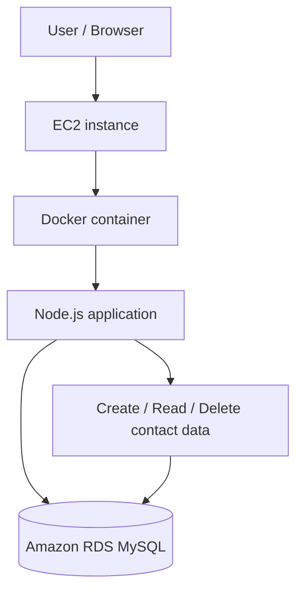
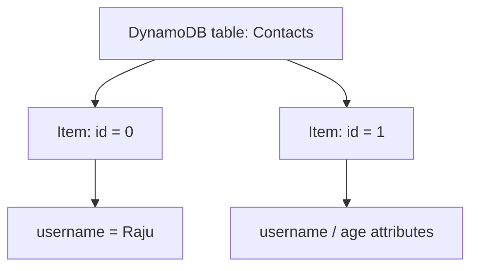

# AWS Zero to Hero — Part 5 (English)
## Chapters 15–16: AWS RDS and AWS DynamoDB

> **Source-preservation note:** Appendix A contains the original transcript for Chapters 15–16, in the same sequence and wording, including timestamps. The study notes before the appendix are organized notes; any extra clarifications are separated at the end.

## Chapter 15 — AWS RDS Service

### 1. What is RDS?
Amazon Relational Database Service (RDS) is a managed relational database service. Relational data is generally structured into tables, rows, and columns. RDS helps operate supported database engines in the cloud while AWS handles parts of the operational workload, such as patching, monitoring, backups, availability, and scaling.

### 2. Relational data and database engines

| Term | Meaning |
|---|---|
| Relational data | Structured data arranged in tables, rows, and columns |
| DBMS | Software used to create, store, query, and manage databases |
| MySQL / PostgreSQL | Relational database engines |
| MariaDB / Oracle / SQL Server | Additional database-engine options discussed in the transcript |
| Amazon Aurora | AWS relational database offering with MySQL- and PostgreSQL-compatible editions |
| Managed service | AWS handles part of the operational work for the underlying database infrastructure |

### 3. Why use RDS?
- Reduces the need to manage all database infrastructure yourself.
- AWS supports operational tasks such as patching and monitoring.
- Instance capacity and storage can be configured to suit requirements.
- Availability, failover, and scaling options exist; exact options depend on the engine and deployment configuration.
- A managed service does not remove your responsibility for schema, queries, credentials, permissions, data quality, or cost.

### 4. Practical architecture in the lesson



The transcript uses a simple web application: users enter email/contact data in a browser, the Node.js application stores it in MySQL and supports deletion. The Docker-based Node application runs on EC2, while RDS provides the database layer.

### 5. RDS database creation workflow (transcript)
1. Open RDS in the AWS Console and go to **Databases → Create database**.
2. Compare **Easy create** and **Standard create**. Standard create exposes more configuration choices.
3. Select a database engine, such as MySQL, and choose a version compatible with the application.
4. Choose a template such as Free tier, Test, or Production, as shown in the lesson.
5. For production-style configuration, understand the cost implications of Multi-AZ/availability options and higher-performance choices.
6. Configure the instance class and storage.
7. Set credentials. Use a strong, unique password; do not hard-code credentials in source code or a public repository.
8. Carefully configure connectivity, VPC, subnet/security group, and public-access settings.
9. Review the configuration and create the database.
10. Once ready, use the endpoint, port, credentials/secret, and network permissions to connect the application.

> **Important:** Console screens, Free Tier eligibility, defaults, engine versions, available instance sizes, and prices can vary by time, Region, and account. Do not treat values/prices shown in the transcript as permanent AWS limits or current prices.

### 6. Multi-AZ, DB instances, and read scaling
The transcript discusses Multi-AZ choices for high availability. Conceptually:
- **Multi-AZ / standby failover:** a standby deployment can support availability and failover. It should not automatically be treated as a read-scaling replica.
- **Read replicas / reader instances:** supported configurations may use readers to distribute read traffic.
- **DB instance:** provides compute, memory, and database runtime capacity.
- **Storage:** provides the database file-storage layer; storage types and autoscaling options depend on configuration.

Exam gotcha: High Availability and read scaling are different objectives. Verify the exact behaviour of the selected engine and deployment model.

### 7. Connectivity and security
- For production, keep the database in a private network in most cases; do not treat public access as the default choice.
- Limit inbound security-group rules to the required database port and trusted application security group/source.
- Give the application a least-privilege database user.
- Prefer Secrets Manager or another approved secret store for credentials.
- Review encryption at rest/in transit, backups, retention, monitoring, and patching settings.
- Making a database endpoint public is not, by itself, a replacement for secure connectivity.

### 8. Cost awareness
- Database compute/instance hours, storage, backups, data transfer, and selected options can increase costs.
- Multi-AZ, higher-capacity instances, and production templates can cost significantly more than a Free Tier/testing setup.
- Plan to stop/delete unused databases and related resources after a lab; preserve required data/backups before deletion.
- Check the billing dashboard and cost alerts. The transcript explicitly warns that unused resources can create unexpected charges.

## Chapter 16 — AWS DynamoDB Service

### 1. What is DynamoDB?
Amazon DynamoDB is a managed NoSQL database service. The transcript describes it as serverless, meaning users do not provision and manage a traditional database instance class and server in the same way as with RDS.

### 2. SQL vs. NoSQL

| Feature | Relational / SQL (e.g., RDS MySQL) | NoSQL (e.g., DynamoDB) |
|---|---|---|
| Typical structure | Tables, rows, columns, defined schema | Items and attributes; item attributes can be flexible |
| Data model | Relational tables | DynamoDB tables with key-value/document-style items |
| Identity/access | Relational primary keys and constraints | Partition key, optionally a sort key |
| Operations | SQL queries | DynamoDB API operations and key/index-based access patterns |
| Good fit | Relational data and SQL use cases | Low-latency access patterns and flexible attributes at scale |

### 3. DynamoDB key terms

| Term | Meaning |
|---|---|
| Table | A collection of related items |
| Item | A record/document-like unit |
| Attribute | A field within an item, such as `username`, `email`, or `age` |
| Partition key | Required primary-key component used to identify/partition items |
| Sort key | Optional key component that can form a composite primary key and help order/group items |
| Key-value pair | An attribute name and its value |
| Serverless | Abstracts server provisioning and instance maintenance from the user |

The transcript's example is a `Contacts` table with a String partition key named `id`. Items can have attributes such as `username` and `age`. A flexible item structure means different items may have different attributes.

### 4. DynamoDB data model



### 5. Console practical — table and items
1. Open DynamoDB in the AWS Console.
2. Choose **Create table**.
3. Name the table `Contacts`, as in the lesson.
4. Set the partition key to `id` and choose the `String` data type.
5. Create the table and wait until it is active/ready.
6. Open **Explore table items** to inspect records.
7. Use **Create item** to add attributes such as `id` and `username`.
8. Add another item with an additional attribute such as `age` and observe that items can have different attributes.
9. When building a CRUD application, keep the table key and field names consistent with the application code.

### 6. Serverless, scaling, and capacity
The transcript highlights these DynamoDB benefits:
- No traditional server/instance provisioning to manage.
- Scaling options that respond to demand.
- Capacity configuration for read/write workloads.
- Billing/capacity modes that can suit fluctuating workloads.
- Suitability for low-latency database access use cases.

**Important nuance:** Capacity behaviour depends on the selected capacity mode, autoscaling settings, workload, and service limits. Do not interpret “scale to zero” or “zero cost when idle” as a universal guarantee for every DynamoDB configuration; verify the current billing mode and pricing.

### 7. Read/write capacity concepts
The transcript discusses read capacity and write capacity as important factors. Practical takeaways:
- Consider read and write demand separately.
- In provisioned capacity mode, capacity units can be configured and autoscaling policies can be adjusted to the workload.
- On-demand mode uses a different capacity-management approach.
- Hot partitions, item size, access patterns, and throttling can affect performance.
- Verify the exact meaning and limits of capacity units against current AWS documentation; do not treat dashboard values from the transcript as universal fixed values.

### 8. DynamoDB gotchas / exam reminders
- DynamoDB is **NoSQL**; RDS MySQL is a **relational SQL** database.
- The partition key is central to primary-key design; selecting it carefully matters when creating a table.
- Design partition-key values for the access patterns; uneven traffic can create hot partitions.
- Items can have different sets of optional attributes, but that does not remove key requirements.
- Serverless does not mean “no limits”; quotas, capacity behaviour, and pricing still matter.
- Choose between RDS and DynamoDB based on data model, query patterns, operational needs, consistency requirements, and cost.

## RDS vs. DynamoDB — quick comparison

| Dimension | Amazon RDS | Amazon DynamoDB |
|---|---|---|
| Database type | Managed relational database | Managed NoSQL database |
| Data representation | Tables, rows, columns | Tables, items, attributes |
| Schema | Relational schema | Flexible item attributes; key schema required |
| Server/instance configuration | DB engine/instance/storage settings | Serverless-oriented; capacity mode/configuration |
| Typical access | SQL and relational queries | Key/index-based API access patterns |
| Lesson practical | EC2 + Docker/Node.js + MySQL on RDS | `Contacts` table + items in DynamoDB |
| Key design focus | Relational schema and indexes | Partition key, optional sort key, access patterns |

## Quick revision questions

| Question | Short answer |
|---|---|
| What does RDS stand for? | Relational Database Service |
| What kind of service is RDS? | Managed relational database |
| Typical format of relational data? | Tables, rows, and columns |
| Which components appear in the RDS practical? | EC2, Docker-based Node.js application, MySQL on RDS |
| Primary goal of Multi-AZ? | Availability/failover |
| What kind of database is DynamoDB? | Managed NoSQL database |
| What is a DynamoDB item? | A record/document-like unit |
| What does a partition key do? | Primary-key identification/partitioning |
| Practical meaning of DynamoDB serverless? | No traditional database server provisioning to manage |
| How should you choose RDS vs. DynamoDB? | Based on data model, access patterns, requirements, and cost |

## Board-Level Answer

**Amazon RDS** is a managed relational database service for structured relational data and supported database engines. It reduces database infrastructure operations and provides configurable compute, storage, backup, monitoring, and availability options. **Amazon DynamoDB** is a managed NoSQL database built around tables, items, attributes, and key-based access patterns. It is serverless-oriented and offers capacity/billing choices for different workloads. Choose between them based on data model, query/access patterns, availability and consistency needs, operational requirements, and cost—not merely because one is “SQL” and the other is “NoSQL.”

## No-Skip Checklist

- [ ] Relational data and rows/columns
- [ ] DBMS and engines mentioned in the source
- [ ] RDS as a managed service
- [ ] RDS engine options and Aurora mention
- [ ] Patching, monitoring, scaling, availability, and fault-tolerance concepts
- [ ] EC2 + Docker + Node.js + MySQL architecture
- [ ] RDS creation workflow and template choices
- [ ] Instance, storage, connectivity, credentials, and cost topics
- [ ] Multi-AZ / availability concepts discussed in the transcript
- [ ] Cost/unused-resource warning
- [ ] DynamoDB as NoSQL and serverless-oriented
- [ ] JSON-like items and key-value attributes
- [ ] `Contacts` table, `id` partition key, and sample attributes
- [ ] Explore table items / create item practical
- [ ] Read/write capacity and scaling concepts
- [ ] Flexible item attributes
- [ ] Original transcript preserved in Appendix A

## Additional Points Added (separate from the original transcript)

1. Production database security: private networking, narrowly scoped security groups, least privilege, secret management, and encryption.
2. Clarification that Multi-AZ standby and read replicas serve different purposes.
3. Clarification that DynamoDB capacity and idle-cost behaviour depend on the chosen mode/configuration; “zero cost” is not a universal guarantee.
4. Access-pattern and hot-partition considerations for DynamoDB.
5. Reminder that AWS console options, Free Tier eligibility, pricing, and service limits can change. Live AWS documentation verification is not included in this file.

## Appendix A — Original Source — Preserved

The original transcript for Chapters 15–16 is reproduced below without reordering or editing the source wording.

```text
Chapter 15: AWS RDS Service
4:25:104 hours, 25 minutes, 10 secondsफ्रंट एंड को यूज करेंगे आईडी में डाटा स्टोर करने के लिए एंड इसमें बत हम लोग एक बहुत ही अच्छी एप्लीकेशन यूज़ करेंगे इजी
4:25:174 hours, 25 minutes, 17 secondsटू एंड आरडीएस को कनेक्ट करके एंड डॉकर बेस्ड एक नोड एप्लीकेशन हम लोग यूज़ करेंगे जो माए से कनेक्ट करेगी तो इंटरेस्टिंग वीडियो होने वाला है चलिए इस
4:25:254 hours, 25 minutes, 25 secondsसेक्शन में बात करते हैं एडब्ल्यू के आरडीए सर्विस के बारे में रिलेशनल डेटाबेस सर्विस सबसे पहले बात करेंगे रिलेशनल डेटा क्या होता है यहां पे कुछ यूजर्स का डटा
4:25:334 hours, 25 minutes, 33 secondsहै पर जो डेटा है उसका फॉर्मेट कैसा है टेबुलर फॉर्म या तो स्ट्रक्चर्ड फॉर्म रो एंड कॉलम के फॉर्म में इसको हम लोग रिलेशनल डाटा बोल सकते हैं अब इस टाइप के
4:25:424 hours, 25 minutes, 42 secondsडेटा को मैनेज करने के लिए हमारे पास कुछ डेटा बेसेस होते हैं डेटाबेस मैनेजमेंट सिस्टम जिसको बोलते हैं जैसे कि पोस्टग्रेस माय एल ओरेकल एक्सेट्रा ओके
4:25:514 hours, 25 minutes, 51 secondsलेकिन जब आप इस टाइप के डाटा को क्लाउड में मैनेज करने की मतलब डिसाइड करते हो सो एडब्ल्यू हमको प्रोवाइड करता है आरडीएस
4:26:004 hours, 26 minutesसर्विस ओके रिलेशनल डेटाबेस सर्विस रिकॉर्डिंग कि आरडीएस में कौन-कौन से अलग-अलग टाइप ऑफ डेटाबेस आप यूज़ कर सकते
4:26:074 hours, 26 minutes, 7 secondsओके सो जो भी आपके पॉपुलर डेटाबेस सर्विस है इन द मार्केट जैसे कि मा स् मारया डीबी पोस्टग्रेस रेकल microsoft's सर्वर तो यह
4:26:164 hours, 26 minutes, 16 secondsसारे ही ऑप्शंस आपको यहां पर मिल जाते हैं मतलब आई मीन डिपेंड अपॉन कि आपकी क्या रिक्वायरमेंट है आपको कौन सा यूज करना है
4:26:234 hours, 26 minutes, 23 secondsएंड जो इनके खुद के मतलब जो एडब्ल्यू की खुद की ऑफर है वह है अरा ये रा एक सीरीज होती है एंड इसमें भी दो ऑप्श दिए
4:26:314 hours, 26 minutes, 31 secondsइन्होंने माय स्ल एंड पोस्ट ग्रेस कंपैटिबल सो इसके बारे में थोड़ा सा और बात करेंगे सो इफ यू आर थिंकिंग कि आरडीएस हमको क्यों यूज करना चाहिए बिकॉज यह एक
4:26:404 hours, 26 minutes, 40 secondsमैनेज्ड डेटाबेस सर्विस है इसका मतलब क्या है कि लेट्स से कि आपने माल आपको यूज करना है सो माल का तो देखो इनके पास ऑप्शन है
4:26:484 hours, 26 minutes, 48 secondsतो इसमें क्या होगा एडब्ल्यू जो आपका माय स्कल जो इंस्टेंस बनेगा वो पूरा मैनेज करेगा अब उसमें देखो पैचिंग हो गया
4:26:554 hours, 26 minutes, 55 secondsमॉनिटरिंग हो गया या तो आपको कल को जाके भाई स्केल करना हो हाई अवेलेबिलिटी चाहिए हो फॉल्ट टोलरेंस चाहिए हो तो जितना भी
4:27:024 hours, 27 minutes, 2 secondsचीजें हैं वो आपको यहां पे फैसिलिटी मिल जाती हैं ओके सो यही तो फायदा है क्लाउड सर्विस यूज करने का ओके सो इसलिए आईडीएस
4:27:094 hours, 27 minutes, 9 secondsइज वेरी गुड चॉइस चलिए एक प्रैक्टिक यूज केस देखते हैं आईडीएस का तो थोड़ा ज्यादा इंटरेस्ट आएगा और आप अच्छे से रिलेट भी कर पाओगे इस एग्जांपल में हम लोग सिंपली एक
4:27:184 hours, 27 minutes, 18 secondsवेबसाइट को डिप्लॉयड एंड में डेटाबेस से अटैच है या तो डेटा स्टोर करेगी ओके सिंपली हम लोग
4:27:264 hours, 27 minutes, 26 secondsएडब्ल्यू लेवल पे आते हैं तो बात करेंगे e2 एंड आरडीएस ये दो सर्विसेस का यूज़ करेंगे e2 पे हमारा फ्रंट एंड होगा जो
4:27:344 hours, 27 minutes, 34 secondsआपका ब्राउजर पे दिखेगा वेबसाइट एक्सेस होगी एंड आरडीएस में आपका बैक एंड या तो माय एए जहां पे आपका डाटा स्टोर होगा ओके
4:27:424 hours, 27 minutes, 42 secondsबहुत अच्छा एग्जांपल है अब ट में हम हम यूज करेंगे डॉकर डॉकर बेस्ड कंटेनर एंड
4:27:494 hours, 27 minutes, 49 secondsकंटेनर में होगा हमारा नोड एप्लीकेशन सो नोड एप्लीकेशन अ ठीक है जो कि कनेक्टेड होगी माल से तो और सिंपल सा यूज केस है जो
4:27:584 hours, 27 minutes, 58 secondsअभी हम लोग इनिशियली देख चुके हैं कि भाई फ्रंट एंड से आप ईमेल ठीक है आप एज अ यूजर इनपुट लोगे एंड उसको मायल पे आप स्टोर कर
4:28:074 hours, 28 minutes, 7 secondsसकते हो एंड डिलीट भी कर सकते हो ठीक है तो ये बहुत सिंपल सा है लेकिन लद हम लोग बहुत सारी चीजें यूज़ कर रहे हैं ec2 डॉकर कंटेनर mysql2 डिफरेंट सर्विसेस आपस में
4:28:174 hours, 28 minutes, 17 secondsकैसे कनेक्टेड है सो काफी कुछ सीखने को मिलेगा चलिए अब ये देखो इसमें दो सर्विसेस यूज़ करनी है तो वन बाय वन करते हैं ठीक
4:28:254 hours, 28 minutes, 25 secondsहै सबसे पहले शुरुआत करते हैं आरडीएस तो हम लोग एक आरडीएस में मतलब एक अपने एक मायल का इंस्टेंस बना लेते हैं डायरेक्टली चलते हैं डैशबोर्ड पे एडब्ल्यू कंसोल पे
4:28:344 hours, 28 minutes, 34 secondsएक छोटा सा नोट करा देता हूं जल्दी से कि जब भी आप काम करो लेट्स से नेक्स्ट डे सो आप सिंपल से एक चीज पे ध्यान रखना कॉस्ट एंड यूसेज जैसे आप जी मैंने ध्यान दिया कि
4:28:434 hours, 28 minutes, 43 secondsमेरा जो कॉस्ट है वो बढ़ते ही जा रहा था और मैंने ध्यान दिया कि जो मेरी एक s3 सर्विस है वो मैंने छोड़ दी थी ऐसे ही ओके सो
4:28:534 hours, 28 minutes, 53 secondsदैट्ची सर्विस आपका कितना ठीक है आपका यूसेज ले रहा है चलिए अ सर्च पे आते हैं डायरेक्टली आईडीएस यहां पे आप सर्च करो तो
4:29:014 hours, 29 minutes, 1 secondयहां पे देखिएगा मैनेज्ड रिलेशनल डेटाबेस सर्विस ओके चलिए इस पे क्लिक कर लेते हैं एंड ये आपको इस टाइप से डैशबोर्ड दिखेगा
4:29:094 hours, 29 minutes, 9 secondsलेफ्ट साइड में आप पहले डायरेक्टली आ जाओ डेटाबेस इस पे ओके सो अभी हम लोग प्रैक्टिकली कर रहे हैं तो डायरेक्टली हम लोग डेटाबेस से ही बनाते हैं ओके क्रिएट
4:29:164 hours, 29 minutes, 16 secondsडेटाबेस इसके बाद यहां पे आपको दो ऑप्शंस मिल जाते हैं स्टैंडर्ड क्रिएट एंड इजी क्रिएट इजी क्रिएट सिंपल है इजी एंड फास्ट
4:29:234 hours, 29 minutes, 23 secondsहै जो भी बेस्ट पैकेज है अलग-अलग पर्पस के लिए वो आपको दे देता है जैसे कि इजी क्रिएट माय स्ल किया सो यहां पे तीन ऑप्शंस है प्रोडक्शन टेस्ट फ्री टियर
4:29:324 hours, 29 minutes, 32 secondsकिसके लिए यूज करना है जो भी बेस्ट पैकेज है प्रोडक्शन के लिए जैसे कि क्या सीपीयू इंस्टेंस टाइप स्टोरेज एंड ऑल एंड इसी के साथ-साथ इसने यहां पे प्राइसिंग भी मेंशन
4:29:414 hours, 29 minutes, 41 secondsकर दी वेरी सिंपल बट हम लोग चलते हैं स्टैंडर्ड क्रिएट के साथ और देखते हैं और
4:29:494 hours, 29 minutes, 49 secondsकॉन्फिन इसमें मिलता है हमको माय स्कल कम्युनिटी एडिशन यहां पे वर्जन आप अलग-अलग सेलेक्ट कर सकते हो जिस पे भी आपने एप्लीकेशन
4:29:574 hours, 29 minutes, 57 secondsबिल्ड करनी है इनेबल आईडीएस एक्सटेंडेड सपोर्ट यह देखोगे यह पेड ऑफि है इसलिए मैंने यहां पे अन सेलेक्ट कर लिया है ओके
4:30:044 hours, 30 minutes, 4 secondsनाउ उसके बाद हमको मिलते हैं टेंपलेट्स फ्री टियर टेस्ट एंड प्रोडक्शन लद हम लोग यहां पे फ्री टियर यूज़ करेंगे बट प्रोडक्शन में मैं एक दो चीज दिखा देता
4:30:124 hours, 30 minutes, 12 secondsहूं प्रोडक्शन पर हमको मिलता है हाई अवेलेबिलिटी एंड फास्ट कंसिस्टेंट परफॉर्मेंस जो कि प्रोडक्शन के लिए इंपोर्टेंट होती है प्रोडक्शन देखिए
4:30:204 hours, 30 minutes, 20 secondsप्रोडक्शन जैसे कि मैंने सेलेक्ट किया तो आप देखोगे यहां पे मेरे पास तीन ऑप्शंस है मल्टीपल अवेलेबिलिटी जोन डीबी क्लस्टर
4:30:274 hours, 30 minutes, 27 secondsमतलब एक रीजन में मल्टीपल एजीज है अलग-अलग जोनस है सारे ही जनस में मेरा जो डेटाबेस इंस्टेंस है वह यहां पर प्रेजेंट होगा ओके
4:30:364 hours, 30 minutes, 36 secondsयहां पर दो ऑप्शंस है क्लस्टर एंड इंस्टेंस दोनों में क्या डिफरेंस है जैसे कि अगर आप यूज करते हो सो लेट्स से आपके
4:30:444 hours, 30 minutes, 44 secondsतीन जोन में तीन इंस्टेंस है मा स्कल के तो तीनों इंस्टेंस रीड ऑपरेशन को आई मीन
4:30:504 hours, 30 minutes, 50 secondsलाइक रिस्पांस करेंगे ओके सर्व करेंगे सो दैट क्या होगा कि तीनों इंस्टेंस रीड ऑपरेशन के लिए रेडी हैं सो आपका जो क्वेरी
4:30:584 hours, 30 minutes, 58 secondsअगर जैसे कि रिक्वेस्ट आती है ठीक है रीड करने के लिए तो वो ज्यादा फास्ट हो जाएगा राइट लेकिन आप सिंपल यहां पे इंस्टेंस
4:31:054 hours, 31 minutes, 5 secondsकरते हो एजी डीबी इंस्टेंस तो क्या है स्टैंड बाय पे रहेंगे आपके बाकी के इंस्टेंस कि अगर एक फेल होता है तो एक आप
4:31:134 hours, 31 minutes, 13 secondsआ जाएगा ओके दैट्ची सेटिंग्स हैं इसके बाद इंस्टेंस
4:31:204 hours, 31 minutes, 20 secondsकॉन्फिन राइट कि जो भी आपका सीपीयू है राइट एंड रम सो वो आपको
4:31:284 hours, 31 minutes, 28 secondsकिस लेवल का चाहिए एंड सेकंड थिंग आप अलग-अलग क्लासेस से इसको अ सेलेक्ट कर सकते हो जैसे कि एम क्लास आर क्लास सी
4:31:354 hours, 31 minutes, 35 secondsक्लास ये हम लोग ने ऑलरेडी कवर किया है ओके डिपेंड अपॉन कि आपकी एप्लीकेशन की रिक्वायरमेंट क्या है स्टोरेज में भी आप
4:31:424 hours, 31 minutes, 42 secondsएसएसडी ओके फिर जनरल पर्पस आईयूपीएस अलग-अलग टाइप के एसएसडी में आप यहां प सेलेक्ट कर सकते हो एलोकेशन एलोकेटेड
4:31:514 hours, 31 minutes, 51 secondsस्टोरेज आपको 400gb का इनिशियली मिल जाता है स्टोरेज ऑटो स्केलिंग का भी एक ऑप्शन यहां पे मिल
4:31:584 hours, 31 minutes, 58 secondsजाता है लद ये मल्टी एजी के लिए अवेलेबल नहीं है ओके फिर कनेक्टिविटी हो गया एंड ऑल एंड लास्ट में आता है सबसे इंटरेस्टिंग
4:32:074 hours, 32 minutes, 7 secondsपार्ट कि अगर आप प्रोडक्शन के लिए ये यूज करते हो सो आप देख सकते हो कि एस्टीमेट मंथली कॉस्ट जो हमारी होगी दैट इज सम वेयर
4:32:144 hours, 32 minutes, 14 secondsअराउंड $1500 लद अभी हम लोग फिर से चलते हैं बैक फ्री टियर पे मैं सेलेक्ट करता हूं
4:32:234 hours, 32 minutes, 23 secondsठीक है सो यहां पे कोई भी ऑप्शन नहीं है मल्टीपल एजीज का यहां पे आप इंस्टेंस का नाम दे सकते हो डिफॉल्ट के साथ हम लोग
4:32:314 hours, 32 minutes, 31 secondsचलते हैं नाउ इट इज आस्किंग फॉर क्रेडेंशियल सेटिंग्स माय स्ल जब हमारा इंस्टेंस बन जाएगा तो आप उसको एक्सेस कैसे करोगे उसके लिए हमको यूजर नेम पासवर्ड की
4:32:394 hours, 32 minutes, 39 secondsजरूरत पड़ेगी यूजर नेम है इस इसका डिफॉल्ट जो है एडमिन ओके एंड इसके बाद पासवर्ड आप ठीक है मेंटेन कर सकते हो जैसे कि हम लोग
4:32:484 hours, 32 minutes, 48 secondsसेल्फ मैनेज पे चलते हैं मास्टर पासवर्ड तो यहां पे आप पासवर्ड दे दो तो मैं यहां पे दे देता हूं ए बी सीडी 1 2 3 4 5 सिंपल सा देते हैं क्योंकि अभी हम लोग टेस्टिंग
4:32:574 hours, 32 minutes, 57 secondsपे हैं ठीक है तो मैंने यहां पे पासवर्ड दे दिया इसका हम यूज़ करेंगे एसक्यूएल को अ
4:33:054 hours, 33 minutes, 5 secondsएक्सेस करने के लिए इंस्टेंस कॉन्फिन जो भी फ्री टियर में है ठीक है तो ये ऑलरेडी यहीं पे है स्टोर 20gb हमको ये मिल जाएगा
4:33:134 hours, 33 minutes, 13 secondsजनरल पर्पस के लिए यहां पे हम लोग को ऑटो स्केलिंग का देखो ऑप्शन मिल जाता है बिकॉज हम लोग सिंगल इंस्टेंस यूज कर रहे हैं एंड यू विल नोटिस वन थिंग कि देखो जब हमारा
4:33:224 hours, 33 minutes, 22 secondsअगर स्टोरेज भरने लगेगा तो वो अ ऑटोमेटिक इसको स्केल करते जाएगा नाउ देयर इज वन थिंग कि यहां पे 20gb इनिशियल मिल रहा है
4:33:294 hours, 33 minutes, 29 secondsऔर स्केलिंग में अगर आप देखोगे 1 टेराबाइट यहां पे लिमिट है ओके थ्रश होल्ड है 1 टेराबाइट तक एंड इसको आप कम ज्यादा भी कर
4:33:374 hours, 33 minutes, 37 secondsसकते हो लद हम इनेबल स्टोरेज यहां पे डी सेलेक्ट कर देते हैं इसके बा आते हैं कनेक्टिविटी कि आपको कैसे इसको कनेक्ट
4:33:444 hours, 33 minutes, 44 secondsकरना है डोंट कनेक्ट टू टू कंप्यूटर सोर्स एंड कनेक्ट टू ट तो e2 इंस्टेंस से आपको कनेक्ट करना है क्या ऑल दो हम कर सकते हैं
4:33:534 hours, 33 minutes, 53 secondsक्योंकि ट बेस्ड हमारा एप्लीकेशन है बट अभी हम लोग इसके साथ चलते हैं रीजन यह है कि डोंट कनेक्ट टू ईट बिकॉज़ इवन आप दूसरे
4:34:004 hours, 34 minutesएप्लीकेशन से अपने दूसरे सर्वर से या तो अपने लैपटॉप कंप्यूटर डेस्कटॉप से अगर उसको एक्सेस करना चाहो तो कर सकते हो सो
4:34:084 hours, 34 minutes, 8 secondsवो वाला अभी हम लोग देखेंगे वीपीसी हम लोग डिफॉल्ट रखते देखो पब्लिक एक्सेस यस क्योंकि हम लोग को
4:34:154 hours, 34 minutes, 15 secondsबाहर से उसको एक्सेस करना है ओके और इसके बाद आ जाते हैं फायरवॉल फायरवॉल जरूरी है रीजन यह है कि देखो इसको हम लोग को बाहर
4:34:244 hours, 34 minutes, 24 secondsसे एक्सेस करना है एप्लीकेशन को सो हम लोग क्या क्रिएट न्यू कर देते हैं वीपीसी एंड इसका नाम दे देते हैं लेट्स से माय एल एजी
4:34:334 hours, 34 minutes, 33 secondsअवेलेबिलिटी जोन का प्रेफरेंस आप दे सकते हो लद हम लोग डिफॉल्ट के साथ चलते हैं एंड इसके बाद टैक्स टैक्स में हम लोग वैसे
4:34:424 hours, 34 minutes, 42 secondsजरूरी नहीं है लेकिन नवी एनवायरमेंट हम लोग लिख देते हैं यूटी आप एसक्यूएल को कनेक्ट कैसे करोगे
4:34:504 hours, 34 minutes, 50 secondsपासवर्ड ऑथेंटिकेशन को यूज करके एंड सो ऑन ठीक है एंड यहां पे मंथली कॉस्ट आपको दे चुका है कि यहां पे फ्री टियर है तो हमारे
4:34:574 hours, 34 minutes, 57 seconds750 आर्स यहां प मिल जाता है एंड सो ऑन एंड इसके बाद हम लोग सिंपली कर देते हैं क्रिएट डेटाबेस ओके सो इसके बाद यहां पे
4:35:044 hours, 35 minutes, 4 secondsसजेस्टेड एडवांस लिख रहा है कि भाई ठीक है इनका काम है प्रमोट करना दो चीजें ऑफर कर रहे हैं जो कि इलास्ट लास्टिक एश क्लस्टर
4:35:124 hours, 35 minutes, 12 secondsइलास्टिक एश में क्या होता है कि यह मेमोरी बेस्ड डाटा आपको सर्व करता है स मेमोरी बेस्ड इट्स रियली वेरी फास्ट लेटेंसी बहुत
4:35:224 hours, 35 minutes, 22 secondsकम होती है यह रीड ऑपरेशन के लिए काफी हेल्पफुल है ओके आप देखोगे 80 टाइम्स फास्टर रीड परफॉर्मेंस सो अगर अगेन जो यह
4:35:314 hours, 35 minutes, 31 secondsप्रोडक्शन वगैरह में चाहे तो यूज कर सकते हैं आरडीएस प्रॉक्सी कनेक्टिविटी के लिए है स्केल करने के लिए लद अभी हम इसको
4:35:394 hours, 35 minutes, 39 secondsअवॉइड करते हैं चलिए ये हमारा डेटाबेस बन रहा है आप देख सकते हो नीचे क्रिएटिंग यहां पे इसका स्टेटस आ गया है लद जब तक हमारा डेटाबेस
4:35:484 hours, 35 minutes, 48 secondsबनता है हम लोग जल्दी से टू अपना इंस्टेंस को प्रिपेयर कर लेते हैं ी टू हम लोग बहुत बना चुके हैं तो अभी तो आई एम श्यर कि आप लोग के लिए थोड़ा सा इजी हो गया होगा ठीक
4:35:564 hours, 35 minutes, 56 secondsहै इंस्टेंसस पे जाके लॉन्च इंस्टेंस ओके सो इसका नाम देना है सो मैं बोल देता हूं
4:36:034 hours, 36 minutes, 3 secondsनोड पप क्योंकि नोड एप्लीकेशंस है हमारी
4:36:114 hours, 36 minutes, 11 secondsकी पेयर मैं बोल देता हूं विदाउट की पेयर ओके हां नेटवर्क में आप एचटीटीपी अलाउ कर
4:36:214 hours, 36 minutes, 21 secondsदेना क्योंकि हम लोग को वेबसाइट एक्सेस करनी है ओके वेरी ये तो नॉर्मल चीज है बाकी सब हम लोग यहां पे डिफॉल्ट के साथ
4:36:284 hours, 36 minutes, 28 secondsचलते हैं ठीक है लॉन्च इंस्टेंस कर लेते हैं चलिए ये हमारा इंस्टेंस आ गया है ओके सो इंस्टेंस हमारा रनिंग भी है ठीक है नोड
4:36:354 hours, 36 minutes, 35 secondsप प मैं क्लिक करता हूं और इसको हम लोग कनेक्ट करते हैं क्योंकि इसको एक्सेस कर सक कुछ चीजें हमको सेटअप भी करनी है इजी टू इंस्टेंस कनेक्ट पे चलते हैं एंड
4:36:434 hours, 36 minutes, 43 secondsसिंपली इसको कनेक्ट करते हैं ओके सो यहां पे हमारा टर्मिनल हो गया एक्सेस एंड इसके बाद जो टर्मिनल पे कमांड्स एग्जीक्यूट करना है वो देखो आपको स्लाइड में मिल जाएगी य हम इंस्टॉल डॉकर मतलब डॉकर
4:36:524 hours, 36 minutes, 52 secondsइंस्टॉल करना है डॉकर स्टार्ट करना है तो वेरी सिंपल है ठीक है तो हम लोग चलते हैं डायरेक्ट सुडो य हम इंस्टॉल डकर न y तो
4:37:024 hours, 37 minutes, 2 secondsयहां पे हमारा डॉकर इंस्टॉल हो जाएगा ओके सो डॉकर हमारा इंस्टॉल हो गया इसके बाद हम लोग क्या करते हैं
4:37:094 hours, 37 minutes, 9 secondsसुडो सिस्टम सीटीएल स्टार्ट डॉकर सो हमारी जो डॉकर की सर्विस स्टार्ट
4:37:174 hours, 37 minutes, 17 secondsहो जाएगी इसके बाद आप चेक भी कर सकते हो स्टेटस करके डॉक सिस्टम सीटीएल डॉकर स्टेटस सो आप देखोगे एक्टिव आपका दिखना
4:37:244 hours, 37 minutes, 24 secondsचाहिए ओके सिंपल इसके बाद हमको एक इमेज को पुल करना है तो यहां पे आप कमांड देख सकते हो और सेम कमांड यूज करना है ठीक है डकर
4:37:314 hours, 37 minutes, 31 secondsपल फप पल फन मा ए और ये 02 वर्जन है यह एक नोड एप्लीकेशन है जो मैंने ठीक है लोकली
4:37:404 hours, 37 minutes, 40 secondsक्रिएट की थी टेस्टिंग परपस के लिए इसकी डॉकर इमेज बना के डॉकर रजिस्ट्री पे यह पब्लिकली प्रेजेंट है तो ये सेम इमेज आप
4:37:484 hours, 37 minutes, 48 secondsलोग भी टेस्टिंग के लिए यूज कर सकते हो तो कमांड विल बी सिमिलर फॉर यू टर्मिनल पे आते हैं करता हूं मैं सुडो डॉकर पल पॉल
4:37:554 hours, 37 minutes, 55 secondsफिलिप दिस एंड एग्जीक्यूट करता हूं ओके सो यहां पे हमारी इमेज हो गई है सक्सेसफुली पुल एंड आप इसको चेक भी कर सकते हो सूडो
4:38:054 hours, 38 minutes, 5 secondsडॉकर इमेजेस सो यू विल सी कि यहां पे आपकी जो इमेज है आ गई अब इसको रन बस करना है एंड हम हमारी जो एप्लीकेशन है वह अप एंड
4:38:134 hours, 38 minutes, 13 secondsरनिंग हो जाएगी इसके बाद जो हमारा नेक्स्ट स्टेप है वह है जो इमेज तो अभी हम लोग ने ले आई थी एंड उसके बाद डॉकर कंटेनर को रन
4:38:204 hours, 38 minutes, 20 secondsकरना उसके लिए हम लोग यह वाली कमांड यूज करेंगे स्लाइड पे दी हुई है ओके आप लास्ट में देखोगे फॉल फप यह वाली सेम इमेज अभी
4:38:274 hours, 38 minutes, 27 secondsजो हम लोग ने डाउनलोड करी डॉकर रन हान हान आरएम कि भाई अपने आप वो डिलीट हो जाए बाद में पोर्ड बाइंडिंग यूज कर रहे हैं 80 से
4:38:354 hours, 38 minutes, 35 seconds3000 क्योंकि जो नोट एप्लीकेशन है हमारा वो 3000 पे लिसनिंग है और 80 क्योंकि हम लोग ने h डीपी इनेबल किया है ओके ी टू से
4:38:444 hours, 38 minutes, 44 secondsएक्सेस कर सके वेबसाइट को ओके सिक्योरिटी ग्रुप में इसके बाद जो माय एएल को कनेक्ट करने के लिए जो डिटेल्स देनी है राइट जैसे
4:38:524 hours, 38 minutes, 52 secondsकि होस्ट नेम यूजर नेम पासवर्ड ये चीज हम लोग देंगे यहां से एनवायरमेंट वेरिएबल के थ्रू हान e यूज करते हैं एनवायरमेंट
4:38:594 hours, 38 minutes, 59 secondsवेरिएबल डीबी होस्ट डीबी यूजर डीबी पासवर्ड एंड इसके बाद होस्ट नेम यूजर नेम पासवर्ड आप दे दोगे
4:39:074 hours, 39 minutes, 7 secondsदैट्ची से कॉपी कर ली है अ कमांड एंड मैं सिंपली चलता हूं मतलब एक टेक्स्ट एडिटर मैंने ओपन कर लिया सो दैट मैं उसको एडिट
4:39:144 hours, 39 minutes, 14 secondsकर सकूं यह सेम वही कमांड है ओके सो यहां पे मैंने देखो ये यूजर नेम एडमिन एंड पासवर्ड यूज कर लिया है एंड इसके बाद हम
4:39:224 hours, 39 minutes, 22 secondsलोग सिंपली क्या करेंगे देखो ये जो डेटाबेस है इसका जो होस्ट नेम है ना ये एंड पॉइंट एंड पॉइंट को कॉपी किया एंड
4:39:304 hours, 39 minutes, 30 secondsइसमें क्या करना है जो डीब होस्ट है इक्वल टू इसकी जगह मैं यहां पे प्लेस कर दूंगा तो होस्ट नेम की जगह होस्ट नेम आ गया एंड
4:39:364 hours, 39 minutes, 36 secondsयूजर नेम हमारा एडमिन था एंड जो पासवर्ड मैंने यहां पे ए बी सीडी 1 2 3 4 फ सिंपल यूज़ किया था सिंपल अब मैं इस क्वेरी को
4:39:444 hours, 39 minutes, 44 secondsकॉपी करता हूं कॉपी ओके एंड यहां पे आप देख सकते हो कि जो हमारा डाटा बेस है रिफ्रेश किया तो यहां पे अवेलेबल भी आ गया
4:39:514 hours, 39 minutes, 51 secondsस्टेटस ओके एंड डॉकर कंटेनर को रन करने से पहले एक छोटी सी चीज है जो आपको नोट करा देता हूं जैसे कि ये हमारा डेटाबेस है एंड
4:39:594 hours, 39 minutes, 59 secondsसिक्योरिटी में आते हैं यहां पे सिक्योरिटी ग्रुप है ये सेम वही है जो नया बनाया था हम लोग ने माय एएल एज सिक्योरिटी
4:40:064 hours, 40 minutes, 6 secondsग्रुप इस पे क्लिक कर लो एंड इसका रूल जरूर देख लेना ओके क्योंकि देखो अभी हम लोग e2 इंस्टेंस से इस माल पे कनेक्ट
4:40:144 hours, 40 minutes, 14 secondsहोंगे तो भाई एएल अलाव कर रहा है कि नहीं तो आप एक बार चेक कर लेना ओके तो ये ये मायल एच मैंने ओपन किया इन बाउंड रूल्स
4:40:224 hours, 40 minutes, 22 secondsओके इन एडिट इन बाउंड रूल्स में आ जाता हूं एंड मैं आपको दिखा देता हूं कि अभी प्रेजेंट रूल क्या है यह देखो यह माल अरा
4:40:304 hours, 40 minutes, 30 secondsदिया है लद यह जो डिफॉल्ट पोर्ट है माल का 3306 इस पे ये ओपन है ओके अभी किस सोर्स
4:40:384 hours, 40 minutes, 38 secondsसे मतलब रिक्वेस्ट एक्सेप्ट कर सकता है तो मैंने यहां पे देखो मैंने यहां पे एनी वेयर किया है मतलब पब्लिकली यह कहीं से भी एक्सेप्ट कर सकता
4:40:474 hours, 40 minutes, 47 secondsहै लद इट इज नॉट रिकमेंड रिकमेंड नहीं किया जाता है बट अभी हम लोग सिर्फ टेस्टिंग कर रहे हैं ओके आप स्पेसिफिक आईपी भी प्रोवाइड कर सकते हो सो यह चीज
4:40:564 hours, 40 minutes, 56 secondsआपने अपन ने कर ली ठीक है तो इसके बाद माय स्ल पे आप पब्लिकली कनेक्ट कर सकते हो इसके बाद हम लोग सिंपली आ जाते हैं अपनी
4:41:054 hours, 41 minutes, 5 secondsकमांड पे सो यह वाली कमांड मैं यहां पे कॉपी कर लेता हूं एंड हम लोग चलते हैं अपने टर्मिनल पे मैं सुडो एंड अपने यहां
4:41:134 hours, 41 minutes, 13 secondsपर जो कमांड है उसको एग्जीक्यूट कर देता हूं एंड इसको एग्जीक्यूट करते हैं सो यहां पर देखोगे सक्सेसफुली रन इसके बाद आप चेक भी कर सकते हो
4:41:224 hours, 41 minutes, 22 secondsसूडो टकर पीएस सो इट इज अप एंड रनिंग एंड आल्सो आप इसके लॉक्स भी चेक कर सकते हो जैसे कि सड
4:41:294 hours, 41 minutes, 29 secondsडॉकर लॉगस आफ एफ एंड यहां पर कंटेनर का नाम सो यू कैन सी आप यहां प देखो लॉक्स
4:41:374 hours, 41 minutes, 37 secondsमें दिखेगा कनेक्टेड टू मायल ओके सो एसक्यूएल से कनेक्टेड है सक्सेसफुली दैट मींस हमारा जो फ्रंट एंड है इट इज अ रनिंग
4:41:454 hours, 41 minutes, 45 secondsएंड रेडी टू यूज एक्चुअली अभी इसके बाद हम लोग को क्या करना है इी टू इंस्टेंस पे चलते हैं इंस्टेंस रनिंग जो अभी हम लोग ने ट इंस्टेंस बनाया था और अभी ट पे हमारी
4:41:554 hours, 41 minutes, 55 secondsएप्लीकेशन रनिंग मतलब कंटेनर रनिंग है उसको एक्सेस करने के लिए हमको ये चाहिए पब्लिक आईपी ओके सो पब्लिक आईपी को मैं कॉपी करता हूं ईजी टू इंस्टेंस से एंड
4:42:044 hours, 42 minutes, 4 secondsयहां ब्राउजर पे जाके मैं सिंपली उसकी आईपी को मैं यहां पे पेस्ट करता हूं एंड एग्जीक्यूट करता हूं एंड यू विल सी कि हमारा जो एप्लीकेशन है इट इज़ अप एंड
4:42:134 hours, 42 minutes, 13 secondsरनिंग ओके एंड सिंपल है अगर यह एक्सेस नहीं हो रहा है तो ध्यान देना कि वह एचटीटीपी से ही शुरुआत होनी चाहिए ओके सो
4:42:214 hours, 42 minutes, 21 secondsनाउ यह हमारा एप्लीकेशन अप एंड रनिंग है ठीक है इसके बाद आप सिंपली यहां पे कुछ ईमेल्स रैंडम ईमेल्स डाल के उसको ऐड कर सकते हो जैसे कि
4:42:294 hours, 42 minutes, 29 secondsraju.com ऐड कर दिया मैंने ओके इसके बाद श @ email.com ऐड कर दिया उसके बा शो ऑल कांटेक्ट करते हो तो आपको ईमेल्स जो भी
4:42:384 hours, 42 minutes, 38 secondsमतलब हम लोग स्टोर कर रहे हैं वह दिख जाएगा और डिलीट का बटन तो मैं सिंपल डिलीट करके उसको रिमूव भी कर सकता हूं आप देखोगे इस तरह से ओके प्रैक्टिकल सेशन में एक और
4:42:474 hours, 42 minutes, 47 secondsपार्ट हम लोग कवर करते हैं लेट्स से देखो आरडीएस में आपने एक डाटाबेस बना दिया जैसे कि हम लोग ने माल बनाया अगर आपको उसमें
4:42:544 hours, 42 minutes, 54 secondsकुछ क्वेरी एग्जीक्यूट करनी है तो जैसे कि सेलेक्ट स्टार फ्रॉम दिस दिस दिस टेबल ओके सिंपल है कि मैनुअली आपको कुछ काम करना हो
4:43:024 hours, 43 minutes, 2 secondsतो आप कैसे करोगे उसको एक्सेस कैसे करोगे वेरी सिंपल अभी देखो यह डेटाबेस से हम लोग ने एक यह देखो यूजर नेम raju.com यह हम
4:43:104 hours, 43 minutes, 10 secondsलोग ने डेटाबेस में स्टोर कर दिया ओके सिंपली आप जाओ अपने ट वाले टर्मिनल पे
4:43:164 hours, 43 minutes, 16 secondsलद ये जो स्लाइड है इसपे मैंने ये कमांड आपको दी है जो आप यूज कर सकते हो डॉकर रन एंड इसमें इंटरेक्ट टर्मिनल हम लोग यूज
4:43:244 hours, 43 minutes, 24 secondsकरेंगे ओके माय स्ल एक सिंपल बेस इमेज यूज करेंगे और माय एएल क्वेरी को यूज करके और यहां पे हाइन ए के बाद आप यहां पे सिंपल
4:43:344 hours, 43 minutes, 34 secondsये अपना जो होस्ट नेम है वो यूज कर लेना ये देखो हान य एडमिन एंड पासवर्ड डाल के आप उसको एक्सेस कर सकते चलो मैं आपको दिखा
4:43:414 hours, 43 minutes, 41 secondsदेता हूं मैं यहां पे पेस्ट कर देता हूं ओके एक्चुअली सुडो एंड यहां पे पेस्ट ओके
4:43:484 hours, 43 minutes, 48 secondsआईडी एंड दिस यहां पे देखो db.com है तो यहां पे हमको एंड पॉइंट की जरूरत पड़ेगी चलिए हम लोग यहां पे एंड पॉइंट को मैं
4:43:554 hours, 43 minutes, 55 secondsकॉपी कर लेता हूं tb.com की जगह हम लोग अपना यहां पे होस्ट नेम डाल देंगे एंड मैं एग्जीक्यूट उसको करता हूं ओके यहां पे
4:44:044 hours, 44 minutes, 4 secondsदेखो एंटर पासवर्ड अ एक्चुअली मैं रिपीट मैं कर रहा हूं इसलिए अदर वाइज आपके केस में वो यह वाली जो इमेज है पूरी
4:44:114 hours, 44 minutes, 11 secondsपुल करके रन करके आपको यहां पर एंटर पासवर्ड के लिए बोलेगा ए बी सीडी टूथ 4 5 इस तरह से मैं ठीक है पासवर्ड डाल देता
4:44:194 hours, 44 minutes, 19 secondsहूं आप देखोगे ये माय एसकल टर्मिनल मतलब जो हमारा आईडीएस वाला था उसके अंदर हम लोग एंटर हो गए नाउ आप चाहो तो अपनी एसल
4:44:274 hours, 44 minutes, 27 secondsक्वेरीज यहां पर जनरेट कर सकते हो एग्जीक्यूट कर सकते हो जैसे कि य देखो शो शो डेटा बेसेस करता हूं सो आप देखोगे
4:44:354 hours, 44 minutes, 35 secondsमाय एप डीबी यह वाला हमारा आ गया ओके मैं सिंपल करता हूं यूज माय ए
4:44:414 hours, 44 minutes, 41 secondsडीबी ओके सो यहां पर हमारा डेटाबेस चेंज हो गया अब मैं सिंपल यहां पर शो टेबल्स करता हूं सो आप देखोगे कांटेक्ट नाम की
4:44:484 hours, 44 minutes, 48 secondsटेबल है ओके आ मैं सिंपल सिलेक्ट स्टार फ्रॉम सिलेक्ट स्टार फ्रॉम कांटेक्ट करता
4:44:554 hours, 44 minutes, 55 secondsहूं सो आप देखोगे राजू email.com एंड सिंपली मैं अगर डैशबोर्ड पे जाके श @ email.com ऐसे ऐड करता हूं यहां पे ऐड हो
4:45:024 hours, 45 minutes, 2 secondsगया एंड यहां पे मैं फिर से सेलेक्ट स्टाफ फ्रॉम कांटेक्ट करता हूं आप देखोगे श @ email.com सो इस तरह से मतलब आपको मैं एक
4:45:104 hours, 45 minutes, 10 secondsरियल लाइफ दिखा हूं कि कैसे ये वर्क कर रहा है बिहाइंड द सीन एंड आपको एज अ टर्मिनल ठीक है कैसे एक्सेस कर सकते हो या
4:45:174 hours, 45 minutes, 17 secondsतो आपको कुछ चेंजेज करना हो रिपोर्ट जनरेट करना हो डटा जनरेट करना हो तो यह चीजें आप कर सकते हो काफी आसानी से लद इस तरीके से
4:45:254 hours, 45 minutes, 25 secondsहम लोग ने प्रैक्टिकल सेशन में देखा कि एक इजी टू मतलब क्लाउड बेस्ड प्लेटफॉर्म पे एक पूरा का पूरा आप एप्लीकेशन कैसे रन कर
4:45:324 hours, 45 minutes, 32 secondsसकते हो ओके एंड इसमें काफी सारी चीजें हम लोग ने कवर करी ओके सो इसके बाद हम लोग चलते हैं फिर से अपने आरडीएस डैशबोर्ड पे
4:45:404 hours, 45 minutes, 40 secondsएंड यह डेटा बेस हमारा यहां पे है कुछ छोटी-छोटी इंफॉर्मेशन जो कि अ मतलब ठीक है अब यहां पे देखोगे करंट एक्टिविटी दो कनेक्शन यहां पे दो कनेक्शन कैसे एक
4:45:484 hours, 45 minutes, 48 secondsटर्मिनल से हम लोग एग्जीक्यूट कर रहे थे और एक हमारा ये अपना वेब वेब यहां पे कनेक्टेड है है ना एंड इसके बाद मॉनिटरिंग मॉनिटरिंग इज अ वेरी गुड डैशबोर्ड आपको
4:45:564 hours, 45 minutes, 56 secondsयहां पे मिल जाता है ठीक है जैसे कि सीपीयू यूटिलाइजेशन ठीक है मॉनिटर कर सकते हो जैसे कि यहां पे देखो कुछ-कुछ एक्टिविटीज आपको देखने को मिलेगी बिकॉज हम
4:46:034 hours, 46 minutes, 3 secondsलोग यहां पे कुछ एक्शन परफॉर्म कर रहे थे लॉक्स एन इवेंट में आपको इसके रिलेटेड लॉक्स मिल जाएंगे जैसे कि आप देखोगे कि
4:46:114 hours, 46 minutes, 11 secondsयहां पे कुछ इवेंट्स जो भी है आपके मा स्कल इंस्टेंस के रिलेटेड जैसे कि कब शट डाउन हुआ डिलीट रीस्टार्ट क्रिएटेडॉक्युमेंट्सफ्रैगमेंट
4:46:404 hours, 46 minutes, 40 secondsबैकअप कि देखो मेंटेनेंस क्यों है क्योंकि भाई देखो एडब्ल्यू भी जो आपके इंस्टेंसस बनते हैं उसका मेंटेनेंस करना पड़ता है जैसे कि कोई अ ठीक है वर्जन अपग्रेड करना
4:46:494 hours, 46 minutes, 49 secondsहो या तो कोई पैच अप्लाई करना हो फॉर रिलेटेड दैट तो उनका एक मेंटेनेंस विंडो होता है यहां से आप देख सकते हो कि नेक्स्ट मेंटेनेंस विंडो देखोगे 28 तारीख
4:46:574 hours, 46 minutes, 57 secondsमतलब अभी जो नेक्स्ट मंडे है और उसको ये करीब 30 मिनट्स का ये विंडो है मतलब इसके बीच में आपका इंस्टेंस ठीक है तो मतलब
4:47:064 hours, 47 minutes, 6 secondsइंटरप्ट होगा और यहां पे इनेबल्ड है ओके सो ये चीज आपको ध्यान रखनी है मेंटेनेंस एंड बैकअप के नीचे अगर आप देखोगे तो यहां
4:47:134 hours, 47 minutes, 13 secondsपे बैकअप का एक ऑप्शन है अब यहां पे देखो ऑटोमेटेड बैकअप मतलब जो बैकअप है वो एवरी डे यहां पे इनेबल्ड है और वन डे मतलब हर
4:47:204 hours, 47 minutes, 20 secondsएक दिन में ये बैकअप लेते जाएगा ऑटोमेटिक सो दैट इज अ वेरी गुड थिंग ठीक है तो स्नैपशॉट यहां पे देखोगे ये इसने बना दिया है आईडीएस डेटाबेस एंड ऑल ओके लेफ्ट साइड
4:47:294 hours, 47 minutes, 29 secondsमें भी आप जाके स्नैपशॉट्स को अ मतलब जो आपके स्नैपशॉट्स हैं वो देख सकते हो लद अभी है नहीं आप चाहो तो मैनुअली भी इसको क्रिएट कर सकते हो जैसे कि टेक टेक
4:47:384 hours, 47 minutes, 38 secondsस्नैपशॉट आप करोगे डीबी इंस्टेंस ओके डेटाबेस वन ओके सो जो हमारा डेटाबेस है उसका स्नैपशॉट लेना ओके देखो ये जो डेटाबेस है ओके एक्शन
4:47:474 hours, 47 minutes, 47 secondsमें जाता हूं मैं एंड यहां पे मैं डिलीट कर देता हूं इसको एंड यहां पर क्रिएट फाइनल स्नैपशॉट मतलब कि डिलीट करने से
4:47:564 hours, 47 minutes, 56 secondsपहले जितनी भी अभी स्टेट है उसका स्नैपशॉट लेना है क्या मैं वैसे यह एक अच्छा ऑप्शन है बट लद हम हमको जरूरत नहीं है रिटेन
4:48:034 hours, 48 minutes, 3 secondsऑटोमेटिक बैकअप एंड ऑल एंड मैं सिंपली यहां पर लिख देता हूं डिलीट मी और यहां पर आई अनोले कि भाई अपनी मर्जी से कर रहा हूं
4:48:124 hours, 48 minutes, 12 secondsओके सो यहां पे हम लोग ने डेटाबेस डिलीट किया था आप देखोगे सक्सेसफुली ठीक है डिलीटेड हो गया हमारा डेटाबेस ओके जैसे कि
4:48:194 hours, 48 minutes, 19 secondsहमारा जो डेटाबेस है वो डिलीट हो गया राइट बट अभी भी हमारे पास स्नैपशॉट है ओके सो हम लोग स्नैपशॉट पे जाके एक्शन पे जाके
4:48:274 hours, 48 minutes, 27 secondsइसको रिस्टोर कर सकते हैं सो हमारा जो इंस्टेंस था जो स्टेट था वो बफ मतलब रिटर्न फिर से आ जाएगा हमारे पास ओके सो
4:48:364 hours, 48 minutes, 36 secondsये एक ब्यूटी है ठीक है इसके बाद आपको ठीक है कुछ ऐसे ही मतलब नॉर्मल जो कॉन्फिन डिटेल्स है वो प्रोवाइड करनी पड़ती है जैसे कि स्टोरेज हो गया एंड ये जो क्लासेस
4:48:454 hours, 48 minutes, 45 secondsवगैरह हो गया एंड सो ऑन एंड इसके बाद रिस्टोर डीबी इंस्टेंस आप कर सकते हो लद अभी हम लोग इसमें नहीं जाएंगे एंड जो हमारे आईडीएस इंस्टेंस का जो बैकअप लिया
4:48:534 hours, 48 minutes, 53 secondsजाता है जैसे कि ये स्नैपशॉट यहां पे प्रेजेंट है ये हमारा पूरे का पूरा जो डेटाबेस है उसका स्टेट मेंटेन करता है डटा
4:49:004 hours, 49 minutesसे लेकर कॉन्फ़िगरेशन तक एवरीथिंग ठीक है तो एक लाइक अ रेप्ट का यहां पे आप इसको क्रिएट कर सकते हो अब जैसे कि देखो आपके
4:49:084 hours, 49 minutes, 8 secondsपास ऑलरेडी डेटाबेस है और आपने ने यहां पे स्नैपशॉट लिया ओके स्नैपशॉट का आप क्या कर सकते हो जैसे कि मैंने क्लिक किया तो
4:49:154 hours, 49 minutes, 15 secondsएक्शन में जाके आप कॉपी स्नैपशॉट कर सकते हो कॉपी स्नैपशॉट में आपको यहां पे मिल जाता है डेस्टिनेशन रीजन मतलब आप मुंबई
4:49:244 hours, 49 minutes, 24 secondsरीजन पे आपका भी इंस्टेंस है आपको लेट्स से स्टॉकहोम रीजन में आपको कॉपी कर मतलब आपको सेम इंस्टेंस बनाना है तो आप
4:49:314 hours, 49 minutes, 31 secondsस्नैपशॉट को कॉपी करके वहां पे काफी आसानी से अपना इंस्टेंस को रीक्रिएट कर सकते हो ठीक है तो एक यह तरी एक यह फायदा हो जाता
4:49:394 hours, 49 minutes, 39 secondsहै एंड जो आप अगर मैनुअल मैनुअल भी यह जो स्नैपशॉट बना सकते हो आरडीएस इंस्टेंस से एंड इसको शेयर भी कर सकते हो जैसे कि अभी
4:49:484 hours, 49 minutes, 48 secondsमैं एज अ रूट यूजर लॉक्ड इन हूं एंड अगर मैं चाहता हूं कि यह जो स्नैपशॉट है ठीक है दूसरे अकाउंट को या तो दूसरे यूजर को
4:49:554 hours, 49 minutes, 55 secondsशेयर करना हो तो वो एडब्ल्यू आईटी से मैं कर सकता हूं चलिए यहां पे ठीक है इस सेक्शन को एंड करते हैं डेटाबेस ठीक है
4:50:034 hours, 50 minutes, 3 secondsमैंने डिलीट कर दिया है एंड इसके बाद मैं सिंपल टू इंस्टेंस भी मैं यहां पे डिलीट कर दूंगा कि देयर इज नथिंग लेफ्ट ट इं पे
4:50:114 hours, 50 minutes, 11 secondsचलते हैं और हमारा जो रनिंग इंस्टेंस है उसको हम डिलीट कर लेते हैं जल्दी से क्लीन अप सो इंस्टेंस है टर्मिनेट कर लेते हैं
4:50:194 hours, 50 minutes, 19 secondsओके डिसेबल टर्मिनेट सो यहां पे शटिंग डाउन है चलिए अभी आरडीएस का प्रैक्टिकल तो हम लोग ने देख लिया इसके रिलेटेड कुछ पॉइंट्स और भी कवर कर लेते हैं जैसे कि
4:50:284 hours, 50 minutes, 28 secondsरिलेटेड टू अरोरा कि जो डब्ल्यू का प्रोडक्ट है क्योंकि नॉर्मल मा स्कल पोस्ट ग्रस तो आपने सुना होगा यह अगर देखोगे तो
4:50:354 hours, 50 minutes, 35 seconds5x टाइम्स इसका थ्रो पोट होता है मा स्क्ल्स के कंपेयर में एंड पोस्ट ग्रेस के कंपेयर 3x तो मतलब ये बहुत ज्यादा हाई
4:50:434 hours, 50 minutes, 43 secondsथ्रो पोट प्रोवाइड करता है अप टू 120 टीबी टेरा पाइड ऑफ ऑटो स्केलिंग यह प्रोवाइड कर देता है ठीक है सिक्स वेयर एप्लीकेशन
4:50:524 hours, 50 minutes, 52 secondsअक्रॉस थ्री अवेलेबिलिटी जन ठीक है तो तीन अवेलेबिलिटी जोन पे सिक्स रेप्स एक टाइम पे यह प्रोवाइड कर सकता है ऑफकोर्स सो
4:51:014 hours, 51 minutes, 1 secondउससे जो आपका रीड वर्कलोड है व बहुत ज्यादा रिड्यूस हो जाता है ओके एंड अप टू
4:51:074 hours, 51 minutes, 7 seconds15 रीड रेप्स विथ रेप्ट लैग अंडर 10 मिली सेकंड तो 10 मिली सेकंड के अंदर का जो लैग
4:51:154 hours, 51 minutes, 15 secondsहै दैट इज ऑसम लाइक बहुत अच्छी स्पीड है एंड ऑटोमेटिक मॉनिटरिंग विथ फेल ओवर एंड ऑल सो ऑफकोर्स ये अरा जो है देखो ये जो
4:51:244 hours, 51 minutes, 24 secondsनॉर्मल प्रोडक्ट्स है उसकी बहुत ज्यादा ट्यूनिंग करके लाइक उसको बहुत हाई स्पीड बना के ज्यादा अच्छे से ऑफि करते हैं सो ऑफकोर्स एंड थोड़ा बहुत पैसा भी ज्यादा
4:51:324 hours, 51 minutes, 32 secondsरहता है इसका चलिए अब आडी इस की बेनिफिट्स के बारे में बात करें देखो ये तो ये जब भी हम एडब्ल्यू की कब से बात करते आ रहे हैं ओके एंड क्लाउड की बात करें तो ये नॉर्मल
4:51:414 hours, 51 minutes, 41 secondsचीजें हैं जो आपको मोस्टली हर सर्विस के साथ मिल जाएगी जैसे हाई अवेलेबिलिटी हो गया एंड फॉल्ट टॉलरेंस हो गया क्योंकि हम नहीं चाहते हमारी एप्लीकेशन डाउन हो या तो
4:51:504 hours, 51 minutes, 50 secondsबहुत स्मूथ ट्रांजिशन हो कि अगर कोई प्रॉब्लम भी आ जाए तो यह दोनों चीजें मिल ही जाती है वर्टिकल एंड हॉरिजॉन्टल
4:51:574 hours, 51 minutes, 57 secondsस्केलिंग यह दोनों में क्या डिफरेंस है और यह कैसे कर सकते हैं यह दोनों ही चीज हम लोग ने देख चुके हैं ऑटोमेटेड बैकअप एंड
4:52:054 hours, 52 minutes, 5 secondsरिकवरी ओके यह बैकअप ऑलरेडी होता है रिकवरी कैसे करना है स्नैपशॉट एंड ऑल यह सारी चीजें यहां पे हैं रीड रेप्स फॉर
4:52:124 hours, 52 minutes, 12 secondsइंप्रूव्ड रीड परफॉर्मेंस ओके सो ये थोड़ा सा मैं आपको एक्सप्लेन कर दूंगा कि हाउ इट वर्क मल्टीपल अवेलेबिलिटी जन सेटअप फॉर
4:52:214 hours, 52 minutes, 21 secondsडीआर डिजास्टर रिकवरी ठीक है क्योंकि आप अ इसको अवेलेबिलिटी जन हो गया एंड मल्टीपल
4:52:284 hours, 52 minutes, 28 secondsरीजन पे भी इसको आप ठीक है सेटअप कर सकते हो एंड कॉस्ट इफेक्टिव ऑफ कोर्स इसके अलावा आरडीएस क्या-क्या ऑफि करता है एंड
4:52:364 hours, 52 minutes, 36 secondsइसका क्या-क्या परपस है तो यह आपको इस एक स्लाइड में जाएगा तो आप इसको गो थ्रू कर सकते हो चलिए अब जल्दी से बात कर लेते हैं
4:52:434 hours, 52 minutes, 43 secondsआरडीएस के डिफरेंट टाइप्स ऑफ आर्किटेक्चर ठीक है सॉल्यूशंस पे ठीक है तो कैसे वर्क करते हैं जैसे कि अभी हम लोग बात कर रहे
4:52:504 hours, 52 minutes, 50 secondsहैं आईडीएस रीड रेप्ट मल्टीपल रीजन ओके सो यहां पे आप देख सकते हो यहां पे दो रीजन
4:52:574 hours, 52 minutes, 57 secondsहै ये मुंबई रीजन में ये स्टॉकहोम रीजन में ओके ये रीड रेप्ट का है लेकिन आप ध्यान रखना आरडीएस रीड रेप्ट का ओके सो
4:53:054 hours, 53 minutes, 5 secondsइसमें होगा क्या कि जो आपका मेन यह जो इंस्टेंस है आईडीएस का लेट्स से कि आपका मुंबई रीजन में तो वो जो मेन इंस्टेंस है
4:53:124 hours, 53 minutes, 12 secondsवो रीड राइट दोनों को अ मतलब सपोर्ट करेगा बट एट द सेम टाइम अगर आप दूसरे रीजन लेट
4:53:194 hours, 53 minutes, 19 secondsसे स्टॉक होम में एक और आरडीएस इंस्टेंस बनाते हो वो रीड रेप्ट का होगा लेकिन इससे बेनिफिट क्या है अब ये जो स्टॉक होम वाला
4:53:274 hours, 53 minutes, 27 secondsहै सिर्फ ये रीडिंग के लिए यूज़ होगा तो मतलब सिंपल है कि लेट्स से कि आपके जो कंज्यूमर हैं या तो कस्टमर्स हैं यूजर्स है आपके वेबसाइट के वो स्टॉक होम से
4:53:364 hours, 53 minutes, 36 secondsएक्सेस कर रहे हैं उनको बहुत बढ़िया मतलब यू नो लो लेटेंसी एंड बहुत अच्छी सर्विस या तो एक्सपीरियंस फील होगा क्योंकि वो
4:53:454 hours, 53 minutes, 45 secondsअपने जो भी लोकेशन है जियोग्राफिक उसके पास से वहां पे रीड कर रहे होंगे ठीक है सो दिस इज वन टाइप ऑफ सॉल्यूशन कि आपका
4:53:544 hours, 53 minutes, 54 secondsमेन जो इंस्टेंस है वो एक रीजन पे और रीड रेप्स आपके मल्टीपल रीजन पे हो सकते हैं इसके अलावा है आरडीएस मल्टीपल
4:54:034 hours, 54 minutes, 3 secondsअवेलेबिलिटी जन अभी एक रीजन में लेट्स से मुंबई में तीन डाटा सेंटर है तो उसमें भी
4:54:104 hours, 54 minutes, 10 secondsआप यह चीज कर सकते हो कि एक डेटा सेंटर में आपका मेन हो गया रीड राइट वाला ओके एंड दूसरा जो डटा सेंटर है उसमें आपका
4:54:204 hours, 54 minutes, 20 secondsरहेगा सिर्फ स्टैंड बाय पे मतलब जो हम लोग ने बात करी थी मल्टीपल एजी इंस्टेंस बट नॉट द क्लस्टर सो ये एक उसका एग्जांपल है
4:54:294 hours, 54 minutes, 29 secondsराइट सो इसमें क्या होगा देखो सिंक्रोनस रेप्स है मतलब ये मतलब शोरिया कि हां भाई
4:54:364 hours, 54 minutes, 36 secondsडाटा लॉस नहीं है सिंक्रोनाइज्ड होगा और मान लो इसमें कुछ प्रॉब्लम होती है तो यह फेल ओवर होके सेकेंडरी पे आ जाएगा मतलब इस
4:54:444 hours, 54 minutes, 44 secondsपे स्टैंड बाय वाले पे सो दैट यह हमें हाई अवेलेबिलिटी प्रोवाइड करेगा इसके अलावा अगेन यह मल्टीपल एजीज
4:54:524 hours, 54 minutes, 52 secondsमें एक और यह सेटअप हो सकता है क्लस्टर में आप देखोगे जैसे कि मुंबई रीजन में तीन डाटा सेंटर है तीनों पे हमारा मायकल का
4:55:004 hours, 55 minutesइंस्टेंस बना हुआ है एक इंस्टेंस जो मेन वाला है वो रीड राइट एक्सेस करेगा मतलब कुछ हमें इंसर्ट करना है मतलब ओके मतलब
4:55:084 hours, 55 minutes, 8 secondsकुछ क्वेरी है तो डाटा तो वह हमारा मेन से होगा लेकिन जो रीड ऑपरेशन है वह तीनों इंस्टेंस से होगा सो ज्यादा अच्छी एक
4:55:174 hours, 55 minutes, 17 secondsसर्वेस या तो एक्सपीरियंस प्रोवाइड होगा हमारे यूजर्स को ठीक है सो दिस इज आल्सो अ सॉल्यूशन कुछ यूज केस कवर कर लेते हैं
4:55:244 hours, 55 minutes, 24 secondsआईडीएस के देखो उसमें ज्यादा कुछ बताने को है नहीं कि मतलब आपकी कोई भी ऐसी एप्लीकेशन है जैसे कि हमारी नोड एप्लीकेशन थी जहां पे भाई हमको माय स्ल की जरूरत
4:55:334 hours, 55 minutes, 33 secondsपड़ी तो वहां आईडीएस यूज कर सकते हैं अलग-अलग पर्पस है जैसे कि वेब एप्लीकेशन हो गया ई-कॉमर्स प्लेटफॉर्म हो गया या तो बिजनेस एली हो गया सीआरएम टूल फाइनेंशियल
4:55:414 hours, 55 minutes, 41 secondsएप्लीकेशंस और मतलब फॉर एनीथिंग राइट जहां पे आपको डेटाबेस की जरूरत है एंड रिलेशनल डेटाबेस की जरूरत है वहां पे आप आईडीएस
4:55:494 hours, 55 minutes, 49 secondsकाफी आसानी से यूज कर सकते हो एंड बहुत सारी फंक्शनालिस में बात करते हैं डायनामो डीवी
Chapter 16: AWS DynamoDB Service
4:55:564 hours, 55 minutes, 56 secondsके बारे में जो कि एक मैनेज्ड डेटाबेस सर्विस है ऑफर्ड बाय एडब्ल्यू इसके लास्ट सेक्शन में हम लोग ने आईडीएस कवर किया था रिलेशनल डेटाबेस सर्विस जो रिलेशनल डाटा
4:56:064 hours, 56 minutes, 6 secondsया तो एसक्यूएल डाटा के साथ डील करता था एंड डायनेमो डील करता है नो एसक्यूएल डाटा के साथ सो डिफरेंस क्या होगा एसएल वर्सेस
4:56:154 hours, 56 minutes, 15 secondsनो एसक्यूएल ओके सो डायनामो डीवी में हम लोग नो एसक्यूएल यूज करते हैं एंड इसी के साथ-साथ ये सिंगल डिजिट मिली सेकंड परफॉर्मेंस प्रोवाइड करता है मैनेज्ड है
4:56:244 hours, 56 minutes, 24 secondsसर्वरलेस है इसके बारे में बात करेंगे ओके अगर आपको नो एएल नहीं पता है थोड़ा सा मैं जल्दी से बता देता हूं नो एएल क्या है नॉन
4:56:314 hours, 56 minutes, 31 secondsटेबुलर फॉर्मेट होता है जेसन लाइक अ डॉक्यूमेंट या तो फॉर्मेट के फॉर्म में होता है की वैल्यूज पेयर होते हैं एक
4:56:384 hours, 56 minutes, 38 secondsएग्जांपल दिखा देता हूं इस टाइप का इस टाइप का डाटा दिखता है आपको नो एसक्यूएल में अगर आप देखोगे यहां पे सिंपल एक यूजर का डाटा है तो जैसे कि नेम ईमेल एज और
4:56:474 hours, 56 minutes, 47 secondsयहां पे की वैल्यू के फॉर्मेट है नेम की हो गई एंड उसके सामने वैल्यू सो इस तरह से यह पूरा एक डॉक्यूमेंट आप इसको कॉल कर
4:56:544 hours, 56 minutes, 54 secondsसकते हो ओके एक ब्लॉक जिसमें एक यूजर का डाटा ऐड है ओके सो एक एग्जांपल हो गया डायनामो डीबी यह डाटा को कैसे स्टोर करता
4:57:034 hours, 57 minutes, 3 secondsहै ऑफकोर्स मतलब एक दो टर्म आपको समझनी है जो कि है शुरुआत आप करते हो टेबल बनाने से जो अभी हम देखेंगे एंड में आप आइटम्स ऐड
4:57:114 hours, 57 minutes, 11 secondsकरते हो जो कि बेसिकली एक जेसन लाइक डॉक्यूमेंट होता है इस टाइप का ये बिहाइंड द सीन है ओके आपको ज्यादा डीप जाने की
4:57:184 hours, 57 minutes, 18 secondsजरूरत नहीं है एंड इसमें की वैल्यू पेयर एंड वो तो अभी हम देख चुके हैं राइट सो चलिए फॉर्मेटिंग अलग करते हैं और एक इस
4:57:264 hours, 57 minutes, 26 secondsतरह से मतलब विजुलाइज भी आप कर सकते हो जैसे कि अलग-अलग यूजर्स का डाटा ऐड करना है तो डॉक्यूमेंट हो गया की वैल्यू पेयर्स एंड ऑल चलिए अब रियल लाइफ यूज केस के बारे
4:57:364 hours, 57 minutes, 36 secondsमें बात करें तो कुछ बिग कंपनीज जैसे कि जूम एंड ड्रॉपबॉक्स ठीक है ऑलरेडी यूजिंग द डायनामो डीब फॉर
4:57:434 hours, 57 minutes, 43 secondsदेयर डिफरेंट पर्पस एंड यूस यूज केसेस ओके चलिए जल्दी से प्रैक्टिकल देखेंगे लेकिन उसके पहले मैं आपको बता देता हूं कि एए
4:57:504 hours, 57 minutes, 50 secondsआपको फ्री टीय सर्विस भी ऑफर करती है 25gb तक स्टोरेज ऑलवेज फ्री है वो ओके एंड यह जो आपको फ्री सर्विस यह तो फ्री टियर में
4:57:594 hours, 57 minutes, 59 secondsभी मिल रहा है ना वो आपका 200 मिलियन रिक्वेस्ट पर मंथ तक ओके यह हैंडल कर सकता है तो आप सोचो कितना होगा सो अगर आपकी
4:58:074 hours, 58 minutes, 7 secondsठीक-ठाक से ट्रैफिक वाली वेबसाइट हो अगर आपको डिप्लॉयडी भी यूज़ कर सकते हो तो चलिए डायरेक्टली आप चलते हैं एडब के कंसोल पे
4:58:154 hours, 58 minutes, 15 secondsऔर प्रैक्टिकल करके देखते हैं सिंपली आपको सर्च करना है डायनामो डीबी सो आप यहां पे देखोगे मैनेज नो एसक्यूएल डेटाबेस क्लिक
4:58:224 hours, 58 minutes, 22 secondsकरते हो ओके सो जब भी आप फर्स्ट टाइम अगर इस तरह से कोई सर्विस यूज़ करते हो सो एक बढ़िया सा पेज मिलता है जिसमें आपको एक ओवरव्यू मिल जाता है ठीक है बेसिक चीजें
4:58:314 hours, 58 minutes, 31 secondsयूज़ केसेस एंड ऑल एंड चलो सबसे पहले मैं क्रिएट टेबल करता हूं जो हम लोग ने यह टर्म्स ऑलरेडी देख चुकी टेबल हम बनाते हैं
4:58:394 hours, 58 minutes, 39 secondsटेबल का नाम मैं दे देता हूं कॉन्टेक्ट्स अगर आप मेरे साथ प्रैक्टिकल फॉलो कर रहे हो तो सेम टेबल नेम रखना क्योंकि अभी हम
4:58:464 hours, 58 minutes, 46 secondsलोग नोड एप्लीकेशन के लिए सेम टेबल या तो डेटाबेस का यूज करेंगे टेबल नेम हो गया कांटेक्ट एंड पार्टीशन आईडी में मैं दे
4:58:544 hours, 58 minutes, 54 secondsदूंगा आईडी और यहां पे टाइप स्ट्रिंग ही होगा ठीक है पार्टीशन की क्या होता है इट इज लाइक अ प्राइमरी की जो हम लोग एसक्यूएल
4:59:024 hours, 59 minutes, 2 secondsमें यूज करते हैं जो भी डेटा है उसको यूनिकल आइडेंटिफिकेशन
4:59:104 hours, 59 minutes, 10 secondsहोती है तो एंप्लॉई आईडी ओके स्कूल में रोल नंबर एंड बैंक में अकाउंट नंबर तो उस टाइप का है ओके सो ये आपको एक कम से कम यह
4:59:204 hours, 59 minutes, 20 secondsचीज तो देनी पड़ेगी की जिससे आप अपने डाटा को आइडेंटिफिकेशन
4:59:364 hours, 59 minutes, 36 secondsहै ओके मैनेज तो है ही लेकिन सर्वरलेस है इसका डिफरेंस क्या है आईडीए जब हम बना रहे थे वहां पर हम इंस्टेंस टाइप सेलेक्ट कर
4:59:444 hours, 59 minutes, 44 secondsसकते थे स्टोरेज टाइप सेलेक्ट कर सकते थे यहां पे सर्वर लेस का यह मतलब होता है कि आपको वह सब करने की भी जरूरत नहीं है इट
4:59:534 hours, 59 minutes, 53 secondsइज सो स्ट्रेट फॉरवर्ड ओके एंड आप यहां पे सिंपल क्रिएट टेबल कर सकते हो ठीक है चलिए क्रिएट टेबल करते हैं सो यहां पे हमारी
5:00:015 hours, 1 secondटेबल बनके क्रिएट हो गई है एक्टिव स्टेट आपको दिख जाएगा मतलब इट इज रेडी टू यूज ओके अब मैं सिंपली इस पर क्लिक करता हूं
5:00:085 hours, 8 secondsएंड चलिए एंड आप यहां पे देखोगे एक्सप्लोर टेबल आइटम्स एक्सप्लोर टेबल आइटम्स मतलब टेबल के अंदर जो भी डाटा है अगर आपको उसको
5:00:175 hours, 17 secondsरीड करना है तो आप कर सकते हो ठीक है तो मैं एक्सप्लोर करता हूं सो यू विल सी नथिंग ठीक है आइटम रिटर्न नथिंग क्योंकि भाई हम लोग ने सिर्फ टेबल बनाया डटा तो स्टोर किया नहीं है आप मैनुअली भी यहां से
5:00:265 hours, 26 secondsकर सकते हो इट्स वेरी सिंपल अब जैसे कि देखोगे क्रिएट आइटम यहां पे दिखा दिखा रहा है क्रिएट आइटम पे आ जाओ ओके सो पार्टीशन की ये तो प्राइमरी की है अब जैसे कि मान
5:00:345 hours, 34 secondsलो मैं यहां पे 0 व कर देता हूं ओके इसके अलावा आपको कुछ और ऐड करना है ऑफकोर्स कर सकते सते हैं किस टाइप का करना है स्ट्रिंग मैं बोलता हूं जैसे कि यूजर नेम
5:00:445 hours, 44 secondsओके और यहां पे मैं यूजर नेम में लिख देता हूं लेट्स से राजू ये हम लोग सेम यूज केस कर रहे हैं ठीक है क्रिएट आइटम करते हैं दैट्ची
5:01:105 hours, 1 minute, 10 secondsआपका फॉर्मेट नहीं होता है अब जैसे कि मैंने यूजर नेम है मैं मान लो यहां पे नंबर करता हूं और यहां पे एज भी डाल देता हूं एज लेट्स से यहां पे 30 डाल दी ओके सो
5:01:185 hours, 1 minute, 18 secondsआप ये चेंज भी कर सकते हो ओके कि एक में अ चलिए मैं करके दिखा देता हूं सो यहां पे आप देखोगे कि भाई देखो फर्स्ट केस में
5:01:265 hours, 1 minute, 26 secondsसिर्फ यूजर नेम था राजू ओके दूसरे केस में यहां पे एज भी था लेकिन फर्स्ट केस में भाई वो ऑलरेडी ब्लैंक हो गया बिकॉज़ उसके पास वो वैल्यू थी नहीं तो ये हो गया
5:01:345 hours, 1 minute, 34 secondsफ्लेक्सिबल या तो थोड़ा सा अन स्ट्रक्चर या तो अ डाटा ओके चलिए बेसिक ऑपरेशन तो हो गया डायनामो डीवी से रिलेटेड कुछ की
5:01:425 hours, 1 minute, 42 secondsपॉइंट्स देख लेते हैं जैसे कि यह सर्वरलेस है ओके सो नो नीड फॉर सर्वर प्रोविजनिंग की जरूरत नहीं है इंस्टेंस टाइप स्टोरेज
5:01:495 hours, 1 minute, 49 secondsऔर ये सब चीजें आपको ठीक है मेंटेन या तो मैनेज करने की जरूरत नहीं है ओके और वो एग्जांपल अभी देख चुके हैं ऑटोमेटिक
5:01:565 hours, 1 minute, 56 secondsस्केलिंग ये जो स्केलिंग है इसमें कैसे काम करती है कि जैसे कि मान लो आपके सडन ट्रैफिक आने लग रहा है और ये वर्क कैसे
5:02:025 hours, 2 minutes, 2 secondsकरेगा रीड राइट रिक्वेस्ट जब आपके डेटाबेस पे रीड राइट रिक्वेस्ट कितनी आ रही है उसके बेस पे स्केल अप स्केल डाउन दोनों हो
5:02:105 hours, 2 minutes, 10 secondsजाता है ऑटोमेटिक ओके ज़ीरो डाउन टाइम दैट इज अ गुड थिंग ओके ऑन डिमांड प्राइसिंग पे ओनली फॉर री ड्राइट रिक्वेस्ट यूज आइडियल
5:02:195 hours, 2 minutes, 19 secondsफॉर फ्लक्ट एटिंग वर्कलोड्स दैट इज अ गुड थिंग मतलब कि क्या है भाई देखो अगर कम ट्रैफिक आ रहा है तो वो कम मतलब कम स्केल
5:02:275 hours, 2 minutes, 27 secondsडाउन हो जाएगा ओके तो ज्यादा आपका चार्जेस नहीं आएगा एंड सबसे बेस्ट थिंग है आइडल कॉस्ट सेविंग मान लो मतलब ऐसा होना नहीं
5:02:345 hours, 2 minutes, 34 secondsचाहिए बट फिर भी आपकी वेबसाइट है मतलब आपने ऐसी नॉर्मल यूज़ के लिए बनाई है हो सकता है कभी-कभार बार उसमें रिक्वेस्ट आई
5:02:405 hours, 2 minutes, 40 secondsही ना राइट सो इट स्केल्स डाउन टू ज़ीरो ड्यूरिंग इन एक्टिविटी सो देयर विल बी नो
5:02:475 hours, 2 minutes, 47 secondsकॉस्ट सो भाई बिल्कुल जरो एक्टिविटी है तो आपको कॉस्ट भी नहीं लगेगा तो दिस इज अ वेरी गुड थिंग अबाउट द डायनेमो डीब अब
5:02:555 hours, 2 minutes, 55 secondsइसमें बात करते हैं एक जो सबसे इंपॉर्टेंट चीज है वो यह है कि अ जो रीड राइट रिक्वेस्ट है एक फैक्टर उसके बारे में बात करते हैं सो डैशबोर्ड में फिर से चलते हैं
5:03:045 hours, 3 minutes, 4 secondsऔर यह रहा हमारा टेबल जो कि कॉन्टेक्ट्स यह तो बेसिक कुछ इंफॉर्मेशन है एंड इसके बाद आते हैं दो दो इंपोर्टेंट फैक्टर्स पे जो कि है रीड कैपेसिटी एंड राइट कैपेसिटी
5:03:135 hours, 3 minutes, 13 secondsये वर्क कैसे करते हैं अब जैसे कि देखोगे मैं इस पे क्लिक करता हूं तो आप बहुत ही सिंपली इसको समझ पाओगे इसका मतलब क्या है
5:03:195 hours, 3 minutes, 19 secondsमिनिमम कैपेसिटी यूनिट वन करेंटली ये पांच है इसके पास यूनिट्स ओके और मैक्सिमम 10
5:03:275 hours, 3 minutes, 27 secondsयूनिट्स तक जाएगा और यहां पे आप देखोगे ऑटो स्केलिंग ऑन है बाय डिफॉल्ट तो इसका मतलब क्या हुआ कि मिनिमम वन मतलब अगर ये
5:03:345 hours, 3 minutes, 34 secondsथोड़ी देर तक नोटिस करेगा कि यहां पे भाई एक्टिविटी है ही नहीं तो ये कम पे आके ये मि मम वन तक चले जाएगा और अगर मान लो
5:03:425 hours, 3 minutes, 42 secondsट्रैफिक बढ़ता है तो यह क्या करेगा प्रोविजन यूनिट मतलब प्रोविजन मतलब अभी इन सर्विस मतलब इतने काम पे लग जाएंगे वो
5:03:495 hours, 3 minutes, 49 secondsयूनिट्स ओके कि रीड राइट क्वेरी को हैंडल कर सके तो रीड और राइट दोनों के लिए ही ये यूनिट्स प्रोवाइडेड है ओके सो 10 यूनिट्स
5:03:585 hours, 3 minutes, 58 secondsमतलब 10 रीड्स ऑपरेशन इस ये चीज आप खुद कंट्रोल कर सकते हो क्योंकि कुछ चीजें आपके कंट्रोल में होना भी चाहिए क्योंकि
5:04:065 hours, 4 minutes, 6 secondsये तो बाय डिफॉल्ट है तो आप आपने थोड़ा सा समझ लिया चलिए चलिए अभी मान लो मैं कांटेक्ट पर चलता हूं अब आप देखो कि जनरल
5:04:135 hours, 4 minutes, 13 secondsइंफॉर्मेशन में प्रोविजन है ओके एंड एडिट कैपेसिटी आप कर सकते हो अब इसमें क्योंकि हो सकता है कि आपकी डिमांड ज्यादा हो राइट
5:04:215 hours, 4 minutes, 21 secondsअब जैसे कि देखो ऑटो स्केलिंग ऑन एंड ऑफ करने का आप ये सिस्टम कर सकते हो ठीक है अब जैसे कि ऑफ करते हो तो आपको एक मतलब
5:04:305 hours, 4 minutes, 30 secondsस्टैटिक मतलब हमेशा कितने ही प्रोविजन चाहिए तो लेट्स से मैं यहां पे 100 कर सकता हूं 1000 कर सकता हूं क्योंकि मुझे
5:04:375 hours, 4 minutes, 37 secondsपता है इतना ट्रैफिक आना है चलो ऑटो स्के करते हैं तो दिस इज अ वेरी गुड थिंग क्योंकि कम एक्टिविटी में वह लोअर डाउन भी
5:04:435 hours, 4 minutes, 43 secondsहो जाएगा तो इसके फायदे भी हैं ओके 70 पर यूटिलाइजेशन पे ये चेंज होगा इसमें भी दो चीजें हैं अब जैसे कि प्रोविजन है इसमें
5:04:525 hours, 4 minutes, 52 secondsभी आप देखोगे मिनिमम एंड मैक्सिमम आपने कर दिया और ऑटो स्केलिंग है एंड देयर इज वन मोर थिंग कि ऑन डिमांड सिंपलीफाई बिलिंग
5:05:005 hours, 5 minutesबाय पेइंग फॉर द एक्चुअल रीड एंड राइट योर एप्लीकेशन परफॉर्म यह प्रोविजन मतलब आपने एडवांस में करके रखा है सब सेटिंग्स ऑन
5:05:075 hours, 5 minutes, 7 secondsडिमांड मतलब य जितनी भी डाटा मतलब यू नो रिक्वेस्ट आते जाएंगी वो बढ़ाते जाएगा बढ़ाते जाएगा एंड सो ऑन लद इसमें भी
5:05:155 hours, 5 minutes, 15 secondsइन्होंने कुछ चीजें प्रोवाइड करी हैं जैसे कि भाई मैक्सिमम टेबल थ्रो पुट आप दे सकते हो जैसे कि मैक्सिमम रीड तो मैक्सिमम रीड
5:05:245 hours, 5 minutes, 24 secondsयहां पे आप दे सकते हो यहां पे देखो वन से लेकर 40000 रीड रिक्वेस्ट यूनिट्स पर
5:05:305 hours, 5 minutes, 30 secondsसेकंड एक सेकंड में 40000 रीड ऑपरेशन जो कि अपने आप में बहुत होता है ओके सो ये
5:05:375 hours, 5 minutes, 37 secondsचीज आप यहां से कंट्रोल कर सकते हो ठीक ठीक है तो ये रीड एंड राइट का ऑपरेशन अन प्रोविजन कैसे काम करता है ऑटो स्किलिंग
5:05:445 hours, 5 minutes, 44 secondsकैसे काम करती है बिलिंग से लेकर ये जो मतलब ये जो सिस्टम है वो कैसे काम करता है वो अब आई एम श्यर कि अब आप थोड़ा सा आप
5:05:525 hours, 5 minutes, 52 secondsरिलेट कर पाओगे इजली एंड इसी में आप नीचे देख सकते हो ऑटो स्केलिंग एक्टिविटीज कि यहां पे कोई भी चेंजेज हो रहे होंगे ओके
5:06:005 hours, 6 minutesसो यहां पे अभी आपके जस्ट आपके सामने ये चीज प्रूव हो गई मतलब लाइव आप देख सकते हो कि अभी प्रोविजन कितना था फाइव था है ना
5:06:085 hours, 6 minutes, 8 secondsफाइव था लेकिन अब देखोगे तोम उसने वन पे कर दिया राइट क्यों क्योंकि भाई एक्टिविटी उसको दिख रहा है कि भाई एक्टिविटी है ही
5:06:155 hours, 6 minutes, 15 secondsनहीं रीड राइट ऑपरेशन नहीं तो उसने जीरो वन पे ले आया सो दिस इज द वेरी गुड यूज केस ऑफ द ऑटो स्केलिंग मतलब वो लोवर डाउन
5:06:235 hours, 6 minutes, 23 secondsभी कर दें और अप भी कर दें एंड जो भी टेबल पे एक्टिविटी वगैरह चल
5:06:305 hours, 6 minutes, 30 secondsरही है ठीक है तो ये इसका मैट्रिक्स या तो मॉनिटरिंग आप काफी आसानी से यहां पे मॉनिटर कर सकते हो ये देखो डेटाबेस में अगर आपको इंडेक्स कांसेप्ट का पता हो होगा
5:06:395 hours, 6 minutes, 39 secondsकि भाई देखो जो रीड ऑपरेशन आपका थोड़ा सा फास्ट कर देता है राइट लद एक सेपरेट वीडियो बना हुआ है चैनल है जाके आप देख
5:06:475 hours, 6 minutes, 47 secondsसकते हो अगर डेटाबेस पांडना लद सिंपल है कि ये रीट क्वेरीज को थोड़ा सा ज्यादा एनहांस कर देता है सर्टिंग के बेस पे ओके एंड जैसे कि प्राइमरी की के बेस पे कर रहे
5:06:555 hours, 6 minutes, 55 secondsहो तो दैट इज द वन थिंग ऑलरेडी होता है इसके बाद अलावा आपको क्रिएट इंडेक्स करना है जैसे कि मान लो आप यूजर नेम के बेसिस प
5:07:035 hours, 7 minutes, 3 secondsबहुत क्वेरीज करते हो तो आप क्रिएट इंडेक्स कर सकते हो तो आपकी क्वेरीज फास्ट हो जाएंगी एंड ऑफकोर्स जब भी हम डेटाबेस के साथ काम कर रहे हैं तो भाई बैकअप तो
5:07:125 hours, 7 minutes, 12 secondsबहुत इंपॉर्टेंट है सो ये बैकअप भी ये हमको प्रोवाइड करता है वेरी इंपॉर्टेंट थिंग कि ये पॉइंट इन टाइम रिकवरी भी
5:07:195 hours, 7 minutes, 19 secondsप्रोवाइड करता है पॉइंट इन टाइम में क्या होता है कि जैसे कि मान लो देखो एक्सीडेंटल देखो लिखा है उसमें एक्सीडेंटल मान लो आपने कुछ डिलीट कर दिया हो रीड
5:07:275 hours, 7 minutes, 27 secondsराइट ऑपरेशन कर दिया हो सो आप आप एक पर्टिकुलर टाइम पे मतलब जैसे मान लो कि मुझे 1 मिनट पहले का जो डेटाबेस का स्टेट
5:07:365 hours, 7 minutes, 36 secondsथा मुझे वो चाहिए आप वो चीज कर पाओगे आप ओके लेट्स से मुझे अी 2 सेकंड पहले मैंने कुछ गलत गलती की थी तो मैं उसके पहले के
5:07:445 hours, 7 minutes, 44 secondsस्टेट को रिकवर कर सकता हूं ऑल दो ये स्टेटस अभी ऑफ है एंड बैकअप देखो क्रिएट बैकअप आप कर सकते हो क्रिएट ऑन डिमांड
5:07:525 hours, 7 minutes, 52 secondsबैकअप तुरंत करना हो या तो शेड्यूल भी आप कर सकते हो इसके अलावा जल्दी से एडिशनल सेटिंग्स भी देख लेते हैं देखो अभी जो प्रोविजन है एंड इसके बाद आप यहां पे
5:08:015 hours, 8 minutes, 1 secondकॉस्ट देख सकते हो एस्टीमेट कॉस्ट तो अभी यू कैन सी लाइक 63 पर मंथ अराउंड है ओके
5:08:085 hours, 8 minutes, 8 secondsएंड य पे कुछ ऑटो स्केलिंग एक्टिविटीज है डिलीट डिलीट प्रोटेक्शन ओके आप इसको टर्न ऑन कर सकते हो सो ये क्या होगा प्रोटेक्ट
5:08:165 hours, 8 minutes, 16 secondsद टेबल फ्रॉम बीइंग डिलीटेड अनइंटेंशनली मतलब गलती से आपकी टेबल डिलीट ना हो जाए नहीं तो आपका गया डाटा आपकी वेबसाइट बंद
5:08:235 hours, 8 minutes, 23 secondsसो आप वो टर्न ऑन कर सकते हो ओके टाइम टू लिव ऑटोमेटिक डिलीट एक्सपायर्ड आइटम्स फ्रॉम अ टेबल ओके सो ये कर सकते हो आप
5:08:335 hours, 8 minutes, 33 secondsइंक्रिप्शन कर सकते हो एंड सो ऑन सो ये रहा एक ओवरव्यू कि डायनामो डीवी कैसे वर्क करता है क्या-क्या चीजें उसमें में होती हैं क्या नहीं होती है ओके एंड इसके बाद
5:08:415 hours, 8 minutes, 41 secondsचलिए नोड एप्लीकेशन वाला प्रैक्टिकल सेशन भी हम लोग कंप्लीट कर लेते हैं और इसी एजिस्टिफाई
5:08:505 hours, 8 minutes, 50 secondsसो इसमें हम लोग क्या करने वाले हैं डॉकर बेस्ड नोड एप्लीकेशन यूज़ करेंगे ओके तो कंटेनर की मदद से हम लोग इसको रन करेंगे
5:08:575 hours, 8 minutes, 57 secondsएंड डायनेमो डीबी से कनेक्ट करेंगे वन मोर थिंग कि जो डॉकर बेस्ड नोड ऐप है इसको आप टू इंस्टेंस पे या तो अपने लोकल
5:09:055 hours, 9 minutes, 5 secondsएनवायरमेंट पे भी मतलब आप रन कर सकते हो अपने डेस्कटॉप लैपटॉप पे भी सो प्रोसेस विल रिमन सेम ओके बट हम लोग ईट इंस्टेंसी
5:09:135 hours, 9 minutes, 13 secondsयूज़ करने वाले हैं ओके एंड इसमें हम लोग डॉकर इंस्टॉल करेंगे एंड अपने नोड एप को रन करेंगे रिगार्डिंग द नट एप ये ऑलरेडी
5:09:205 hours, 9 minutes, 20 secondsबना चुका हूं मैं पब्लिकली यह रजिस्टर मतलब ये डॉकर रजिस्ट्री में अवेलेबल है तो आप इसको सेम वही एप्लीकेशन यूज़ कर सकते
5:09:285 hours, 9 minutes, 28 secondsहो मैं लिंक ठीक है दे दूंगा डिस्क्रिप्शन में ओके एंड ये डायनेमो टीवी से कनेक्ट होगी एक छोटी सी इंफॉर्मेशन यहां पे मैं
5:09:365 hours, 9 minutes, 36 secondsऐड कर रहा हूं आप लोग के लिए कि अगर आप क्यूरियस हो यह जानने के लिए कि आप एक एप्लीकेशन डेवलप कर रहे हो जैसे कि
5:10:095 hours, 10 minutes, 9 secondsओके सो यहां पर आप देखोगे एडब्ल्यू एचडी के सॉफ्टवेयर डेवलपमेंट किट फॉर नट जए ओके
5:10:155 hours, 10 minutes, 15 secondsयह एनपीएम ओके नोट पैकेट मैनेजर के मतलब आप काफी इजली एनपीएम इंस्टॉल को यूज करके
5:10:235 hours, 10 minutes, 23 secondsएडब्ल्यू एचडी के इंस्टॉल कर सकते हो और वहां से आपको एक्सेसिबिलिटी मिल जाती है एड्स के सर्विसेस को यूज करने का एंड लद
5:10:305 hours, 10 minutes, 30 secondsएंड इसके बाद आप ठीक है धीरे-धीरे पढ़ सकते हो जैसे कि गेट स्टार्टेड विथ एडब एचडी के एंड इसमें आपको काफी सारे एग्जांपल्स और गेट स्टार्टेड विद चीजें
5:10:385 hours, 10 minutes, 38 secondsमिल जाती है स्टेप्स के बारे में बात कर ल डायनेमो डीबी क्रिएट अ टेबल कांटेक्ट विद प्राइमरी आईडी ये तो पहला स्टेप हो गया है
5:10:455 hours, 10 minutes, 45 secondsटेबल बन गया हमारा डायनेमो डीबी का अब बनाते हैं हम लोग e2 इंस्टेंस एंड इस पे डॉकर इंस्टॉल करना है तो फिर से चलते हैं एडब कंसोल पे सिंपल e2 इंस्टेंस पे जाते
5:10:545 hours, 10 minutes, 54 secondsहैं ओके एक जल्दी से इंस्टेंस बना लेते हैं सो अभी कोई भी इंस्टेंस नहीं बना है इसका नाम दे देता हूं माय वेब सवर बाकी
5:11:025 hours, 11 minutes, 2 secondsसारी चीजें डिफॉल्ट रखेंगे की पेयर की अभी हमें जरूरत नहीं है लद अलाउ एचटीडी भी ट्रैफिक जरूर कर देना क्योंकि हम लोग
5:11:105 hours, 11 minutes, 10 secondsवेबसाइट होस्ट करने वाले हैं एंड इसके अलावा सारी चीजें सेम है और लॉन्च इंस्टेंस कर देते हैं सारी चीजें डिफॉल्ट यूज़ करी है हमने ओके सो इंस्टेंस इज
5:11:195 hours, 11 minutes, 19 secondsरनिंग सो यह हमारा इंस्टेंस रनिंग है सिंपल इसको क्लिक करके कनेक्ट करते हैं एंड ईटू इंस्टेंस कनेक्ट से नीचे जाके
5:11:265 hours, 11 minutes, 26 secondsकनेक्ट कर देते हैं सो दैट अभी हमें मिल जाएगा टर्मिनल एंड उसके बाद हम लोग जल्दी से इसको यूज कर सकते हैं ये फेल्ड हो गया क्योंकि अभी भी शायद लोड हो रहा होगा फिर
5:11:355 hours, 11 minutes, 35 secondsसे हम लोग रिफ्रेश करते हैं एंड लेट्स सी ओके सो ये हमारा टर्मिनल हो गया है लॉन्च एंड सिंपली हम लोग कुछ कमांड्स का यूज करेंगे जो कि आप इस पर देख सकते हो स्लाइड
5:11:445 hours, 11 minutes, 44 secondsपे ओके सो सिंपली हम लोग करेंगे सूडो एम इंस्टॉल डकर नवा सो हम लोग जल्दी से डॉकर
5:11:525 hours, 11 minutes, 52 secondsइंस्टॉल कर लेते हैं ओके सो डॉकर इंस्टॉल हो गया है अभी सुडो हम लोग क्या करेंगे
5:11:585 hours, 11 minutes, 58 secondsसिस्टम सीटीएल स्टार्ट डॉकर सो यहां प हम हम डॉकर सर्विस को स्टार्ट करेंगे सो दैट हम उसको यूज कर पाएं स्टार्ट करने के बाद
5:12:075 hours, 12 minutes, 7 secondsआप चेक कर सकते हो स्टेटस की लोड एक्टिव एंड रनिंग होना चाहिए कंट्रोल सी इसको बंद करने के लिए इसके बाद हमारा काम क्या है
5:12:155 hours, 12 minutes, 15 secondsडॉकर पुल करेंगे डॉकर हब में आप जाते हो सो आपको यहां पर नीचे स्टेप्स भी मिल जाएंगे ओके इसको रन करने के लिए सो मैं जो
5:12:225 hours, 12 minutes, 22 secondsइमेज का नाम है मैं इसको ठीक है क्लिक कर लेता हूं ठीक है कॉपी एसी डस्टेंस पर चलते
5:12:285 hours, 12 minutes, 28 secondsहैं सूडो डॉकर पुल एंड यह हमारा जो इमेज की नाम है पल फप नोट डायनेमो डीवी डेमो एप
5:12:375 hours, 12 minutes, 37 secondsजब आप डॉकर कंटेनर को रन करो तो रन करते टाइम आपको एनवायरमेंट वेरिएबल के थ्रू ये तीन चीजों की जरूरत पड़ेगी एक हो गया एडब्ल्यू रीजन कि भाई आपका डायनेमो डी किस
5:12:465 hours, 12 minutes, 46 secondsरीजन में है राइट क्योंकि इवन दो लेट्स से आप अगर आप लोकल एनवायरमेंट से अगर आप कनेक्ट करना चाहते हो सो आपको रीजन बताना
5:12:535 hours, 12 minutes, 53 secondsपड़ेगा राइट एंड उसके बाद एडस एक्सेस की और सीक्रेट की ठीक है तो ये हम लोग ने आईए एम वाले सेक्शन में देख चुका है लद मैं
5:13:015 hours, 13 minutes, 1 secondजल्दी से इसको भी कवर कर देता हूं ओके ये इंस्टेंसस मतलब कंसोल पे आ गए हैं ठीक है सिंपल आप आईएएम प चले जाओ
5:13:095 hours, 13 minutes, 9 secondsओके आई एम डैशबोर्ड पे आ गए ओके इसके बाद आप सिंपली यूजर्स पे जाओ ओके अगर यूजर्स ऑलरेडी नहीं बना है तो बना लेना जैसे कि
5:13:175 hours, 13 minutes, 17 secondsएलेक्स एक बना हुआ है मैं एलेक्स पे क्लिक करता हूं ठीक है सिक्योरिटी क्रेडेंशियल पे जाता हूं तो देयर इज वन सेक्शन ऑफ
5:13:245 hours, 13 minutes, 24 secondsक्रिएट एक्सेस की क्रिएट एक्सेस की पे जाओगे ओके अब सिंपल कमांड लाइन सील आई के
5:13:305 hours, 13 minutes, 30 secondsलिए यूज कर सकते हो ओके आई अंडरस्टैंड करो और नेक्स्ट कर लो डायना डायना डीवी में कर देता हूं एंड क्रिएट एक्सेस की सो आप
5:13:385 hours, 13 minutes, 38 secondsदेखोगे तो यहां पे आपको एक्सेस की और सीक्रेट की मिल जाएगी और इसी ये दोनों वैल्यू या तो ये कीज का आप यूज करने वाले
5:13:465 hours, 13 minutes, 46 secondsहो अपने डॉकर कंटेनर को रन करने के लिए ओके अभी हम लोग चलते हैं अपने टर्मिनल पे डॉकर हब में यह जो डिस्क्रिप्शन में यह
5:13:555 hours, 13 minutes, 55 secondsआपको एक कमांड दी गई है है ना तो स्लाइड प भी आपको यह कमांड मिल जाएगी ठीक है इसमें आप रीजन एक्सेस की और सीक्रेट की प्रोवाइड
5:14:045 hours, 14 minutes, 4 secondsकरते हो ठीक है तो मैंने यहां पर कॉपी करी अब मैं चलता हूं इंस्टेंस पे सूडो यूज कर लेना स्टार्टिंग में ठीक है पहले तो रीजन
5:14:135 hours, 14 minutes, 13 secondsमैं चेंज कर लेता हूं सो रीजन क्या है मेरा जैसे कि यू नॉर्थ वन ओके अब एक्सेस की आईडी चाहिए ओके सो मैं सिंपली अपने इस
5:14:225 hours, 14 minutes, 22 secondsपे चाहता हूं एंड एक्सेस की है मैं इसको कॉपी कर लेता हूं ठीक है कॉपी एंड इसके जगह मैं यहां पे पेस्ट कर देता हूं ठीक है
5:14:305 hours, 14 minutes, 30 secondsएंड इसके बाद हम लोग को देना है क्या एक् a ए सीक्रेट एक्सेस की ओके तो इसकी जगह हम लोग क्या करेंगे ये जो सीक्रेट एक्सेस की
5:14:375 hours, 14 minutes, 37 secondsहै जो मैं आपको नहीं दिखाने वाला हूं ओके मैं इसको कॉपी करता हूं डायरेक्ट बिना शो किए एंड यहां पे जाके हम लोग यहां पे
5:14:445 hours, 14 minutes, 44 secondsपेस्ट कर देते हैं ओके एंड इसके बाद हम लोग इसको डन कर देते हैं ठीक है इट्स फाइन कंटिन्यू बिकॉज भाई हम लोग ने यूज कर लिया
5:14:525 hours, 14 minutes, 52 secondsउसको ठीक है एंड इसके बाद हम लोग करेंगे इसको एंटर सो यू कैन सी कि भाई हमारा
5:14:595 hours, 14 minutes, 59 secondsसक्सेसफुली यहां पे डॉकर पीएस करके देख सकते हैं तो अभी हमारा जो कंटेनर है इट इज अप एंड रनिंग अगर आप यहां पे नोटिस करोगे
5:15:065 hours, 15 minutes, 6 secondsतो यहां पे पोर्ट बाइंडिंग हम लोग ने यूज करी है ट 80 पोर्ट एंड 3000 सो नोड एप्लीकेशन 3000 पे लिसन है 80 पोर्ट से हम
5:15:135 hours, 15 minutes, 13 secondsलोग एक्सेस करेंगे अब एक्सेस करने के लिए क्या करना है वो अभी हम लोग को पता है बहुत हम लोग प्रैक्टिस कर चुके हैं ट पे फिर से जाते
5:15:215 hours, 15 minutes, 21 secondsहैं और इंस्टेंस पे ओके इस इंस्टेंस जो रनिंग इंस्टेंस है
5:15:285 hours, 15 minutes, 28 secondsयह भी स्टॉक होम में ही है नथ व ओके सो इस पे मैं क्लिक करता हूं सो इसमें हम करेंगे पब्लिक आईपी को कॉपी सो ब्राउजर पे एक नया
5:15:375 hours, 15 minutes, 37 secondsटैब खोल लेता हूं मैं और सिंपली यह जो हम लोग ने आईपी जो पब्लिक आईपी उसको एक्सेस किया था मैं उसको एंटर करता हूं सो यहां
5:15:455 hours, 15 minutes, 45 secondsपे इस तरह से दिखेगा क्योंकि एचटीटीपी साइट है कंटिन्यू टू साइट करता हूं सो हमारी वेबसाइट यहां पे हो गई है लॉन्च सो आपको इस तरह से दिखेगा कांटेक्ट ऐप नट
5:15:545 hours, 15 minutes, 54 secondsप्लस डायनेमो डीवी ओके शो ऑल कांटेक्ट देखते हैं कि वी कैन सी समथिंग ऑर नॉट तो राजू श्याम हम लोग ने डायरेक्टली वहां से
5:16:015 hours, 16 minutes, 1 secondबनाए थे ओके हमें सिंपली यहां पे देखो जैसे कि एक बाबूराव @ email.com करता हूं ऐड यूजर नेम करता हूं वेरी सिंपल शो ऑल कॉन्टेक्ट्स में जाओगे तो बाबूराव यहां पे
5:16:105 hours, 16 minutes, 10 secondsदिखाई दे रहा है बट हम लोग फिर से एड कंसोल पे चलते हैं डायनामो डीवी पे चलते हैं अपनी टेबल्स को एक्सेस करते हैं ठीक
5:16:195 hours, 16 minutes, 19 secondsहै टेबल्स एंड यहां पे शो एक्सप्लोर आइटम्स सो सो यहां पे आप नोटिस करोगे कि जो आइटम्स रिटर्न में देखोगे कि यहां पे
5:16:265 hours, 16 minutes, 26 secondsएक यूनिक आईडी के साथ-साथ य baba.com यहां पे आ गया सो यू कैन सी कि यहां पे लाइव यह जो डाटा है यहां पे ऐड कर
5:16:355 hours, 16 minutes, 35 secondsरहा है हमें सिंपली जैसे कि मान लो ए में पे ऐड ऐड यूजरनेम करता हूं और यहां पे मैं रिफ्रेश करता हूं सो यू विल सी कि यहां पे
5:16:435 hours, 16 minutes, 43 secondsएक और ए यूजर ऐड हो गया ओके सो इस तरह से भाई आपने देखा कि एक प्रैक्टिकल एग्जांपल भी देख लिया ओके सो जो अभी हम लोग ने एग्जांपल देखा उसमें क्या किया था e2 में
5:16:515 hours, 16 minutes, 51 secondsहम लोग ने डॉकर की मदद से नोड एप्लीकेशन यूज़ किया सम हाउ अगर आप डायरेक्टली नोड एप्लीकेशन टू इंस्टेंस पे करते हो सो उस
5:16:595 hours, 16 minutes, 59 secondsकेस में आपको क्या करना पड़ेगा वहां पे हम लोग यूज़ करेंगे आईएएम रूल्स का और जैसे कि मैं सिंपली एक एग्जांपल दिखा देता हूं एक थोड़ा सा रिवीजन भी हो जाएगा आईएम पे
5:17:085 hours, 17 minutes, 8 secondsगए एंड यहां पे हम लोग रोल्स पे आते हैं ओके रोल्स में इफ यू कैन सी कि यहां पे काफी सारे रोल्स बने हुए हैं लद आप क्रिएट
5:17:155 hours, 17 minutes, 15 secondsरोल कर सकते हो एडब्ल्यू सर्विस ओके यहां पे कौन सी सर्विस आपको यूज करना है मतलब किसके लिए करना है e2 के लिए ठीक है ec2
5:17:245 hours, 17 minutes, 24 secondsऑल राइट नेक्स्ट पे चलते हैं एंड इसके बाद आपको e2 को क क्या परमिशन देनी है अब जैसे
5:17:315 hours, 17 minutes, 31 secondsकि आपको e2 से डायनामो डीवी आपको ठीक है एक्सेस करना है तो आप सिंपली यहां पे डायनामो आप सर्च करोगे यू विल सी अ लॉट ऑफ
5:17:395 hours, 17 minutes, 39 secondsएसिस्टिंग टेंप्लेट जैसे कि देखोगे डायनामो डीबी फुल एक्सेस सो e2 के पास डायनामो डीबी का एक्सेस होगा ठीक है तो यह
5:17:475 hours, 17 minutes, 47 secondsएडब्ल्यू एस रीजन में ही होगा ओके सो नेक्स्ट नेक्स्ट आप कर सकते हो और यह रोल का नाम दे सकते हो एंड यह आपकी पॉलिसी क्रिएट हो जाएगी एक बार जब एक पॉलिसी
5:17:555 hours, 17 minutes, 55 secondsक्रिएट हो गई तो आप e2 इंस्टेंस पे यह पॉलिसी अटैच कर सकते हो ठीक है ec2 ऑल दो
5:18:015 hours, 18 minutes, 1 secondएक्शन पे जाएंगे सिक्योरिटी एंड यहां पे देखोगे मॉडिफाई आईएएम रोल कि आपको क्या एक्सेस देना है तो आप यहां पे एक् ठीक है
5:18:105 hours, 18 minutes, 10 secondsवह जो आपका एक बार रोल बन जाता है जैसे कि मैंने यहां पे बनाया ec2 से डायनेमो टीवी तो मैं इसको अटैच कर सकता हूं सो दिस इज़
5:18:185 hours, 18 minutes, 18 secondsहाउ इट वर्क्स ओके एंड आल्सो अह जो एजिस्टिफाई
5:18:395 hours, 18 minutes, 39 secondsके बारे में देखो इसका जो फ्लेक्सिबल डाटा मॉडल है और परफॉर्मेंस है जो कि बहुत अच्छी परफॉर्मेंस है ठीक है सिंगल डिजिट मिली सेकंड परफॉर्मेंस ये प्रोवाइड करता
5:18:475 hours, 18 minutes, 47 secondsहै इसके वजह से ये मोबाइल वेब गेमिंग एडवर्टाइजमेंट यू नो टेक्नोलॉजी आईओटी वगर ठीक है डोमस में ये काफी ज्यादा यूज़फुल
5:18:555 hours, 18 minutes, 55 secondsहै ओके इसके अलावा एक दो टॉपिक और कवर कर लेते हैं डायनेमो डीब के रिलेटेड या तो उसके अराउंड एक हो गया डेक्स डायनेमो डीवी
5:19:035 hours, 19 minutes, 3 secondsएक्सीलरेटर ये क्या है इन मेमोरी कैशे सर्विस प्रोवाइड करता है जैसे कि इलास्टिक कैशे था हमारे आईडीएस में डायनामो डीब में
5:19:105 hours, 19 minutes, 10 secondsडेक्स होता है ओके यह फुली मैनेज्ड होता है इन मेमोरी कैशे ओके अब जैसे कि अभी हम लोग ने क्या देखा था कि सिंगल डिजिट मिली
5:19:195 hours, 19 minutes, 19 secondsसेकंड परफॉर्मेंस दे रहा है अगर आप डक्स यूज़ करते हो सो आप देखोगे इट ऑफर्स द माइक्रो सेकंड लेटेंसी अब मिली सेकंड से
5:19:265 hours, 19 minutes, 26 secondsमाइक्रो सेकंड हो गया 10x परफॉर्मेंस यहां पे आप बूस्ट कर सकते हो ऑफकोर्स आई मीन लाइक जैसे फाइनेंशियल कुछ एप्लीकेशंस एंड ऑल जहां पे भाई टाइम क्रिटिकल चीजें होती
5:19:355 hours, 19 minutes, 35 secondsहैं रिक्वेस्ट होती हैं वहां पे आप डे जैसी सर्विसेस भी मतलब एडब्ल्यू आपको प्रोवाइड करता है हाई अवेलेबिलिटी एंड स्केलेबिलिटी ओके कैन बी डिप्लॉयड इन
5:19:435 hours, 19 minutes, 43 secondsमल्टीपल अवेलेबिलिटी जन एंड डेक्स इज ओनली यूज्ड फॉर एन इ इंटीग्रेटेड विद डायनेमो टीवी एंड इसके लिए ही यह स्पेशल बना हुआ
5:19:525 hours, 19 minutes, 52 secondsहै ओके यह काम कैसे करता है ठीक है आपको थोड़ा सा एक विजुलाइज कराने के लिए जैसे कि मान लो आप टू इंस्टेंस है आपका
5:19:595 hours, 19 minutes, 59 secondsएप्लीकेशन है अब टू में क्या था आपका फ्रंट एंड था ओके कोई यूजर आपकी वेबसाइट एक्सेस कर रहा है तो वह सबसे पहले
5:20:065 hours, 20 minutes, 6 secondsरिक्वेस्ट कहां जाएगी वह e2 के पास जाए टू बैक एंड में जाके मतलब डायनेमो डेटाबेस के पास जाके व रिक्वेस्ट ठीक है एक्सेस
5:20:145 hours, 20 minutes, 14 secondsकरेगा तो यह इसमें क्या हो रहा है डेक्स यहां पे बीच में आ गया यह पूरा जो भी मोस्ट कॉमनली एक्सेस डाटा है वह कैश कर
5:20:215 hours, 20 minutes, 21 secondsकैश करके रखेगा तो जैसे ही यहां पे कुछ रिक्वेस्ट आई वो कैश में ढूंढ के जल्दी से आपको वो प्रोवाइड कर देता है तो इस इस वजह
5:20:295 hours, 20 minutes, 29 secondsसे 10x परफॉर्मेंस देता है एंड ऑफकोर्स यह इन मेमोरी कैश बेसिस पर काम करता है ओके इसके बाद बात करते हैं डायनेमो डीबी
5:20:385 hours, 20 minutes, 38 secondsग्लोबल टेबल ओके सो ये बहुत ही एक प्रैक्टिकल और ये यूज़फुल केस है क्योंकि जो इंडस्ट्री में यूज़ हो रहा है डायनामो
5:20:445 hours, 20 minutes, 44 secondsडीबी इस वजह से होता है ग्लोबल टेबल जैसे कि नाम ही है सजेस्ट कर रहा है भाई आपको मल्टी रीजन जैसे कि आपकी वेबसाइट है ल ऑल
5:20:525 hours, 20 minutes, 52 secondsओवर द ग्लोब ग्लोबल यूजर्स को आपको सर्व करना है ग्लोबल टेबल आप उसको यूज कर सकते हो अब जैसे कि देखो एक आपका एप्लीकेशन है
5:21:015 hours, 21 minutes, 1 secondजो आपका अमेरिका यूरोप एशिया हार जगह यूजर्स हैं सो आप उसके लिए ग्लोबल टेबल आप यूज कर सकते हो ओके ये दोनों ही टॉपिक
5:21:095 hours, 21 minutes, 9 secondsडेक्स एंड ग्लोबल टेबल ये कहां पे दिखते हैं मैं आपको दिखा देता हूं डायनामो डीबीआर डैशबोर्ड पे जाते हो लेफ्ट साइड में आपको डेक्स यहां पे दिखाई दे देता है
5:21:165 hours, 21 minutes, 16 secondsआप यहां पे क्लस्टर क्रिएट करके उसको एस्टेब्लिश कर सकते हो ओके एंड इसके अलावा बात करें ग्लोबल टेबल की तो टेबल्स पे हम
5:21:245 hours, 21 minutes, 24 secondsजाते हैं इसको क्लिक करते हैं या तो आप इसको ठीक है इस पे क्लिक करते हैं सो आप देखोगे यहां पे काफी सारी टैब्स हैं इसमें आप देखोगे ग्लोबल टेबल्स एंड ग्लोबल
5:21:325 hours, 21 minutes, 32 secondsटेबल्स में ही आप देखोगे तो रेप्ट का ऑप्शंस आया है जैसे कि क्रिएट रेप्ट का करते हो सो ऑफकोर्स इट विल आस्क यू कि
5:21:405 hours, 21 minutes, 40 secondsआपको अभी जैसे कि स्टॉक होम में है तो आपको कौन से दूसरे रीजन में इसका रेप्ट का क्रिएट करना है सो दिस इज हाउ इट वर्क ओके
5:21:485 hours, 21 minutes, 48 secondsसेक्शन का एंड हमारा क्लीन अप टाइम होता है मैं सिंपली जो भी चीजें इंस्टेंसस या तो चीजें बनी है हम उसको डिलीट कर देंगे सबसे पहले तो मैं टेबल को डिलीट कर देता
5:21:565 hours, 21 minutes, 56 secondsहूं डिलीट ओके एंड कंफर्म एंड य डिलीट ऑल क्लाउड वॉच एंड क्या आपको यहां पे बैकअप बनाना है ठीक है
5:22:045 hours, 22 minutes, 4 secondsतो मुझे बैकअप की जरूरत नहीं है क्योंकि हमारा प्रैक्टिस था तो यह डिलीट ंग हो रही है इसके अलावा हम लोग चलते हैं ट इंस्टेंस पे यहां पे डायरेक्टली इंस्टेंस पे हम लोग
5:22:125 hours, 22 minutes, 12 secondsचले जाते हैं अपने रनिंग इंस्टेंस को सिलेक्ट करते हैं एंड इसके बाद इसको कर देते हैं
5:22:225 hours, 22 minutes, 22 secondsटर्मिनेट सो यहां पई टू इंस्टेंस हमारा डिलीट हो रहा है इसके बाद हम लोग आज चलते हैं आईएएम पे आइडेंटिटी एंड एक्सेस मैनेजमेंट एंड जो
5:22:325 hours, 22 minutes, 32 secondsयूजर्स के लिए हम लोग ने जो सिक्योरिटी जो कीज बनाई है ओके जैसे कि यूजर्स पे चलते हैं एंड सॉरी अभी जो एडमिन है एक्चुअली
5:22:405 hours, 22 minutes, 40 secondsएलेक्स मतलब आप जिस भी यूजर के लिए आपने एक्सेस की जनरेट करी है ठीक है अगर रूट के लिए करी है तो आप उसको भी कर सकते हो सिक्योरिटी क्रेडेंशियल एंड यहां से आप
5:22:495 hours, 22 minutes, 49 secondsमॉनिटर भी कर सकते हो एक्सेस की देखो एक्सेस की आप अपने प्रैक्टिस के लिए जनरेट कर रहे हो फॉर नाउ तो आप इसको या तो मॉनिटर कर सकते हो अगर आपका बिल्कुल यूज़
5:22:575 hours, 22 minutes, 57 secondsनहीं है तो आप बेटर है उसको डिलीट कर दो क्योंकि देखो जनरेट करना इजी है जब भी आपको जरूरत पड़ेगी आप कर सकते हो सो मैं आई वुड सजेस्ट कि भाई देखो अभी एक्सेस की
5:23:045 hours, 23 minutes, 4 secondsहै डिलीट कर देते हैं सिंपल एक्सेस की है हां ये दो ऑप्शंस है डीएक्टिवेट कर सकते हो फॉर एग्जांपल आपको इन फ्यूचर जरूरत पड़ेगी तो बाद में एक्टिवेट कर लेना ठीक
5:23:135 hours, 23 minutes, 13 secondsहै सो मैं सिंपली यहां पे डिलीट कर देता हूं फॉर नाउ ओके सो सबसे पहले तो हमको डीएक्टिवेट करना पड़ता है ओके सो एक्सेस डीएक्टिवेट हो गया एंड इसके बाद हम लोग की
5:23:225 hours, 23 minutes, 22 secondsप्रोवाइड करते हैं यहां पे एंड इसके बाद हम लोग सिंपली डिलीट कर सकते हैं ठीक है इसी तरह से हम लोग ने आईम
5:23:305 hours, 23 minutes, 30 secondsस2 इंस्टेंस एंड टेबल मतलब जो भी हम लोग ने क्रिएट किया था वो डिलीट कर दिया है एंड इसके अलावा आप सिंपल एडब्ल्यू की जो
5:23:385 hours, 23 minutes, 38 secondsमेन डैशबोर्ड है मेन कंसोल है इस परे आप जा सकते हो कॉस्ट एंड यूसेज वाला जो कॉलम है ठीक है आप सिंपली यहां पर थोड़ा सा
5:23:455 hours, 23 minutes, 45 secondsमॉनिटर कर सकते हो कि इफ इट इज गोइंग अप और डाउन और सिंपली अगर आपको लगता है कि यहां पे कॉस्ट ज्यादा किसी वजह से तो जा रहा है तो आप सिंपली यहां पे देख सकते हो
5:23:535 hours, 23 minutes, 53 secondsकि भाई कौन सा जा रहा है ओके सो थोड़ा सा आपको ध्यान रखना है दैट्ची

```
