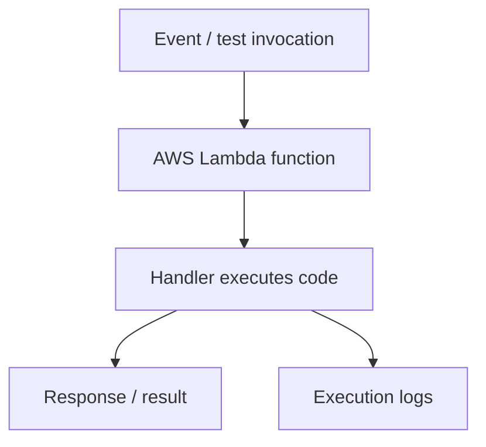
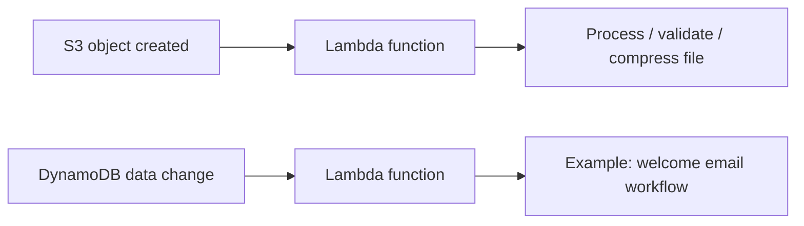
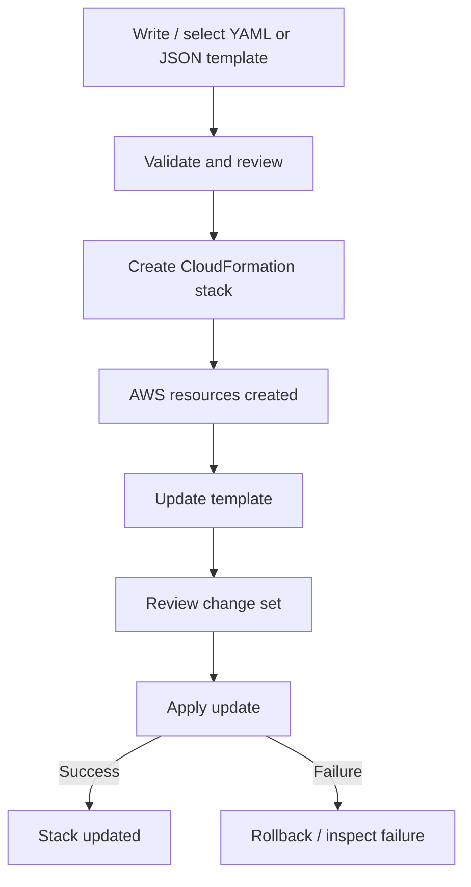

# AWS Zero to Hero — Part 6 (English)
## Chapters 17–18: AWS Lambda and AWS CloudFormation (IaC)

> **Source-preservation note:** Appendix A contains the original transcript for Chapters 17–18 in its original order, including timestamps and source wording. Study notes are organized for revision. Extra clarifications are separated at the end.

## Chapter 17 — AWS Lambda Function

### 1. What is AWS Lambda?
AWS Lambda is a serverless compute service. You upload function code, while AWS manages the underlying servers. Serverless does **not** mean that no servers exist; it means the customer does not manage the provisioning and infrastructure in the traditional way.

### 2. Core concepts

| Concept | Explanation |
|---|---|
| Function | A reusable block of code that executes when invoked |
| Runtime | The language/runtime environment in which the function executes |
| Handler | The entry point that processes a Lambda invocation |
| Event | Input/trigger data that can invoke the function |
| Invocation | A request to execute the function |
| Deployment | Publishing code/configuration changes to the deployed version |
| Trigger / event source | A configured service or event that invokes the function |
| Logs | Execution output/diagnostics, commonly available through CloudWatch Logs |

### 3. Basic Lambda workflow



The transcript demonstrates creating a function in the Lambda console, choosing a runtime, editing handler code, creating a test event, running the test, and inspecting output/logs.

### 4. Console practical — create and test a function
1. Open Lambda in the AWS Console.
2. Choose **Create function**.
3. Choose to author the function from scratch, or use a supported blueprint if appropriate.
4. Enter a function name, such as the transcript's `demo-function`.
5. Select a supported runtime. Do not treat the runtime version shown in the transcript as a current recommendation; verify the supported runtimes in the console.
6. Create the function and open the handler/code editor.
7. Update the code, then deploy the changes.
8. Use **Test** to create and save a test event.
9. Run the test and inspect the response and execution logs.
10. After changing the code, deploy and test again to confirm that the updated code executes.

### 5. Event-driven execution
In addition to manual tests, Lambda can be invoked in response to events. Examples in the transcript:
- **S3:** An object is uploaded to a bucket; a configured object-created event can trigger Lambda. The function could inspect, compress, or otherwise process the file.
- **DynamoDB:** A configured event integration can invoke a function when table data is added/changed; the example is sending a welcome email after user signup.
- **API Gateway / CloudWatch / other services:** The transcript mentions these as examples of services that can integrate with Lambda.



### 6. Connecting S3 as a Lambda trigger — transcript workflow
1. Create an S3 bucket or select an existing one.
2. In the Lambda function overview, choose **Add trigger**.
3. Select S3 as the trigger source.
4. Select the bucket.
5. Choose the event type—the transcript uses **All object create events** as an example.
6. Acknowledge/confirm and add the trigger.
7. Upload a test object to the S3 bucket.
8. Check Lambda executions and logs to confirm that the trigger invoked the function.

**Practical caution:** Consider recursion when configuring event filters. If Lambda writes an output file into the same bucket and that write triggers the function again, repeated invocations can occur. Separate input/output prefixes or buckets may help.

### 7. Understand Lambda benefits and limits accurately
- AWS handles server provisioning and much of the infrastructure management.
- A function can scale with demand, subject to Lambda quotas and configuration.
- Billing may depend on invocation count, execution duration, memory/architecture, and related usage factors.
- Do not interpret “no invocation means zero cost” as a universal statement; storage, logs, other AWS services, and configuration can incur separate charges.
- Lambda is not automatically the best fit for every long-running or stateful workload. Check execution duration, runtime support, concurrency, payload, and networking constraints.

### 8. Common gotchas / exam reminders
- **Serverless ≠ no servers.** AWS manages the servers.
- Creating a function and invoking a function are separate steps.
- Code edits may require deployment; undeployed changes may not produce the expected result in the deployed version.
- Trigger behaviour depends on the event source, bucket/table, event type, and permissions.
- Logs and the returned response are different; inspecting both is useful.
- In production, configure a least-privilege execution role and understand error/retry behaviour.

## Chapter 18 — AWS CloudFormation IaC

### 1. What is Infrastructure as Code (IaC)?
Infrastructure as Code means defining and managing infrastructure through code/templates rather than relying only on manual console steps. AWS CloudFormation can create, update, and delete AWS resources based on a template.

### 2. Declarative approach
The transcript describes CloudFormation as declarative:
- Declare the desired result.
- Specify resources and their properties in a template.
- CloudFormation performs resource operations to achieve the declared configuration.
- Templates can use JSON or YAML.

### 3. Core terminology

| Term | Meaning |
|---|---|
| Template | A JSON/YAML document describing AWS resources and properties |
| Resource | An AWS resource declared in the template, such as an EC2 instance |
| Stack | A group of resources managed by CloudFormation |
| Create stack | Apply a template to create resources |
| Update stack | Apply template/configuration changes |
| Change set | A way to review proposed changes before applying an update |
| Rollback | An attempt by CloudFormation to restore a previous known state after a failed operation |
| Infrastructure Composer | An interface for visualizing/editing resources and connections, as shown in the transcript |

### 4. CloudFormation workflow



### 5. Transcript practical — create an EC2 stack
1. Open CloudFormation in the AWS Console.
2. Choose **Create stack**.
3. Select a suitable route, such as an existing template, sample template, or available template-building option.
4. Upload a local YAML template. In the transcript, the template defines an EC2 instance and properties such as instance type, AMI ID, and name.
5. Use Infrastructure Composer visualization to inspect resources and their details where available.
6. Validate/review the template.
7. Give the stack a name, such as `demo-stack`.
8. Carefully review tags, IAM/capability acknowledgements, and other required settings.
9. Create/submit the stack and inspect its status/events.
10. In the stack's Resources section, verify the created EC2 instance's physical ID/status.

### 6. Stack updates and change preview
The transcript demonstrates updating an existing stack:
1. Select the existing stack.
2. Choose Update and use a modified/replacement template or visual editor.
3. Change a simple property in the template, such as the instance name.
4. Review the proposed change set.
5. Check whether the operation modifies the resource or requires replacement.
6. Submit the change and monitor stack status/events.
7. Verify the final state in the EC2 console.

**Important:** Resource replacement can be destructive. Review a change set before applying it, especially for production workloads.

### 7. Failure and rollback
The transcript shows a negative test case where an invalid template update fails and rollback status appears. Practical lessons:
- Investigate failed updates through stack events.
- Rollback attempts to restore the previous resource/configuration state, but should not be treated as a guarantee against every form of data loss.
- Correct the template before retrying.
- For production, use backups, resource policies, deletion protection where applicable, change review, and a deployment process.

### 8. CloudFormation benefits
- **Consistency:** Repeatable infrastructure can be deployed from the same template.
- **Automation:** Reduces manual console steps.
- **Versioning/review:** Templates can be maintained and reviewed in source control.
- **Repeatability:** Helps standardize development and test environments.
- **Lifecycle management:** Resources can be created, updated, and deleted through stacks.
- **Visibility:** Stack status/events and change sets help inspect operations.

### 9. Common gotchas / exam reminders
- The template describes desired resources; the stack manages those resources.
- YAML/JSON syntax and resource properties must be valid.
- AMI IDs, instance types, Region-specific properties, and permissions affect deployment.
- An update may modify or replace a resource; review the change set.
- Deleting a stack can delete its managed resources, depending on resource configuration and retention policies.
- Rollback is useful but is not a substitute for a backup/recovery strategy.
- Understanding resource drift and manually changed resources is important for operations.

## Lambda vs. CloudFormation — quick comparison

| Dimension | AWS Lambda | AWS CloudFormation |
|---|---|---|
| Primary purpose | Execute code/functions | Provision and manage infrastructure lifecycle |
| Main artifact | Function code + configuration | JSON/YAML template |
| Execution model | Invoked by events or requests | Template applied through stack operations |
| Transcript example | S3 object-created event triggers a function | Template creates an EC2 instance |
| Key focus | Handler, runtime, event, logs, permissions | Resources, stack, updates, change sets, rollback |

## Quick revision questions

| Question | Short answer |
|---|---|
| What is Lambda? | Serverless compute service for running functions |
| What does serverless mean here? | AWS manages the underlying servers/infrastructure |
| What is a Lambda handler? | Entry point that processes an invocation |
| What is an event trigger? | A configured event/request that invokes a function |
| What is the transcript's S3 example? | An object-created event triggers Lambda |
| What is IaC? | Defining/managing infrastructure through code |
| What is a CloudFormation template? | A JSON/YAML resource definition |
| What is a stack? | A group of resources managed by CloudFormation |
| Why review a change set? | To inspect proposed changes and possible replacements |
| What does rollback do? | Attempts to return a failed operation to a previous state |

## Board-Level Answer

**AWS Lambda** runs application code as functions without requiring customers to manage the underlying servers. Functions can be invoked by test events, service events, or supported request integrations; the handler processes the invocation and logs help diagnose execution. **AWS CloudFormation** is an Infrastructure as Code service that uses JSON/YAML templates to declare AWS resources and manages them through stacks. It supports repeatable create/update/delete workflows and change review. For safe production use, configure least-privilege IAM, monitor logs and failures, review resource replacements, and maintain appropriate backups and recovery plans.

## No-Skip Checklist

- [ ] Lambda serverless compute concept
- [ ] AWS manages underlying servers
- [ ] Function, runtime, handler, and test event
- [ ] Create function from scratch/blueprint
- [ ] Edit, deploy, and test code
- [ ] Response and logs
- [ ] Event-driven execution
- [ ] S3 object-created event example
- [ ] DynamoDB signup / welcome-email example
- [ ] API Gateway and CloudWatch mentioned as integrations
- [ ] S3 trigger setup and event type
- [ ] IaC definition and purpose
- [ ] CloudFormation declarative templates in JSON/YAML
- [ ] EC2 resource template practical
- [ ] Stack creation, review, and resource verification
- [ ] Infrastructure Composer visualization
- [ ] Stack update and change-set preview
- [ ] Modify vs. replacement
- [ ] Failed update and rollback example
- [ ] Create/update/delete lifecycle
- [ ] Original transcript preserved in Appendix A

## Additional Points Added (separate from original transcript)

1. Clarified that Lambda billing and “no cost when idle” depend on related services, configuration, and current pricing.
2. Added production considerations for least-privilege IAM, logs, retries, execution limits, and S3-trigger recursion.
3. Clarified that CloudFormation rollback is not a substitute for backups and that resource replacement can be destructive.
4. Added template version control, change-set review, drift, and safe lifecycle management reminders.
5. Runtime availability, console options, limits, and prices can change. This file does not claim live AWS documentation verification.

## Appendix A — Original Source — Preserved

The transcript for Chapters 17–18 is reproduced below in the original order and wording, including timestamps.

```text
Chapter 17: AWS Lambda Function
5:24:085 hours, 24 minutes, 8 secondsको क्लाउड में रन कर सकते हो काफी आसानी से ओके एक एग्जांपल से समझते हैं आप मान लो एक एप्लीकेशन बिल्ड कर रहे हो उसका एक छोटा सा सेक्शन ले लेते हैं मान लो एक
5:24:165 hours, 24 minutes, 16 secondsफंक्शनैलिटी के लिए एक आपने एक कोड लिखा इस कोड को रन करने के लिए आपको कोई तो सर्वर चाहिए राइट जैसे आप मान लो लैपटॉप पे भी रन कर रहे हो तो वो एक सर्वर हो गया
5:24:255 hours, 24 minutes, 25 secondsया तो आप क्लाउड पे कोई इंस्टेंस बनाते हो वो भी एक मशीन हो गई राइट जो कि ऑफकोर्स कॉस्ट भी करती है बट एडब लडा क्या करता है
5:24:335 hours, 24 minutes, 33 secondsआपको एक सर्विस प्रोवाइड करता है जिसके बाद आपको यह जो कोड है सिर्फ अपलोड करना है एंड वो बाकी सब संभाल लेगा एडब्ल्यू
5:24:415 hours, 24 minutes, 41 secondsएंड इसीलिए एए लडा को सर्वरलेस कंप्यूटिंग सर्विस भी बोलते हैं सर्वरलेस क्यों जैसे कि हम लोग ने लास्ट सेक्शन में भी देखा था
5:24:485 hours, 24 minutes, 48 secondsसर्वरलेस का मतलब सिंपल है कि जहां पे आपके जो सर्वर्स हैं वो एडब्ल्यू मैनेज करता है क्योंकि अ प्रैक्टिकली देखें तो
5:24:555 hours, 24 minutes, 55 secondsबिना सर्वर के ये चल ही नहीं सकता सर्वर तो है लेकिन एडब्ल्यू मैनेज कर रहा है दैट इज द ओनली थिंग इसके अलावा छोटी-छोटी चीजें कि आपको सिर्फ कोड अपलोड करना है
5:25:045 hours, 25 minutes, 4 secondsपहली चीज इसके बाद अगर उस स्केलिंग की जरूरत हो तो तो वो भी एडब्ल्यू एस करता है
5:25:105 hours, 25 minutes, 10 secondsइसके अलावा फंक्शन जितने बार यूज होगा आपको सिर्फ उसका ही चार्ज लगता है उसका ही पैसे देना है लेट्स से आपने फंक्शन बना तो
5:25:195 hours, 25 minutes, 19 secondsदिया फंक्शन यूज ही नहीं है सो देयर विल बी नो कॉस्ट सो मैं डायरेक्टली आ गया हूं अपने एडब्ल्यू एस कंसोल पे एंड सिंपली यहां पे सर्च करूंगा मैं लैडा यहां पे
5:25:275 hours, 25 minutes, 27 secondsलैडा सर्विस ओपन हो जाएगी एंड अभी यहां से हम लोग प्रैक्टिकल स्टार्ट करेंगे शुरुआत में मैंने बोला था कि आप अपने कोड को
5:25:355 hours, 25 minutes, 35 secondsअपलोड कर सकते हो बट कोड किसी प्रोग्रामिंग लैंग्वेज में होगा सो सपोर्टेड प्रोग्रामिंग लैंग्वेज यहां पे आप देख सकते हो नेट
5:26:045 hours, 26 minutes, 4 secondsjava4s डाटा ओके सो लाइक फ्री सो बहुत है ओके एंड अब हमारी लर्निंग और ट्रेनिंग के
5:26:125 hours, 26 minutes, 12 secondsहिसाब से काफी है एंड इसके बाद डायरेक्टली हम लोग चलते हैं क्रिएट अ फंक्शन अब जब यहां पे एक चीज यह नोटिस करते जाना है कि
5:26:205 hours, 26 minutes, 20 secondsजैसे कि प्रोग्रामिंग लैंग्वेज में फंक्शन क्या है एक ब्लॉक ऑफ कोड है जब आप उसको कॉल करोगे तभी उस मतलब उसके अंदर का कोड
5:26:275 hours, 26 minutes, 27 secondsरन होता है एंड इसी तरह से आप एडब्ल्यू लडा में भी फंक्शन बनाते हो ओके एंड फंक्शन के अंदर अपना कोड रन करते हो ठीक
5:26:355 hours, 26 minutes, 35 secondsहै क्रिएट फंक्शन करते हैं काफी अलग-अलग ऑ ऑप्शन है स्क्रैच से आपको करना है क्योंकि आपका कोड ऑलरेडी रेडी है या तो अ
5:26:435 hours, 26 minutes, 43 secondsब्लूप्रिंट आप यूज कर सकते हो कुछ कॉमन सिनेरियो के ब्लूप्रिंट या तो टेंप्लेट आपको यहां पे मिल जाएंगे हम लोग अभी स्क्रैच से करते हैं फंक्शन का नाम देना
5:26:515 hours, 26 minutes, 51 secondsहै मैं सिंपली यहां पे डेमो फंक्शन दे देता हूं एंड इसके बाद रन टाइम मतलब आपको
5:26:585 hours, 26 minutes, 58 secondsकिस में रन करना है तो मैं अभी के लिए python2 आप उसमें से कोई भी चूज कर सकते
5:27:065 hours, 27 minutes, 6 secondsहो मैं अभी पाइथन करता हूं एंड इसके बाद सिंपली हम लोग क्रिएट फंक्शन पे क्लिक करते हैं सो यहां पे हमारा डेमो फंक्शन
5:27:135 hours, 27 minutes, 13 secondsरेडी है मैं थोड़ा सा नीचे आता हूं यहां पे जो आप एक टेक्स्ट एडिटर देखोगे जो कोड एडिटर है वो इट इज वेरी सिमिलर टू वीएस
5:27:215 hours, 27 minutes, 21 secondsकोड आई थिंक वीएस कोड का ही एक्सटेंशन है एनीवे तो आपने वीएस कोड यूज़ किया है तो आपको सेम वही वही चीजें मिलने वाली है ओके
5:27:275 hours, 27 minutes, 27 secondsसो यहां पे आप अपना कोड लिखते हो एंड
5:27:375 hours, 27 minutes, 37 secondsदैट्ची जो फंक्शन है मतलब जो मेन फंक्शन है वो है लैडा हैंडलर एंड ऑफकोर्स ये एडब्ल्यू हैंडल करता है
5:27:555 hours, 27 minutes, 55 secondsदैट्ची है मैं टेस्ट पे क्लिक करता हूं इट विल आस्क यू फॉर इवेंट नॉर्मली आप प्रोग्रामिंग में क्या होता है जो फंक्शन
5:28:025 hours, 28 minutes, 2 secondsहोता है बना तो देते हो लेकिन फंक्शन कॉल जब तक नहीं करो तब तक वो रन नहीं होता है राइट तो इसी तरीके से ये फंक्शन तो है
5:28:105 hours, 28 minutes, 10 secondsआपका लेकिन ये रन कब होगा जब आप इसको कॉल करोगे या तो इवेंट जब इसको मतलब ट्रिगर करेगा अभी के लिए हम मैं टेस्ट करता हूं
5:28:185 hours, 28 minutes, 18 secondsसो यहां पे मैं सिंपली क्या है एक इवेंट को बना लेता हूं क्रिएट न्यू इवेंट टेस्ट पे आते हैं ये इवेंट का नाम है तो मैं सिंपल यहां पे डेमो इवेंट यहां पे नाम दे
5:28:275 hours, 28 minutes, 27 secondsदेता हूं प्राइवेट पे ही यह लिखा हुआ है एंड इसके बाद मैं सिंपली इसको सेव कर दूंगा ओके सो यहां पे हमारा इवेंट एक
5:28:345 hours, 28 minutes, 34 secondsजनरेट हो गया ठीक है मैं इसको कर देता हूं क्लोज अभी आप लेफ्ट साइड में भी देख सकते हो नीचे आपको एक इवेंट में डेमो इवेंट
5:28:415 hours, 28 minutes, 41 secondsयहां पे दिखेगा ओके अब मैं जैसे ही टेस्ट करता हूं सो यू विल सी कि ये देखो डेमो इवेंट यहां पे लिखा हुआ है और मैं जैसे ही
5:28:505 hours, 28 minutes, 50 secondsकरता हूं यू विल सी सम रिस्पांस इन आउटपुट ठीक है तो यहां पे या हेलो फ्रॉम द लैडा यहां पे प्रिंट हो गया मैं यहां पे सिंपल
5:28:585 hours, 28 minutes, 58 secondsचेंज भी कर सकता हूं यहां पे एम प्रशांत कर देता हूं कि जब भी आप यहां पे कुछ चेंजेज करते हो ओके जैसे कि हेलो फ्रॉम एम प्रशांत मतलब मैंने छोटा सा एक चेंज किया
5:29:065 hours, 29 minutes, 6 secondsसो उस चेंज के बाद आपको यहां पे डिप्लॉयड है यहां पे आप देखोगे यू हैव अन डिप्लॉयड चेंजेज तो आपको ये इट इज़ लाइक द सेम थिंग
5:29:135 hours, 29 minutes, 13 secondsठीक है तो आप सिंपल जब तक डिप्लॉयड में चेंज नहीं होगा यह देखो यह डिप्लॉयड अपडेट हो गया इसके बाद मैं
5:29:215 hours, 29 minutes, 21 secondsसिंपली अब टेस्ट करता हूं एंड डेमो इवेंट करता हूं एंड इसके बाद आउटपुट में आप देखोगे हेलो फ्रॉम एम प्रशांत यहां पे प्रिंट हो गया इस कोड में आप अपने हिसाब
5:29:305 hours, 29 minutes, 30 secondsसे चेंजेज भी कर सकते हो जैसे कि मान लो मैं एक एडिशनल लाइन यहां पे सिंपल एक प्रिंट स्टेटमेंट यहां पे यूज़ कर लेता हूं एंड यहां पे लेट्स से हेलो एंड यहां
5:29:385 hours, 29 minutes, 38 secondsपे मैं डिप्लॉयडी शल लाइन ऐड करिए है मैं सिंपल टेस्ट करके देखता हूं एंड लेट्स सी कि आपको क्या रिस्पांस मिलता है आप देख सकते
5:29:475 hours, 29 minutes, 47 secondsहो ये देखो ये आपका रिस्पांस आया वो तो जेसन के फॉर्मेट में था एंड इसके बाद फंक्शनल लॉग जो आपके रियल लॉग हैं तो फंक्शनल लॉग में आप देखोगे यहां पे हेलो
5:29:555 hours, 29 minutes, 55 secondsप्रिंट हो गया इसके बाद एक और लेवल अप करते हैं ये आपका मान लो यह कोड है जो कि आपके किसी काम का तो है किसी टास्क के लिए
5:30:025 hours, 30 minutes, 2 secondsहै अभी तो अभी हम लोग टेस्ट करके यहां पे रन कर रहे हैं लेकिन यह रियल लाइफ में में कैसे रन करेगा तो यह रन करता है इवेंट के
5:30:115 hours, 30 minutes, 11 secondsबेसिस पे इवेंट ड्रिवन एग्जीक्यूशन जिसको हम बोलते हैं इसका मतलब क्या हुआ एंड इसको रियल लाइफ से भी आपको मैं सिखाता हूं
5:30:195 hours, 30 minutes, 19 secondsसमझाता हूं जो भी आपका कोड है वोह रन होता है इन रिस्पांस ऑफ एन इवेंट जो कि आपके फंक्शन को ट्रिगर करता है ओके जैसे कि अब
5:30:285 hours, 30 minutes, 28 secondsएग्जांपल है अभी हम लोग देखो प्लेलिस्ट में चले आ रहे हैं काफी सारी सर्विसेस हम लोग ने देखी जैसे कि s3 सर्विस हो गई s3 सर्विस में या तो बकेट में आपने एक इमेज
5:30:375 hours, 30 minutes, 37 secondsअपलोड करी है ना इमेज अपलोड हुई तो वहां पे कुछ चेंजेज हुआ मतलब एक इवेंट हुआ वहां पे ओके सो वो इवेंट हुआ तो आप उस इवेंट को
5:30:475 hours, 30 minutes, 47 secondsयूज करके अपने फंक्शन को ट्रिगर करा सकते हो रन करा सकते हो अब आप सोचोगे कि यार इसका क्या फायदा है अब एक सिंपल सी चीज है
5:30:545 hours, 30 minutes, 54 secondsजो कोड है उस कोड में जो s3 में जो आपकी फाइल अपलोड हुई है उसको आप चेक कर सकते हो उसका बैकअप ले सकते हो उसका साइज रिड्यूस
5:31:035 hours, 31 minutes, 3 secondsकर सकते हो कंप्रेस कर सकते हो काफी सारे अलग-अलग टाइप के टास्क हो सकते हैं अब ये सिर्फ s3 क्या ही नहीं है इसके अलावा अगर
5:31:105 hours, 31 minutes, 10 secondsदेखोगे डायनेमो डीवी जिस पे भी अभी हम लोग ने लास्ट वीडियो बनाया था अब डायनेमो डीवी मतलब डेटाबेस है अब मान लो डेटाबेस में
5:31:185 hours, 31 minutes, 18 secondsमान लो एक यूजर है वो साइन अप कर रहा है और डायनेमो डीवी में उसकी डिटेल्स आ रही है अब डेटाबेस में जैसे ही कोई नई डिटेल
5:31:265 hours, 31 minutes, 26 secondsआई या तो ऐड हुई वो क्या हुआ एक इवेंट हुआ उस इवेंट से आप अपने फंक्शन को ट्रिगर करा सकते हो वो फंक्शन क्या कर सकता है भाई अ
5:31:355 hours, 31 minutes, 35 secondsआपका जो यूजर साइन अप कर रहा है उसको एक ईमेल भेज सकता है वेलकम ईमेल राइट सो आप समझो कि ये कैसे और कहां पे फिट बैठेगा
5:31:445 hours, 31 minutes, 44 secondsमतलब आपका जो लैडा सर्विस है वो कहां पे आप उसको यूटिलाइज कर सकते हो यह थोड़ा सा समझने की कोशिश करो एंड इसी के अलावा
5:31:515 hours, 31 minutes, 51 secondsअलग-अलग चीजें हैं जैसे कि एपीआई गेटवे क्लाउड वॉच एंड अलग-अलग चीजें ओके सो इवेंट समझ गए और कैसे वर्क करता है वो समझ
5:31:595 hours, 31 minutes, 59 secondsगए चलिए अब जैसे कि ये तो हमारा कोड हो गया रन करके देखा डिप्लॉयड काफी सारी चीजें देख ली अब आते हैं हम लोग सबसे ऊपर
5:32:065 hours, 32 minutes, 6 secondsजो कि फंक्शनल ओवर व्यू यह हमारा डेमो फंक्शन है अभी डेमो फंक्शन के लिए ऐड ट्रिगर मतलब किस इवेंट के बेसिस पे आपका
5:32:155 hours, 32 minutes, 15 secondsयह जो फंक्शन है वो चलना चाहिए सो अभी हम लोग लैडा फंक्शन में s3 बकेट को एज अ ट्रिगर यूज़ करेंगे इसलिए उससे पहले आपके
5:32:225 hours, 32 minutes, 22 secondsपास s3 बकेट होना चाहिए इफ इन केस आपके पास नहीं है तो सिंपली यहां पे सर्च करो s3 यहां पे क्लिक कर लो एंड वेरी सिंपल
5:32:315 hours, 32 minutes, 31 secondsयहां पे क्रिएट बकेट कर दो ओके दैट्ची नेम देना है और आज का डेट डाल देना
5:32:385 hours, 32 minutes, 38 secondsतो वो यूनिक हो जाएगा एनीवे और यहां पे सिंपली बाकी सब चीजें डिफॉल्ट रखना है ओके एंड यहां पे आपको क्रिएट बकेट कर देना है
5:32:465 hours, 32 minutes, 46 secondsसो यहां पे आपको इस तरह से एक बकेट मिल जाएगी और आप देखोगे जैसे कि मैंने डेट यहां पे ऐड की है डेट ऐड कर देना
5:32:585 hours, 32 minutes, 58 secondsदैट्ची है आईओटी वॉइस अब वॉइस के बेसिस पे कोई इवेंट होता है एंड ऑल सो उसके बेसिस पे आपको कोई एक्शन परफॉर्म करना हो एंड
5:33:065 hours, 33 minutes, 6 secondsकाफी सारे ऑप्शन है एक्शन अ एपीआई गेटवे एंड ऑल काफी तो है बट हम लोग सबसे सिंपल पे जाते हैं जो कि हमारा s3 क्योंकि हम लोग ने उस परे काम किया हुआ
5:33:155 hours, 33 minutes, 15 secondsहै और ऐड करते हैं ठीक है कि भाई s3 है लेकिन कौन सा बकेट आपके पास बकेट भी तो होना चाहिए ठीक है तो यहां पे मेरे पास एक
5:33:225 hours, 33 minutes, 22 secondsऑलरेडी बकेट बना हुआ है बकेट बनाना काफी आसान है आप जल्दी से बना सकते हो ठीक है बकेट को मैंने क्लिक कर सेलेक्ट कर लिया
5:33:305 hours, 33 minutes, 30 secondsइवेंट टाइप यहां ये भी एक ऑप्शन है इवेंट टाइप में मतलब क्या होता है अब जैसे कि देखोगे ऑल ऑब्जेक्ट क्रिएट इवेंट मतलब कुछ
5:33:385 hours, 33 minutes, 38 secondsभी चेंज होता है तो वो एक इवेंट कंसीडर होगा लेकिन आप चाहते हो कि लेट्स से यहां पर देखो अलग-अलग ऑप्शन है जैसे पुट है
5:33:445 hours, 33 minutes, 44 secondsपोस्ट है ठीक है सो इस टाइप के अलग-अलग जो भी ऑपरेशन हो रहा है उसके बेसिस पर आप अपना ट्रिगर करा सकते हो सो मैं अभी ऑल
5:33:535 hours, 33 minutes, 53 secondsऑब्जेक्ट क्रिएट इवेंट ही कर देता हूं एंड इसके बाद आई एक नॉलेज प मैं क्लिक करता हूं एंड ऐड कर देता हूं वेरी सिंपल आपका
5:34:015 hours, 34 minutes, 1 secondफ्लो मतलब काइंड ऑफ कंप्लीट हो गया है ओके फ्लो क्या है s3 बकेट में अगर कुछ चेंज
5:34:085 hours, 34 minutes, 8 secondsहुआ ओके सो वो आपके डेमो फंक्शन को ट्रिगर करेगा इसको टेस्ट करके देखें ठीक है क्योंकि देखो ये आपका फंक्शन नीचे आप
5:34:175 hours, 34 minutes, 17 secondsदेखोगे कोड में जाके तो आपका ये जो फंक्शन है वो तो रेडी है ठीक है आपका फ्लो भी रेडी है अब चलते हैं s3 में बकेट में ओके
5:34:275 hours, 34 minutes, 27 secondsये देखो ये माय बकेट है इमेज को अपलोड कर देता हूं या तो कोई फाइल अपलोड कर देता हूं सिंपल अपलोड एंड ऐड फाइल्स सो यहां पे
5:34:345 hours, 34 minutes, 34 secondsमैंने एक ये इमेज है इसको मैं अपलोड मतलब सेलेक्ट कर लेता हूं एंड इसको अपलोड करता हूं s3 बकेट में एक इमेज मैंने अपलोड करी
5:34:425 hours, 34 minutes, 42 secondsमतलब एक कुछ इवेंट हुआ एंड इसके बाद हम लोग चलते हैं डेमो फंक्शन में अब पता कैसे चलेगा भाई वो रन हुआ या नहीं हुआ इसी के लिए हमारे पास होते हैं लॉक्स एंड इसके
5:34:515 hours, 34 minutes, 51 secondsबाद अब आप देखोगे भैया यहां पे मॉनिटरिंग का भी एक सेक्शन है चलो मॉनिटरिंग पे चलते हैं अभी देखते हैं यहां पे क्या हुआ सो
5:34:595 hours, 34 minutes, 59 secondsयहां पे आप देखोगे कुछ तो एक्टिविटी हुई है ना जी अब यहां पे अ आप चेंज भी कर सकते हो कि कस्टम जैसे कि मिनट है लेट्स से मैं
5:35:065 hours, 35 minutes, 6 seconds5 मिनट पहले की बात करता हूं क्योंकि अभी पांच ही मिनट भी नहीं हुए हैं सो आप देखोगे यहां पे कोई इवेंट दिखाई नहीं दे रहा क्योंकि मॉनिटरिंग में थोड़ा टाइम
5:35:145 hours, 35 minutes, 14 secondsलगता है अब मैं रिफ्रेश करता हूं सो आप बोलोगे भाई इतना टाइम लग रहा है तो क्या ही मतलब ओके यह आपके फंक्शन का भाई इतना
5:35:225 hours, 35 minutes, 22 secondsडिले कर रहा है ऐसी बात नहीं है जैसे मॉनिटरिंग में डिले कर रहा है ओके लेकिन आप उतने टाइम में यह व्यू क्लाउड वॉच
5:35:295 hours, 35 minutes, 29 secondsलॉक्स में क्लिक कर लो तो आपको जो रियल लॉगस है वो दिख जाएंगे ओके तो देखो मैंने क्लाउड वॉच मैंने ओपन कर लिया है आप
5:35:385 hours, 35 minutes, 38 secondsदेखोगे एडब लैडा डेमो फंक्शन जो आपका फंक्शन है वही उसी के लिए है ओके एंड यहां पे लॉग स्ट्रीम्स में आप देखोगे ये देखो ये लेटेस्ट आपका ये ऐसे फाइल जैसी बन
5:35:475 hours, 35 minutes, 47 secondsजाएगी इसको आप ओपन करोगे सो यहां पे लॉगस में आप क्लीयरली देख सकते हो यहां पे हेलो जो हम लोग ने एक लाइन प्रिंट करी थी वो यहां पे प्रिंट हो गई एंड यहां पे सिर्फ
5:35:555 hours, 35 minutes, 55 secondsफंक्शनल जो लाइन है या तो लॉक्स है वो प्रिंट होंगे तो इसीलिए सिर्फ हेलो आया है अब आप सोचोगे कि यार ये पुराना भी हो सकता है ठीक है मैं इसको ना ऐसे ही छोड़ रहा
5:36:035 hours, 36 minutes, 3 secondsहूं मैं सिंपली यहां पे यहां पे s3 बकेट में जाता हूं और एक और फाइल अपलोड करता हूं मैं सिंपली एक और फाइल यहां पे अपलोड
5:36:105 hours, 36 minutes, 10 secondsकरता हूं ओके यहां पे फाइल अपलोड हुई मैं क्लाउड वॉच में जाता हूं अभी एक ही हेलो है मैं सिंपल रिफ्रेश करता हूं एंड यू विल
5:36:175 hours, 36 minutes, 17 secondsसी ये देखो एक और हेलो आ गया सो जितने बार आप कुछ भी फाइल अपलोड करोगे तो वो यहां पे ट्रिगर होते जाएगा चलिए लॉक्स कैसे देखना
5:36:265 hours, 36 minutes, 26 secondsहै वो तो हम लोग ने देख लिया फिर से डेमो फंक्शन पे चलते हैं अपने एंड आपको वो चीज दिखा देता हूं मॉनिटरिंग पे क्योंकि अभी तक अपलोड हो गया होगा वो थोड़ा सा टाइम
5:36:335 hours, 36 minutes, 33 secondsलगता है सो मैं यहां पे कस्टम में 30 मिनट करके देखता हूं एंड ओके सी हेयर यू गो सो यहां पे आप देखोगे यहां पे आपको इवेंट इस
5:36:415 hours, 36 minutes, 41 secondsतरह से दिखाई दे रहा है ठीक है एंड यहां पे कितने मिली सेकंड का यहां पे ड्यूरेशन था मतलब कितने देर तक हुआ है एंड यहां पे
5:36:495 hours, 36 minutes, 49 secondsकोई एरर तो नहीं है सो मतलब जो भी आपके फंक्शंस के रिलेटेड एक्टिविटी है वो यहां पे आपको दिख जाएगी लॉक्स में आप ज्यादा इंफॉर्मेशन आप देख सकते हो एंड इसी के अगर
5:36:575 hours, 36 minutes, 57 secondsआप नीचे आते हो सो यहां पे आपको क्लाउड वच लॉक्स देखो यहां से डायरेक्टली एक्सेस कर सकते हो लद वो वहीं पे आपको ले जाएगा ठीक है चलिए लैडा फंक्शन की बेसिक फंक्शनैलिटी
5:37:065 hours, 37 minutes, 6 secondsदेख ली इसके रिलेटेड रिलेटेड कुछ छोटे-छोटे माइनर पॉइंट्स आपको यहां पे मैं आपको कवर कर देता हूं जैसे कि देखो जब आपने s3 यहां पे एज अ ट्रिगर पॉइंट ऐड
5:37:155 hours, 37 minutes, 15 secondsकिया फॉर द फंक्शन यह होता कैसे है नोटिफिकेशन के बेसिस पे अब मैं जैसे कि यहां पे देखोगे मैं बकेट्स में फिर से जाता हूं यहां पे माय बकेट मैं इसको ओपन
5:37:225 hours, 37 minutes, 22 secondsकरता हूं प्रॉपर्टीज में जाता हूं एंड मैं थोड़ा सा नीचे आके मैं आपको दिखा देता हूं कि आपको यहां पे ये चीज दिखाई देगी इवेंट
5:37:305 hours, 37 minutes, 30 secondsनोटिफिकेशन के अंदर यू विल सी कि यहां पे एक ऑलरेडी डेड है देखो ऑल ऑब्जेक्ट क्रिएट इवेंट कि किस ये क्या करेगा वो चीज भी है
5:37:385 hours, 37 minutes, 38 secondsतो ये इवेंट किसको ट्रिगर कर देगा लैडा फंक्शन जो कि है हमारा डेमो फंक्शन जैसे ही हम लोग ने इसको पॉइंट किया तो यह ऑटोमेटिक ऐड हो गया बिहाइंड द सीन एंड अगर
5:37:485 hours, 37 minutes, 48 secondsहम अपने डेमो फंक्शन के कॉन्फ़िगरेशन में जाते हैं सो आपको काफी सारी चीजें यहां पे देखने को मिलेंगी जैसे कि अभी ट्रिगर पॉइंट क्या है हमारा s3 बकेट है कौन सा
5:37:565 hours, 37 minutes, 56 secondsबकेट है एंड इसके बारे में जो इंफॉर्मेशन है वो मिल जाएगी परमिशन पे जाते हो आप देखोगे कि एक s3 जो सर्विस है और लैडा
5:38:035 hours, 38 minutes, 3 secondsसर्विस है वो अलग-अलग सर्विस है कि मान लो s3 में जो जो फाइल अपलोड है ओके उसमें चेंजेज करके आपको फिर से s3 में अपलोड
5:38:115 hours, 38 minutes, 11 secondsकरना है तो आप यहां पे क्या कर रहे हो अपने कोड से किसी सर्विस में आप चेंजेज कर रहे हो राइट सो क्या ये सर्विस ऑटोमेटिक
5:38:195 hours, 38 minutes, 19 secondsकर पाएगी नहीं आपको वहां पे परमिश देनी पड़ेंगी तभी तो हो पाएगा राइट स उसके लिए मैं मैं इसलिए थोड़ी-थोड़ी बेसिक कवर कर
5:38:275 hours, 38 minutes, 27 secondsरहा हूं क्योंकि अगर आप एडवांस लेवल पे जाते हो खुद से कुछ कर रहे हो तो आपको ये चीजें दिमाग में रहेंगी ओके सोब सिंपल जैसे कि आप देखोगे रोल जैसे हम लोग आईएम
5:38:355 hours, 38 minutes, 35 secondsवाले सेक्शन में देखा था रोल्स हम लोग असाइन कर सकते हैं अब यहां पे डेमो फंक्शन रोल यहां पे ऑलरेडी है ओके नाउ अगर मैं
5:38:425 hours, 38 minutes, 42 secondsइसको मतलब एक ओपन करता हूं ओके एंड इसमें देखते हैं कि इसको क्या-क्या परमिश है सो आप देखोगे कि यहां पे बेसिक लैडा
5:38:505 hours, 38 minutes, 50 secondsएग्जीक्यूशन रोल है ओके मान लो कि इस कोड को अगर कुछ चेंजेज करने हैं लेट्स से डायनेमो डीबी में एंड ऑल सो आप सिंपल ऐड परमिशन यहां पे कर सकते हो अटैच पॉलिसी या
5:38:585 hours, 38 minutes, 58 secondsतो आप क्रिएट अपनी पॉलिसी बना सकते हो अब जैसे कि मान लो मैं बोलता हूं s3 ओके सो यहां पे amazon's 3 फुल एक्सेस
5:39:065 hours, 39 minutes, 6 secondsओके ट्स इट मैं मान लो ऐड परमिश कर देता हूं सो यू विल सी कि ये जो डेमो फंक्शन रोल है जो कि हमारे लैडा फंक्शन में अटैच
5:39:155 hours, 39 minutes, 15 secondsहै इसके पास अब क्या है s3 सर्विस की फुल एक्सेस है तो अब वो उसमें कुछ चेंजेज कर पाएगा हम फिर से चलते हैं कॉन्फिन परमिशन
5:39:245 hours, 39 minutes, 24 secondsपे एंड य हेयर यू विल सी रिसोर्स बेस्ड पॉलिसी स्टेटमेंट ओके यहां पे एक ऑलरेडी पॉलिसी अटैच है मैं इसको क्लिक करता हूं
5:39:325 hours, 39 minutes, 32 secondsओपन करता हूं सो यू विल सी एक छोटी सी चीज क्या इस लैडा फंक्शन पर के ऊपर ओके ये जो
5:39:395 hours, 39 minutes, 39 secondss3 है सर्विस हां वो क्या कर सकती है इफेक्ट क्या है अलाउ मतलब और ये क्या है लैडा इवोक फंक्शन सो मींस s3 जो सर्विस है
5:39:495 hours, 39 minutes, 49 secondsवो इस लैडा फंक्शन को ट्रिगर कर सकती है ऑफकोर्स वो चीज हम लोग ने जब ट्रिगर करी तो वो ऑटोमेटिक अटैच हो गई बट यहां से आप
5:39:565 hours, 39 minutes, 56 secondsइसको समझ सकते हो और एडिट कर सकते हो अगर आपको कुछ और चेंजेज करने हो इसमें तो ओके सो इस पॉइंट तक हम लोग ने लैडा फंक्शन की बेसिक फंक्शनैलिटी देख ली एक ओवरव्यू देख
5:40:055 hours, 40 minutes, 5 secondsलिया ठीक है प्रैक्टिस भी करके देख ली अब एक बहुत इंपॉर्टेंट क्वेश्चन आ सकता है आपके माइंड में नहीं आ रहा तो मैं बता देता हूं कि भाई इसकी क्या मतलब क्या
5:40:135 hours, 40 minutes, 13 secondsलिमिट्स हैं मतलब देखो अभी यहां पे छोटा सा कोड है क्या मैं एक पूरे की पूरी एक वेबसाइट यहां पे कोड कर सकता हूं क्या मैं
5:40:215 hours, 40 minutes, 21 secondsयहां पे ठीक है डिप्लॉयड कर सकता हूं ऑफकोर्स नॉट क्योंकि आपने यह देखो ये फंक्शन काम कैसे करता है
5:40:295 hours, 40 minutes, 29 secondsवो चीज देख ली ये इवेंट ड्रिवन है मतलब ये ऑकेजनल ही काम करेगा ये ऑल टाइम नहीं चलता है चलो इसी के थोड़ा और आगे आते हैं और
5:40:385 hours, 40 minutes, 38 secondsबात करते हैं एए लैड की लिमिटेशंस पे एंड इसके बाद बेनिफिट्स के बारे में बात करेंगे सबसे पहले तो है भाई इसका
5:40:445 hours, 40 minutes, 44 secondsएग्जीक्यूशन टाइम अब जैसे कि मान लो अगर आप सोच रहे हो कि भाई मैं एक वेबसाइट को डिप्लॉयड सो वेबसाइट आपकी भाई 247 रनिंग
5:40:525 hours, 40 minutes, 52 secondsहोनी चाहिए लेकिन एग्जीक्यूशन टाइम जो आपका लैडा का होता है वो 15 मिनट्स होता है यार ज्यादा से ज्यादा 15 मिनट्स चल सकता है तो इसका मतलब क्या हुआ जो शॉर्ट
5:41:015 hours, 41 minutes, 1 secondटास्क होते हैं आपके मतलब जो छोटे से टास्क हैं जो मतलब यू नो किया और हो गया दैट्ची वो उसके लिए परफेक्ट है दूसरी चीज
5:41:095 hours, 41 minutes, 9 secondsसर्वरलेस है ऑटो स्केलिंग हो जाती है ओके एंड सो ऑन अब जैसे कि यहां पे 15 मिनट्स है तो भाई छोटे टास्क के लिए ये राइट चॉइस
5:41:195 hours, 41 minutes, 19 secondsहै स्टेट लेस है स्टेट लेस अ भी एक लिमिटेशंस है क्योंकि यह पुरानी चीजों को याद नहीं रखता है तो मतलब उस चीजों से
5:41:275 hours, 41 minutes, 27 secondsरिलेटेड है तो यह फिर से चालू हो जाएगा सो दैट इज आल्सो काइंड ऑफ अ लिमिटेशन सो आपके टास्क कि अगर इस टाइप की रिक्वायरमेंट है कि भाई आपको लॉन्ग टर्म मेमोरी मतलब आपको
5:41:365 hours, 41 minutes, 36 secondsवो चीजें याद रखनी है उसके बेसिस पे कुछ करना है सो अगेन इट इज नॉट सूटेबल फॉर दैट एंड कोल्ड स्टार्ट डिले सो जब भी हम लैडा
5:41:445 hours, 41 minutes, 44 secondsकी बात करते हैं तो ये चीज जरूर होती है कि क्या है देखो मान लो जो आपका फंक्शन है बहुत टाइम से चला ही नहीं है कुछ ट्रगर ही नहीं हुआ कुछ इवेंट ही जनरेट नहीं हुआ एंड
5:41:525 hours, 41 minutes, 52 secondsबहुत टाइम के बाद लेट्स से कोई एक इवेंट आता है सो उसको कोल्ड स्टार्ट होने में टाइम लगता है इट्स सिमिलर टू कि ज कि आपके
5:41:595 hours, 41 minutes, 59 secondsघर में गाड़ी बहुत टाइम से खड़ी हुई है तो आप जब स्टार्ट करते हो तो व थोड़ा सा टाइम लगता है सो ये एक इसकी लिमिटेशन हो जाती
5:42:075 hours, 42 minutes, 7 secondsहै चलिए बात करते हैं व्हेन टू यूज लैडा कि लैडा की लिमिटेशंस तो है बट इसको यूज़ कहां करना है और कहां कर सकते हैं सो है
5:42:155 hours, 42 minutes, 15 secondsजैसे कि ये दो-तीन एग्जांपल्स है इमेज प्रोसेसिंग में आप कर सकते हो जैसे कि मान लो एक वेबसाइट है आपकी ओके एंड जो आपके यूजर्स हैं वो इमेज को अपलोड करते हैं लेट
5:42:235 hours, 42 minutes, 23 secondsसे s3 में तो उस इमेज के साथ क्या करना है वो चीज आप काफी आसानी से इसमें कर सकते हो जैसे कि आप लैडा को यूज करके अ साइज
5:42:325 hours, 42 minutes, 32 secondsरिसाइट कर सकते हो कंप्रेस कर सकते हो इवन फिल्टर्स अप्लाई कर सकते हो एंड सो ऑन एंड रिकॉग्नाइजेस भी यूज कर सकते हो अलग
5:42:395 hours, 42 minutes, 39 secondsसर्विस कि भाई वो वैलिड है कि नहीं मान लो एक यूजर ने गधे की फोटो लाइक अपलोड कर दी है सो दैट इज नॉट अ रियल प्रोफाइल पिक्चर
5:42:495 hours, 42 minutes, 49 secondsसो उन चीजों को रिकॉग्नाइज करने के लिए डेटा ट्रांसफॉर्मेशन अब जैसे कि मान लो आपको डेटा प्रोसेसिंग करनी है जैसे कि
5:42:575 hours, 42 minutes, 57 secondsआपकी एप्लीकेशन से डटा आपके डेटाबेस में जा रहा है ओके एंड उसको मतलब वो जो डाटा जा रहा है अब क्या है लेट्स से यूजर ने तो
5:43:065 hours, 43 minutes, 6 secondsभाई डेटा इनपुट कर दिया उस डाटा में आपको प्रोसेसिंग करनी है कुछ क्लीन अप करना है कि मतलब जो काम का कोड हो वही स्टोर हो वो
5:43:135 hours, 43 minutes, 13 secondsचीज आप कर सकते हो इसके साथ रियल टाइम नोटिफिकेशन जैसे कि मैंने बताया था फर्स्ट टाइम अगर यूजर मान लो साइन अप कर रहा है
5:43:205 hours, 43 minutes, 20 secondsउसको एक ईमेल भेजना है तो ट्रिगर अब ये क्योंकि ये ट्रिगर है बेस है है ना इवन ड्रिवन है तो मतलब क्या है जैसे ही भाई
5:43:285 hours, 43 minutes, 28 secondsकोई यूजर साइन अप करेगा ये तुरंत ट्रिगर होगा और उसको एक ईमेल भेज देगा ठीक है तो इस तरह से काफी सारी जगहों पर जहां पे ये
5:43:355 hours, 43 minutes, 35 secondsस्मॉल टास्क है वहां पे आप इसका यूटिलाइज कर सकते हो इसके बाद थोड़े से फीचर्स के बारे में बात कर लेते हैं लड की तो एक हो गया इवेंट ड्रिवन जो हम लोग ने अच्छे से
5:43:445 hours, 43 minutes, 44 secondsप्रैक्टिकली समझ लिया सो बात करते हैं कि ऑटोमेटिक स्केलिंग कैसे काम करती है लैडा फंक्शन में और यह हमारे लिए कैसे बेनिफिशियल है एक रियल लाइफ यूज़ केस आपको
5:43:525 hours, 43 minutes, 52 secondsबताता हूं आपकी वेबसाइट है जहां पे यूजर साइन अप कर सकता है और हम लोगों ने बोला कि लैडा फंक्शन बनाया जो जैसे ही साइन अप
5:44:015 hours, 44 minutes, 1 secondहोता है एक वेलकम ईमेल भेजता है यूजर को मान लो 100 यूजर ने एक साथ एक ही समय पे साइन अप कर दिया अब लैडा किसको सर्व करेगा
5:44:095 hours, 44 minutes, 9 secondsराइट क्योंकि 100 यूजर एक साथ आ गए सो दिस इज द बेस्ट थिंग अबाउट इट कि ये ऑटो स्केल करता है बिहाइंड द सीन हॉरिजॉन्टल स्केल
5:44:165 hours, 44 minutes, 16 secondsकरता है मतलब कि 100 फंक्शन बन जाएंगे आप इमेजिन करो 100 फंक्शन बन गए और 100 के 100 पैरेलली वर्क कर रहे हैं तो होगा क्या
5:44:265 hours, 44 minutes, 26 secondsकि किसी को डिले का सामना नहीं करना पड़ेगा एंड इसके बाद पे एज यू गो फीचर जो कि हमको पता है भाई कि जितने बार फंक्शन कॉल होगा ओके सो उसके बेसिस पे भाई चार्ज
5:44:355 hours, 44 minutes, 35 secondsहोता है एक यहां पे फ्लो भी भी है स्लाइड में आपको मिल जाएगा अगर आपको ठीक है इन फ्यूचर आपको रेफर रेफर करना हो वो भी यही ठीक है इसके बाद लास्ट में मैं एक चीज और
5:44:435 hours, 44 minutes, 43 secondsकवर करा देता हूं एक नेगेटिव केस और एक और पॉजिटिव केस एक्चुअली ये जो कोड है ओके सो यहां पे ये ऑलरेडी जनरेट है लेकिन देयर इज
5:44:515 hours, 44 minutes, 51 secondsवन मोर थिंग कि देखो मोस्टली जो डेवलपर्स हो ग होते हैं वो भाई लैपटॉप पे जैसे अपने एडिटर पे जहां भी उनको कंफर्टेबल है वहां पे वो कोड करके रख लेते हैं लेट्स से कि
5:45:005 hours, 45 minutesआपके पास ऑलरेडी कोड है कोड कोड आपके पास ऑलरेडी रेडी टू यूज है आप क्या कर सकते हो यहां पे कोड को आपको टाइप करने की जरूरत
5:45:095 hours, 45 minutes, 9 secondsनहीं है अपलोड फ्रॉम z फाइल जो एक z फाइल के थ्रू आप कर सकते हो ठीक है तो मैं आपको एक एग्जांपल भी बता देता हूं जैसे कि य
5:45:165 hours, 45 minutes, 16 secondsमैंने सिंपली अपलोड किया एंड यहां पे मैंने एक सिंपल सा वो जो पाइथन बेस्ड कोड है वो यहां पे मैंने जिप करके रखा है तो मैं इसको अपलोड करता हूं एंड आपको दिखाता
5:45:235 hours, 45 minutes, 23 secondsहूं कि हाउ इट्स सी मतलब ये कैसे दिखता है एंड कैसे वर्क करता है अब आप देखोगे सक्सेसफुली अपलोडेड हो गया यहां पर कोई
5:45:305 hours, 45 minutes, 30 secondsरिफ्रेश का बटन तो दिख नहीं रहा मुझे मैं सिंपली टेस्ट प जाके कोड प जाता हूं फिर से एंड सी सो हेयर यू गो सी देखोगे आप कितना सारा
5:45:395 hours, 45 minutes, 39 secondsजो कोड है वो आ गया इसके रिलेटेड जो डिपेंडेंसीज है जैसे कि यहां पे इंपोर्ट देखोगे यहां पे दूसरे मॉड्यूस मैं डिफरेंट मॉड्यूस यूज़ कर रहा हूं जो मे बी बाय
5:45:485 hours, 45 minutes, 48 secondsडिफॉल्ट अवेलेबल ना हो एडब्ल्यू के पास ओके सो ये देखोगे तो वो चीजें भी वो मॉड्यूस भी मैं लेके आ गया हूं ओके सो ये
5:45:575 hours, 45 minutes, 57 secondsहमारा काम आसान करता है ऑल राइट सो दिस इज ऑल अबाउट a ws3 ही हम लोग ने यूज़ किया तो सिंपली मैं
5:46:055 hours, 46 minutes, 5 secondss3 को यहां पे एमटी कर देता हूं पहले तो एमटी करना पड़ेगा एंड उसके बाद आप डिलीट कर देना सो पहले मैंने एमटी कर लिया है मैं इसको एग्जिट करता हूं एंड फिर से इसको
5:46:145 hours, 46 minutes, 14 secondsक्लिक करके सिंपली इसको डिलीट कर देते हैं एंड यहां पे हमें बकेट का नाम देना है तो मैं यहां पे कॉपी पेस्ट कर लेता हूं सिंपल
5:46:215 hours, 46 minutes, 21 secondsएंड डिलीट बकेट सो दैट्ची चलिए इस सेक्शन में हम लोग एड क्लाउड
Chapter 18: AWS CloudFormation IAC
5:46:285 hours, 46 minutes, 28 secondsफॉर्मेशन के बारे में बात करेंगे जो कि एक आईएसी सर्विस है फॉर एए इंफ्रास्ट्रक्चर एज कोड मीनिंग आप कोड की मदद से अपने
5:46:375 hours, 46 minutes, 37 secondsएडब्ल्यू रिसोर्सेस को बना सकते हो मैनेज कर सकते हो अभी तक हम लोग क्या प्रोसेस फॉलो कर रहे थे कि एड्यू कंसोल पे जाएंगे मैनुअली सब कुछ कर रहे थे जैसे कि लेट्स
5:46:455 hours, 46 minutes, 45 secondsसे ईटू इंस्टेंस बनाना है ईटू इंस्टेंस पे क्लिक किया फिर उसके बाद हम लोग सारी डिटेल्स प्रोवाइड कर रहे हैं इमेज कौन सी यूज़ करनी है नाम प्रोवाइड कर रहे हैं फिर
5:46:545 hours, 46 minutes, 54 secondsउसके बाद इंस्टेंस टाइप स्टोरेज एंड सो मेनी थिंग्स राइट एंड इसमें अगर मान लो सिक्योरिटी ग्रुप में चेंजेज करने हैं तो
5:47:005 hours, 47 minutesकाफी सारा मैनुअल वर्क था बट अगर हमको सेम काम ऑटोमेट करना हो समथिंग तो वो कोड की मदद से ज्यादा यूज़फुल है एंड क्लाउड
5:47:095 hours, 47 minutes, 9 secondsफॉर्मेशन इसी में हमारी हेल्प करता है एंड इसके लिए हम लोग एक फाइल बनाते हैं जिसको हम टेंप्लेट बोलते हैं इसमें जो कोड रहेगा
5:47:165 hours, 47 minutes, 16 secondsहमारा वह या तो जेसन या तोमल फॉर्मेट में होगा एंड एक डिक्लेरेटर अप्रोच यह फॉलो करता है एक एग्जांपल मैं आपको दिखा देता
5:47:235 hours, 47 minutes, 23 secondsहूं सिंपल सामल फॉर्मेट में एक कोड है इस कोड से हम ईजी टू इंस्टेंस क्रिएट कर सकते हैं अगर आप कोड का फॉर्मेट या तो
5:47:315 hours, 47 minutes, 31 secondsस्ट्रक्चर देखोगे इट्स कॉल्ड डिक्लेरेटर मींस आप सिर्फ अपनी डिजायर्ड रिजल्ट बताते हो जैसे कि इस कोड को देखें तो मैंने बोला
5:47:385 hours, 47 minutes, 38 secondsपहले कि भाई मुझे रिसोर्सेस बनाना है ओके मैंने एक रेफरेंस नाम दे दिया अब रिसोर्सेस किस टाइप का रिसोर्स बनाना है मैंने बोला e2 इंस्टेंस बनाना है ओके अब
5:47:475 hours, 47 minutes, 47 secondsस2 इंस्टेंस में क्या आपको चीजें ऐड करनी है तो मैंने बोला प्रॉपर्टीज में कि भाई t3 माइक्रो अ इ इंस्टेंस टाइप एंड इमेज
5:47:555 hours, 47 minutes, 55 secondsआईडी मैंने ये और इसका एक नाम भी दे दिया सिंपल सा ओके सो मैंने सिर्फ उसको यह बताया कि मैं क्या चाहता हूं दैट्ची
5:48:075 hours, 48 minutes, 7 secondsचलिए प्रैक्टिकल करके देखते हैं एंड इसके बाद में थोड़ा सा और डिस्कशन करेंगे कि इसके क्या बेनिफिट्स हैं सिंपली एडब्ल्यू
5:48:145 hours, 48 minutes, 14 secondsकंसोल में आ गए हैं सर्च पे मैं जाता हूं क्लाउड फॉर्मेशन पे जल चलते हैं के बाद हम लोग एक
5:48:205 hours, 48 minutes, 20 secondsस्टैक बनाते हैं तो यह थोड़े से जो टर्म्स है आप याद रखना ओके क्रिएट स्टैक करते हैं इसमें आपके पास अलग-अलग ऑप्शंस है जैसे कि
5:48:295 hours, 48 minutes, 29 secondsचूज एन एक्जिस्टिंग टेंप्लेट सैंपल टेंप्लेट और बिल्ड फ्रॉम इंफ्रास्ट्रक्चर कंपोजर तो अलग-अलग ऑप्शंस है सैंपल
5:48:365 hours, 48 minutes, 36 secondsटेंप्लेट भी हैं मतलब कुछ जो कॉमन यूज केस वाले मिल जाते हैं बट हम लोग
5:48:515 hours, 48 minutes, 51 secondsएजिस्टिफाई ये दिस इज आल्सो वेरी यूजफुल क्योंकि देखो आप लोकली बनाते हो मैक्सिमम टाइम सो ये जो टेंप्लेट है मैंने ऑलरेडी बना के रखा है जो मैंने स्क्रीन पे जो
5:49:005 hours, 49 minutesआपको एक कोड दिखाया था छोटा सा आप देखोगे सेम वही कोड है ओके एंड इसमें t3 माइक्रो और जो इमेज आईडी है वो मैंने अ कंसोल से
5:49:085 hours, 49 minutes, 8 secondsही ली थी ओके एंड इसको मैंने डॉट याल फाइल में मैंने सेव कर लिया है सिंपली इसके बाद मैं चूज फाइल करता हूं और e टू क्रिएट डॉट
5:49:165 hours, 49 minutes, 16 secondsयाल y एमएल या तो y एमएल भी कर सकते हो ओके मैं इसको सेलेक्ट करता हूं ओके सो ये हो गए सेलेक्ट इसके बाद इसका सबसे बढ़िया
5:49:235 hours, 49 minutes, 23 secondsकाम है मतलब ये अच्छी चीज है इसमें अ इंफ्रास्ट्रक्चर कंपोजर पे क्लिक करता हूं सो आप ना एक विजुलाइज कर सकते हो मतलब इसे
5:49:315 hours, 49 minutes, 31 secondsब्लॉक ऐसे इमेजेस में सो आप देखोगे सी यह आपका आ गया इजी टू इमेज इंस्टेंस आपके पास मल्टीपल रिसोर्सेस होंगे ना सब आपको ऐसे
5:49:385 hours, 49 minutes, 38 secondsकनेक्टेड ऐसा फ्लो डायग्राम जैसा दिखेगा तो ये अच्छी चीज है इसमें जैसे कि क्लिक करते डिटेल्स तो इसके बारे में इ इंफॉर्मेशन आ जाएगी सो यहां से आप वैलिडेट
5:49:475 hours, 49 minutes, 47 secondsवगैरह भी कर सकते हो ठीक है इस तरह से वैलिडेट कर सकते हो ठीक है क्रिएट टेंप्लेट कंफर्म एंड कंटिन्यू टू क्लाउड
5:49:535 hours, 49 minutes, 53 secondsफॉर्मेशन लद यह आपका सिर्फ एक मतलब चेक करने का था चलिए अभी मेरा सब कुछ सही है तो मैं नेक्स्ट पे चलता हूं स्टैक का नाम
5:50:015 hours, 50 minutes, 1 secondदेना है तो मैं लेट्स से मैं बोल देता हूं डेमो स्टैक सिंपल नेक्स्ट ओके क्रिएट टैक्स वगैरह आप दे
5:50:095 hours, 50 minutes, 9 secondsसकते हो इन आई एम रोल बाकी हम बाकी सारी चीजें हम लोग डिफॉल्ट पे चलते हैं और नेक्स्ट करते हैं सिंपली इसके बाद रिव्यू
5:50:175 hours, 50 minutes, 17 secondsएंड क्रिएट क्रिएट करने से पहले एक बार रिव्यू का भी ऑप्शन आता है जैसे ही हम लोग सबमिट करते हैं यह बनाना शुरू कर देता है
5:50:245 hours, 50 minutes, 24 secondsमतलब मैंने e2 का वो टेंप्लेट यहां पे अपलोड किया था आप देखोगे क्रिएट इन प्रोग्रेस यहां पे देखो ये स्टेटस भी इस तरह से दिखेगा ओके इसके बाद यह ग्रीन हो
5:50:335 hours, 50 minutes, 33 secondsगया है क्रिएट कंप्लीट हो गया ओके अब यह जो डेमो स्ट टक है इसमें आप रिसोर्स में आओगे तो आपको जो भी रिसोर्स बना है वो उस
5:50:395 hours, 50 minutes, 39 secondsदिख जाएगा ओके तो यहां देखोगे सिंपल ई टू इंस्टेंस जो हम लोग ने नाम दिया था और ये फिजिकल आईडी तो अब मैं इस पे क्लिक करता
5:50:465 hours, 50 minutes, 46 secondsहूं सो यू विल सी यहां पे आपको अप एंड रनिंग सी माय सिंपल इंस्टेंस और ये एक इजी टू इंस्टेंस इसने बना दिया और क्रिएट कर
5:50:555 hours, 50 minutes, 55 secondsदिया ये देखो ये t3 माइक्रो ये हमारा ही इजी टू इंस्टेंस है देखो आपने e2 इंस्टेंस बना तो दिया टेंप्लेट को यूज़ करके लेट्स
5:51:045 hours, 51 minutes, 4 secondsसे आपको कुछ उसमें चेंजेज करना हो तो अब चलो मैं फिर से स्टैक में चलता हूं यह हमारा सिलेक्टेड है डेमो स्टैक अब आप अपडेट कर सकते हो अपडेट मतलब उसमें कुछ
5:51:135 hours, 51 minutes, 13 secondsचेंजेज करना हो तो यहां पे क्या है अ कि एसिस्टिंग टेंप्लेट में कुछ चेंज करना हो मतलब मॉडिफाई करना हो कुछ छोटे करेक्शंस
5:51:215 hours, 51 minutes, 21 secondsएंड ऑल या तो आपको कोई दूसरा टेंप्लेट ही रिप्लेस करना एंड यहां पे एक और ऑप्शन मिलता है एडिट एन इंफ्रास्ट्रक्चर कंपोजर कि आपको जो विजुलाइज वाला डैशबोर्ड था
5:51:305 hours, 51 minutes, 30 secondsचलिए तो इस पे चलते हैं मैंने इस पे क्लिक किया अब आप देखोगे एडिट एन इंफ्रास्ट्रक्चर कंपोजर मैं इस पे चलता हूं सो जो हमारे पास जो टेंप्लेट था ओके
5:51:385 hours, 51 minutes, 38 secondsसो आप देखोगे ये हमारा इजी टू इंस्टेंस आ गया ओके इस पे आप टेंप्लेट पे क्लिक करोगे आप देखोगे जो आपका टेंप्लेट था वो यहां पे आ गया आप इसको एडिट कर सकते हो अब लेट्स
5:51:475 hours, 51 minutes, 47 secondsसे ये जो माय सिंपल इंस्टेंस है मैं बोलता हूं माय डेमो इंस्टेंस ठीक है एक छोटा सा चेंज था नाम
5:51:555 hours, 51 minutes, 55 secondsका ही चेंज था राइट अब मैं इसको अपडेट टेंप्लेट करता हूं कंफर्म एंड कंटिन्यू टू क्लाउड फॉर्मेशन ओके एंड ये देखो सक्सेसफुली
5:52:045 hours, 52 minutes, 4 secondsइंपोर्टेड हो गया इसके बाद नेक्स्ट पे चलते हैं ओके यहां पे कोई डिटेल्स नहीं है एंड इसके बाद सिंपली नेक्स्ट कर देते हैं क्योंकि ज्यादा इसमें चेंजेज नहीं थे यह
5:52:135 hours, 52 minutes, 13 secondsएक बहुत अच्छा इसमें बेनिफिट मिलता है कि जो भी आप चेंज करते हो ठीक है ये देखोगे चेंज सेट प्रीव्यू कि क्या चेंज होने वाला
5:52:195 hours, 52 minutes, 19 secondsहै आप इसको पहले से ही देख सकते हो ठीक है यहां पे देखो कि मॉडिफाई का एक ऑप्शन आ गया और यहां पे एक और ऑप्शन है कि रिप्लेसमेंट मतलब हो सक कि रिप्लेसमेंट
5:52:285 hours, 52 minutes, 28 secondsमतलब आपका पुराना रिसोर्स डिलीट होके दूसरा बनेगा ये उसी में चेंजेज होगा तो यहां पे रिप्लेसमेंट फाल्स है मतलब हमारा
5:52:355 hours, 52 minutes, 35 secondsसेम स्टेंस रहेगा बट वो डिटेल ब चेंज होगी ठीक है ठीक है मैं इसको सबमिट करता हूं सिंपल अब यहां पे देखो अपडेट इन प्रोग्रेस
5:52:435 hours, 52 minutes, 43 secondsमतलब यहां पे चेंजेज होने लग रहे हैं सो नाउ यू कैन सी कि अपडेट यहां पे हो गया है कंप्लीट वेरी सिंपल अभी मैं यहां पे इंस्टेंस पे जाता हूं अभी माय इंस्टेंस
5:52:515 hours, 52 minutes, 51 secondsमाय सिंपल इंस्टेंस है और मैं इसको रिफ्रेश करता हूं सो यू विल सी कि माय डेमो इंस्टेंस चलिए एक जल्दी से एक और चेंज करके मैं आपको दिखा देता हूं जैसे कि
5:53:005 hours, 53 minutesयहां पे हम लोग अ स्टक पे चलते हैं ऑल दो यहां पे अपडेट आप फिर से कर सकते हो अपडेट किया एडिट इन इंफ्रास्ट्रक्चर कंपोजर पे
5:53:075 hours, 53 minutes, 7 secondsचलते हैं एडिट करता हूं मैं टेंप्लेट पे चलते हैं ओके अभी t3 mic2
5:53:365 hours, 53 minutes, 36 secondsमतलब डिफॉल्ट मतलब रिप्लेस हो भी सकता है तो चलिए मैं सबमिट करता हूं और इस बार देखते हैं क्या होता है यहां पे देखोगे अपडेट इन प्रोग्रेस हो गया है अब ओके स
5:53:435 hours, 53 minutes, 43 secondsदिस टाइम जो हमारा टेंप्लेट है वो फेल हो गया है ओके इट्स फाइन बट नेगेटिव टेस्ट केसेस भी हम लोग कवर कर रहे हैं
5:53:575 hours, 53 minutes, 57 secondsदैट्ची जन भी देख सकते हो अब जैसे कि मैं देखता हूं कि यहां पे देखो रोल बैक आया अपडेट यहां पे फेल हुआ था फेल हो गया इसके
5:54:055 hours, 54 minutes, 5 secondsसामने अगर आप देखोगे कि जो t2
5:54:205 hours, 54 minutes, 20 secondsmic2
5:54:345 hours, 54 minutes, 34 secondsmicro-b कंप्लीट तो जो भी हम कम एक टेंप्लेट बनाया था उसको वो रोल बैक कर देता है पहली चीज कि हमारा
5:54:425 hours, 54 minutes, 42 secondsइंस्टेंस तो भाई मतलब डिस्टर्ब नहीं होना चाहिए पहली चीज अगर इंस्टेंस देखते हैं मैं रिफ्रेश करता हूं इट इज अप एंड रनिंग t3 माइक्रो में ही है बट इट इज स्टिल अप
5:54:515 hours, 54 minutes, 51 secondsएंड रनिंग क्लाउड फॉर्मेशन पे चलते हैं सबसे इंटरेस्टिंग चीज इसकी बताता हूं कि देखो हम लोग ने टेंपलेट में कुछ चेंज किया था तो मतलब वो टेंप्लेट में कुछ तो गड़बड़
5:55:005 hours, 55 minutesहुआ टेंप्लेट हमारा फेल हो गया बेस्ट पार्ट यह है कि अगर मैं आपको फिर से अपडेट में जाके ठीक है दिखा भी देता हूं जैसे कि
5:55:075 hours, 55 minutes, 7 secondsएडिट करके सो अगर मैं टेंप्लेट में जाता हूं सो यू विल सी कि t2 माइ से t3 माइरो
5:55:155 hours, 55 minutes, 15 secondsइसने अपने आप रोल बैक करके वो पुराने स्टेट पे ले आया सो ये स्टेट मैनेजमेंट भी करता है कि जो आपका प्रेजेंटली स्टेटर
5:55:235 hours, 55 minutes, 23 secondsमतलब जो स्टेट है आपका इंस्टेंस का वो चीज यहां पे ये मेंटेन करके रख रहा है ओके चलिए ी टू इंस्टेंस बनाना सीख लिया
5:55:325 hours, 55 minutes, 32 secondsनेगेटिव टेस्ट केस देख लिया अपडेट करना सीख लिया अब सबसे बेस्ट चीज यह है कि मान लो कि आपको य इस टू इंस्टेंस डिलीट करना
5:55:395 hours, 55 minutes, 39 secondsहै तो इट्स बिकम सो इजी नाउ ओके सो मैं सिंपली यहां पे क्लिक करता हूं और यहां पे डिलीट कर देता हूं वेरी सिंपल सो यहां पे
5:55:465 hours, 55 minutes, 46 secondsडिलीट इनिशिएटिव सी कि यहां पे शट डाउन भी हो रहा है सो ये
5:55:545 hours, 55 minutes, 54 secondsथा एक बिल्कुल बेसिक यूज केस यहां पे अपडेट डिलीट एंड क्रिएट ये तीनों ही ऑप्शन हम लोग ने कवर कर लिए और यहां पे विजुलाइज कैसे उसको चेक करना है वो भी हम लोग ने
5:56:035 hours, 56 minutes, 3 secondsयहां पे कवर कर लिया सो जो अभी हम लोग ने प्रैक्टिकल करके देखा सो इस टाइप का आपका फ्लो दिखता है क्रिएट और यूज एन एसिस्टिंग टेंप्लेट फिर वो सेव लोकली या तो s3 बकेट
5:56:125 hours, 56 minutes, 12 secondsमें आप सेव कर सकते हो दोनों ही ऑप्शन है और लोकली भी आप करते हो तो अपलोड करना काफी आसान है बट बिहाइंड द सीन आई थिंक वो
5:56:185 hours, 56 minutes, 18 secondss3 ही यूज कर रहा है बट इट्स इट्स फाइन एंड ये उसके बाद जो भी हमारे टेंप्लेट में लिखा होता है वो यह रिसोर्स क्रिएट करके
5:56:265 hours, 56 minutes, 26 secondsदे देता है अब चलो आते हैं मुद्दे की बात पे कि भाई इसको हम लोग क्यों यूज़ कर रहे हैं क्योंकि भाई आप ए ी टू इंस्टेंस बना
5:56:345 hours, 56 minutes, 34 secondsरहे हो लेट्स से आप बोलोगे कि मैं मैनुअली भी कर सकता सकता हूं इसका क्या यूज केस है तो मैं दो-तीन चीजें बताता हूं प्रैक्टिकल के बेसिस पे कंसिस्टेंसी डिफाइन
5:56:425 hours, 56 minutes, 42 secondsइंफ्रास्ट्रक्चर इन कोड ओके मान लीजिए आपने एक एक बार टेंप्लेट बना दिया ठीक है लेट्स से आपको अभी ईसी टू इंस्टेंस का काम
5:56:515 hours, 56 minutes, 51 secondsसिर्फ दो दिन था फिर 10 दिन के बाद फिर है फिर अगले महीने है लेट्स से साल में आपके पास 20 बार 30 बार आपको ईट इंस्टेंस बनाना
5:56:585 hours, 56 minutes, 58 secondsहै सेम बनाना है सो बेटर है कि आप एक बार टेंप्लेट बना लो उसको रीयूज करते जाओ इसके बाद है ऑटोमेशन ऑटोमेशन मतलब मतलब कि कि
5:57:075 hours, 57 minutes, 7 secondsआप किसी कंडीशन के बेसिस पे आप चाहते हो कि भाई रात को 2 बजे ट इंस्टेंस अप हो जाए बन जाए अब आप रात को 2 बजे सोना काम करोगे
5:57:155 hours, 57 minutes, 15 secondsवो अगर ऑटोमेशन आपको करना है जैसे कि एडब्ल्यू ए सीएल आई ठीक है कमांड लाइन को यूज करके आपको ये चीजें एग्जीक्यूट करनी
5:57:225 hours, 57 minutes, 22 secondsहै तो टेंप्लेट की मदद से यह चीजें काफी आसान हो जाती है कि भ आपने शेड्यूल जॉब बना दिया और वो स्क्रिप्ट रन करके और रात
5:57:295 hours, 57 minutes, 29 secondsमें आपके 2 बजे भी इजी टू इंस्टेंस आप ले आएगा ओके इसके बाद है रिपीटेबल रेप्ट एवा इजली
5:57:405 hours, 57 minutes, 40 secondsदैट्ची जिस करते जा रहे हो लेट्स से आप टेस्टिंग कर रहे हो ठीक है टेस्टिंग एनवायरमेंट में आप ी टू इंस्टेंस में कुछ ना कुछ नया ऐड कर रहे हो नया ऐड कर रहे हो
5:57:485 hours, 57 minutes, 48 secondsफीचर्स काफी सारी चीजें हो गई है अब सेम एनवायरमेंट ऑफकोर्स थोड़े बहुत चेंजेज होंगे बट सेम एनवायरमेंट क्लोज टू दैट
5:57:565 hours, 57 minutes, 56 secondsआपको प्रोडक्शन में चाहिए तो आप वो टेंप्लेट को रीयूज कर सकते हो राइट सो दैट इज द बेनिफिट कि भाई यहां पे आईएसी बहुत
5:58:045 hours, 58 minutes, 4 secondsज्यादा यूजफुल हो जाता है चलिए हम लोग फिर से कंसोल पे चलते हैं एक और मैं एग्जांपल आपको दिखाता हूं लेकिन यह थोड़ा सा हाई लेवल एग्जांपल है और इसमें हम लोग क्या
5:58:125 hours, 58 minutes, 12 secondsकरने वाले हैं मेरे पास एक टेंप्लेट बना हुआ है एंड इस टेंप्लेट की मदद से मैं आपको दिखाना चाहता हूं कि आप क्या-क्या
5:58:195 hours, 58 minutes, 19 secondsचीजें अचीव कर सकते हो और कितना यूजफुल है पहली चीज पिछले बार हम लोग ने रिसोर्सेस में सिर्फ एक ईजी टू इंस्टेंस बनाया था
5:58:265 hours, 58 minutes, 26 secondsलेकिन आप मल्टीपल रिसोर्स एक ही फाइल के मदद से आप बना सकते हो एक क्विक ओवरव्यू देख लेते हैं इस टेंप्लेट का कि हम लोग
5:58:345 hours, 58 minutes, 34 secondsइसमें क्या चीजें अचीव कर रहे हैं एक सिंपल सा पहले तो हम लोग एक रिसोर्स बना रहे हैं टू इंस्टेंस ओके t3 माइरो एंड कौन सी इमेज यूज़ कर रहे हैं ओके इसके बाद
5:58:435 hours, 58 minutes, 43 secondsटैग्स है इसके बाद यूजर डाटा एक यूज करके हम लोग एक स्टार्टअप स्क्रिप्ट यहां पे रन करने वाले हैं जो कि बिन बैच टाइप होगा
5:58:515 hours, 58 minutes, 51 secondsओके इसके बाद हम लोग क्या है एजन सर्विस स्टा मतलब इंस्टॉल कर रहे हैं इनेबल कर रहे हैं ओके तो ये भी ऑटोमेटेड होगा जब e2
5:58:585 hours, 58 minutes, 58 secondsइंस्टेंस बनेगा खुद बनाएगा इसके बाद हम लोग एक html5 वेब पेज सर्व्ड बाय इजन एंड उसके
5:59:065 hours, 59 minutes, 6 secondsबाद हम लोग यह यूजर शेयर मतलब जो इनका लोकेशन है वहां पे कॉपी कर रहे हैं इसके बाद हम लोग ने इंस्टेंस सिक्योरिटी ग्रुप सिक्योरिटी ग्रुप बना रहे हैं क्यों
5:59:155 hours, 59 minutes, 15 secondsक्योंकि इजी टू इंस्टेंस पे आपको अगर वेबसाइट को एक्सेस करना है तो आपको इनेबल करना पड़ता है अलाउ करना पड़ता है तो हम लोग क्या कर रहे हैं देखो इनेबल एचटीटीपी
5:59:235 hours, 59 minutes, 23 secondsसर्विस ओके आईपी प्रोटोकॉल टीसीपी 8084 एंड अलाउ ये देखो ये मतलब पब्लिकली ये अलाउड होगा इसके बाद एक इलास्टिक आईपी हम
5:59:315 hours, 59 minutes, 31 secondsलोग इसमें यूज़ कर रहे हैं एंड वन मोर थिंग आप नोटिस करोगे कि हम हम लोग यहां पे रेफरेंस भी यूज कर रहे हैं जैसे कि देखो
5:59:385 hours, 59 minutes, 38 secondsहम लोग ने सिक्योरिटी ग्रुप बना तो दिया वो एक अलग रिसोर्सेस है लेकिन आप एक चीज और नोटिस करोगे कि जब हम लोग ने स2
5:59:455 hours, 59 minutes, 45 secondsइंस्टेंस बनाया सो व्हाट वी आर सेइंग कि यह रेफर ये करना है सिक्योरिटी ग्रुप मतलब
5:59:525 hours, 59 minutes, 52 secondsयह सिक्योरिटी ग्रुप जो बनेगा ईसी टू इंस्टेंस यह वाला सिक्योरिटी ग्रुप यूज करेगा एंड एट द सेम टाइम जब इलास्टिक आईपी
6:00:016 hours, 1 secondबन रही है तो वो कौन से इंस्टेंस को रेफर कर रहा है मतलब यूज कर वो चीज भी हम लोग ने यहां पे मेंशन कर दी इलास्टिक आईपी
6:00:086 hours, 8 secondsमतलब जो स्टैटिक आईपी आपको मिल जाती है फॉर योर ट इंस्टेंस सो दैट्ची है रीलोड भी हो रहा है तो आपकी
6:00:176 hours, 17 secondsआईपी चेंज नहीं होगी तो यू विल सी कि इस टेंप्लेट में इतनी सारी चीजें हो रही है और वैसे यह जो टेंप्लेट है उसका मैं लिंक
6:00:246 hours, 24 secondsआपको दे दूंगा ठीक है तो आप इसको डाउनलोड कर सकते हो अभी हम लोग क्लाउड फॉर्मेशन प चलते हैं क्रिएट स्टैक करते हैं ओके अपलोड
6:00:326 hours, 32 secondsअ फाइल चूज अ फाइल एंड यहां पे इजी टू एचज मतलब ग्रुप वाला है ठीक है इसको करते हैं अब इसमें मतलब मल्टीपल रिसोर्स है तो कैसे
6:00:406 hours, 40 secondsदिखता है विजुलाइज में मैं आपको वो भी दिखा देता हूं यहां पे देखोगे मैं तीन रिसोर्सेस बना रहा हूं इलास्टिक आईपी इजी टू इंस्टेंस एंड सिक्योरिटी ग्रुप और ये
6:00:486 hours, 48 secondsदेखोगे तीनों आपस में अटैच है इसकी डिटेल्स आप देख सकते हो और टेंप्लेट भी देख सकते हो ओके सो इस इस टाइप से और क्या-क्या चीजें होने वाली है ठीक है तो
6:00:576 hours, 57 secondsमैं बोलता हूं वैलिडेट कर देता हूं ठीक है इट्स गुड एंड ठीक है क्रिएट टेंप्लेट कंटिन्यू टू क्लाउड फॉर्मेशन एंड टेंप्लेट
6:01:046 hours, 1 minute, 4 secondsमें हमारे पास सब कुछ है तो तो हम लोग ज्यादा जाएंगे नहीं जैसे कि मैं बोलता हूं वेब सर्वर स्टैक का नाम दे देता हूं नेक्स्ट और नेक्स्ट एंड सबमिट सो सबमिट
6:01:146 hours, 1 minute, 14 secondsकरते हैं एंड थोड़ा सा वेट करते हैं सो यहां पे हमारे तीनों जो टास्क थे तीनों रिसोर्सेस थे वो क्रिएट कंप्लीट हो गए रिसोर्सेस में आप जाओगे तो इस बार आपको
6:01:226 hours, 1 minute, 22 secondsतीन रिसोर्सेस मिलेंगे देखो इलास्टिक आईपी आपको इसकी जो आईडी है वो भी मिल जाती है सो डायरेक्टली आप यहां से डायरेक्टली जा सकते हो ओके ओके सो इंस्टेंस पे मैं आ गया
6:01:316 hours, 1 minute, 31 secondsहूं रिफ्रेश मैंने किया तो यहां पे आप देखोगे वो पुराना वाला टर्मिनेट हो गया माय सिंपल इंस्टेंस ये रन पे है तो यह एक हमारा इंस्टेंस बन गया इसकी एक पब्लिक
6:01:396 hours, 1 minute, 39 secondsआईपी हो गई है एंड इस आई आईपी को मैं कॉपी करता हूं सो जब हम लोग ने पब्लिक आईपी सिंपली यहां पे ब्राउजर प मैंने क्लिक
6:01:466 hours, 1 minute, 46 secondsकिया एंड एचटीटीपी है तो सिंपल 80 पोर्ट पे लेसन कर रहा है सैंपल वेब पेज यूजिंग क्लाउड फॉर्मेशन ओके सो हम लोग ने एक इसका
6:01:556 hours, 1 minute, 55 secondsथोड़ा सा एक अपग्रेडेड वर्जन भी देख लिया कि जब आप मल्टीपल रिसोर्सेस भी इसमें आसानी से बना सकते हो यह देखोगे यह तीनों
6:02:026 hours, 2 minutes, 2 secondsरिसोर्सेस एंड यह सारे एक दूसरे से असोस कटेड है अ सिक्योरिटी ग्रुप है एंड ऑल एंड इसमें किसी कुछ चेंजेज करना है तो आप काफी
6:02:106 hours, 2 minutes, 10 secondsआसानी से कर सकते हो व चीज हम लोग ने देख ली है एंड अब इसका सबसे बड़ा बेनिफिट जब क्लाउड पे काम करते हैं सो हम लोग प्राइसिंग के बारे में काफी सोचते हैं सो
6:02:196 hours, 2 minutes, 19 secondsदिस इज द बेस्ट थिंग प्राइसिंग मतलब जैसे कि मान लो बहुत बड़ा प्रोजेक्ट कर रहे हो अब उसमें से लेट्स से आप 10 सर्विस यूज कर रहे हो ओके 10 सर्विस और जो कि आपस में
6:02:276 hours, 2 minutes, 27 secondsकनेक्टेड है और आपस में लाइक यू नो रिलेटेड है अब जब क्लीन अप करते हो तो उसमें भी बहुत ज्यादा टाइम वेस्ट होता है और टाइम लगता है और शायद आपसे छूट भी जाए
6:02:356 hours, 2 minutes, 35 secondsतो आप आपको एक्स्ट्रा प्राइसिंग देनी पड़ेगी बेस्ट चीज है इसके बारे में क्लाउड फॉर्मेशन अब यहां पे मैंने ये जो स्टैक है मेरा ओके मैं इसको डिलीट करता हूं ओके एक
6:02:456 hours, 2 minutes, 45 secondsही बार डिलीट करने पे आपके सारे रिसोर्सेस भी डिलीट हो जाते हैं एंड यहां से आप देख सकते हो कि जो रिसोर्सेस थे हमारे तीन रिसोर्सेस बने थे आप देखोगे डिलीट यहां पे
6:02:536 hours, 2 minutes, 53 secondsकंप्लीट हो गया सक्सेसफुली एंड स्टिल इसके बाद आप जाओगे तो वो आपको रिसोर्सेस नहीं मिलेगा तो इससे आपकी काफी प्राइसिंग भी
6:03:006 hours, 3 minutesसेव हो जाती है चलिए सेक्शन के एंड में क्लाउड फॉर्मेशन के रिलेटेड कुछ पॉइंट सराइज कर लेते हैं जैसे कि यह आईएसए टूल है इंफ्रास्ट्रक्चर एज कोड जहां पे हम कोड
6:03:096 hours, 3 minutes, 9 secondsकी मदद से रिसोर्स बनाते हैं डिक्लेरेटर लैंग्वेज इसका क्या मतलब होता है मैंने एक्सप्लेन किया है टेंप्लेट बेस्ड मींस या मल या तो जेसन टेंप्लेट और मैंने इसका
6:03:186 hours, 3 minutes, 18 secondsएग्जांपल भी आपको दिखाया था एडब नेटिव है बिकॉज़ एडब्ल्यू की ही ये सर्विस है सो एडब्ल्यू एस के रिलेटेड रि सोर्सेस आप
6:03:266 hours, 3 minutes, 26 secondsइससे बना सकते हो स्टेट मैनेजमेंट इसका भी हम लोग ने वो नेगेटिव टेस्ट केसेस से देखा था कि जो भी रिसोर्सेस आपका चल रहा है वही
6:03:336 hours, 3 minutes, 33 secondsस्टेट आपका मेंटेन रहता है और उसको वो ट्रैक भी करता है कि आपकी जैसे कि टेंप्लेट में कुछ चेंज हुआ वो इमीडिएट
6:03:406 hours, 3 minutes, 40 secondsउसको अप्लाई भी कर देता है और वो स्टेट मैनेजमेंट के थ्रू ही होता है स्टैक्स एंड स्टैक्स सेट स्टैक हम लोग बनाते हैं ओके
6:03:486 hours, 3 minutes, 48 secondsऑर्गेनाइज रिसोर्सेस एंड स्टैक फॉर इजियर मैनेजमेंट एंड अलाउ फॉर मल्टी अकाउंट एंड रीजन डिप्लॉयड विद स्टैक सेट क्योंकि देखो
6:03:566 hours, 3 minutes, 56 secondsअभी हम लोग ने जो स्टैक बनाया था वो रीजन स्पेसिफिक था बट ऑफकोर्स अगर आप जब भी ग्लोबली काम करते हो मल्टी अकाउंट बेसिस
6:04:046 hours, 4 minutes, 4 secondsपे काम करते हो या तो मल्टी रीजन सो वहां पे आपका स्टैक सेट्स वहां पे आपका यूज़
6:04:116 hours, 4 minutes, 11 secondsयूज़फुल होता है कॉस्ट फ्री टूल है ओके क्लाउड फॉर्मेशन इट सेल्फ इज़ फ्री मतलब जो भी आप इसमें ठीक है टेंप्लेट यूज़ कर रहे हो कोड यूज़ कर रहे हो यह सर्विस फ्री
6:04:206 hours, 4 minutes, 20 secondsहै जो रिसोर्सेस बनता है सिफ उसका पैसा लगता है ड्रिफ्ट डिटेक्शन आइडेंटिफिकेशन
6:04:296 hours, 4 minutes, 29 secondsरिसोर्सेस स्टे अलाइन विद द टेंप्लेट सो यह कुछ अ इसके की पॉइंट्स हो गए रिलेटेड टू हमारे क्लाउड फॉर्मेशन एंड जल्दी से
6:04:376 hours, 4 minutes, 37 secondsकुछ यूज केसेस मैं आपको दिखा देता हूं लद हम लोग ने कुछ बहुत अच्छे यूज केस देखे जैसे कि ट इंस्टेंस एक ही फाइल में e2 के साथ हम लोग ने सिक्योरिटी ग्रुप और
6:04:466 hours, 4 minutes, 46 secondsइलास्टिक आईपी भी हम लोग ने क्रिएट करके देख लिया इसके अलावा आप s3 बकेट विथ एटीटीपी एंड पॉइंट्स मतलब आपको एक सिंपल
6:04:546 hours, 4 minutes, 54 secondsसी वेबसाइट के डिप्लॉयड है आप अपना खुद के वीपीसी सबनेट्स एंड राउट टेबल बना सकते हो एंड
6:05:016 hours, 5 minutes, 1 secondउसमें अपने इंस्टेंसस क्रिएट कर सकते हो इसके अलावा आईडीएस डाटाबेस बनाना हो ऑटोमेटिक बैकअप इनेबल करना हो लैडा
6:05:086 hours, 5 minutes, 8 secondsफंक्शंस यूज करने हो ओके एपीआई गेटवे इंटीग्रेशन के साथ अ इलास्टिक लोड बैलेंसर
6:05:156 hours, 5 minutes, 15 secondsऑटो स्केलिंग फॉर वेब एप्लीकेशंस डिप्लॉयड मतलब यूजर मैनेजमेंट वगैरह जो है एडब्ल्यू पे वो भी आप सारा कुछ कर सकते हो काफी
6:05:246 hours, 5 minutes, 24 secondsआसानी से अभी एक चीज और मैं आपको बताता हूं जैसे कि हम लोग ने ऑटोमेशन की बात करी टेंप्लेट अ आप कैसे यूज कर सकते हो तो यह
6:05:346 hours, 5 minutes, 34 secondsचीज मतलब प्लेलिस्ट में हम लोग ने आईएम वाले मतलब सेक्शन में यह कवर किया था कि आप सीएआई की मदद से एडब्ल्यू को कैसे यूज
6:05:416 hours, 5 minutes, 41 secondsकर सकते हो आपके पास सीएआई का मतलब सेटअप है सो आप इस तरह से अ मतलब कमांड बेसिस पे
6:05:486 hours, 5 minutes, 48 secondsभी काम कर सकते हो जैसे कि देखो लेटल ये आपके पास फाइल है लोकली ओके आपने एडब्ल्यू कॉन्फिन किया हुआ है जिसमें आपको एक यूजर
6:05:576 hours, 5 minutes, 57 secondsबना के ठीक है सिक्योरिटी एक्सेस चाहिए होता है वहां पे आप की और पासवर्ड रहता है और आप रीजन प्रोवाइड करते हो जो भी रीजन प्रोवाइड करोगे उसमें बन जाएगा अब सिपली
6:06:056 hours, 6 minutes, 5 secondsक्या करो एडब्ल्यू क्लाउड फॉर्मेशन क्रिएट स्टैक स्टैक का नाम देना है और इसके टेंप्लेट बॉडी में आपको अपनी फाइल का नाम देना है आप यहां पे सिर्फ ये कमांड
6:06:146 hours, 6 minutes, 14 secondsएग्जीक्यूट करोगे लद ये टास्क है आपके लिए करके देख सकते हो ठीक है आईएम वाला सेक्शन फिर से देख लेना सील आई कैसे कॉन्फिन इसके
6:06:216 hours, 6 minutes, 21 secondsबाद ये जो फाइल है फाइल का भी लिंक दे दूंगा आप डाउनलोड कर लेना और यह वाली कमांड से आप करके देखना कि इट इज वर्किंग और नॉट सेक्शन के एंड में सबसे इंपॉर्टेंट
6:06:316 hours, 6 minutes, 31 secondsचीज मैं यहां पर कवर करने वाला हूं कि देखो जो हम लोग टेंप्लेट यूज कर रहे हैं तो भाई जो पलेट में जो भी चीजें लिखी हुई हैं वो हमको कैसे पता चलेगा कि उसमें यूज
6:06:396 hours, 6 minutes, 39 secondsक्या करना है ऑफकोर्स इन चीजों के लिए हम लोग डॉक्यूमेंटेशन का रेफरेंस लेते हैं और यह डॉक्यूमेंटेशन का लिंक यहां पे दिया हुआ है मैं आपको एक ओवरव्यू भी दे देता
6:06:486 hours, 6 minutes, 48 secondsहूं इस तरह से ये लिंक दिखाई देती है अब सिंपली जाओ यूजर गाइड में ओके एंड इसके बाद लेफ्ट हैंड साइड में आपको आएगा
6:06:566 hours, 6 minutes, 56 secondsटेंप्लेट रेफरेंस ओके टेंप्लेट रेफरेंस में आए इसके बाद आओगे आप रिसोर्स एंड प्रॉपर्टी रेफरेंस लद बहुत सारे सेक्शंस है आप गो थ्रू कर सकते हो मैं आपको एक
6:07:046 hours, 7 minutes, 4 secondsलिकिन ओवर ओव्यू बता रहा हूं अब आप य चीज देखोगे कि आप किस चीज के साथ काम कर रहे हो देखो एडब्ल्यू एमप्लीफाई एंड ऑल ठीक है
6:07:126 hours, 7 minutes, 12 secondsअभी मान लो अभी हम लोग ने e2 इंस्टेंस पे काम किया था सो देखोगे ये amazon2 इंस्टेंस आ गया ठीक है मैं इस पे क्लिक करता हूं सो यू विल सी मतलब जितनी भी
6:07:216 hours, 7 minutes, 21 secondsऑप्शंस है आपको देखो यहां पे सब दिख जाएगा अभी हम लोग ने क्या-क्या यूज़ किया था ई टू इंस्टेंस यूज़ किया था इसमें हम लोग ने अ इलास्टिक आईपी यूज़ करी थी इसी में आपने
6:07:306 hours, 7 minutes, 30 secondsसिक्योरिटी ग्रुप यूज़ किया था वेरी सिंपल अब जैसे कि मान लो आप इंस्टेंस यूज़ कर रहे मैं इस पे क्लिक करता हूं सो आपको देखोगे यहां पे ये इस टाइप से जेसन का एक
6:07:396 hours, 7 minutes, 39 secondsरेफरेंस मिल जाएगा और कितनी सारी प्रॉपर्टीज आप यहां पे ऐड कर सकते हो यहां पे आपको पूरा एक रेफरेंस मिल जाएगा सो आई
6:07:476 hours, 7 minutes, 47 secondsबिलीव सो मैं मैं आपको एक एक ओवरव्यू ही दे रहा था कि ये आपको कैसे यूज करना है ये सर्विस ये सर्विस का क्या बेनिफिट है कैसे
6:07:556 hours, 7 minutes, 55 secondsयूज करना है एंड इसके बाद आई बिलीव सो कि आप ठीक है आप आगे कर सकते हो ठीक है एंड बस आपको कौन सी सर्विस यूज करनी है इसके
6:08:026 hours, 8 minutes, 2 secondsरिलेटेड अ रिसोर्स देखना है एंड यू आर गुड टू गो ऑलराइट सो चलिए इस सेक्शन में हम लोग

```
