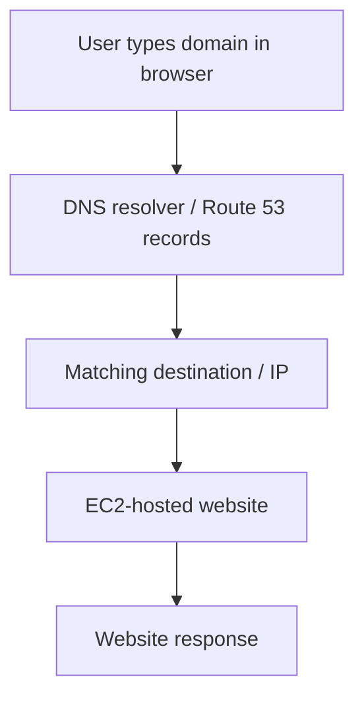
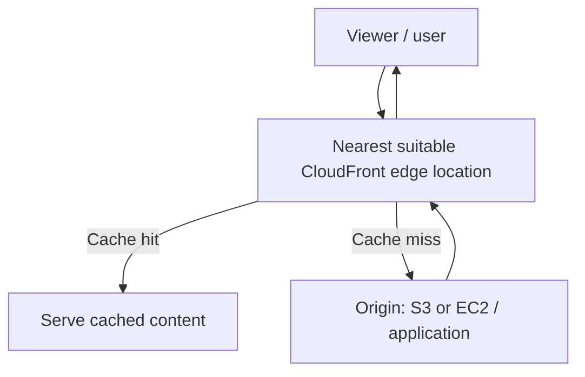

# AWS Zero to Hero — Part 7 (English)
## Chapters 19–20: Amazon Route 53 and Amazon CloudFront CDN

> **Source-preservation rule:** Appendix A preserves the original transcript for Chapters 19–20 in source order, with timestamps and wording. Notes before the appendix are organized for learning; additions are clearly separated.

## Chapter 19 — AWS Route 53 Service

### 1. What are Route 53 and DNS?
Amazon Route 53 is a scalable DNS (Domain Name System) service. DNS maps a domain name through relevant DNS records to an IP address or another destination. The transcript notes that DNS uses default port 53, which is the basis for the Route 53 name.

### 2. Basic domain request flow



When a website is hosted on EC2, DNS records can let users access it through a custom domain instead of typing a raw IP address.

### 3. Important terminology

| Term | Meaning |
|---|---|
| Domain name | A readable website name, such as `example.com` |
| DNS | Naming system that resolves a domain to a destination |
| Hosted zone | Place to manage DNS records for a domain |
| Name server (NS) record | Information about authoritative DNS servers |
| A record | Maps a domain/hostname to an IPv4 address |
| Record | A configured DNS routing entry |
| Registrar | Where a domain is registered |
| Simple routing | Basic DNS routing policy when advanced routing policies are not needed |

### 4. Transcript practical — connect an externally registered domain
The transcript uses a domain registered with an external registrar (example: Hostinger) and creates a hosted zone in Route 53.

1. Launch the website on EC2 and note its public IP/destination.
2. Open Route 53.
3. If the domain was not registered through AWS, create a public hosted zone for the domain under **Hosted zones → Create hosted zone**.
4. Note/copy the name servers shown in the hosted zone's NS records.
5. In the external registrar's DNS/name-server settings, configure the Route 53 name servers.
6. Save the registrar settings; DNS delegation changes can take time to propagate.
7. Create the required record in the Route 53 hosted zone.
8. Configure an A record for the website's IPv4 destination. If using an EC2 public IP, plan for a stable destination where appropriate.
9. Test the domain in a browser. DNS caching/delegation means changes may not appear everywhere immediately.

> **Cost note:** The transcript describes Route 53 as billable; hosted zones and domain registration may incur charges. Verify current prices and billing details in AWS pricing.

### 5. Route 53 gotchas
- Creating a hosted zone and registering a domain are separate steps.
- With an external registrar, update the registrar's authoritative name-server delegation.
- Creating an A record alone does not automatically change delegation at the registrar.
- An A record maps to IPv4; an AAAA record is used for IPv6.
- An EC2 public IP can change; plan DNS records around an appropriate stable destination.
- DNS changes may be delayed by caching/TTL and delegation updates.

## Chapter 20 — AWS CloudFront CDN

### 1. What is CloudFront?
Amazon CloudFront is a Content Delivery Network (CDN). It helps deliver website/application content faster by caching content at edge locations closer to viewers.

### 2. Why use CloudFront?
The transcript's example is a website hosted in one AWS Region (such as Mumbai) and accessed by users in Europe or other regions. Direct origin access can increase latency. Creating separate EC2 instances in every region can increase cost. CloudFront provides an alternative by serving cached content from edge locations.

### 3. CDN request flow



- **Cache hit:** requested content is available in the edge cache and can be served from there.
- **Cache miss:** CloudFront may fetch content from the origin and cache it according to the configured caching policy.
- **Origin:** original content source, such as an S3 bucket or an EC2-hosted web server.

### 4. What content can be cached?
Examples in the transcript:
- Images, including high-resolution images
- CSS stylesheets
- JavaScript files
- Videos
- Depending on configuration, dynamic content such as HTML and API responses can also be cached

**Important:** Do not blindly cache sensitive or user-specific data or backend logic. Configure cache policy, headers, cookies, query strings, and TTL according to application behaviour.

### 5. High-level CloudFront practical workflow
The transcript begins a practical that uploads website content to S3 and delivers it with CloudFront.

1. Prepare a website origin—an S3 bucket or an EC2-hosted website.
2. Upload/deploy website files (such as `index.html`, images, and CSS) to the origin.
3. Create a CloudFront distribution.
4. Select/configure the origin.
5. Review viewer protocol policy, allowed methods, cache behaviour, and relevant settings.
6. Wait for the distribution to deploy.
7. Test the website using the CloudFront domain name.
8. Understand cache behaviour and the content-update process; TTL expiry or invalidation may be needed for updates to appear.

> The console steps and sample bucket settings shown in the transcript are part of a learning demo. In production, prefer an appropriate private-origin access pattern rather than making S3 unnecessarily public.

### 6. Route 53 vs. CloudFront

| Dimension | Route 53 | CloudFront |
|---|---|---|
| Main role | DNS and domain routing | CDN and content delivery |
| Main problem solved | Resolve a domain to the correct destination | Deliver content closer to viewers |
| Core building blocks | Hosted zone, DNS records, name servers | Distribution, origin, edge locations, cache behaviour |
| Transcript example | Connect a custom domain to an EC2 website | Cache website content for global viewers |
| Does it replace the other? | No | No; they can be used together |

### 7. Common exam/practical gotchas
- Route 53 resolves DNS; it does not cache website content like a CDN.
- CloudFront is a content-delivery/cache layer, not a replacement for domain registration or authoritative DNS.
- A cache miss can result in a request to the origin.
- Do not assume every request or content type will be cached; cache policies matter.
- Caching dynamic/user-specific content can expose data or return stale responses.
- CloudFront distributions can take time to deploy.
- DNS routing, origin routing, TLS/HTTPS, and caching are separate concerns even when used together.

## Quick revision

| Question | Short answer |
|---|---|
| What is Route 53? | Scalable DNS service |
| What does DNS do? | Resolves/maps a domain name to a destination |
| What is a hosted zone? | Place to manage DNS records for a domain |
| What does an A record map? | Hostname/domain to an IPv4 address |
| How do you connect an externally registered domain to Route 53? | Configure the hosted zone's NS values at the registrar, then create DNS records |
| What is CloudFront? | A CDN that caches/delivers content through edge locations |
| What is a cache hit? | Content is available in the edge cache |
| What is a cache miss? | Content may need to be fetched from the origin |
| Examples of origins? | S3 bucket or EC2/application server |
| Route 53 vs. CloudFront? | DNS resolution vs. content delivery/cache |

## Board-Level Answer

**Amazon Route 53** is a scalable DNS service used to manage domain records and route domain queries to the appropriate destination. When a domain is registered with an external registrar, the registrar must delegate DNS authority to the correct Route 53 name servers, and the hosted zone must contain the required records. **Amazon CloudFront** is a CDN that can cache content at edge locations closer to viewers, reducing latency and origin load for cacheable content. They solve different problems and can be used together. Secure designs must consider DNS delegation, stable origins, HTTPS, cache policies, sensitive data, and cost.

## No-Skip Checklist

- [ ] Route 53 as a scalable DNS service
- [ ] DNS maps domain names to destinations/IP addresses
- [ ] DNS port 53 explanation in the source
- [ ] EC2-hosted website and custom-domain use case
- [ ] Route 53 billing/hosted-zone/domain-registration cost warning
- [ ] Domain registration vs. an external registrar
- [ ] Creating a public hosted zone
- [ ] NS/name-server records and registrar configuration
- [ ] Creating an A record and simple routing
- [ ] DNS propagation/caching delay
- [ ] Global website latency problem
- [ ] CloudFront as a CDN
- [ ] Edge locations and caching
- [ ] Origin examples: S3 and EC2
- [ ] Static assets and possible dynamic-content caching
- [ ] S3 website-content practical setup begins in the source
- [ ] Route 53 vs. CloudFront distinction
- [ ] Original transcript preserved in Appendix A

## Additional Points Added (separate from the original transcript)

1. Added AAAA record, TTL/cache, stable EC2 destination, cache-hit/miss, and invalidation terminology for clearer revision.
2. Added security guidance about HTTPS, sensitive/user-specific content, and avoiding unnecessary public S3 access.
3. Clarified that Route 53 DNS and CloudFront CDN have different roles and commonly complement each other.
4. Current prices, console options, cache policies, and service limits may change; this file does not claim live AWS documentation verification.

## Appendix A — Original Source — Preserved

The original transcript for Chapters 19–20 is reproduced below in source order, including timestamps and wording.

```text
Chapter 19: AWS Route53 Service
6:08:106 hours, 8 minutes, 10 secondsamazon2 सर्विस के बारे में बात करेंगे विद प्रैक्टिकल एग्जांपल लेकिन सबसे पहले यूज़ केस आपको जल्दी से बता देता हूं अभी
6:08:176 hours, 8 minutes, 17 secondsतक हम लोग ने प्लेलिस्ट में यह कवर कर लिया है कि एक स्टैटिक वेबसाइट को इजी टू इंस्टेंस या तो s3 पैकेट पे कैसे
6:08:256 hours, 8 minutes, 25 secondsडिप्लॉयड कैसे करते थे मान लीजिए ec2 पे आपका वेबसाइट डिप्लॉयड करते थे तो ब्राउजर में आपको एक
6:08:326 hours, 8 minutes, 32 secondsआईपी डालनी पड़ती थी लेकिन मैं बोलता हूं कि भाई मुझे आईपी नहीं चाहिए मुझे इस टाइप से अपनी वेबसाइट का एक नाम चाहिए जिसको हम कस्टम डोमेन बोलते हैं सो उस पर्पस के लिए
6:08:416 hours, 8 minutes, 41 secondsहम लोग ये राउट 53 सर्विस यूज़ कर सकते हैं जो कि एक स्केलेबल डीएनएस सर्विस है बाय एडब्ल्यू ओके इतना समझ गए चलिए अब
6:08:486 hours, 8 minutes, 48 secondsडीएनएस क्या होता है सिंपल है कि जो डोमेन नेम है उसको ट्रांसलेट करता है एक आईपी में जो मतलब एक राउटिंग जैसा वहां पे आपके
6:08:556 hours, 8 minutes, 55 secondsसर्वर पे होता है डीएनए सर्वर में एंड वन मोर थिंग कि ये राउट 53 नाम क्यों है अब आप इससे रिलेट कर पाओगे कि जो डीएनएस का
6:09:026 hours, 9 minutes, 2 secondsडिफॉल्ट पोर्ट है वो 53 तो राउ 53 इस टाइप से उन्होंने सर्विस का नाम दिया है सो जब आप डी आप मतलब राउट 53 सर्विस यूज करते हो
6:09:116 hours, 9 minutes, 11 secondsसो आपका सेटअप कुछ इस टाइप का दिखेगा तो आप जब भी ब्राउजर से यह इस टाइप से डोमेन ठीक है आप टाइप करोगे तो वो डीएनएस सर्वर
6:09:186 hours, 9 minutes, 18 secondsके पास जाएगा और डीएनएस सर्वर क्या करेगा यह डोमेन के अगेंस्ट में जो भी आईपी मतलब जो मैप होगी व आईपी यहां पे वापस आएगी और
6:09:276 hours, 9 minutes, 27 secondsव ब्राउजर ऑटोमेटिक डायवर्ट कर देगा आपके इजी टू इंस्टेंस या तो जहां जिस सर्वर पे भी आपकी वेबसाइट लॉन्च है सो इस तरह से
6:09:356 hours, 9 minutes, 35 secondsकाम करता है और यही सेटअप अभी हम लोग प्रैक्टिकल करके देखते चलो ओके आगे बढ़ने से पहले एक इंपॉर्टेंट
6:09:426 hours, 9 minutes, 42 secondsनोट है कि ये जो सर्विस है राउट 53 ये एक बिलेबल सर्विस है मंथली लेवल पे इसमें फीस होती है आपका जो भी होस्टेड जन बनता है
6:09:506 hours, 9 minutes, 50 secondsएंड इंक्लूडिंग जो डोमेन आप रजिस्ट्रेशन परचेस करते हो उसकी भी एक फीस होती है सो अगर आप कंफर्टेबल नहीं हो इवन दो आप सिंपल
6:09:576 hours, 9 minutes, 57 secondsदेख सकते हो सो दैट आपको एक अंडरस्टैंडिंग कर जाएगी कि प्रैक्टिकल ये कैसे वर्क करता है एंड कांसेप्चुअली कैसे काम करता है सो सेटअप के लिए सबसे पहले तो हमारे पास ये
6:10:056 hours, 10 minutes, 5 secondsटू पे एक स्टैटिक वेबसाइट होनी चाहिए तो वह मैं जल्दी से पहले तो हम लोग यह बना लेते हैं मैं सिंपल टू इंस्टेंस पे चलता
6:10:116 hours, 10 minutes, 11 secondsहूं लच इंस्टेंस माय वेब सवर इसके बाद हम लोग सिंपल
6:10:256 hours, 10 minutes, 25 secondsamazon2 पी कर देना एसएसए हम लोग यहां से निकाल सकते हैं एडवांस डिटेल में जाके आपको यूजर डाटा प जाना है एंड यहां पे मैं
6:10:336 hours, 10 minutes, 33 secondsसिंपल सी स्क्रिप्ट यूज़ करूंगा यह स्क्रिप्ट कहां से मिलेगी तो यही आपको स्लाइड में मिल जाएगी लद बहुत बेसिक स्क्रिप्ट है स्क्रिप्ट में हम लोग क्या
6:10:406 hours, 10 minutes, 40 secondsहै एक
6:11:056 hours, 11 minutes, 5 secondsसकते हो कि जो हमारी वेबसाइट है वो स्टार्ट हो गई है वेलकम टू अचे वेब सर्वर फ्रॉम यूरोप ओके सो हमारी वेबसाइट तो अप अप एंड रनिंग है बट यह आई से एक्सेस हो
6:11:146 hours, 11 minutes, 14 secondsरही है अब हम चलते हैं अपने मेन टास्क पे जो कि है थ्री वाली सर्विस पे मैं डायरेक्टली यहां से ओपन करता हूं आपको कुछ इस टाइप का
6:11:236 hours, 11 minutes, 23 secondsपेज दिखेगा लेकिन मेरे लिए जो ज्यादा इजी पड़ता है जैसे कि लेफ्ट साइड में आप जाओगे राउट 53 इस पर क्लिक करना सो आपको एक ओवरव्यू यहां पे मिल जाता है बेसिक
6:11:306 hours, 11 minutes, 30 secondsइंफॉर्मेशन एंड गेट स्टार्टेड कि अपनी वेबसाइट में डोमेन अपना कस्टम डोमेन यूज कर करना है सबसे पहले तो हमारे पास डोमेन होना चाहिए राइट तो हमारे लिए सबसे पहला
6:11:386 hours, 11 minutes, 38 secondsस्टेप क्या होगा भाई रजिस्टर और डोमेन अब इसके दो तरीके हो सकते हैं या तो आप एए के अंदर ही अपना डोमेन खरीद लो या तो रजिस्टर
6:11:466 hours, 11 minutes, 46 secondsकर लो खरीदना नहीं बोल सकते बट रजिस्टर बिकॉज़ उसमें पर एनम के बेसिस पे आपको चार्जेस लगते हैं चलिए तो सबसे पहले हम लोग रजिस्टर डोमेन करेंगे एंड गेट
6:11:546 hours, 11 minutes, 54 secondsस्टार्टेड सो जो भी आपको वेबसाइट खरीदनी है आप यहां पे सर्च कर सकते हो जैसे कि मान लो अगर ये अवेलेबल नहीं है तो ये आपको बता देगा इसके अल्टरनेटिव जैसे कि मामनी
6:12:036 hours, 12 minutes, 3 secondswebsite.com और in.net ऐसे अलग-अलग आपको मिल जाएंगे इसके प्राइसिंग भी है कि पर एनम आपको कितना चार्जेस लगेगा 14$ यूएस डर
6:12:126 hours, 12 minutes, 12 secondsसे 303 यूड काफी अलग-अलग चार्जेस हैं आप सिंपल कोई भी एक सेलेक्ट करके यहां पे चेक आउट करके मतलब ऑफकोर्स इसमें आपका बिल
6:12:196 hours, 12 minutes, 19 secondsआएगा राइट एंड आप इसको उसके बाद यूज कर सकते हो लेकिन मैं इस केस में अ एक दूसरी
6:12:266 hours, 12 minutes, 26 secondsअप्रोच यूज़ कर रहा हूं मैंने अ जो एक डोमेन ऑलरेडी परचेस करके रखा है जो कि है होस्टिंगर से ओके अ होस्टिंगर हो गया कोड
6:12:356 hours, 12 minutes, 35 secondsआईडी हो गया ऐसे काफी सारी वेबसाइट है जहां पे आप अपने डोमेन को रजिस्टर कर सकते हो और यहां भी होस्टर में देखोगे तो काफी चीप प्राइस में आपको देखने को मिल जाएगा ड
6:12:436 hours, 12 minutes, 43 secondsइ में देखोगे 99 पर एनम में तो मैंने ऑलरेडी लेके रखा है डोमेन रजिस्टर किया तो
6:12:506 hours, 12 minutes, 50 secondsमैं आपको इसकी डिटेल दिखा देता हूं अ माय
6:13:046 hours, 13 minutes, 4 secondsexample.net ने पड़ेंगे ठीक है तो अभी हम लोग क्या करेंगे हमारा डोमेन ऑलरेडी है हमारे पास तो हम लोग क्या करते हैं राउट
6:13:126 hours, 13 minutes, 12 seconds53 में फिर से चलते हैं अभी हमको डोमेन रजिस्टर करने की जरूरत नहीं है हम लोग चलते हैं होस्टेड जन में होस्टेड जन पे
6:13:206 hours, 13 minutes, 20 secondsचलते हैं हां और वन मोर थिंग कि जब आप एडब्ल्यूएम रजिस्टर करते हो स आपको
6:13:276 hours, 13 minutes, 27 secondsहोस्टेड जोन अपने आप बना मिलता है ओके उसमें नेम सर्वर वगैरह सब कुछ कॉन्फिडो गया यह जो स्टेप्स है वो उनके लिए य है
6:13:356 hours, 13 minutes, 35 secondsजिन्होंने बाहर से खरीदा है लिक मतलब रजिस्टर किया है जैसे होस्टिंगर से मैंने लिया है मैं क्रिएट हो होस्टेड जोन करता
6:13:426 hours, 13 minutes, 42 secondsहूं सो इट इज आस्किंग फॉर सबसे पहले तो ये पूछ रहा है डोमेन नेम ठीक है तो जैसे कि example.com है लेकिन हमारे केस में क्या
6:13:496 hours, 13 minutes, 49 secondsहै ये माय
6:14:056 hours, 14 minutes, 5 secondsइट रियली वेरी सिंपल ओके इसके बाद फिर से चलते हैं होस्टेड जोन में एंड रिफ्रेश करते हैं सो आप देखोगे माय एग्जांपल
6:14:126 hours, 14 minutes, 12 secondsवेबसाइड x वाज पब्लिक टाइप का यह हमारा होस्टेड जन अ ठीक है क्रिएट हो गया है मैं इसको क्लिक करता हूं इसके अंदर आपको दो
6:14:216 hours, 14 minutes, 21 secondsरिकॉर्ड्स देखने को मिलेंगे और जो टाइप है एक एनए मतलब ये नेम सर्वर बोलते हैं जिसको ओके सो इसमें अगर आप चलो मैं इसको क्लिक
6:14:306 hours, 14 minutes, 30 secondsकरता हूं सो आपको लेफ्ट साइड में काफी सारी वैल्यूज दिखेंगी अभी हम लोग चलते हैं डायरेक्टली होस्टिंगर पे मतलब जो भी जहां से भी आपने लिया है परचेस किया है सो आप
6:14:396 hours, 14 minutes, 39 secondsदेखोगे डोमेन ओवरव्यू यहां पे आपको चेंजेज करने के ऑप्शंस मिल जाते हैं जैसे कि डीएनएस ये तो नेम सर्वर्स है उसको मैं एडिट कर सकता हूं ओके सो यू विल सी कि
6:14:476 hours, 14 minutes, 47 secondsयहां पे मैं चेंज नेम सर्वर का एक ऑप्शन है चेंज माय नेम सर्वर ओके अब मैं यहां पे कॉपी करके ठीक है अपने यह वाले नेम सर्वर
6:14:566 hours, 14 minutes, 56 secondsऐड कर सकता हूं ओके सो यह मैंने कर लिया और मतलब यह नेम सर्वर मैंने इसके ऐड कर दिए सो यहां
6:15:056 hours, 15 minutes, 5 secondsपे हम लोग क्या कर रहे हैं थोड़ा सा फ्लो समझ में समझने की कोशिश करना देखो जब भी कोई यूजर माय एग्जांपल वेबसाइट पे ठीक है
6:15:126 hours, 15 minutes, 12 secondsब्राउजर पे क्लिक करेगा तो जो रिक्वेस्ट है वो अब कहां पे जाएगी एडब्ल्यू एस की राउट 53 पे ओके तो इसीलिए हम लोग ने ये
6:15:216 hours, 15 minutes, 21 secondsकिया कि भाई ये जो अभी हम लोग ने डोमेन रजिस्टर किया है अगर कोई यूजर उसको यूज करें तो ये वाले जो भी नेम सर्वर है मतलब
6:15:296 hours, 15 minutes, 29 secondsये डीएनएस सर्वर है इस पे आप राउट कर देना भैया उसके बाद हम संभाल लेंगे ठीक है जी चलो मैं इसको सेव कर देता हूं और यह
6:15:386 hours, 15 minutes, 38 secondsचेंजेज करने के बाद इट मे टेक अप टू 24 आवर्स तो ठीक है तो यह सब चेंजेज होने में 24 टू 40 आवर्स तक भी लग सकते हैं लद
6:15:466 hours, 15 minutes, 46 secondsकभी-कभी फास्ट भी होते हैं बट ये थोड़े से सेफ जन के लिए इन लोग बोल देते हैं कि 24 आवर्स है तो फॉर नाउ मैं इसको क्लोज कर देता हूं ओके सो फ्लो के अकॉर्डिंग जब
6:15:556 hours, 15 minutes, 55 secondsयूजर मा example.com पे क्लिक करेगा तो उसकी रिक्वेस्ट यह हमारा जो राउट 53 है
6:16:026 hours, 16 minutes, 2 secondsमतलब यह वाला यहां तक तो आ जाएगा अब इसके बाद कहां पर राउट करना है वह राउटिंग या तो रूल हमको क्रिएट करना पड़ेगा उसके लिए
6:16:116 hours, 16 minutes, 11 secondsहम लोग यूज करेंगे क्रिएट रिकॉर्ड ओके तो हम लोग एक रिकॉर्ड बनाते हैं चलिए और इसमें लेट्स से कि देखो जैसे कि आप देख
6:16:196 hours, 16 minutes, 19 secondsसकते हो माय एग्जांपल वेबसाइट एक्ज सब डोमेन जैसे कि लेट्स से आप डड इस तरह से यूज कर सकते हो या तो कोई ऑफ सब डोमेन भी
6:16:276 hours, 16 minutes, 27 secondsयूज कर सकते हो रिकॉर्ड टाइप अपन जो रखेंगे ए रखेंगे ओके ए रिकॉर्ड टाइप का मतलब क्या होता है कि जो होस्ट नेम है या
6:16:356 hours, 16 minutes, 35 secondsतो आपका डोमेन नेम है उसको कन्वर्ट किसम करता है वह एक आईपी में जो मशीन आईपी में
6:16:426 hours, 16 minutes, 42 secondsओके चलिए तो और यहां पे आप देख भी सकते हो कि जैसे कि www.my
6:17:056 hours, 17 minutes, 5 secondsथी इसको मैं कॉपी करता हूं और यह जो रिकॉर्ड है यहां पे सिंपली पेस्ट कर देता हूं ओके और यहां पे हम लोग ने सिंपल राउटिंग रखी है
6:17:336 hours, 17 minutes, 33 secondsदैट्ची दिस इज अ लाइव एग्जांपल कि भाई हमने एक अपने जो सिंपल सी वेबसाइट थी जो कि ी टू इंस्टेंस पे एक अपना कस्टम डोमेन
6:17:416 hours, 17 minutes, 41 secondsफिट कर लिया और ऐड कर लिया ओके सो दिस इज हाउ इट वर्क्स चलिए इस पॉइंट तक हम लोग ने एक डीएनएस की सिंपल राउटिंग कैसे वर्क
6:17:486 hours, 17 minutes, 48 secondsकरती है यह समझ लिया हमारी वेबसाइट अप एंड रनिंग है हमारा डोमेन भी वर्क कर रहा है ठीक है अभी हम लोग थोड़ा सा और लेवल अप
6:17:556 hours, 17 minutes, 55 secondsकरते हैं एक और यूज केस समझते हैं इसका यह हमारा यूजर है या तो आपका क्लाइंट है यह बोलता है कि भैया यह जो मेरी
6:18:036 hours, 18 minutes, 3 secondsवेबसाइट है उसको मुझे ग्लोबली सर्व करना है मतलब कि मेरे जो यूजर्स हैं वेबसाइट के वो ऑल ओवर द वर्ल्ड हो सकते हैं और उनको एक अच्छा एक्सपीरियंस देना है विद लो
6:18:126 hours, 18 minutes, 12 secondsलेटेंसी लो लेटेंसी मतलब चलो इसको थोड़ा सा सेटअप से समझते हैं अभी जो एट प्रेजेंट हमारा सेटअप है कुछ इस टाइप का है हमारे
6:18:196 hours, 18 minutes, 19 secondsपास एक इजी टू इंस्टेंस है एक ही है और जो कि स्टॉक होम में है मेरे केस में ओके अब नाउ अगर एक यूजर यूरोप में हो या तो एक
6:18:276 hours, 18 minutes, 27 secondsयूजर मुंबई में हो अगर वो वेबसाइट को एक्सेस करेगा तो वो यही सेम टू इंस्टेंस में जाएगा जो कि स्टॉक होम में है अब जो
6:18:366 hours, 18 minutes, 36 secondsयूजर यूरोप में है तो भाई यह यूरोप में स्टॉक होम पास पड़ेगा तो उसको एक ज्यादा मतलब लेटेंसी बहुत कम रहेगी ओके तो एक
6:18:456 hours, 18 minutes, 45 secondsउसको ज्यादा अच्छा एक्सपीरियंस मिलेगा फास्ट सर्विस मिलेगी लेकिन एट द सेम टाइम जब मुंबई होता है तो यहां पे जियोग्राफिक रीजन या तो डिस्टेंस बहुत बढ़ जाता है सो
6:18:536 hours, 18 minutes, 53 secondsवहां पे एक लेटेंसी आ सकती है मे बी फ्यू मिली सेकंड सेकंड्स की हो लेकिन वो थोड़ा सा इंपैक्ट करता है जब भी आप कोई जैसी
6:19:016 hours, 19 minutes, 1 secondफास्ट सर्विस प्रोवाइड करते हो ओके सो इतना अभी हम समझ गए इसका लेकिन सॉल्यूशन क्या है इसका सॉल्यूशन है कि क्यों ना हम
6:19:096 hours, 19 minutes, 9 secondsइस टाइप का सेटअप कर दें राइट कि मान लो हम लोग ने अब दो ईटू इंस्टेंस बना दिए एक ईट इंस्टेंस हमारा स्टॉकहोम में है मे बी
6:19:186 hours, 19 minutes, 18 secondsयूरोप में कहीं भी और एक ईटू इंस्टेंस हमारा मुंबई में ओके नाउ जब भी कोई यूजर यूरोप से हमारी वेबसाइट को एक्सेस करें तो
6:19:256 hours, 19 minutes, 25 secondsव स्टॉक होम से सर्व हो और अगर कोई यूजर हमारे एशिया से या तो मुंबई रीजन से या तो इंडिया से कहीं भी मतलब एक्सेस करें तो वह
6:19:336 hours, 19 minutes, 33 secondsमुंबई वाले ईट इंस्टेंस से फैच सो अब आप देखोगे कि उनका काम आसान हो गया और यहां पे लो लेटेंसी वहां पे हमारी काम करेगी
6:19:406 hours, 19 minutes, 40 secondsठीक है इस चीज को भी हम राउट 53 सर्विस से यूज कर सकते हैं कैसे करते हैं जल्दी से एक एग्जांपल देखते हैं सो मैं आ गया हूं
6:19:476 hours, 19 minutes, 47 secondsअपने एए कंसोल पे यह जो माय वेब सर्वर एक हमारा ऑलरेडी इंस्टेंस बना हुआ है ठीक है तो इसका नाम है मैं पहले दे देता हूं यू
6:19:556 hours, 19 minutes, 55 secondsक्योंकि ये यूरोप का है इसके बाद एक और लॉन्च इंस्टेंस कर लेते हैं एंड यह हम लोग करेंगे अ मुंबई में तो देखोगे मैंने लॉन्च
6:20:026 hours, 20 minutes, 2 secondsइंस्टेंस किया लेकिन रीजन मेरा स्टॉक होम मैं अपने रीजन को चेंज कर लेता हूं मुंबई क्योंकि मुझे अपने मुंबई में इंस्टेंस बनाना है ओके सो अभी जो मेरा रीजन है वोह
6:20:106 hours, 20 minutes, 10 secondsमुंबई है यहां पर मैं दे देता हूं माय वेब सर्वर और यहां पे एशिया कर देता
6:20:186 hours, 20 minutes, 18 secondsहूं
6:20:336 hours, 20 minutes, 33 secondsamazonbusiness.in में सेम स्क्रिप्ट यूज़ करेंगे लेकिन इसमें मैं थोड़ा सा चेंज करता हूं अचे वेब सर्वर फ्रॉम मुंबई ठीक है फ्रॉम मुंबई कर देता हूं या तो एशिया
6:20:426 hours, 20 minutes, 42 secondsकर सकते हैं एंड सिंपल सा मैं लॉन्च इंस्टेंस करता हूं जो इंस्टेंस है रन अप एंड रनिंग है मैं इसको ओपन करता हूं सो यहां पे मेरे पास अभी दो इंस्टेंस रनिंग
6:20:496 hours, 20 minutes, 49 secondsहै देखो ईयू वाला और यह एक हो गया एशिया वाला एशिया वाला भी हम लोग एक बार चेक कर लेते हैं वेरीफाई कर लेते हैं पब्लिक आईपी मैं इसको कॉपी करता हूं एंड सिंपली
6:20:586 hours, 20 minutes, 58 secondsब्राउजर पे जाके पेस्ट ओके साइड इज नॉट सिक्योर कंटिन्यू करते हैं सो यू विल सी ये देखो अची वेब सर्वर फम मुंबई इसके बाद
6:21:056 hours, 21 minutes, 5 secondsमैं चलता हूं फिर से अपने इंस्टेंस पे इसके बाद मैं आता हूं राउट 53 वाले डैशबोर्ड पे आप देखोगे डीएनएस मैनेजमेंट
6:21:126 hours, 21 minutes, 12 secondsएक है हमारे पास होस्टेड जन पे मैं आता हूं एंड इसके बाद एक ही होस्टेड जन है इस पे मैं क्लिक करता हूं ठीक है एंड इसके
6:21:206 hours, 21 minutes, 20 secondsबाद जो हम लोग ने ए रिकॉर्ड बनाया था कल ओके सो लास्ट में अगर आप लास्ट वाला देखोगे तो ए रिकॉर्ड जो हम लोग ने बनाया था अपने डोमेन के लिए उसको मैं क्लिक करता
6:21:286 hours, 21 minutes, 28 secondsहूं आप देखोगे यहां पे एडिट रिकॉर्ड मैं एडिट कर सकता हूं चलिए मैं इसको एडिट करता हूं जो राउटिंग पॉलिसी है पहले सिंपल राउटिंग थी मतलब एक जगह से आया दूसरी जगह
6:21:366 hours, 21 minutes, 36 secondsप अपन ने भेज दिया अब सिंप सिंपल राउटिंग की जगह यहां पे एक और अ मतलब काफी सारे आपको डिफरेंसेस मिल जाएंगे जैसे कि लेटेंसी बेस्ड पे फेल ओवर जिओ लोकेशन
6:21:446 hours, 21 minutes, 44 secondsवेटेड काफी सारे ऑप्शंस हैं अभी हम लोग बात करेंगे लेटेंसी लेटेंसी क्योंकि लो लेटेंसी चाहिए ठीक है अब जैसे ही आप लेटेंसी यहां पे सेलेक्ट करते हो आपको
6:21:536 hours, 21 minutes, 53 secondsदेखोगे कि यहां पे रीजन आ गया कि देखो यह जो आपने आईपी दिया इट इज आस्किंग कि यह कौन सी रीजन में सो मैं रीजन यहां पे
6:22:006 hours, 22 minutesसेलेक्ट कर लेता हूं स्टॉक होम एंड इसमें हम लोग को रिकॉर्ड एक एक आईडी देनी है तो मैं सिंपल ईयू रिकॉर्ड मतलब यूरोप के लिए
6:22:086 hours, 22 minutes, 8 secondsरिकॉर्ड इसको सेव कर देता हूं तो अभी हम लोग का रिकॉर्ड हो गया है चेंज ये हो गया है लेटेंसी बेस्ड तो हम लोग का एक रिकॉर्ड
6:22:156 hours, 22 minutes, 15 secondsबन गया फॉर स्टॉक होम हम लोग क्या है एक और रिकॉर्ड बना लेते हैं और लेटस से डड
6:22:226 hours, 22 minutes, 22 secondsएंड इसमें हम लोग यूज करेंगे मुंबई वाला तो मुंबई वाला हमारा कौन सा है देखो ये एशिया वाला है ठीक है ई टू इंस्टेंस इसकी
6:22:316 hours, 22 minutes, 31 secondsमैंने आईपी कॉपी करी है इसमें मैं पेस्ट कर देता हूं ठीक है जी और राउटिंग में हम लोग कर देंगे लेटेंसी वेरी सिंपल अब इसका
6:22:396 hours, 22 minutes, 39 secondsरीजन भी हमको सेलेक्ट करना है तो मैं यहां पे सेलेक्ट कर लेता हूं अ मुंबई ठीक है और इसमें बोल देता हूं मैं एशिया रिकॉर्ड
6:22:486 hours, 22 minutes, 48 secondsवेरी सिंपल ठीक है सब कुछ परफेक्ट है अ क्रिएट रिकॉर्ड सो हमारे कुछ दो रिकॉर्ड्स बन गए और कुछ इस टाइप के देखते हैं कि भाई
6:22:566 hours, 22 minutes, 56 secondsलेटेंसी बेस्ड है ये एशिया पैसिफिक एंड यूरोप मैं आपको इसका प्रैक्टिकल करके दिखाता हूं जैसे कि मान लो मैं अभी यूरोप
6:23:046 hours, 23 minutes, 4 secondsमें हूं ठीक है मैं रोमानिया में हूं सो अगर मैं अ माय एग्जांपल वेबसाइट xyz.com
6:23:346 hours, 23 minutes, 34 secondsद सेम टाइम मैं आपको ये भी दिखा दूं ये जो मेरा मेन लैपटॉप है और मैं यहां यूरोप से इसको एक्सेस कर रहा हूं सो आप देखोगे
6:23:416 hours, 23 minutes, 41 secondsइसमें यूरोप से ही आपकी वेबसाइट एक्सेस हो रही है चलिए इसमें हेल्थ चेक कैसे काम करता है
6:23:486 hours, 23 minutes, 48 secondsमैं वो भी आपको जल्दी से दिखा ही देता हूं राउट 53 का डैशबोर्ड हेल्थ चेक पे हम लोग चलते हैं एंड क्रिएट हेल्थ चेक एक क्रिएट
6:23:566 hours, 23 minutes, 56 secondsकर लेते हैं इसमें आपको नेम देना है सो मैं लेट्स से आपको देखो जो भी आपके अलग-अलग रीजन में अगर इंस्टेंसस है तो अलग-अलग आपको अ
6:24:046 hours, 24 minutes, 4 secondsहेल्थ चेक बनाना पड़ेगा जैसे कि मान लीजिए मैं पहले बना देता हूं ईयू ईयू हेल्थ चेक मतलब यूरोप के लिए हो गया एंड पॉइंट ही
6:24:116 hours, 24 minutes, 11 secondsयूज करेंगे आईपी एड्रेस और टाइप ऑफ जैसे कि अभी हमारे केस में एचटीटीपी है तो अ एचटीटीपी रखेंगे एंड लेट्स से ये यूरोप है
6:24:196 hours, 24 minutes, 19 secondsएंड मैं इसको मान लो सेलेक्ट करता हूं सो इसकी पब्लिक आईपी मैं यहां पे पेस्ट कर देता हूं कुछ इस तरह से ठीक है जी और यहां
6:24:276 hours, 24 minutes, 27 secondsपे एडवांस सेटिंग मतलब कितने देर देर में उसको चेक करना है 30 सेकंड 10 सेकंड सो वो चीज भी आप कर सकते हो
6:24:346 hours, 24 minutes, 34 secondsसो अभी हम लोग नॉर्मल ही रखते हैं सो यह हमारा एक हेल्थ चेक हो गया यह यूरोप के लिए हो गया हमारा देखो ये एक हेल्थ चेक हो
6:24:426 hours, 24 minutes, 42 secondsगया एंड अ देखो ये यहां पे इसने मैट्रिक्स भी दिखाना चालू कर दिया अभी हम लोग का एक एक बन गया ईयू हेल्थ के लिए एक हम लोग
6:24:506 hours, 24 minutes, 50 secondsएशिया के लिए भी बना ही लेते हैं इसका मैं नाम दे देता हूं एशिया हेल्थ एंड पॉइंट ही आईपी एड्रेस रखेंगे एंड इस केस में हम लोग
6:24:576 hours, 24 minutes, 57 secondsयह जो है माय वेब सर्वर एशिया इसका मैं आईपी यहां प कॉपी कर लेता हूं एंड इसमें हम लोग पेस्ट कर देते हैं ट्स इट एंड
6:25:046 hours, 25 minutes, 4 secondsसिंपल हेल्थ चेक क्रिएट कर देते हैं अभी हम लोग ने हेल्थ चेक सिर्फ क्रिएट किया है वो सिर्फ चेक कर रहा है लेकिन इसका यूज कहां करना है हमको होस्टेड जोन में करना
6:25:136 hours, 25 minutes, 13 secondsहै ठीक है जी चलिए ये होस्टेड जोन ओपन करते हैं और यह हमारे रिकॉर्ड ये नीचे हैं ये देखो एक एशिया एंड यूरोप अब ये एशिया
6:25:226 hours, 25 minutes, 22 secondsवाला मैं क्लिक करता हूं एडिट रिकॉर्ड्स पे चलते हैं और यहां पे आप जो हेल्थ आईडी है उसको आप सेलेक्ट कर सकते हो सो सबसे पहले एशिया हेल्थ है तो मैं इसको सेलेक्ट
6:25:306 hours, 25 minutes, 30 secondsकर लेता हूं सेव कर लेता हूं ठीक है जी और इसके बाद यूरोप यूरोप वाला देखो य स्टॉक होम वाला है एडिट रिकॉर्ड करते हैं सो
6:25:396 hours, 25 minutes, 39 secondsस्टॉक होम है तो इसका हम लोग यूज करेंगे ईयू हेल्थ ठीक है जी सेव हो गया सिंपल अभी क्या होगा जब राउटिंग करने से पहले मतलब
6:25:476 hours, 25 minutes, 47 secondsजब लेटेंसी बेस्ड करने से पहले वह चेक करेगा कि भाई वो हेल्दी है कि नहीं अभी हमारा देखो स्टॉक होम वाला इंस्टेंस है अप
6:25:556 hours, 25 minutes, 55 secondsएंड रनिंग है तो मैं रिफ्रेश करता हूं सो अभी भी मुझे यूरोप ही मिल रहा है बिकॉज लो लेटेंसी वेस्ट काम कर रहा है अभी मैं एक काम करता हूं यह जो हमारा इंस्टेंस से जो
6:26:046 hours, 26 minutes, 4 secondsईयू वाला उसको मैं टर्मिनेट कर देता हूं मान लीजिए हमारा सर्वर बंद हो गया तो इसके बाद क्या होगा अब देखते हैं ओके सो यहां
6:26:126 hours, 26 minutes, 12 secondsपे वन बाय वन देखते हैं स्टॉक होम में जो इजी टू इंस्टेंस है हमारा हो गया है डाउन इसके बाद चलते हैं राउट 53 वाले हमारे
6:26:196 hours, 26 minutes, 19 secondsडैशबोर्ड पे हेल्थ चेक पे चलते हैं सो यू विल सी हियर कि हेल्थ चेक जो हमारे ईयू वाला था स्टॉक होम का ईटू इंस्टेंस वो
6:26:276 hours, 26 minutes, 27 secondsअनहेल्दी है ओके इसके बाद सिंपल आपको क्या करना है कि ब्राउजर पे जाना है एंड सी यहां पर ऑलरेडी है मैं देखो अब जितने बार
6:26:366 hours, 26 minutes, 36 secondsभी रिफ्रेश करूं सो यू विल सी कि इवन मैं अब यूरोप से इसको एक्सेस कर रहा हूं वेबसाइट को तो यह मुंबई पे इसने डाइवर्ट
6:26:436 hours, 26 minutes, 43 secondsकर दिया दैट मींस कि हेल्थ चेक के यह बेनिफिट है कि फेल ओवर और मतलब जो आपकी जीरो डाउन टाइम है वो आपको प्रोवाइड कर
6:26:516 hours, 26 minutes, 51 secondsदेता है लद इसमें थोड़ा सा टाइम लग सकता है क्योंकि हेल्थ चेक का हम लोग ने जो ड्यूरेशन है वो 30 सेकंड रखा है तो इसमें थोड़ा सा टाइम लग सकता है तो आप उसको और
6:26:586 hours, 26 minutes, 58 secondsभी फास्ट कर सकते हो चलिए हम लोग ने राउट 53 का एग्जाम एपल तो देख लिया प्रैक्टिकल करके बट इसके
6:27:066 hours, 27 minutes, 6 secondsरिलेटेड कुछ एडिशनल पॉइंट या तो हम समरी देख लेते हैं कि काम कैसे करता है तो सबसे पहले शुरुआत हम लोग ने करी थी डोमेन नेम रजिस्ट्रेशन आपके पास एक डोमेन नेम होना
6:27:146 hours, 27 minutes, 14 secondsचाहिए जो कि आप एडब्ल्यूएल कर सकते हो ठीक है इसके बाद है होस्टेड जोन क्रिएशन आप एक होस्टेड जोन
6:27:216 hours, 27 minutes, 21 secondsबनाते हो अगर एडब्ल्यूएल किया है तो ये ऑटोमेटिक बन जाता है या तो आप बना सकते हो हमने बनाया था डीएनएस रिकॉर्ड क्योंकि होस्टेड जोन जब
6:27:306 hours, 27 minutes, 30 secondsएक बार बन जाता है उसके अंदर आप रिकॉर्ड्स बनाते हो तो हम लोग ने एक रिकॉर्ड बनाया था ए टाइप का रिकॉर्ड हम उसके बारे में भी
6:27:376 hours, 27 minutes, 37 secondsबात करेंगे ऐड रिकॉर्ड जो भी अलग-अलग टाइप के ए सी नेम एमएस टू राउट ट्रैफिक टू वेरियस एंड पॉइंट्स रिकॉर्ड्स हम लोग
6:27:456 hours, 27 minutes, 45 secondsबनाते हैं आपके ट्रैफिक को राउट या तो रूट करने के लिए राउटिंग पॉलिसीज पॉलिसीज भी हम लोग क्रिएट कर सकते हैं क्योंकि आप
6:27:546 hours, 27 minutes, 54 secondsथोड़े से जब प्रैक्टिकल करते हो आप एडवांस लेवल पे चीजें करते हो जैसे कि लेटेंसी बेस्ड और फेल ओवर राउटिंग ओके सो अभी हम
6:28:016 hours, 28 minutes, 1 secondलोग ने लेटेंसी बेस्ड किया था इसका मतलब मतलब कि कि जो भी डिफरेंट रीजन है वो उसके पास का जो भी यूजर है वहां पे आपकी
6:28:086 hours, 28 minutes, 8 secondsवेबसाइट सर्व होगी ठीक है तो ये एग्जांपल तो हम लोग ने प्रैक्टिकल देखा है फेल ओवर राउटिंग मतलब सिंपल सा है ये अलग-अलग जगह
6:28:156 hours, 28 minutes, 15 secondsराउट नहीं करेगा लेकिन आपका जो एक और इंस्टेंस है वो बैकअप में रखेगा मान लीजिए एक इंस्टेंस आपका डाउन हो जाता है वेबसाइट
6:28:236 hours, 28 minutes, 23 secondsमतलब सर्वर तो दूसरी जगह से आपका वो वेबसाइट सर्व होगी सो इस तर की भी चीजें प्रोवाइड करता है हेल्थ चेक कॉन्फिन हेल्थ
6:28:316 hours, 28 minutes, 31 secondsचेक टू मॉनिटर एंड पॉइंट्स एंड ट्रिगर फेल ओवर व्हेन नीडेड ऑफकोर्स अ हेल्थ चेक ये काफी इंपॉर्टेंट है मान लीजिए देखिए अभी
6:28:396 hours, 28 minutes, 39 secondsआपने क्या किया अ यूज़ किया अपने स्टॉक होम एक मुंबई ठीक है लेकिन यहां पे हम लोग ने कोई हेल्थ चेक यूज़ नहीं किया हेल्थ
6:28:466 hours, 28 minutes, 46 secondsचेक अगर आप इनेबल कर देते हो तो पता क्या होगा कि मान लीजिए अ अभी तो लेटेंसी बेस चल रहा है लेकिन आप हेल्थ चेक होता है सो
6:28:546 hours, 28 minutes, 54 secondsमान लीजिए अगर आपका स्टॉक होम वाला इंस्टेंस सम हाउ डाउन हो जाता है कुछ क्रैश हो जाता है कुछ प्रॉब्लम आती है तो इवन दो अगर यूरोप से कोई मान लो कोई यूजर
6:29:036 hours, 29 minutes, 3 secondsआपकी वेबसाइट को एक्सेस करता है तो वो मुंबई से आपको सर्फ करके दे देगा मतलब कि भले ही लेटेंसी हो लेकिन आपकी वेबसाइट अप
6:29:106 hours, 29 minutes, 10 secondsएंड रनिंग तो रहेगी ओके सो यह होता है हेल्थ चेक का सो मतलब आपको पूरी सिक्योरिटी पूरा जो जो भी डिफरेंट
6:29:176 hours, 29 minutes, 17 secondsफंक्शनैलिटीज है आपकी वेबसाइट के लिए वो आपको मिल जाता है अब बात करते हैं टाइप्स ऑफ रिकॉर्ड जो थोड़ा सा आपको समझने की जरूरत है या तो
6:29:266 hours, 29 minutes, 26 secondsआपके नॉलेज के लिए सपोर्टेड बाय एड राउ 53 ठीक है अब यहां पे डिफरेंट टाइप्स के रिकॉर्ड्स हैं हम लोग ने ए रिकॉर्ड बनाया
6:29:336 hours, 29 minutes, 33 secondsथा जो कि यूज होता है आई v4 वर्जन फोर के लिए ठीक है इसका सिंपल सा मतलब क्या है मैप्स अ डोमेन नेम टू एन आईपी v4 एड्रेस
6:29:426 hours, 29 minutes, 42 secondsओके सो हमारा इस टाइप का एड्रेस था जो कि आईपी v4 बोलते हैं अगर मान लीजिए आप लेटेस्ट के साथ जाते हो आई v6 रहता है कुछ
6:29:496 hours, 29 minutes, 49 secondsइस टाइप का आपका एड्रेस दिखता है सो इन दैट केस आपको ए ए मतलब ड एड ए रिकॉर्ड
6:29:566 hours, 29 minutes, 56 secondsबनाना पड़ेगा फॉर आईपीवी स सो जिस भी टाइप का आपका एंड पॉइंट है उसके बेसिस पे आपको रिकॉर्ड टाइप आपका चेंज हो जाता है है ओके
6:30:046 hours, 30 minutes, 4 secondsइसके बाद है सी नेम रिकॉर्ड मैप्स आ डोमेन नेम टू अनदर डोमेन नेम ओके सो मतलब जैसे कि आपने नोटिस किया होगा कि
6:30:146 hours, 30 minutes, 14 secondsgoogle.com भी करो तो आपकी
6:30:346 hours, 30 minutes, 34 secondsपड़ता है जैसे कि बड़ी-बड़ी कंपनीज करती हैं ओके
6:30:406 hours, 30 minutes, 40 secondsएएक्टरील पर्पस के लिए यूज होता है ठीक है जैसे कि example.com तो mail.com
6:30:476 hours, 30 minutes, 47 secondsओके एंड टीएक इसके बाद टी एकटी रिकॉर्ड एनएस रिकॉर्ड एस आरवी रिकॉर्ड एंड सो ऑन सो इस टाइप से अलग-अलग रिकॉर्ड्स आप इसमें
6:30:556 hours, 30 minutes, 55 secondsयूज कर सकते हो फॉर अलग-अलग पर्पस अब बात करते हैं यूज केसेस की ऑफ
6:31:026 hours, 31 minutes, 2 secondsराउ 53 सो कुछ कुछ चीजें तो हम लोग ने देख ही चुके हैं प्रैक्टिकल जैसे कि होस्टिंग वेबसाइट अभी हम लोग ने देखा डोमेन नेम एंड
6:31:096 hours, 31 minutes, 9 secondsराउट ट्रैफिक टू वब एप्लीकेशन लोड बैलेंसिंग डिस्ट्रीब्यूटर अक्रॉस मल्टीपल एंड पॉइंट यूजिंग द वेटेड और लेटेंसी बेस्ड राउटिंग
6:31:166 hours, 31 minutes, 16 secondsओके सो मान लीजिए देयर मे बी अ डिफरेंट केस कि मान लीजिए आपके अब जैसे कि कुछ वेबसाइट्स है जैसे
6:31:336 hours, 31 minutes, 33 secondsदिल्ली में एक बेंगलोर में या या मुंबई में हैदराबाद में एंड आप वहां पे अ डिस्ट्रीब्यूटर सकते हो लोड ठीक है
6:31:436 hours, 31 minutes, 43 secondsडिस्ट्रीब्यूटर राउटिंग वेटेड मतलब कि आपको लोड डिस्ट्रीब्यूटर है खुद से तो मतलब अगर आप बोलते हो कि हां मेरे पास दो
6:31:506 hours, 31 minutes, 50 secondsसर्वर हैं इंडिया में मुंबई में और दिल्ली में मुझे हाफ हाफ ट्रैफिक डिस्ट्रीब्यूटर है आधा ट्रैफिक मुंबई में जाए आधा ट्रैफिक दिल्ली में जाए उस टाइप की चीजें आप यहां
6:31:586 hours, 31 minutes, 58 secondsपे कर सकते हो डिजास्टर रिकवरी ऑफ कोर्स कि यहां पे हेल्थ चेक है कोई भी आपका एक इंस्टेंस डाउन होता है तो ऑटोमेटिक वो इसको डिटेक्ट करके आपका पूरा ट्रैफिक
6:32:076 hours, 32 minutes, 7 secondsदूसरे इंस्टेंस पे डाइवर्ट कर देगा मल्टी रीजन डिप्लॉयड राउट ट्रैफिक टू क्लोजेस्ट रीजन फॉर लो लेटेंसी इसका हम लोग ने
6:32:146 hours, 32 minutes, 14 secondsप्रैक्टिकल ऑलरेडी देख चुका है अब बात कर लेते हैं समरी ऑफ़ बिलिंग क्योंकि भाई आप एडब्ल्यू सर्विस यूज़ करते हो सो बिलिंग तो आती ही है बिलेबल कंपोनेंट कौन से हैं
6:32:236 hours, 32 minutes, 23 secondsइंक्लूड द होस्टेड जन डीएनएस क्वेरीज हेल्थ चेक डोमेन रजिस्ट्रेशन एंड ट्रैफिक पॉलिसीज ऑफकोर्स डोमेन रजिस्ट्रेशन का
6:32:306 hours, 32 minutes, 30 secondsईयरली बेसिस पे लगता ही है ट्रैफिक पॉलिसीज हेल्थ चेक हेल्थ चेक का भी ठीक है लगता है डीएनएस क्वेरीज एंड ऑल सो अगर आप
6:32:376 hours, 32 minutes, 37 secondsदेखोगे ऑलमोस्ट सारी ही चीजों का बिल है मतलब लगता है फ्री टीआर में क्या है यहां पे राउट 53 डज नॉट इंक्लूड अ फ्री टीय सो
6:32:446 hours, 32 minutes, 44 secondsचार्जेस स्टार्ट एज सून एज यू यूज इट्स सर्विसेस ओके सो वही अगर आपको थोड़ा सा अ
6:32:526 hours, 32 minutes, 52 secondsकॉस्टिंग का कुछ है इश्यूज तो प्लीज मत मत करो आप ट्राई आप देख के भी समझ सकते हो क्योंकि देखो कांसेप्ट और अंडरस्टैंडिंग
6:32:596 hours, 32 minutes, 59 secondsऑफ द सर्विस ज्यादा जरूरी है रदर देन आप करके ही देखो कॉस्ट वेरी डिपेंड अपऑन द यूसेज एंड द टाइप ऑफ कॉन्फिन ठीक है अब
6:33:066 hours, 33 minutes, 6 secondsजैसे कि जो राउटिंग पॉलिसीज है अब वो अगर आप बहुत सिंपल और मिनिमल रखते हो या तो आप बहुत कॉम्प्लेक्शन चीजें रखते हो तो उसके
6:33:156 hours, 33 minutes, 15 secondsबेसिस पे भी आपका कॉस्ट वरी कर सकता है एंड में देख लेते हैं कि राउट 53 हमको क्या-क्या चीजें प्रोवाइड करता है एक तो डोमेन नेम आप रजिस्टर कर सकते हो होस्टेड
6:33:236 hours, 33 minutes, 23 secondsजन आप बनाते हो हेल्थ चेक आपको प्रोवाइड करता है ट्रैफिक फ्लो कैसे आपको फ्लो करवाना है एंड ऑल वो चीज आप कर सकते हो एंड इसके बाद है
6:33:326 hours, 33 minutes, 32 secondsरिजॉल्वर अगर आप सिफ टेस्टिंग परपस के लिए प्रैक्टिस कर रहे हो तो डोंट फॉरगेट टू क्लीन अप सो हम लोग जल्दी से क्लीन अप कर लेते हैं पहले तो हेल्थ चेक ओके सो ये दो
6:33:406 hours, 33 minutes, 40 secondsहेल्थ चेक हम लोग ने बनाए थे हम सिंपली इसको डिलीट कर देते हैं क्योंकि हमको अब जरूरत नहीं है कंफर्म ये देखो हेल्थ चेक
6:33:476 hours, 33 minutes, 47 secondsहमारा हो गया डिलीट एंड इसके बाद ई टू इंस्टेंस पे आप जरूर ध्यान देना कि देखो ये मेरा स्टॉक होम में था और एक मुंबई में था सो मुंबई वाला अभी भी अप एन रनिंग है
6:33:566 hours, 33 minutes, 56 secondsमैं इसको कर देता हूं टर्मिनेट सो ये चीज आप जरूर करना लद शायद आपसे कुछ चीजें मिस हो सकती हैं लाइक अलग-अलग रीजन में आपने
6:34:036 hours, 34 minutes, 3 secondsबनाया हुआ आप मिस कर दो सिंपल आप टू ग्लोबल व्यू पर चले जाना ग्लोबल व्यू में आपके मतलब सारे ही रीजन में तो आपको एक
6:34:106 hours, 34 minutes, 10 secondsओवरव्यू मिल जाएगा जैसे कि देखो 17 रीजन है और उसमें इंस्टेंसस कितने हैं आपके जैसे वन इन वन रीजन तो अभी वन दिखा रहा है
6:34:196 hours, 34 minutes, 19 seconds्र इन टू रीजन ओके क्यों दिखा रहा है भाई ये ठीक है अभी देखोगे इसमें एक है इसमें दो है ठीक है व्यू ऑल करते हैं अपन अब
6:34:286 hours, 34 minutes, 28 secondsजैसे कि मान लो ये इंस्टेंस है आप इसको ओपन भी करके देख सकते हो सो यू विल सी कि ये यहां पे देखो ये टर्म नेटेड स्टेट में सो टर्मिनेटेड इट्स फाइन वहां से वो
6:34:366 hours, 34 minutes, 36 secondsरिफ्रेश हो जाएगा इट्स ओके सो यहां से आप रिव्यू कर सकते हो एंड इसके बाद हम लोग चलते हैं हेल चेक हम लोग ने ठीक है डिलीट
6:34:436 hours, 34 minutes, 43 secondsकर दिया है होस्टेड जोन अ होस्टेड जन में मैं एक दो चीजें और बता देता हूं आपको मान लो मैं क्रिएट रिकॉर्ड करता हूं ओके सो
6:34:516 hours, 34 minutes, 51 secondsक्रिएट रिकॉर्ड कैसे वर्क करता है ठीक है समझ लिया हम लोग ने एक आपको देखो यहां पे अभी क्या है ऑप्शन एक आईपी का ऑप्शन मिलता है ठीक है और एनीवे अगर आप ये टाइप चेंज
6:34:596 hours, 34 minutes, 59 secondsकरते हो सो इतने टाइप के आपको यहां पे मिल जाते हैं डबल ए ड ए एक्चुअली सो आप देखोगे यहां पे फॉर्मेट आपके चेंज हो जाता है आईपी v6 हो जाता है ठीक है और दो लेट्स से
6:35:086 hours, 35 minutes, 8 secondsअगर आप एी करते हो और मान लीजिए आलिया से यूज करते हो तो आलियास का क्या मतलब होता है कि आप यहां पे एंड पॉइंट मतलब मान लो
6:35:156 hours, 35 minutes, 15 secondsजैसे कि अ आपने s3 बकेट में अपनी वेबसाइट को डिप्लॉयड पॉइंट मिल जाता है सो वहां पे
6:35:236 hours, 35 minutes, 23 secondsआपको भाई आईपी की तो जरूरत नहीं है आप सिंपल क्या है एंड पॉइंट यहां पे सेलेक्ट कर सकते हो अभी जैसे कि देखोगे आलियास टू अनदर रिकॉर्ड इन दिस होस्टेड जोन और यह
6:35:326 hours, 35 minutes, 32 secondsदेखो एक एक ऑप्शन है आलिस टू s3 वेबसाइट एंड पॉइंट कि भाई आपके s3 पे वेबसाइट है तो आप उसके भी आप उस पे ठीक है कर सकते हो
6:35:406 hours, 35 minutes, 40 secondsरीजन जैसे कि मान लो कोई मैं स्पेसिफिक करता हूं सो वो चीज अब देखो यहां s3 एंड पॉइंट अभी तक तो है नहीं अगर होगा तो यहां पे आपको दिख जाएगा तो आप उसमें मतलब आप
6:35:496 hours, 35 minutes, 49 secondsउसको सेलेक्ट कर सकते हो तो मैंने एक सिंपल सा एक चीज बता दिया राउटिंग पॉलिसी में हम लोग ने सिंपल राउटिंग और यहां पे लेटेंसी बेस्ड किया है फेल ओवर बहुत सिंपल
6:35:576 hours, 35 minutes, 57 secondsहै कि ये सिर्फ बैकअप के लिए यूज़ होगा स य डिफरेंट ऑप्शंस भी आप कर सकते हो ठीक है ऑल दो मैंने एक ओवरव्यू आपको देना था बस अ इसके बाद हम लोग होस्टड टन को भी डिलीट कर
6:36:066 hours, 36 minutes, 6 secondsदेते हैं लेकिन उससे पहले आपको यह जो हम लोग ने दो अपने खुद के जो रिकॉर्ड बनाए थे उसको हमको डिलीट करना पड़ेगा मैंने दोनों सेलेक्ट कर लिया है एंड इसके बाद हम लोग
6:36:146 hours, 36 minutes, 14 secondsडिलीट रिकॉर्ड्स कर लेते हैं ठीक है जी डिलीट ओके ये दोनों रिकॉर्ड्स हमारे डिलीट हो गए एंड इसके बाद हम लोग चलते हैं
6:36:226 hours, 36 minutes, 22 secondsहोस्टेड जन पे एंड इसको भी मैं डिलीट कर देता हूं सो यू विल सी कि हमारा होस्टेड जन भी हो गया डिलीट सो हमारा हो गया है सेटअप क्लीन अप बट स्टिल मेरे पास जो
6:36:316 hours, 36 minutes, 31 secondsहोस्टिंगर वाली जो अभी डोमेन नेम है वो अभी भी प्रेजेंट है तो लद मैं इन फ्यूचर में इसको यूज़ कर सकता हूं सो दिस इज ऑल अबाउट दिस सेक्शन अ पसंद आया हो तो प्लीज
6:36:396 hours, 36 minutes, 39 secondsलाइक शेयर कमेंट जरूर कर देना या थोड़ा सा सपोर्ट मिल जाएगा थैंक्स फॉर वाचिंग चलिए इस सेक्शन में बात करेंगे
Chapter 20: AWS CloudFront CDN
6:36:536 hours, 36 minutes, 53 secondsamazon2 इंस्टेंस s3 बकेट इसका प्रैक्टिकल हम लोग देख चुके हैं ओके नाउ उसके थोड़ा सा और लेवल अप करते हैं कि भाई ये वेबसाइट
6:37:006 hours, 37 minutesको डिप्लॉयड इजी एक्सेस करना इजी बट नेक्स्ट चैलेंज है हमारा कि इस वेबसाइट को हमको ग्लोबली सर्व करना है अभी मान लीजिए
6:37:086 hours, 37 minutes, 8 secondsकि भाई आपकी जो वेबसाइट है वो मुंबई रीजन में है आप मुंबई में आपने डिप्लॉयड आपके यूजर्स अगर यूरोप से इसको एक्सेस करेंगे
6:37:166 hours, 37 minutes, 16 secondsठीक है तो वहां पे परफॉर्मेंस इश्यूज थोड़े से डेफिनेटली आएंगे राइट लाइक लोडिंग टाइम एंड ऑल जिसको हम लेटेंसी भी बोलते हैं सो वहां पे एक चैलेंज क्या होगा
6:37:246 hours, 37 minutes, 24 secondsआपको लो लेटेंसी के साथ अपने वेबसाइट का मतलब सर्व करना है मतलब आपको एक्सपीरियंस अच्छा बढ़ाना है राइट अब अगर हमसे वेबसाइट
6:37:336 hours, 37 minutes, 33 secondsके बारे में बात कर रहे हैं उसमें भी कैटेगरी होती है जैसे कि सि या तो आपकी सिंपल सी वेबसाइट हो सकती है स्टैटिक बेस्ड सिंपल यहां पे टेक्स्ट है और कुछ
6:37:406 hours, 37 minutes, 40 secondsनहीं है कुछ तामझाम नहीं है है ना और आपकी वेबसाइट कुछ इस तरह की भी हो सकती है बहुत ही ब्यूटीफुली डिजाइन बहुत सारे ग्राफिक्स
6:37:476 hours, 37 minutes, 47 secondsकलर्स स्टाइल्स ठीक है आपकी स्क्रिप्टिंग और जो आपकी खूब सारी इमेजेस हैं एंड इमेजेस भी हाई रेजोल्यूशन वाली है कि आप
6:37:566 hours, 37 minutes, 56 secondsअच्छे से अच्छे एक्सपीरियंस दो या तो आपकी वेबसाइट में भाई वीडियोस वगैरह ठीक है तो उस टाइप के ग्राफिक्स भी हो सकते हैं नाउ द ओनली चैलेंज इज कि भाई अगर आपको कुछ इस
6:38:046 hours, 38 minutes, 4 secondsटाइप की वेबसाइट को अ डिप्लॉयडी सर्व करना है विद द लो लेटेंसी तो व्हाट इज द सॉल्यूशन सो अभी हम लोग ने
6:38:126 hours, 38 minutes, 12 secondsलास्ट सेक्शन में जब राउट 53 सर्विस हम लोग ने देखी थी उसमें हम लोग ने एक सॉल्यूशन क्रिएट किया था इस टाइप से लो लेटेंसी के लिए और वो भी ग्लोबली के लिए
6:38:206 hours, 38 minutes, 20 secondsउसमें हम लोग ने क्या किया था अब एक इंस्टेंस हम लोग ने मुंबई में था और एक इंस्टेंस हम लोग ने स्टॉकहोम में बना दिया मतलब लाइक यूरोप रीजन में तो भाई तो अगर
6:38:296 hours, 38 minutes, 29 secondsयूरोपियन जो भी यूजर्स हैं वो एक्सेस करेंगे तो यहां पे आपके स्टॉक से आपकी वेबसाइट सव हो गई एंड सो ऑन ठीक है तो यहां पे हम लोग ने ये प्रॉब्लम सॉल्व तो
6:38:376 hours, 38 minutes, 37 secondsकर ली थी ग्लोबली वाली बट यहां पे डिफरेंस या तो प्रॉब्लम क्या थी कि आप जितने ज्यादा इंस्टेंसस यूज करोगे इवन यहां दो थे बट आप रियल लाइफ में और ज्यादा करोगे
6:38:456 hours, 38 minutes, 45 secondsएंड जितने ज्यादा इंस्टेंसस आप यूज करोगे उतना ज्यादा आपका बिल भी आएगा सो आरओ आई आपको ध्यान रखना पड़ेगा कि भाई आप मतलब
6:38:546 hours, 38 minutes, 54 secondsकितना आपके लिए बेनिफिशियल है नहीं है अगर यह नहीं तो भाई क्या सॉल्यूशन है सो ऑफकोर्स वी आर टॉकिंग अबाउट द क्लाउड फ्रंट सो वही एक सॉल्यूशन है सो क्लाउड
6:39:036 hours, 39 minutes, 3 secondsफ्रंट क्या है ये है एक कंटेंट डिलीवरी नेटवर्क सीडीएन जिसको हम बोलते हैं और इसका काम क्या होता है आपकी जो वेबसाइट है
6:39:116 hours, 39 minutes, 11 secondsउसको स्पीड अप करना मतलब जो डिलीवरी है उसकी स्पीड अप करना वो कैसे करेगा एज लोकेशन में जो वेबसाइट का कंटेंट है उसको
6:39:196 hours, 39 minutes, 19 secondsकैश करके ठीक है क्लोज टू देम मतलब जहां भी य जहां से भी यूजर एक्सेस कर रहा है उसके पास की की जो भी एज लोकेशन है वहां
6:39:286 hours, 39 minutes, 28 secondsपे आपकी वेबसाइट कैश हो जाएगी एंड नेक्स्ट टाइम जब भी यूजर आपकी वेबसाइट को एक्सेस करेगा सो वो ज्यादा फास्ट होगा एंड
6:39:356 hours, 39 minutes, 35 secondsइंप्रूव्ड होगा एक्सपीरियंस ठीक है अब जैसे कि इसको डायग्राम से भी समझ लेते हैं अब जैसे कि मान लो e2 इंस्टेंस s3 है कहीं भी आपने वेबसाइट को डिप्लॉयड केस में क्या
6:39:446 hours, 39 minutes, 44 secondsहै व्यूवर्स आपको डायरेक्टली एक्सेस कहां से करेंगे स2 इंस्टेंस से लेट्स से तो ट अगर अगर आप मुंबई में है तो वो डायरेक्ट
6:39:516 hours, 39 minutes, 51 secondsमुंबई में जाके आपकी वेबसाइट को भाई मतलब लाइक सर्व करेगा या तो एक्सेस करेगा लेकिन जैसे ही आप क्लाउड फ्रंट आप यूज करते हो
6:40:006 hours, 40 minutesसो क्लाउड फ्रंट में आपका कुछ फ्लो इस टाइप का हो हो जाएगा ओके सो मान लो जो मान लो कि यूरोप है एंड यहां पे व्यूवर्स
6:40:086 hours, 40 minutes, 8 secondsएक्सेस कर रहे हैं अब जैसे ही वेबसाइट एक्सेस करेंगे तो क्या होगा यह यूरोप या तो ये यूजर के पास मतलब इसकी लोकेशन के
6:40:166 hours, 40 minutes, 16 secondsपास जो भी एज लोकेशन होगा सबसे पहले तो वो मतलब जो एडब्ल्यूएल केशन में चेक करेगा कि भाई
6:40:236 hours, 40 minutes, 23 secondsवेबसाइट यहां पे है कि नहीं कैश अगर यहां पे वेबसाइट के आपकी कंटेंट यहां पे कैश है तो वो वहीं से सर्व कर देगा व्यूवर्स को
6:40:316 hours, 40 minutes, 31 secondsतो आप देखोगे यहां पे ज्यादा क्लोज है तो वहां पे एक अच्छी परफॉर्मेंस मिलेगी नहीं है तो क्या होगा भाई एज लोकेशन से रीजनल
6:40:396 hours, 40 minutes, 39 secondsकैसे यह सब डिफरेंस अभी हम लोग समझेंगे एंड वो s3 या तो ac2 इंस्टेंस से आपकी वेबसाइट को लेके आएगा यहां पे कैश करके
6:40:466 hours, 40 minutes, 46 secondsरखेगा फॉर द नेक्स्ट टाइम सो जब भी इस एज लोकेशन के पास सेकंड टाइम कोई भी यूजर एक्सेस करेगा तो वो एज लोकेशन से सर्व
6:40:546 hours, 40 minutes, 54 secondsहोगी ना कि आपके ओरिजिनल s3 या तो ट इंस्टेंस से तो इस तरह से आपका जो लो
6:41:016 hours, 41 minutes, 1 secondलेटेंसी वाला इशू है बट जाता है इस तरह सेय काम करता है एंड अगर बिहाइंड द सीन थोड़ी सी अगर बात करें कि भाई कंटेंट को
6:41:096 hours, 41 minutes, 9 secondsकैश करना का मतलब क्या होता है मतलब यह क्लाउड फ्रंट काम कैसे करता है सो वो क्या करेगा जैसे कि आपकी वेबसाइट में जो भी
6:41:166 hours, 41 minutes, 16 secondsकंटेंट है अब कंटेंट में क्या होगा जैसे कि इमेजेस हम लोग ने बोला था हाई रेजोल्यूशन वाली इमेजेस है हैवी वेट वाली सीएसएस मतलब स्टाइलिंग हो गई
6:41:256 hours, 41 minutes, 25 secondsजावास्क्रिप्ट हो गई वीडियोस हो ग है तो ये सारी जो हैवी चीजें हैं वो भाई वो कैश करके रखेगा सो दैट एक अच्छा एक्सपीरियंस
6:41:326 hours, 41 minutes, 32 secondsऔर जो फास्टर डिलीवरी हो सके ओके इट कैन आल्सो कैच द डायनेमिक कंटेंट जैसे कि एचटीएमएल और एपीआई रिस्पांसस भी ये अ मतलब
6:41:426 hours, 41 minutes, 42 secondsकैश कर सकता है बाय डिफॉल्ट क्या है सेंसिटिव और यूजर स्पेसिफिक डाटा एंड बैक एंड लॉजिक आर नॉट कैश सो इन चीजों का ध्यान रखा जाता है ठीक है तो अभी तो हम
6:41:516 hours, 41 minutes, 51 secondsलोग ये तो समझ गए कि भाई क्लाउड फंड का मेन पर्पस क्या है कैसे काम करता है चलिए इसका प्रैक्टिकल करके देख लेते हैं एक सिंपल स एग्जांपल के साथ सबसे पहले तो मैं
6:41:586 hours, 41 minutes, 58 secondsआ गया हूं यहां पे अपने क्लाउड फ्रंट के डॉक्यूमेंटेशन पे एंड इसमें मैं आ जाता हूं फीचर्स में सो मैं आपको वो चीज दिखा देता हूं कि जिसको हम लोग एज लोकेशन बोल
6:42:066 hours, 42 minutes, 6 secondsरहे थे उसका मतलब क्या है अ सो की फीचर्स में आ जाते हैं ठीक है सो यू विल सी यहां पे देखो इतने सारे डॉट डॉट डॉट डॉट दिख रहे हैं तो इसमें एज लोकेशन आपको दिखाई दे
6:42:156 hours, 42 minutes, 15 secondsरही है इसमें मैं एशिया पैसिफिक में आ जाता हूं अब यहां पे आपको देखेगा इंडिया मेन रीजन आपको ये रेड वाला ही दिखेगा लेकिन बाकी अगर आप देखोगे इतने सारे डॉट
6:42:236 hours, 42 minutes, 23 secondsहैं सो इससे क्या है यूजर के पास का एक्सपीरियंस बढ़ जाएगा अ यहां पे स्टार्टिंग में श्रीनगर से लेकर आप मतलब
6:42:316 hours, 42 minutes, 31 secondsबहुत सारे नागपुर जयपुर अहमदाबाद बड़ौदा राजकोट एंड ऑल सो इतनी सारी सिटीज हैं एंड यहां पे ये इनके एज लोकेशन आर प्रेजेंट तो
6:42:396 hours, 42 minutes, 39 secondsइस तरह से काम करता है सो मेन जो एज लोकेशन है ये देखो ये वाले ब्लू में दिखेंगे एंड जो पर्पल में है ये चीज है एंबेडेड पीओपी मतलब इन लोग यूज करते हैं
6:42:486 hours, 42 minutes, 48 secondsजो आपके इंटरनेट सर्विस प्रोवाइडर्स होते हैं ना जो भी कंपनीज उनके नेटवर्क में कैसे होती हैं ये सब चीजें सो वो और एक
6:42:556 hours, 42 minutes, 55 secondsनेक्स्ट लेवल का आपको थोड़ा सा परफॉर्मेंस इंप्रूव करते ठीक है सो यहां से हम लोग समझ गए कि ये कैसे वर्क करता है चलिए डायरेक्टली चलते हैं एडब के कंसोल पे एंड
6:43:046 hours, 43 minutes, 4 secondsइसका प्रैक्टिकल करके देखते हैं भा ec2 या तो s3 पे आपके पास एक वेबसाइट होनी चाहिए ठीक है तो हम लोग क्या करते हैं और ये जो मैंने वेबसाइट दिखाई थी ठीक है तो ये मेरे
6:43:126 hours, 43 minutes, 12 secondsपास वेबसाइट ऑलरेडी मतलब बनी हुई है इसमें कुछ है नहीं बहुत सिंपल है काफी सारी इमेजेस यूज़ करी है थोड़े से हैवी है और यही वेबसाइट हम लोग यूज करेंगे ये लोकली
6:43:226 hours, 43 minutes, 22 secondsहै है ना सबसे पहले तो इसको डिप्लॉयड बना लेते हैं एंड ये वाली वेबसाइट को हम लोग
6:43:296 hours, 43 minutes, 29 secondsडिप्लॉयड बकेट करता हूं बकेट का नाम मैंने रख दे माय वेबसाइट 312024 बाकी हम लोग सारी चीजें डिफॉल्ट के
6:43:376 hours, 43 minutes, 37 secondsसाथ चले जाएंगे एसीएल डिसेबल ब्लॉक पब्लिक एक्सेस यहां पे डिसेबल कर देते हैं क्योंकि अभी s3 जो हमारा है वो मतलब व्यूवर्स डायरेक्टली उसको एक्सेस नहीं
6:43:466 hours, 43 minutes, 46 secondsकरेंगे बाकी चीजें हम लोग डिफॉल्ट छोड़ देते हैं और क्रिएट यहां पे बकेट कर लेते हैं सो यहां पे हमारी बकेट बन के रेडी हो गई माय वेबसाइट 3012 2024 यहां पे अपलोड
6:43:546 hours, 43 minutes, 54 secondsका ऑप्शन है सो अभी हम लोग अपनी वेबसाइट का कंटेंट को अपलोड कर सकते हैं मैं अपलोड पे क्लिक करता हूं ऐड फाइल्स सो यहां पे मेरे जो अ वेबसाइट के जो कंटेंट है मतलब
6:44:036 hours, 44 minutes, 3 secondsइतनी सारी इमेजेस हैं और हाई क्वालिटी इमेजेस हैं एंड विथ index.htm सो मैं इसको अपलोड कर लेता हूं सो नाउ यू कैन सी कि
6:44:116 hours, 44 minutes, 11 secondsहमारी सारी फाइल्स यहां पे सक्सेसफुली अ डिप्लॉयड इ index.htm प चलते हैं एंड इसको सिंपली मैं ओपन क्लिक करता हूं सो कुछ इस
6:44:206 hours, 44 minutes, 20 secondsटाइप की ठीक है वेबसाइट हमारी मतलब एक्सेस एक्सेसिबल हो गई है कलर्स वगैरह सब आ गए हैं इमेजेस नहीं आई है क्योंकि उनको एक्सेस नहीं है ठीक है पब्लिक एक्सेस नहीं
6:44:286 hours, 44 minutes, 28 secondsहै इसलिए ठीक है बट हम लोग एक्सेस कर पा रहे हैं इट्स फाइन चलिए अभी हम लोग ने अपनी वेबसाइट को तो डिप्लॉयड दिया इसके बाद हम लोग डायरेक्टली चलते हैं क्लाउड
6:44:356 hours, 44 minutes, 35 secondsफ्रंट पे तो मैं सिंपली सर्च करूंगा क्लाउड फ्रंट क्लाउड फ्रंट तो ग्लोबल कंटेंट डिलीवरी नेटवर्क इस पे मैं क्लिक
6:44:426 hours, 44 minutes, 42 secondsकरूंगा ओके सी एड फ्री टर अवेलेबल है एंड काफी सारा है वन टीवी ऑफ डेटा ट्रांसफर आउट सो ईच मंथ ऑलवेज फ्री ठीक है सो इट्स
6:44:516 hours, 44 minutes, 51 secondsफाइन सो मतलब आप टेस्टिंग आराम से कर सकते हो कोई दिक्कत नहीं है क्रिएट अ क्लाउड फ्रें डिस्ट्रीब्यूशन सो दिस इज अ ग्लोबल
6:44:586 hours, 44 minutes, 58 secondsअ सर्विस ठीक है क्योंकि ये किसी रीजन स्पेसिफिक नहीं है अब देखो सबसे पहले क्या बोल रहा है ओरिजिन डोमेन क्लिक चूज ओरिजिन
6:45:076 hours, 45 minutes, 7 secondsसो अगर मैं यहां पे क्लिक करूंगा सो यू विल सी डिफरेंट टाइप्स ऑफ जो ओरिजिन है यहां पे सपोर्टेड है जैसे कि amazon's 3
6:45:156 hours, 45 minutes, 15 secondsअभी मैंने जो बनाया था देखो 13 12 2024 तो ये इसका एक लिंक आ गया इसके अलावा आप इलास्टिक लोड बैलेंसर एपीआई गेटवे और बाकी
6:45:256 hours, 45 minutes, 25 secondsअलग-अलग चीजें यूज कर सकते हो तो अभी यह अवेलेबल है तो इसका आ गया ठीक है मैं इसको क्लिक कर लेता हूं इसके बाद हम लोग सेम
6:45:326 hours, 45 minutes, 32 secondsरखेंगे ओरिजन एक्सेस तो यह रिकमेंड जो भी कर रहा है हम उस परे क्लिक कर देते हैं और यह अभी
6:45:396 hours, 45 minutes, 39 secondsनहीं है तो क्रिएट न्यू कर लेते हैं हम लोग ठीक है इसमें भी हम लोग जो रिकमेंड कर रहे हैं उसके साथ एंड डिफॉल्ट इसमें कुछ
6:45:466 hours, 45 minutes, 46 secondsहै नहीं और s3 ही ओरिजिन टाइप है क्रिएट कर लेते हैं तो क्रिएट करके वह यहां पे बना भी देगा एंड इसके बाद देयर इज वन मोर
6:45:546 hours, 45 minutes, 54 secondsथिंग कि एक ए3 बकेट है एक सर्विस है यह क्लाउड फ्रंट दूसरी सर्विस है एक सर्विस दूसरे सर्विस को एक्सेस करेगी सो यहां पे
6:46:026 hours, 46 minutes, 2 secondsपॉलिसी में हमको थोड़े से चेंजेज करने पड़ेंगे यह खुद करके देता है डोंट वरी ठीक है तो यह दे लेकिन इसने एक वार्निंग दे दी
6:46:096 hours, 46 minutes, 9 secondsयू मस्ट अपडेट द s3 बकेट पॉलिसी डिफॉल्ट ही रखेंगे काफी सारी चीजें एचटीटीपी एंड
6:46:156 hours, 46 minutes, 15 secondsक्या-क्या मेथड्स हैं अलाउड एंड ऑल ओके कैशय पॉलिसी ठीक है जो रिकमेंडेशन है हम
6:46:236 hours, 46 minutes, 23 secondsउसी के साथ जाते हैं यहां पे फायरवॉल इनेबल करना है डू नॉट इनेबल कर देता हूं मैं क्योंकि अभी हम लोग सिर्फ टेस्टिंग कर
6:46:306 hours, 46 minutes, 30 secondsरहे हैं एंड इसके बाद से सी सेटिंग्स में अगर आते हैं देखो प्राइस क्लास यूज ऑल एज लोकेशन बेस्ट परफॉर्मेंस ठीक है या तो
6:46:376 hours, 46 minutes, 37 secondsआपको कुछ स्पेसिफिक है जैसे कि नॉर्थ अमेरिका एंड यूरोप एंड यूरोप एशिया मिडिल ईस्ट एंड अफ्रीका एंड ऑल ठीक है सो आप स्पेसिफाई कर सकते हो ऑल दो हम लोग ऑल एज
6:46:466 hours, 46 minutes, 46 secondsलोकेशन पे चलते हैं क्योंकि जहां भी यूजर्स होगा भाई वो ऑटोमेटिक वहां से डिटेक्ट कर लेगा बाकी सारी चीजें नॉर्मल है इसके बाद है डिफॉल्ट रूट ऑब्जेक्ट रूट
6:46:566 hours, 46 minutes, 56 secondsऑब्जेक्ट मतलब जैसे कि आपकी जो वेबसाइट का लोकेशन है s3 के अंदर सबसे पहले वो किसको एक्सेस करेगा सो रूट तो हम लोग यहां पे
6:47:036 hours, 47 minutes, 3 secondsबोल देते हैं index.htm कि भाई उस लोकेशन में h जो index.htm है वो हमारी मेन वेबसाइट की फाइल है रूट ऑब्जेक्ट है तो
6:47:126 hours, 47 minutes, 12 secondsindex.htm हम लोग ने नाम दे दिया एंड क्रिएट डिस्ट्रीब्यूशन हम लोग कर लेते हैं इट्स वेरी वेरी सिंपल अब जैसे ही हम लोग
6:47:196 hours, 47 minutes, 19 secondsडिस्ट्रीब्यूशन बनाते हैं इट इज सेइंग कॉपी पॉलिसी अभी हम लोग ने बात करी थी कि s3 बकेट की पॉलिसी परमिश में चेंजेज करने
6:47:276 hours, 47 minutes, 27 secondsपड़ेंगे कि क्लाउड फ्रंट उसको एक्सेस कर सके और वेबसाइट को सर्व कर सके यूजर्स को तो हम लोग सिंपली यहां पे कॉपी पॉलिसी कर
6:47:356 hours, 47 minutes, 35 secondsलेंगे इसके बाद हम लोग चलते हैं अपने s3 बकेट पे सो s3 बकेट ये है हमारा माय वेबसाइट 13 12 2024 इसके परमिशन पे चलते
6:47:446 hours, 47 minutes, 44 secondsहैं ये हम लोग देख चुके हैं लद काफी बार इसके बाद बकेट पॉलिसी है इसके बाद सिंपली एडिट करेंगे एंड ये देखो ये जो क्लाउड
6:47:526 hours, 47 minutes, 52 secondsफ्रंट में ये जो था ना कॉपी पॉलिसी यहां पे कॉपी कर लिया एंड इसके बाद सिंपली यहां पे जाके पेस्ट करना है देखो ये आपकी पॉलिसी भी पूरी आ गई वेरी सिंपल एंड इसके
6:48:006 hours, 48 minutesबाद सेव चेंजेज करना है दैट्ची सो यहां पे आप देखोगे सक्सेसफुली एडिटेड बकेट पॉलिसी सो इतना ही आपको करना है
6:48:086 hours, 48 minutes, 8 secondsदैट्ची है क्लाउड फ्रंट पे गया एंड इसके बाद ये हमारा एक डिस्ट्रीब्यूशन ऑलरेडी बना हुआ है मैं इस पे क्लिक करता हूं यहां पे देखोगे लास्ट मॉडिफाई इट इज स्टिल
6:48:176 hours, 48 minutes, 17 secondsडिप्लॉयडी लॉय वाले फैक्टर में है अभी फेस में है तो इसको थोड़ा सा टाइम लगेगा थोड़ा सा आप वेट करो ओके सो थोड़ी देर में आपको कुछ इस टाइप का दिखेगा यहां पे डिप्लॉयड
6:48:266 hours, 48 minutes, 26 secondsजाएगा और लास्ट मॉडिफाइड आपको यहां पे दिखेगा यहां पे इस तरह से क्लिक करके आप और भी चीजें देख सकते हो इसके बाद जो मेन चीज है आपको क्या करना है डिस्ट्रीब्यूशन
6:48:346 hours, 48 minutes, 34 secondsडोमेन नेम तो आपकी जो वेबसाइट है उसका एक डोमेन नेम असाइन हो जाता है जो कि cloudflare.com
6:49:036 hours, 49 minutes, 3 secondsमतलब यूएस से वीपीएन कनेक्ट किया है सो बेसिकली हम लोग अपनी जो वेबसाइट है अब यूएस से एक्सेस कर रहे हैं ठीक है तो मैंने फर्स्ट टाइम जब इसको रिफ्रेश मतलब
6:49:116 hours, 49 minutes, 11 secondsएक्सेस किया सो यू कैन सी कि हमारी वेबसाइट तो एक्सेस हो गई है एंड इसके इंस्पेक्ट पे नेटवर्क में जाके देखते हैं सो यू कैन सी कि जो टाइमिंग है दैट इज सम
6:49:206 hours, 49 minutes, 20 secondsसम वेयर अराउंड 640 मिली सेकंड ठीक है सो इतना टाइम लिया लेट्स से उसने लोड करने में एंड इसके बाद क्योंकि देखो फर्स्ट
6:49:286 hours, 49 minutes, 28 secondsटाइम इसने कर लिया इसके बाद मतलब क्या है कि एज लोकेशन में हमारी वेबसाइट आ गई अब मैं सिंपली इसको रिफ्रेश करता हूं वन मोर
6:49:356 hours, 49 minutes, 35 secondsटाइम नाउ यू कैन सी द डिफरेंस कि मैं इसके बाद फिर जब भी रिफ्रेश करता हूं सो इट इज टेकिंग अराउंड 200 मिली सेकंड 195 सो आप
6:49:436 hours, 49 minutes, 43 secondsदेख सकते हो ये कम होते जा रहा है ओके फर्स्ट टाइम में 600 मिली सेकंड था एंड इसके बाद अब इसका टाइम कम होते जा रहा है एंड इसके बाद यहां पे क्लाउड फ्रंट का जो
6:49:526 hours, 49 minutes, 52 secondsडैशबोर्ड है इसमें काफी सारे ऑप्शंस मिल जाते हैं एंड इसमें जाके आप ठीक है तो मॉनिटरिंग भी कर सकते हो और स्टैट्स देख
6:49:596 hours, 49 minutes, 59 secondsसकते हो अब जैसे कि कैश स्टैटिस स्टैटिक्स देखते हैं सो अभी हम लोग ने ट्राई कर चुके हैं कि यूएस से अगर हम लोग अपनी वेबसाइट
6:50:066 hours, 50 minutes, 6 secondsको एक्सेस करें सो हम लोग ने न्यूयॉर्क से ट्राई किया था राइट सो अ अभी जैसे कि लोकेशन आप देख सकते हो व्यूवर्स के लोकेशन अभी मैं मान लो नॉर्थ अमेरिका ट्राई करता
6:50:156 hours, 50 minutes, 15 secondsहूं सो यू कैन सी कि यहां से भी आपको कुछ रिक्वेस्ट देखने को मिल जाएंगी तीन रिक्वेस्ट जो हम लोग ने कुछ थोड़ा बहुत ट्राई किया था सो इस तरह से आप यहां से
6:50:236 hours, 50 minutes, 23 secondsमॉनिटरिंग भी कर सकते हो स्टैट्स दे सकते हो यहां से अगर एरर है कुछ मिसिंग है जैसे कि आप देखोगे एरर्स मिसेस हिट्स हिट्स
6:50:306 hours, 50 minutes, 30 secondsमतलब कि सक्सेसफुली डिलीवर हो गई है नहीं हो रही है तो यहां से भी आपको यहां पे इस टाइप से ग्राफ देखने को मिल जाएगा सेक्शन के एंड में हमारा होता है क्लीन अप का
6:50:396 hours, 50 minutes, 39 secondsटाइम ओके सो जो भी रिसोर्सेस बनाया हम उसको रिमूव करते हैं सिंपली डिस्ट्रीब्यूशन पे जाओ यह हमारा डिस्ट्रीब्यूशन है इसको क्लिक कर दो डिलीट करने से पहले आपको इसको डिसेबल करना
6:50:466 hours, 50 minutes, 46 secondsपड़ेगा सो लेट्स डिसेबल एंड इसमें डिसेबल होने में भी थोड़ा सा टाइम लगता है क्योंकि डिप्लॉयड जैसे ही डिसेबल कंप्लीट
6:50:546 hours, 50 minutes, 54 secondsहो जाता है इसके बाद यहां पे आप जाके डिलीट कर सकते हो जब तक ये डिलीट हो रहा है हम सिंपली क्या करते हैं s3 बकेट पे
6:51:016 hours, 51 minutes, 1 secondचले जाते हैं ये रहा हमारा s3 बकेट और इस पे मैं क्लिक करता हूं एंड पहले तो हमको एमटी करना पड़ेगा इसमें सो यहां पे हमारी
6:51:096 hours, 51 minutes, 9 secondsसारी फाइल्स यहां पे डिलीट हो चुकी है तो अभी हमारा जो बकेट है वो एमटी हो गया है
6:51:156 hours, 51 minutes, 15 secondsएंड इसके बाद हम लोग सिंपली अ बकेट को ठीक है सेलेक्ट करके डिलीट कर सकते हैं यहां पे सिंपली हमको नाम यूज़ करना है तो मैं सिंपली कॉपी पेस्ट कर देता हूं जल्दी से
6:51:256 hours, 51 minutes, 25 secondsदैट इट एंड डिलीट बकेट सो यहां पे हमारा बकेट हो गया है क्लियर सो ये हमारा एक काम हो गया एंड इसके बाद आप क्लाउड फ्रंट पे
6:51:326 hours, 51 minutes, 32 secondsफिर से चलते हैं एंड थोड़ी देर के बाद अगर आप नोटिस करोगे इसको रिफ्रेश कर लो सिंपल और इसको मैं क्लिक करता हूं सो यहां पे डिलीट का ऑप्शन आ जाता है सिंपली यहां पे
6:51:396 hours, 51 minutes, 39 secondsमैं इस डिस्ट्रीब्यूशन को कर देता हूं डिलीट सो यहां पे हमारे रिसोर्स क्लीनअप तो हो गया डन एंड इसके बाद आपको अ कुछ और
6:51:466 hours, 51 minutes, 46 secondsएडिशनल चीजें जैसे कि अ इस रिसोर्सेस के रिलेटेड जो भी डॉक्यूमेंटेशन है उसका लिंक आपको मिल जाएगा स्लाइड्स में एंड इसके
6:51:536 hours, 51 minutes, 53 secondsरिलेटेड कुछ टर्म्स जो आपको शायद पता होने चाहिए क्योंकि कौन से एक्चुअली ये चीजें कैसे काम करती हैं यू शुड नो अबाउट इट जैसे कि एज लोकेशन एज लोकेशन के अ बाद
6:52:026 hours, 52 minutes, 2 secondsयहां यहां पे आता है रीजनल एज कैशे ठीक है एंड इसके बाद एक चीज और आती है यहां पे एंबेडेड पॉइंट ऑफ प्रेजेंस पीओपी सो इसका
6:52:096 hours, 52 minutes, 9 secondsक्या डिफरेंसेस है कैसे काम करते हैं जैसे कि अगर एंबेडेड पॉइंट ऑफ प्रेजेंस की अगर बात करें सो ये इंटरनेट सर्विस प्रोवाइडर
6:52:176 hours, 52 minutes, 17 secondsजो आईएएसपी होता है उनका यूज होता है और इनके खुद के जो क्लाउड फ्रंट के पॉइंट होते हैं उसको एज लोकेशन बोलते हैं एंड
6:52:246 hours, 52 minutes, 24 secondsइसके बाद रीजनल एज कैशे क्योंकि ठीक है तो यह थोड़ा सा इस तरह से डिस्ट्रीब्यूटर होता है इसके अलावा जैसे कि आपको शायद
6:52:316 hours, 52 minutes, 31 secondsथोड़ा बहुत हो कि ब्राउजर भी एक एज अ मिनी सीडीएन वर्क करते हैं क्योंकि आपकी जो वेबसाइट है उसको कैश टीके करके रखते हैं फ
6:52:406 hours, 52 minutes, 40 secondsटू इंप्रूव द ठीक है परफॉर्मेंस बट इसमें दिक्कत यह है कि जो ब्राउजर है वो एक इंडिविजुअल यूजर है अगर जैसे कि आप एक
6:52:476 hours, 52 minutes, 47 secondsयूजर हो आपने एक्सेस की किसी वेबसाइट को उसने आपके ब्राउजर ने कैश कर ली तो वो आपके लिए नेक्स्ट टाइम बेटर होगा लेकिन
6:52:556 hours, 52 minutes, 55 secondsआपके अगर लोकेशन में कोई दूसरा यूजर यूज कर रहा है तो उसको फर्स्ट टाइम ठीक है फिर भी परफॉर्मेंस इश्यूज आएंगे एंड इट इज नॉट
6:53:016 hours, 53 minutes, 1 secondअप टूट मार्क एंड इसका जो पूरा फ्लो है आप समझ चुके हो कि कैसा है ठीक है क्योंकि इस बार डिफरेंस यह हुआ है कि आप s3 या फिर आ2
6:53:106 hours, 53 minutes, 10 secondsइंस्टेंस यूज करते हो तो डायरेक्टली आप उसको एक्सेस नहीं करते हो अब आपको यहां पे जो क्लाउड फ्रंट है उसकी एक अलग से आपको
6:53:176 hours, 53 minutes, 17 secondsएक यूआरएल मिलता है फ्री टियर है इसमें बहुत बहुत सारी चीजें आपको फ्री टियर में मिल जाती है जैसे कि 1 टेराबाइट ऑफ डाटा
6:53:246 hours, 53 minutes, 24 secondsट्रांसफर सिर्फ डेटा ट्रांसफर का यहां पे पैसा लगता है वन मोर थिंग कि जैसे कि एज लोकेशन यहां पे बन गई ठीक है उसका आपको चार्जेस नहीं लगेगा आप आपको चार्जेस क्या
6:53:336 hours, 53 minutes, 33 secondsलगेगा कि भाई जब यूजर वहां से एक्सेस कर रहा है तो जितना भी आपका डाटा ट्रांसफर हो रहा है ना ओवर द नेटवर्क उस चीज का आपको
6:53:406 hours, 53 minutes, 40 secondsयहां पर पैसा लगता है एंड दैट इज वेरी गुड एक्चुअली एंड अगर आप इस चीज में कंफ्यूज हो रहे हो कि क्लाउड फ्रंट यूज करना चाहिए
6:53:476 hours, 53 minutes, 47 secondsहम लोग को सीडीएन सर्विसेस या तो मल्टी लोकेशन होस्टिंग करना चाहिए तो इट डिपेंड अपॉन यूज केस टू यूज केस दैट्ची

```
