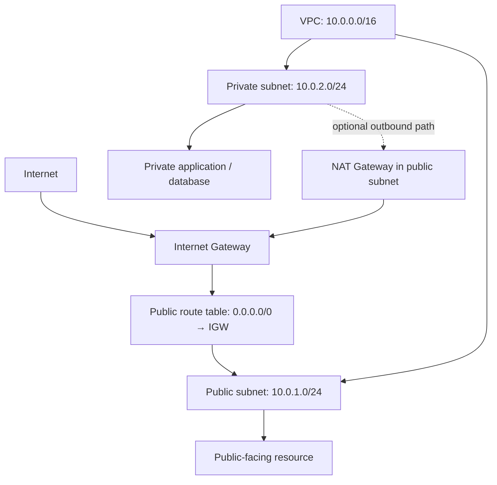

# AWS Zero to Hero — Part 8 (English)
## Chapters 21–22: AWS VPC and VPC Creation Practical

> **Source-preservation rule:** Appendix A preserves the original transcript for Chapters 21–22 in source order, including timestamps and wording. These study notes reorganize concepts for revision. Extra clarifications are separated at the end.

## Chapter 21 — AWS VPC

### 1. What is a VPC?
**Amazon Virtual Private Cloud (VPC)** is a logically isolated virtual network within AWS. You can place AWS resources inside it and control IP addressing and network connectivity.

The main purposes of a VPC are:
- **Security:** control network traffic through rules.
- **Isolation:** place resources in a logically separate network environment.
- **Control:** configure IP ranges, subnets, routes, and traffic rules.

The transcript notes that other cloud platforms may have a similar concept under a different name.

### 2. AWS Region vs. Availability Zone (AZ)

| Term | Meaning |
|---|---|
| Region | An AWS geographical area, such as the Mumbai Region |
| Availability Zone (AZ) | An isolated infrastructure location within a Region |
| VPC | A logically isolated virtual network created in a Region |
| Subnet | A subdivision of a VPC IP range, associated with one AZ |

Region selection can depend on user location, latency, service availability, compliance, and cost. Using multiple AZs can help improve resilience to failures.

### 3. CIDR block and IP range

When creating a VPC, define a CIDR block—the IP address range for the network.

Example: `10.0.0.0/16`

- An IPv4 address is 32 bits.
- `/16` means the first 16 bits are the network prefix.
- `10.0.0.0/16` contains \(2^{16}=65,536\) total IPv4 addresses.
- AWS reserves some IPv4 addresses in each subnet, so total and usable address counts differ.
- Plan CIDR ranges to avoid overlap with other VPCs and connected networks.

The transcript's console shows a VPC IPv4 CIDR prefix length between `/16` and `/28`; verify exact options and limits against the applicable service rules.

### 4. Key VPC networking components

| Component | Role |
|---|---|
| Subnet | A smaller address range within a VPC, in one AZ |
| Route table | Determines where destination traffic should be sent |
| Internet Gateway (IGW) | Provides an internet-routing target for a VPC |
| Security Group | Stateful virtual firewall for a resource/network interface |
| Network ACL (NACL) | Stateless inbound/outbound traffic rules at subnet level |
| NAT Gateway | Common option for outbound internet access from private-subnet resources without directly exposing them to unsolicited inbound internet connections |
| CIDR | Notation for an IP address range |

### 5. Public vs. private subnet

| Feature | Public subnet | Private subnet |
|---|---|---|
| Route table | Has a route to an Internet Gateway | Does not have a direct IGW route |
| Typical resources | Public-facing load balancer or carefully controlled bastion | Application servers, databases, internal services |
| Public IP | Suitable public addressing/routing/configuration is needed for internet reachability | Usually does not require a public IP |
| Security | Security Group/NACL rules are still required | Security Group/NACL rules are still required |

**Important:** Naming a subnet “public” does not make it public. Effective routing and IP configuration matter. Even in a public subnet, an instance needs the appropriate route, public IPv4/EIP in the IPv4 case, security rules, and service configuration to be reachable from the internet.

### 6. Route table role
A route table contains destination CIDRs and targets. For example:

| Destination | Target | Meaning |
|---|---|---|
| VPC CIDR, e.g. `10.0.0.0/16` | `local` | Routing within the same VPC |
| `0.0.0.0/0` | Internet Gateway | IPv4 default route towards the internet |
| Specific private network | NAT Gateway / VPN / Transit Gateway, as designed | Configured network path |

`0.0.0.0/0` is the default route for all IPv4 destinations. Route tables determine traffic paths; Security Groups and NACLs separately control traffic permissions.

### 7. Security Group vs. Network ACL (NACL)

| Feature | Security Group | Network ACL |
|---|---|---|
| Scope | Resource/elastic network interface level | Subnet level |
| Behaviour | Stateful | Stateless |
| Rules | Allow rules; response traffic is statefully allowed | Inbound/outbound allow and deny rules |
| Return traffic | Responses for tracked connections are automatically allowed | A corresponding rule is needed for the return direction |
| Use | Control resource/service traffic | Additional subnet-level traffic filtering |

**Exam gotcha:** Security Groups and NACLs are not substitutes for one another. Both can affect effective connectivity.

### 8. Internet Gateway and NAT Gateway
- **Internet Gateway:** provides an internet-routing path for the VPC; route-table, instance-addressing, and security configuration must also be correct.
- **NAT Gateway:** commonly enables outbound internet connections for resources in private subnets. It is not a substitute for exposing private resources to unsolicited inbound internet connections.
- Consider NAT Gateway placement, route tables, and cost in the architecture.

## Chapter 22 — AWS VPC Creation Practical

### 1. Create a VPC
Summary of the console workflow in the transcript:

1. Open **VPC** in the AWS Console.
2. Choose **Create VPC**.
3. Enter a name tag, such as `my-vpc`.
4. Choose an IPv4 CIDR block; the transcript example is `10.0.0.0/16`.
5. Configure IPv6 according to requirements; the transcript practical uses IPv4 only.
6. Create the VPC.
7. Verify the VPC, subnets, and route tables in the resource map.

### 2. Create two subnets
The transcript creates one public subnet and one private subnet.

Example address plan:

| Resource | Example CIDR | Purpose |
|---|---|---|
| VPC | `10.0.0.0/16` | Overall private network range |
| Public subnet | `10.0.1.0/24` | Intended for public-facing resources |
| Private subnet | `10.0.2.0/24` | Intended for internal resources |

A `/24` has 256 total IPv4 addresses, but AWS reserves five IPv4 addresses in each subnet, leaving 251 usable addresses. A subnet CIDR must fit inside the VPC CIDR, and subnet CIDRs in the same VPC must not overlap.

1. Go to **Subnets → Create subnet**.
2. Select the VPC.
3. Choose the subnet name and Availability Zone.
4. Specify the subnet CIDR.
5. Add a second subnet with a separate, non-overlapping CIDR.
6. Create the subnets and verify them in the subnet list/resource map.

### 3. Create and associate route tables
A default/main route table is created with the VPC. If you create custom route tables, explicitly associate them with the intended subnet(s).

1. Choose **Route tables → Create route table**.
2. Enter a name and select the VPC.
3. Open **Subnet associations** after creation.
4. Associate the intended public subnet with the public route table.
5. Associate the private subnet with the private route table if using a separate route-table design.
6. Verify destinations and targets under Routes.

### 4. Attach an Internet Gateway
1. Choose **Internet gateways → Create internet gateway**.
2. Enter a name, such as `my-igw`.
3. Create the IGW.
4. Choose **Actions → Attach to VPC**.
5. Select your VPC and attach it.
6. In the public route table, set the IPv4 default route `0.0.0.0/0` to the IGW target.
7. Associate the public subnet with that route table.

Attaching an IGW alone is not enough—routes, suitable public addressing, and Security Group/NACL rules must also be correct.

### 5. Private-subnet internet egress (Additional clarification)
The transcript portion covers VPC, subnets, route tables, and IGW setup. In a more complete production design, if instances in a private subnet need outbound internet access, consider a NAT Gateway or another egress architecture:
- A common pattern places a NAT Gateway in a public subnet.
- The private route table can direct `0.0.0.0/0` to the NAT Gateway.
- Evaluate NAT Gateway cost and availability design.
- Giving a private subnet a direct IGW default route is not the typical private-subnet pattern.

### 6. End-to-end network diagram



### 7. Common mistakes / exam gotchas
- Do not confuse a Region with an Availability Zone.
- Subnet CIDRs must fit inside the VPC CIDR; avoid overlapping subnet ranges.
- A public subnet needs an IGW route and route-table configuration for internet routing.
- Attaching an IGW alone does not guarantee internet access.
- Security Groups are stateful; NACLs are stateless.
- A route table determines traffic paths; it does not replace Security Groups.
- Giving private-subnet resources public IPs or direct internet routes changes the security design.
- The main route table exists by default; remember to associate custom route tables with intended subnets.
- AWS reserves five IPv4 addresses in each subnet; total CIDR size is not the usable count.

## Quick revision table

| Question | Short answer |
|---|---|
| What is a VPC? | A logically isolated virtual network in AWS |
| What is a Region? | An AWS geographical area |
| What is an AZ? | An isolated infrastructure location within a Region |
| What does a CIDR block define? | An IP address range |
| Total IPv4 addresses in `10.0.0.0/16`? | 65,536 total addresses |
| What is a subnet associated with? | One Availability Zone |
| What does a route table do? | Determines the next hop based on destination |
| What does an IGW do? | Provides an internet-routing path for the VPC |
| What is a Security Group? | Stateful resource-level virtual firewall |
| What is a NACL? | Stateless subnet-level traffic filter |
| Key routing feature of a public subnet? | Suitable route to an IGW |
| Private-subnet outbound internet option? | Commonly a NAT Gateway or designed egress path |

## Board-Level Answer

An **AWS VPC** is a logically isolated virtual network with a defined IP CIDR range. A VPC can be divided into subnets, each associated with one Availability Zone. Route tables determine traffic paths; an Internet Gateway provides an internet-routing target; Security Groups provide stateful resource-level filtering; and Network ACLs provide stateless subnet-level filtering. To build a public/private network, create non-overlapping subnet CIDRs, associate the correct route tables, attach an IGW, and add the public default route only where required. For private-subnet egress, design a suitable NAT/egress path. Validate routes, IP addressing, and security rules together.

## No-Skip Checklist

- [ ] VPC definition and purpose: isolation, security, control
- [ ] Similar networking concepts in other cloud platforms mentioned
- [ ] Region and Availability Zone
- [ ] Multiple AZs and failure-resilience motivation
- [ ] CIDR block and IPv4 32-bit concept
- [ ] `10.0.0.0/16` example and address-count concept
- [ ] Subnets
- [ ] Route tables and routing rules
- [ ] Internet Gateway
- [ ] Security Groups
- [ ] Network ACLs
- [ ] NAT concept mentioned in the lesson introduction
- [ ] Create VPC practical
- [ ] Create public/private subnet practical
- [ ] Availability Zone selection
- [ ] Default/main route table
- [ ] Create custom route table
- [ ] Create and attach Internet Gateway
- [ ] Associate subnets with route tables
- [ ] Original transcript preserved in Appendix A

## Additional Points Added (separate from the original transcript)

1. Distinguishes total IPv4 addresses from AWS-usable subnet addresses (AWS reserves five IPv4 addresses per subnet).
2. Adds clearer public-subnet requirements: IGW route, public addressing, and appropriate security rules.
3. Explains Security Group statefulness versus NACL statelessness in a comparison table.
4. Adds a private-subnet NAT/egress explanation as additional context; this is clarification, not a claim that every step was shown in the transcript.
5. Adds route-table examples and a consolidated Mermaid network diagram.
6. Current console options and service limits can change; live AWS documentation verification is not included.

## Appendix A — Original Source — Preserved

The original transcript for Chapters 21–22 is reproduced below in its original order, including timestamps and wording.

```text
Chapter 21: AWS VPC
6:54:026 hours, 54 minutes, 2 secondsऑलराइट सो चलिए सेक्शन में समझते हैं वर्चुअल प्राइवेट क्लाउड वीपीसी क्या होता है एंड इसी के साथ-साथ नेटवर्किंग से रिलेटेड टर्म्स जैसे कि इंटरनेट गेटवे
6:54:096 hours, 54 minutes, 9 secondsराउटिंग टेबल सबनेट सिक्योरिटी ग्रुप एंड एसीएल नेट ये सारी चीजें क्या होती हैं इस वीडियो के एंड तक आपको सब क्लियर हो जाएगा
6:54:176 hours, 54 minutes, 17 secondsतो चाहे आप इंटरव्यू के लिए प्रिपेयर कर रहे हो या तो आप क्लाउड प्लेटफॉर्म पर काम कर रहे हो यह कांसेप्ट की अंडरस्टैंडिंग आपको बहुत हेल्प करने वाली है शुरुआत करते
6:54:256 hours, 54 minutes, 25 secondsहैं वीपीसी होता क्या है अ प्राइवेट आइसोलेटेड नेटवर्क विद इन द एडब्ल्यू एस क्लाउड जब आप क्लाउड प्लेटफार्म पे अपना
6:54:326 hours, 54 minutes, 32 secondsखुद का प्राइवेट नेटवर्क क्रिएट करते हो उसको हम वर्चुअल प्राइवेट क्लाउड वीपीसी बोलते हैं सिंपल एंड यहां पे एक चीज और ऐड
6:54:416 hours, 54 minutes, 41 secondsकरूंगा कि एडब्ल्यू एस मैंने यहां पे मेंशन किया है बट ये जो वीपीसी का कांसेप्ट है वो जनरल कांसेप्ट है ठीक है सो ये अदर जो क्लाउड प्लेटफॉर्म है जैसे
6:54:496 hours, 54 minutes, 49 secondsअजर हो गया शायद इसमें नाम अलग होगा जैसे कि एजर में वर्चुअल नेटवर्क होता है नेट ओके सो नाम शायद डिफरेंट होगा बट ये
6:54:566 hours, 54 minutes, 56 secondsकांसेप्ट सेम ही होते हैं और ऐसे ही वर्क करते हैं ठीक है आगे बढ़ते हैं सबसे पहले तो क्वेश्चन ही आता है कि भाई वीपीसी क्या होता है प्राइवेट नेटवर्क बट इसकी जरूरत
6:55:056 hours, 55 minutes, 5 secondsक्या होती है क्यों होती है क्यों बनाते हैं हम लोग तो सिंपल सा आंसर है टू सिक्योर आइसोलेट एंड कंट्रोल नेटवर्क एनवायरमेंट ओके हमारा जब खुद का नेटवर्क
6:55:146 hours, 55 minutes, 14 secondsहोगा तो पहला हमारे पास एडवांटेज होगा कि हमारा ज्यादा कंट्रोल होगा उस नेटवर्क पे राइट क्योंकि हम प्राइवेटली खुद मैनेज कर रहे हैं तो ज्यादा कंट्रोल होगा ज्यादा
6:55:236 hours, 55 minutes, 23 secondsअच्छे से मैनेज और कस्टमाइज हम कर सकते हैं अपने अकॉर्डिंग दूसरी चीज हम जो डिफॉल्ट जो उनका नेटवर्क होता है है ना
6:55:326 hours, 55 minutes, 32 secondsउससे आइसोलेट हो जाएंगे देखो क्या होता है जैसे कि एए की बात करें यह एए का कंसोल है अभी नॉर्मली क्या है मल्टीपल यूजर्स
6:55:416 hours, 55 minutes, 41 secondsएडब्ल्यू की सर्विसेस यूज़ करते हैं सो जैसे कि मान लो अगर यहां पे 10 यूजर्स हैं इस और दसों यूजर्स ईसी टू इंस्टेंस बनाते
6:55:486 hours, 55 minutes, 48 secondsहैं वो सारे यूजर जो हैं वह एक शेयर्ड नेटवर्क यूज करते हैं जैसे कि आप देखोगे एक यहां पे मेरे जो रीजन है स्टॉक होम
6:55:576 hours, 55 minutes, 57 secondsयहां पे एक वीपीसी ऑलरेडी बना हुआ है ओके सो ये हो गया शेयर्ड नेटवर्क लेकिन जब हम प्रा टली बनाते हैं सो यह शेयर्ड नेटवर्क से आइसोलेट हो जाता है सो दैट हम जो भी
6:56:066 hours, 56 minutes, 6 secondsरिसोर्स बनाते हैं अपने नेटवर्क में सो उसमें एक एडिशनल लेयर ऑफ सेफ्टी हमको मिल जाती सिंपल सा ये कांसेप्ट हुआ वीपीसी का
6:56:146 hours, 56 minutes, 14 secondsठीक है इस कांसेप्ट को और अच्छे से समझने के लिए स्पेशली हम पूरा क्लाउड प्लेटफॉर्म को थोड़ा कवर कर रहे हैं एक छोटा सा यूज
6:56:226 hours, 56 minutes, 22 secondsकेस लाया हूं जैसे कि मान लो ये मेरी वेबसाइट है रेडी टू पब्लिश है ये वेबसाइट बन गई है और मैं डिसाइड करता हूं कि क्लाउड प्लेटफार्म पर मुझे पब्लिश करना है
6:56:296 hours, 56 minutes, 29 secondsठीक है सो मैं एडब्ल्यू को अ मतलब मैं चूज करता हूं कि एडब्ल्यू को यूज करने वाला हूं ठीक है अब एडब्ल्यू तो ऑल ओवर द
6:56:376 hours, 56 minutes, 37 secondsवर्ल्ड ऑपरेट करता है ठीक है तो किस पार्ट में वर्ल्ड के किस पार्ट में मुझे उसको
6:56:446 hours, 56 minutes, 44 secondsडिप्लॉयडी है कि यह जो वेबसाइट मैं बना रहा हूं वो इंडियन यूजर्स के लिए मतलब जो मेरे टारगेट यूजर्स है वो इंडियंस है ओके
6:56:516 hours, 56 minutes, 51 secondsसो उसको सिंपलीफाई करने के लिए amazonbusiness.in एशिया मैंने पिक कर
6:57:026 hours, 57 minutes, 2 secondsलिया अब एशिया भी अपने आप में बहुत बड़ा है तो उन्होंने डिवाइड फर्द डिवाइड कर दिया एशिया को नॉर्थ ईस्ट साउथ में एंड यह
6:57:106 hours, 57 minutes, 10 secondsजो अलग-अलग पार्ट है नॉर्थ ईस्ट साउथ इसमें जो एडब्ल्यूएमपीयूआई
6:57:306 hours, 57 minutes, 30 secondsदिया आ गया कि आप किस तरह से यह चीजें चूज करते हो सो हमारी वेबसाइट क्या है इंडियन
6:57:376 hours, 57 minutes, 37 secondsयूजर्स के लिए ठीक है टारगेट है सो या तो मैं मुंबई या तो हैदराबाद में चूज कर सकता हूं ठीक है तो लेट्स से मैं मुंबई रीजन को
6:57:446 hours, 57 minutes, 44 secondsपिक करता हूं तो सबसे पहले मैंने क्या चीज पिक करी अपने वेबसाइट के लिए एंड क्लाउड प्लेटफॉर्म में जो कि रीजन रीजन इज लाइक अ
6:57:526 hours, 57 minutes, 52 secondsसिटी और अ प्लेस जहां पे इनका डटा सेंटर प्रेजेंट होता है ठीक है सो यहां पे मुंबई इज अ रीजन अब आगे आते हैं कि जैसे कि
6:58:006 hours, 58 minutesमुंबई रीजन है जहां पे एडब्ल्यू एस के डाटा सेंटर्स हैं सो ये किसी एक जगह नहीं होते मल्टीपल जगह होते हैं जैसे कि मुंबई
6:58:096 hours, 58 minutes, 9 secondsमें एक जगह मतलब दो जगह तीन जगह चार जगह भी हो सकते हैं इसका रीजन यही है सिंगल पॉइंट ऑफ फेलियर से बचने के लिए ओके
6:58:166 hours, 58 minutes, 16 secondsक्योंकि अगर सिर्फ एक जगह है और आपने यहीं पे वेबसाइट डिप्लॉयड से पावर फेलियर हो गया फायर का कुछ इशू हो गया सो आपकी
6:58:236 hours, 58 minutes, 23 secondsवेबसाइट तो पूरी डाउन और डाटा भी आपका गया सो उस उससे बचने के लिए यहां पे एक रीजन में मल्टीपल डाटा सेंटर्स इन लोग अलग-अलग
6:58:326 hours, 58 minutes, 32 secondsगग पर रखते हैं जिसको बोलते हैं अवेलेबिलिटी जनस या तो एजीस भी बोलते हैं एजीस अवेलेबिलिटी जन ओके सो यहां पे दो
6:58:406 hours, 58 minutes, 40 secondsचीजें हम लोग को समझ में आ गई रीजन क्या होता है और अवेलेबिलिटी जोन क्या होता है ठीक है और ये कुछ इस टाइप से ही डिनोट
6:58:486 hours, 58 minutes, 48 secondsहोते हैं ये ए बी सी ओके सो जैसे कि मुंबई है तो मुंबई का एक रीजन होगा टोटल एंड
6:58:566 hours, 58 minutes, 56 secondsउसके बाद ए बी सी इस तरह से एजीस होते हैं जैसे कि मैं कंसोल पे भी जाके दिखा देता हूं यह मेरा क्या बोलते हैं यह रीजन आपको
6:59:036 hours, 59 minutes, 3 secondsयहां पे दिख जाएगा और आप इस तरह से देखोगे ना सो आपको यहां पे इसी दिखेगा जैसे कि एशिया में अगर आप देखोगे सो ये देखो ये
6:59:116 hours, 59 minutes, 11 secondsमुंबई है तो मुंबई में एी साउथ वन एंड फिर वन के बाद 1a व बी व सी मतलब ये अलग-अलग
6:59:186 hours, 59 minutes, 18 secondsजो इनके एजीज होते हैं अवेलेबिलिटी जन वो हम लोग कवर करेंगे ठीक है तो ये टर्म्स आपको क्लियर होनी चाहिए कि हाउ इट इज वर्क
6:59:266 hours, 59 minutes, 26 secondsतो सपोज करो कि देखो हमने मुंबई रीजन को पिक कर लिया मुंबई रीजन है ब्लैक में आप देख रहे हो और इसके अंदर हम लोग ने माय
6:59:346 hours, 59 minutes, 34 secondsवीपीसी नाम का एक वीपीसी क्रिएट कर दिया ओके हम लोग का एक रीजन के अंदर हम लोग ने एक वीपीसी बना तो दिया लेकिन वीपीसी बनाते
6:59:426 hours, 59 minutes, 42 secondsहैं तो एक्चुअल में होता क्या है थोड़ा सा हम लोग डेप्थ में जाते हैं और समझाता हूं तो जब हम वीपीसी बनाते हैं तो हम बेसिकली
6:59:496 hours, 59 minutes, 49 secondsक्या प्रोवाइड करते हैं एक सीआईडीआर ब्लॉक ऑफ आईपी एड्रेसस ठीक है सो नेटवर्क मतलब क्या होता है सेट ऑफ आईपी एड्रेसस ही होता
6:59:586 hours, 59 minutes, 58 secondsहै तो हम लोग क्या करते हैं जब ये प्राइवेट नेटवर्क हम बनाते हैं उसको हम लोग एक सेट ऑफ आईपीस अ असाइन कर देते हैं
7:00:077 hours, 7 secondsसो दैट हम उसको अलग-अलग डिवाइसेज कर सकें फॉर फर्द कम्युनिकेशन ठीक है इतना ही मतलब होता है वीपीसी का सीआईडीआर ब्लॉक का क्या
7:00:167 hours, 16 secondsमतलब होता है क्लास लेस इंटर डोमेन राउटिंग एक मेथड होता है जिस जो यूज करते हैं हम लोग एलोकेटिंग द आईपी एड्रेसस तो
7:00:247 hours, 24 secondsहम लोग वीपीसी बना रहे हैं हम लोग ने एक नाम दे दिया और बोला कि भाई हमें इस रेंज की आईपीस मुझे चाहिए जो कि मैं फर्द यूज़
7:00:317 hours, 31 secondsकरूंगा अपने नेटवर्क में वेरी सिंपल और जो सीआईडीआर ब्लॉक का जो एक फॉर्मेटिंग होती है ना इस टाइप से होती है जैसे कि एक ही
7:00:397 hours, 39 secondsसिंपल है 10.0.01 ओके सो ये क्या होता है सीआईडीआर ब्लॉक इसको अच्छे से और समझना है ना तो आप
7:00:487 hours, 48 secondsसिंपल एक मैं आपको साइट बताता हूं c एकवा एक साइट है एंड इंटरेक्ट आईपी एड्रेस सीआईडीआर रेंज विजुलाइज है तो आपको और
7:00:567 hours, 56 secondsअच्छे से समझ में आएगा सेम मैंने यही फॉर्मेट यूज़ किया है ठीक है 10.0.0 0 फ 16 इसका मतलब क्या होता है आपको यहां पे
7:01:047 hours, 1 minute, 4 secondsसब दिखेगा अब ये जो आप नंबर देखते हो ना ये स्टार्टिंग के वो हर नंबर एक 8 बिट का
7:01:117 hours, 1 minute, 11 secondsएक नंबर आपको रिप्रेजेंट करता है तो टोटल यहां पे 32 बिट होता है जो कि आईपी वर्जन 4 का एक फॉर्मेट है
7:01:207 hours, 1 minute, 20 secondsओके एंड चलो अब फव स् 16 का मतलब क्या होता है अ आप इससे एक चीज मतलब ये वेबसाइट से आपको
7:01:307 hours, 1 minute, 30 secondsथोड़ा सा क्लियर हो जाएगा कि देखोगे कि टोटल जब आप फॉरवर्ड स्ला 16 करते हो सो आपको
7:01:367 hours, 1 minute, 36 seconds65000 से ज्यादा आईपीस असाइन हो जाती है सिंपल सो जब हम लेट्स से हम वीपीसी बना
7:01:437 hours, 1 minute, 43 secondsरहे हैं और मैंने ये सीआईडीआर ब्लॉक दे दिया ठीक है सो जब हमारा वीपीसी बनेगा उसमें हमारे पास 65000 आईपीस होंगी जो हम
7:01:517 hours, 1 minute, 51 secondsलोग अलग-अलग पर्पस के लिए यूज कर सकते हैं वेरी सिंपल और आप देखोगे यहां पे फर्स्ट यूज बल आईपी देखो ये हो गई और लास्ट यूब
7:01:597 hours, 1 minute, 59 secondsआईपी ये हो गई ओके सो आप इससे समझ सकते हो चलिए अगर आपको नहीं हो पा रहा रिलेट तो मैं बताता हूं जैसे मैं क्रिएट वीपीसी
7:02:087 hours, 2 minutes, 8 secondsकरता हूं वीपीसी ओनली ठीक है मतलब यह मैं आपको दिखा भी दे रहा हूं तो जब आप वीपीसी क्रिएट करते हो आपको सि देखो सिर्फ वो एक
7:02:157 hours, 2 minutes, 15 secondsचीज पूछेगा नेम टैग मतलब आप नाम दे दो माय वीपीसी आप दे सकते हो इसके बाद देखोगे
7:02:217 hours, 2 minutes, 21 secondsआईपी b4 वर्जन 4 जो कि 32 बिट होता है एंड इसमें इट इज आस्किंग फॉर द सीआईडीआर ब्लॉक
7:02:287 hours, 2 minutes, 28 secondsकि मतलब आपको कितनी आईपी की रेंज प्र वाइड करनी है और इसने देखो यहां पे मेंशन भी किया है मिनिमम 16 एंड मैक्सिमम 28 आप इस
7:02:387 hours, 2 minutes, 38 secondsरेंज में बता सकते हो ठीक है लेट्स से अब मैं सीआईडीआर ब्लॉक जाता हूं मैक्सिमम कितना था हमारा 28 तो मैं यहां पे 28 करता
7:02:467 hours, 2 minutes, 46 secondsहूं सो आप देखोगे 28 अगर करता हूं तो हमें 16 आईपीस मिलती है तो सिंपल मैं क्या कह रहा हूं
7:02:527 hours, 2 minutes, 52 secondsकि ये जो हमारा वीपीसी बन रहा है इसके अंदर हमारे पास 16 आईपीस अवेलेबल होगी यूज करने के लिए सो इतना ही एक आईडिया है ठीक
7:03:027 hours, 3 minutes, 2 secondsहै चलिए आगे बढ़ते हैं अब बात करते हैं सबनेट्स की ठीक है सो यह हम थोड़ा सा एक और ऐड ऑन कर रहे हैं सबनेट्स क्या होता है
7:03:117 hours, 3 minutes, 11 secondsअ सबनेट इज अ स्मॉलर सेगमेंटेड पार्ट ऑफ अ लार्जर नेटवर्क ठीक है अभी लेट्स से कि हमारा देखो यहां पे वीपीसी बन गया था और
7:03:207 hours, 3 minutes, 20 secondsउसके अंदर कुछ आईपीस थी ओके चलिए मैं अजूम कर रहा हूं मैं मतलब एग्जांपल ही ले रहा हूं जैसे कि ये हमारा वीपीसी है जिसमें
7:03:287 hours, 3 minutes, 28 secondsमैंने 100 आईपी हमारे पास अवेलेबल है यूज करने के सबनेट क्या होता है स्मॉलर सेगमेंटेड पार्ट मतलब मैंने उसको एक छोटे पार्ट में
7:03:377 hours, 3 minutes, 37 secondsडिवाइड कर दिया जैसे कि पब्लिक सबनेट एक छोटा पार्ट जिसमें मैंने 50 आईपीस दे दी और एक और मैंने सबनेट बना दिया प्राइवेट
7:03:457 hours, 3 minutes, 45 secondsसबनेट यहां पे पब्लिक लिखा है प्राइवेट है ये है ना तो प्राइवेट सबनेट और उसमें 50 आईपीस ठीक है तो मैंने ये जो भी अवेलेबल
7:03:537 hours, 3 minutes, 53 secondsआईपीस थी उसको छोटे-छोटे पार्ट में डिवाइड कर दिया अपने यूज केस के अकॉर्डिंग ठीक है और इसको और अच्छे से समझे तो हमारा कुछ इस
7:03:597 hours, 3 minutes, 59 secondsटाइप का डायग्राम दिखेगा एट द एंड पहले तो आया रीजन लेट्स से हमारा मुंबई ठीक है उसके अंदर हम लोग ने वीपीसी बनाया
7:04:087 hours, 4 minutes, 8 secondsवीपीसी में देखोगे यह रेंज दे दिया मैंने फॉरवर्ड स् 16 इसका मतलब क्या हुआ 65000 हमारे पास आईपी है राइट उसके अंदर हम लोग
7:04:167 hours, 4 minutes, 16 secondsने देखो ये छोटे-छोटे दो सबनेट्स बना दिए एक पब्लिक एंड प्राइवेट एंड बिल्कुल अच्छे से मैं क्लियर कर दूं आपको कि जो आप
7:04:247 hours, 4 minutes, 24 secondsरिसोर्स बनाते हो ठीक है क्योंकि देखो नेटवर्क हम क्यों बना रहे कि नेटवर्क के अंदर हम कोई रि सोर्स बनाएंगे राइट तो जो
7:04:347 hours, 4 minutes, 34 secondsरिसोर्स हम बनाते हैं जैसे कि ईट इंस्टेंस तो वो ट इंस्टेंस सबनेट के अंदर बनता है वीपीसी को आप डायरेक्ट यूज नहीं कर सकते
7:04:427 hours, 4 minutes, 42 secondsहो है ना आपका जो रिसोर्स बनेगा वो सबनेट के अंदर बनेगा यह चीज आपको ध्यान रखना है ये डायग्राम से भी आप समझ सकते हो देखो ये सबनेट है और सबनेट के अंदर इंस्टेंसस है
7:04:517 hours, 4 minutes, 51 secondsतो आप यहां पे मल्टीपल इंस्टेंस बना सकते हो आप देखोगे कि जैसे कि हम लोग एसी टू इंस्टेंस बनाते हैं आपको एक आईपी असाइन
7:04:587 hours, 4 minutes, 58 secondsहोती है ना राइट सो जैसे कि मान लो आपका सबनेट है पब्लिक सबनेट ठीक है तो यह जो
7:05:057 hours, 5 minutes, 5 secondsइंस्टेंस बनाओगे लेट्स से टू इंस्टेंस सो आपको यह जो रेंज आप प्रोवाइड कर रहे हो ना सबनेट्स की वही रेंज की आईपी असाइन होगी
7:05:147 hours, 5 minutes, 14 secondsआप इसको ट्राई करके देख भी सकते हो ठीक है अब आप शायद कंफ्यूज हो रहे होंगे कि अलग-अलग सबनेट्स की जरूरत क्या है तो मैं
7:05:227 hours, 5 minutes, 22 secondsआपको वो भी एक आईडिया दे देता हूं सो दैट आप विजुलाइज कर पाओ अच्छे से यहां पर आप देखोगे मैंने सिर्फ दो ही कैटेगरी यूज करी है पब्लिक सबनेट एंड प्राइवेट सबनेट बाकी
7:05:307 hours, 5 minutes, 30 secondsऔर मल्टीपल आप यूज कर सकते हो यह नाम भी आप अपने अकॉर्डिंग दे सकते हो इट डजन मैटर ठीक है पब्लिक सबनेट प्राइवेट सबनेट मतलब
7:05:387 hours, 5 minutes, 38 secondsक्या है देखो कई बार जैसे कि ईटू इंस्टेंसस है राइट कुछ ईटू इंस्टेंस है जिस परे आप फ्रंट एंड को
7:05:467 hours, 5 minutes, 46 secondsडिप्लॉयड से एक्सेसिबल होना चाहिए राइट कुछ आपके पास एप्लीकेशंस होगी जैसे कि डेटाबेस राइट सो डेटाबेस वैसे ऑफकोर्स
7:05:557 hours, 5 minutes, 55 secondsक्रिटिकल भी होता है थोड़ा सा कि एंड सेफ्टी पॉइंट ऑफ व्यू से एंड उसको आप इंटरनेट से सेबल नहीं करना चाहोगे जरूरत
7:06:037 hours, 6 minutes, 3 secondsही नहीं है और सिक्योरिटी पॉइंट ऑफ व्यू से भी आप बिल्कुल नहीं चाहोगे राइट सो अलग-अलग पर्पस हो गए ना कुछ एप्लीकेशंस को आप चाहते ही नहीं हो इंटरनेट से एक्सेसिबल
7:06:127 hours, 6 minutes, 12 secondsहो तो बेटर है कि हम आईपीस डिवाइड कर दें कि कुछ आईपीस हम प्राइवेट रखें कुछ प्रा आईपीस हम पब्लिक रखें ठीक है और जो भी
7:06:217 hours, 6 minutes, 21 secondsहमें इंस्टेंस की जरूरत हो जो कि जो कि यूज हो हम उस सबनेट के अंदर बनाएंगे राइट सो यहां पे आप क्लियर ये देख सकते हो जैसे
7:06:287 hours, 6 minutes, 28 secondsकि प्राइवेट सबनेट है ओके सो इसके अंदर हम लोग डे टा बेस वाला इंस्टेंस बना देंगे और पब्लिक सबनेट है इसमें हम लोग फ्रंट एंड वाला ठीक है इंस्टेंस बना देंगे तो ये रहा
7:06:377 hours, 6 minutes, 37 secondsथोड़ा सा बेसिक डिफरेंस चलिए आगे बढ़ते हैं और यह थोड़ा सा मैं और एक चीज ड ऑन कर देता हूं जैसे कि देखो रीजन था मुंबई एंड
7:06:477 hours, 6 minutes, 47 secondsमुंबई रीजन में अलग-अलग जोनस थे एजीस आपको याद होगा ए बी सी ठीक है सो जो सबनेट
7:06:547 hours, 6 minutes, 54 secondsहमारा जो बनता है वो अवेलेबिलिटी जोन में बनता है क्योंकि अवेलेबिलिटी जन मतलब क्या है देखो एक एक रियल फिजिकल सर्वर होते हैं
7:07:027 hours, 7 minutes, 2 secondsएक्चुअली ठीक है तो दो सो जो आपके रिसोर्स हैं वो फिजिकल सर्वर प ही बनेंगे सो एक्चुअल में जो आपका जो सबनेट है वो
7:07:117 hours, 7 minutes, 11 secondsअवेलेबिलिटी जोन पे बनता है ओके इसमें भी मल्टीपल केसेस हैं जैसे कि एक अवेलेबिलिटी जन पे आप मल्टीपल सबनेट बना सकते हो ठीक
7:07:207 hours, 7 minutes, 20 secondsहै या तो अलग-अलग अवेलेबिलिटी जन पे अलग-अलग सबनेट बना सकते हो ये डिसीजन टोटली आपका है ओके चलिए मैं इसका ये भी
7:07:297 hours, 7 minutes, 29 secondsदिखा देता हूं एंड आल्सो एक चीज और ड करता हूं कि जब हम सबनेट बनाते हैं क्योंकि जैसे वीपीसी बनाते थे तो हम लोग एक सीआईडी
7:07:367 hours, 7 minutes, 36 secondsरेंज प्रोवाइड करते थे बट जब हम सबनेट बना रहे हैं तो हम लोग क्या करते हैं या तो हम लोग क्या प्रोवाइड करते हैं सो सबनेट के
7:07:447 hours, 7 minutes, 44 secondsटाइम में भी हम लोग रेंज ऑफ आईपीस बताते हैं जैसे कि मैंने वो एग्जांपल लिया था ना 100 आईपी से तो 5050 में डिवाइड कर दिया
7:07:517 hours, 7 minutes, 51 secondsसो आप रेंज बताते हो और वो रेंज वीपीसी के रेंज के अंदर होनी चाहिए
7:08:007 hours, 8 minutesदैट्ची है ना वीपीसी एंड मोर वाले पर मैं क्लिक कर देता हूं ठीक है सो इसमें यह वीपीसी के साथ-साथ सबनेट्स भी ऐड कर देगा
7:08:087 hours, 8 minutes, 8 secondsठीक है चलिए यह रहा हमारा वीपीसी का पार्ट यह देखो यह रेंज हो गई 16 वाला इस कम
7:08:167 hours, 8 minutes, 16 secondsज्यादा भी कर सकते हैं यह सीआईडीआर ब्लॉक हम लोग ने प्रोवाइड किया अब नीचे आ जाते हैं अब एक चीज देखोगे एस यहां पे देखो पूछ
7:08:237 hours, 8 minutes, 23 secondsरहा है ना अवेलेबिलिटी जोन एस राइट कितने जोनस में आपको यह सबनेट्स बनाने हैं यहां
7:08:317 hours, 8 minutes, 31 secondsपर दो यूज किए यहां पे वन भी आप कर सकते हो टू यूज कर सकते हो थ्री कर सकते हो ठीक है जैसे कि मैंने बताया था कि जो नेमिन
7:08:387 hours, 8 minutes, 38 secondsकन्वेंशन है ना जैसे कि देखो दो तीन ठीक है तो अगर आप देखोगे स्टॉक होम सो अभी स्टॉक होम अगर आप देखोगे यू नॉर्थ व यह
7:08:487 hours, 8 minutes, 48 secondsमेरा स्टॉकहोम का रीजन है और जो अवेलेबिलिटी जन है ये देखोगे नॉर्थ 1a 1 ब
7:08:557 hours, 8 minutes, 55 seconds1c जो हम लोग ने अपने एग्जांपल में देखा था ए बी सी तो अलग-अलग जनस है ठीक है अब आप सब रिलेट कर पाओगे अच्छे से ओके नाउ इट
7:09:057 hours, 9 minutes, 5 secondsइज आस्किंग नंबर ऑफ द सबनेट कि कितने सबनेट्स बनाना है ओके एक्चुअली इट इज आस्किंग फॉर नंबर ऑफ पब्लिक सबनेट कि पब्लिक सबनेट कितने रखना है प्राइवेट
7:09:137 hours, 9 minutes, 13 secondsसबनेट कितने रखना है ठीक है एंड इसके बाद ठीक है सो मैं लेट्स से यहां पे
7:09:207 hours, 9 minutes, 20 secondsअवेलेबिलिटी जन वन कर देता हूं ठीक है चलो दो दो कर लेते हैं इट्स फाइन यहां पे जो सबनेट का सेक्शन है अगर सबनेट के सेक्शन
7:09:277 hours, 9 minutes, 27 secondsमें कस्टमाइज पे मैं आता हूं नीचे करता हूं इसको आप देखोगे कि यहां पे टोटल चार सबनेट बन रहे हैं दो मतलब दो सबनेट एक जोन
7:09:367 hours, 9 minutes, 36 secondsपे दो सबनेट दूसरे जोन पे और जो हम लोग ने डिटेल्स यहां पे प्रोवाइड करी है रेंज देखोगे
7:09:447 hours, 9 minutes, 44 seconds10.0.0 20 अ ये जो ब्लॉक आपको कभी भी समझना हो सीआईडीआर ब्लॉक पे जाना जैसे कि हम लोग इसमें 20 दे रहे हैं अब देखोगे
7:09:517 hours, 9 minutes, 51 seconds4096 यहां पे आईपी हम लोग प्रोवाइड कर र है तो इसका मतलब क्या हुआ वीपीसी हम लोग ने बनाया था देखोगे 65000 आईपीस का ठीक
7:10:017 hours, 10 minutes, 1 secondठीक है 65000 टोटल आईपीस थी उसके अंडर हम लोग ने छोटे-छोटे चार सबनेट बना दिए चारों सबनेट को हम लोग ने 44000 यहां पे आईपीस
7:10:107 hours, 10 minutes, 10 secondsदे दी तो अभी अभी भी हमारे पास बहुत सारी बची है सो इस तरह से वर्क करता है एंड आल्सो जब आप ये बना रहे होते हैं ना सो आपको एक अच्छा सा प्रीव्यू मिलता है जो कि
7:10:187 hours, 10 minutes, 18 secondsआप काफी अच्छे से रिलेट कर सकते हो जैसे कि देखो वीपीसी बनाया वीपीसी के अंदर आप देखोगे चार सबनेट बने हुए हैं अलग-अलग
7:10:257 hours, 10 minutes, 25 secondsअवेलेबिलिटी जन 1 ए एंड वन बी पे ठीक है यहां पे प्राइवेट एंड पब्लिक दोनों सबनेट है जैसे कि यहां पे जो पब्लिक सबनेट होते
7:10:347 hours, 10 minutes, 34 secondsहैं ग्रीन में दिखाई देते हैं ठीक है और और ये जो ग्रीन वाले हैं वो एक राउटिंग टेबल से कनेक्टेड है यह देखोगे प
7:10:437 hours, 10 minutes, 43 secondsप्रोजेक्ट आरटीबी पब्लिक ये पब्लिक राउटिंग टेबल है और ये राउटिंग टेबल जाता है इंटरनेट गेटवे पे क्योंकि यह पब्लिक है
7:10:517 hours, 10 minutes, 51 secondsतो ये इंटरनेट से एक्सेसिबल होने चाहिए तो इंटरनेट गेटवे पे ये कनेक्टेड है सो आप इससे भी देख सकते हो कि आपका ये फ्लो पूरा
7:10:577 hours, 10 minutes, 57 secondsजो नेटवर्क है नेटवर्क का है वो कैसे काम करेगा चलिए इतना तो हम लोग ने काफी अच्छे से समझ लिया अब आगे बढ़ते हैं राउटिंग
7:11:047 hours, 11 minutes, 4 secondsटेबल ठीक है तो अभी इस फ्लो से तो आई एम श्यर कि आप समझ गए होंगे कि यह राउटिंग टेबल यह देखो यह कैसे वर्क कर रहा है बट
7:11:117 hours, 11 minutes, 11 secondsफिर भी थोड़ा सा हम लोग और बात करते हैं राउट टेबल क्या होता है राउट टेबल इज अ सेट ऑफ रूल्स कॉल्ड राउट्स
7:11:197 hours, 11 minutes, 19 secondsदेखिए हम लोग ने एक अपना नेटवर्क बना दिया उसको नेट सबनेट्स बना दिए ओके एंड एंड सो
7:11:267 hours, 11 minutes, 26 secondsऑन बट यह जो हमारा नेटवर्क है इसके अंदर अलग अलग सबनेट्स हैं अलग-अलग सबनेट्स से अलग-अलग डेटा फ्लो हो रहा है अब वो डाटा
7:11:357 hours, 11 minutes, 35 secondsको आपको कहां डाइवर्ट करना है कहां फॉरवर्ड करना है यह कौन डिसाइड करेगा ये
7:11:427 hours, 11 minutes, 42 secondsडिसाइड करता है राउटिंग टेबल राइट जो मदद करता है आपके जो जो भी डाटा फ्लो हो रहा है ट्रैफिक फ्लो हो रहा है ना आपके
7:11:507 hours, 11 minutes, 50 secondsनेटवर्क में उसको एक सही डायरेक्शन में फॉरवर्ड करने के लिए सिंपल एंड राउटिंग टेबल में सिंपल होते हैं राउट्स जिसको सेट
7:11:577 hours, 11 minutes, 57 secondsऑफ रूल्स बोलते हैं और रूल्स में हम लोग बताते हैं कि भाई जो डाटा आएगा लेट्स से इस सबनेट से अगर डाटा आ रहा है तो उसको कहां फॉरवर्ड करना है वेरी सिंपल राउट
7:12:067 hours, 12 minutes, 6 secondsटेबल एसोसिएट होता है सबनेट के साथ ठीक है ओके वीपीसी के अंदर सबनेट और राउट टेबल जो
7:12:147 hours, 12 minutes, 14 secondsहै वो सबनेट के साथ काम करता है यह चीज आपको ध्यान देनी है और ये हम लोग ने प्रीव्यू में भी देखा था वीपीसी वीपीसी के अंदर सबनेट और ये जो सब ये जो राउटिंग
7:12:227 hours, 12 minutes, 22 secondsटेबल है वो एक सबनेट के साथ काम करता है अब जैसे कि यहां पर आप देखोगे मैं इसको क्लिक कर रहा हूं ठीक है सो व्हाट डज इट
7:12:297 hours, 12 minutes, 29 secondsमीन कि अगर यहां से इस वाले सबनेट से अगर डाटा आता है तो
7:12:387 hours, 12 minutes, 38 secondsआपको इस राउटिंग टेबल पे मतलब मैंने एसोसिएट किया है इस राउटिंग टेबल में एक रूल होता है कि भाई देखो अगर यहां से डाटा
7:12:487 hours, 12 minutes, 48 secondsआएगा तो उसको फॉरवर्ड कर दो इंटरनेट गेटवे पे ओके लेकिन अगर यह प्राइवेट वाले नेटवर्क सबनेट से अगर डाटा आता है सो उसको
7:12:577 hours, 12 minutes, 57 secondsकहां फॉरवर्ड कर दो यह दूसरे पे ठीक है यह वीपीसी एंड पॉइंट सो राउटिंग टेबल का
7:13:047 hours, 13 minutes, 4 secondsसिंपल सा एक यूज केस होता है यूज होता है एक्चुअली कि कहां फॉरवर्ड करना है व यह डिसाइड करता है ठीक है चलिए मैं यहां पे
7:13:117 hours, 13 minutes, 11 secondsवीपीसी पे जाता हूं यह देखो एक डिफॉल्ट वीपीसी ऑलरेडी बना होता है क्योंकि बिना नेटवर्क के तो ठीक
7:13:187 hours, 13 minutes, 18 secondsहै रिसोर्सेस चलेंगे नहीं सो एक डिफॉल्ट वीपीसी बना हुआ आता है जो कि प्रोवाइडेड बाय एडब्ल्यू एस मैनेज बाय एडब्ल्यू एस होता है जब आप वीपीसी क्रिएट करते हो राइट
7:13:287 hours, 13 minutes, 28 secondsसो आपको देखोगे एक मेन राउट टेबल ऑलरेडी ब बना हुआ होता है ठीक है अगर मैं इस राउटिंग टेबल पर क्लिक करता हूं यह देखो
7:13:357 hours, 13 minutes, 35 secondsराउट टेबल बना हुआ है इसको क्लिक करता हूं आप देखोगे राउट्स राउट्स मतलब क्या होता है सेट ऑफ रूल्स कि भाई क्या करना है
7:13:437 hours, 13 minutes, 43 secondsसबनेट एसोसिएशन ओके एंड चलिए ये तो मेन राउट्स है सो यह सब इस पे वो
7:13:527 hours, 13 minutes, 52 secondsरहेगा अब इस पे आप ध्यान दोगे तो आप देखोगे 0.0.0 ये एक रूल यहां पे प्रोवाइड है मतलब
7:13:597 hours, 13 minutes, 59 secondsक्या है कि इस वीपीसी में जितने भी सबनेट्स हैं जितना भी डाटा है वह सब इंटरनेट गेटवे पे फॉरवर्ड कर दो ठीक है
7:14:097 hours, 14 minutes, 9 secondsक्योंकि देखो यह डिफॉल्ट राउटिंग टेबल है तो वह तो सब पब्लिक रख रहा है ठीक है दिस इज आल्सो अ बेसिक डिफरेंस ठीक है अगर आप खुद का नेटवर्क है तो काफी चीजें आप
7:14:177 hours, 14 minutes, 17 secondsकंट्रोल में प्राइवेट रखोगे ओके वेरी सिंपल चलिए अब आगे बढ़ते हैं राउटिंग टेबल हम लोग समझ गए क्या करना है अब बात करते
7:14:257 hours, 14 minutes, 25 secondsहैं इंटरनेट गेटवे की ठीक है आपने अपना वीपीसी बनाया सबनेट्स बना लिया उस उसमें रिसोर्स कर दिया सो आपका रिसोर्स जो है
7:14:357 hours, 14 minutes, 35 secondsइजी टू इंस्टेंस वो इंटरनेट से एक्सेसिबल कैसे होगा उसके लिए कोई तो एक तरीका होना चाहिए जिसको हम बोलते हैं इंटरनेट गेटवे
7:14:427 hours, 14 minutes, 42 secondsतो इंटरनेट गेटवे कैसे काम करता है इस इस डायग्राम से आपको काफी अच्छे से क्लियर हो जाएगा देखो यह रीजन था वीपीसी सबनेट एंड
7:14:517 hours, 14 minutes, 51 secondsरिसोर्सेस अब हम लोग क्या करते हैं इंटरनेट गेटवे बनाते हैं इस तरह से और उसको वीपीसी में अटैच कर देते हैं ठीक है
7:14:597 hours, 14 minutes, 59 secondsएंड यह जो इंटरनेट गेट वे है इट इज एक्सेसिबल और कनेक्टेड टू द आउटर वर्ल्ड मतलब इंटरनेट से कनेक्टेड होता है
7:15:077 hours, 15 minutes, 7 secondsएक्सेसिबल होता है ओके एंड लेट्स से कि आपको इस सबनेट के अंदर जो रिसोर्सेस है उसको पब्लिक करना है ठीक है तो आप सिंपल
7:15:167 hours, 15 minutes, 16 secondsक्या करोगे इस सबनेट को राउटिंग टेबल की राउट्स या तो रूल्स को यूज करके आप इंटरनेट गेटवे पे फॉरवर्ड कर सकते हो ठीक
7:15:237 hours, 15 minutes, 23 secondsहै सो दिस इज हाउ इट वर्क्स गेटवे मतलब एक गेट बन रहा है जहां पे द्वार खुल जाते हैं ठीक है तो इंटरनेट से एक्सेसिबिलिटी क्या
7:15:347 hours, 15 minutes, 34 secondsदैट्ची ग्रुप्स की सिक्योरिटी ग्रुप क्या होता है नेटवर्क फायरवॉल रूल्स होते हैं दैट कंट्रोल्स द इन बाउंड एंड आउट बाउंड
7:15:437 hours, 15 minutes, 43 secondsट्रैफिक ऑफ इंस्टेंस ओके सो इसका क्या मतलब हुआ देखो सबनेट के अंदर
7:15:507 hours, 15 minutes, 50 secondsजब हम इंस्टेंस बनाते हैं जैसे कि ईसी टू इंस्टेंस ठीक है इसी टू इंस्टेंस पे हम
7:15:577 hours, 15 minutes, 57 secondsलोग को कौन सा डाटा बाहर के लिए या तो इन बाउंड एंड आउट बाउंड क्या अलाव करना है क्या अलाउ नहीं करना है वो हम कंट्रोल
7:16:057 hours, 16 minutes, 5 secondsकरते हैं सिक्योरिटी ग्रुप से ठीक है इसमें एक दो पॉइंट ध्यान देने वाली है देखो यह फायरवॉल रूल जरूर है लेकिन
7:16:137 hours, 16 minutes, 13 secondsइंस्टेंस स्पेसिफिक है जैसे कि देखो सबनेट के अंदर आप मल्टीपल इंस्टेंस बना सकते हो लेट्स से दो ईटू इंस्टेंस बनाए आप दोनों
7:16:217 hours, 16 minutes, 21 secondsईटू इंस्टेंस के लिए अलग-अलग सिक्योरिटी ग्रुप बना सकते हो या तो एक ग्रुप बनाक दोनों को शेयर भी कर सकते हो यह टोटली आप
7:16:297 hours, 16 minutes, 29 secondsपे है लेकिन मैं बता रहा हूं जब आप सिक्योरिटी ग्रुप बनाते हो वह किसी एक इंस्टेंस लेवल पे काम करता है अगर देखो लेफ्ट साइड में आते हैं एंड यहां पे
7:16:377 hours, 16 minutes, 37 secondsदेखोगे सिक्योरिटी के अंदर सिक्योरिटी ग्रुप्स यहां पे प्रोवाइडेड है यहां पे देखो मल्टीपल दिए हुए हैं एंड यहां पे एक मैंने ऑलरेडी खुद का एक अ सिक्योरिटी
7:16:467 hours, 16 minutes, 46 secondsग्रुप बनाया था मायजी एंड उसको मैं क्लिक करता हूं सो आप देखोगे कि यहां देखो इन बाउंड रूल्स एंड आउट बाउंड रूल्स ठीक है
7:16:547 hours, 16 minutes, 54 secondsसो जैसे कि मुझे एक ईट इंस्टेंस बनाना था जिस पे मेरी वेबसाइट होस्टेड है या तो आपका वेब सर्वर होस्ट है सो
7:17:307 hours, 17 minutes, 30 secondsको आप एक्सेस कर लोगे लेकिन उसके अंदर कोई सर्विस चल रही है वहां तक बाहर से कोई पहुंच नहीं पाएगा दिस इज आल्सो गुड थिंग
7:17:387 hours, 17 minutes, 38 secondsकि सिक्योरिटी पॉइंट ऑफ व्यू से चलो यह बात हो गई सिक्योरिटी ग्रुप्स की एंड इसके
7:17:447 hours, 17 minutes, 44 secondsसाथ इसके अलावा जो इंटरनेट गेटवे अभी हम लोग ने देखा था वो मैं आपको दिखा देता हूं सिंपल सा एक इंटरनेट गेटवे बना हुआ है
7:17:517 hours, 17 minutes, 51 secondsयहां पे मैं इसको क्लिक करता हूं सो इसमें आपको बहुत कम इंफॉर्मेशन दिखेगी इंटरनेट गेटवे बना ठीक है यह सिर्फ एक वीपीसी से
7:18:007 hours, 18 minutesअटैच होता है एक वीपीसी से अटैच कि किस वीपी वीपीसी के साथ इसको काम करना
7:18:107 hours, 18 minutes, 10 secondsदैट्ची ग्रुप्स हम लोग ने देख लिया अब आते हैं नेक्स्ट लेवल पे जो कि है नेटवर्क एसीएल एक्सेस कंट्रोल लिस्ट ओके सो एक्सेस
7:18:197 hours, 18 minutes, 19 secondsकंट्रोल लिस्ट और सिक्यूरिटी ग्रुप में एक छोटा सा डिफरेंस है वो क्या है इट आई मीन
7:18:267 hours, 18 minutes, 26 secondsवर्क्स ऑन द सबनेट लेवल ठीक है जैसे कि अगर आप देखोगे एक्ट एज अ फायरवॉल फॉर कंट्रोलिंग ट्रैफिक इन एंड आउट ऑफ वन और
7:18:357 hours, 18 minutes, 35 secondsमोर सबनेट ओके एंड इसमें एक और एडिशनल चीज होती है अलाउ और डिनायर ओके सिक्योरिटी ग्रुप में
7:18:447 hours, 18 minutes, 44 secondsआपको सिर्फ इन बाउंड एंड आउट बाउंड होता है मतलब आप कुछ अलाउ ही कर सकते हो कि भाई अलाउ मतलब सिक्योरिटी ग्रुप में सिर्फ
7:18:517 hours, 18 minutes, 51 secondsअलाउ कर सकते हो एसीएल में आप अलाउ एंड डिनायर सकते हो चलिए मैं इसको एक डायग्राम
7:18:587 hours, 18 minutes, 58 secondsमतलब डायग्राम से बता देता हूं देखो सिक्योरिटी ग्रुप फिर से यह जो इंस्टेंस बना है सबनेट के अंदर उस एक इंस्टेंस पर
7:19:057 hours, 19 minutes, 5 secondsकाम करता है एएल यह पूरे सबनेट प काम करता है तो मान लो मैंने ये पूरे सबनेट पे एसीएल को एक अप्लाई कर दिया इसके अंदर अगर
7:19:147 hours, 19 minutes, 14 secondsआप 10 इंस्टेंस 20 इंस्टेंस बनाते हो तो वो सबके लिए एप्लीकेबल होगा इतना सा डिफरेंस है ठीक है चलिए मैं यहां पर दिखा
7:19:217 hours, 19 minutes, 21 secondsभी देता हूं सिक्योरिटी में आपको नेटवर्क एसीएल यहां प दिखाई दे देगा और यहां पे एक बना हुआ है और यहां पे देखोगे तीन
7:19:287 hours, 19 minutes, 28 secondsएसोसिएटेड विद तीन सबनेट सो आप एक दो जो जो भी सबनेट को एसोसिएट करना चाहते हो कर
7:19:357 hours, 19 minutes, 35 secondsसकते हो और इसमें इन बाउंड आउट बाउंड रूल दोनों हैं लेकिन इसके साथ अगर आप नीचे देखोगे दो चीज इसमें अलाउ या तो नाय यह दो
7:19:437 hours, 19 minutes, 43 secondsऑप्शंस मिल जाते हैं आपको तो वह आप कैटेगरी या तो रूल्स यहां पर प्रोवाइड कर सकते हो चलिए आगे बढ़ते हैं एसीएल भी हो
7:19:527 hours, 19 minutes, 52 secondsगया इसके बाद आ जाते हैं नेट पे नेटवर्क एड्रेस ट्रांसलेशन गेटवे इसका मतलब क्या
7:19:597 hours, 19 minutes, 59 secondsहोता है यूज इट इनेबल्स द इंस्टेंसस इन अ प्राइवेट सबनेट टू कनेक्ट टू द इंटरनेट और अदर एडब्ल्यू एस सर्विसेस बट प्रिवेंट द
7:20:087 hours, 20 minutes, 8 secondsइंटरनेट फ्रॉम इनिशिएटिव इंस्टेंस बनाया ठीक है प्राइवेट सबनेट
7:20:167 hours, 20 minutes, 16 secondsबनाया प्राइवेट इंस्टेंस बनाया राइट लेट्स से आपने उस परे डेटाबेस आपको एस्टेब्लिश करना था सेटअप करना था
7:20:257 hours, 20 minutes, 25 secondsठीक है सो डेटाबेस को मतलब इंटरनेट से एक्सेसिबिलिटी की जरूरत नहीं है बट डेटाबेस को खुद के लिए खुद को जैसे अपडेट
7:20:337 hours, 20 minutes, 33 secondsकरना हो राइट डेटाबेस का कोई वर्जन अपग्रेड करना हो तो यह सारी चीजों के लिए उसको डाउनलोड करनी पड़ेगी ना फाइल्स मतलब
7:20:417 hours, 20 minutes, 41 secondsक्या है कि इंस्टेंस से बाहर रिक्वेस्ट कर सकते हैं लेकिन बाहर से रिक्वेस्ट एक्सेप्ट नहीं करेंगे सो वन वे कम्युनिकेशन उस चीज के लिए हम लोग नेट यूज
7:20:507 hours, 20 minutes, 50 secondsकरते हैं ठीक है क ये एंड इसमें अगर फ्लो देखें देखो ये ये हमारा प्राइवेट सबनेट है
7:20:577 hours, 20 minutes, 57 secondsलेट्स से इंस्टेंस है वो क्या करेगा वो सिंपल नेट गेटवे के थ्रू इंटरनेट गेटवे की हेल्प लेके वह सारी चीजें आपको मतलब
7:21:067 hours, 21 minutes, 6 secondsप्रोवाइड कर देगा चाहे अपडेट्स डाउनलोड करना हो यह तो एक एग्जांपल हो गया सो कंसोल पे यहां पे नेट गेटवे का एक ऑप्शन
7:21:137 hours, 21 minutes, 13 secondsहै क्रिएट नेट गेटवे तो हम कर भी सकते हैं लद सो यहां पे जब हम नेट गेटवे करते हैं सो क्या-क्या ऑप्शन मांगता है तो आप देख सकते हो जैसे कि सिंपल नाम देना है किस
7:21:227 hours, 21 minutes, 22 secondsसबनेट को अप्लाई करना है ठीक है जैसे कि आप यहां पे एक एग्जांपल दे सकते हो एक सबनेट का एक इंस्टेंस के लिए मुझे नेट यूज करना है सो मैं वो सेलेक्ट कर लूंगा फिर
7:21:307 hours, 21 minutes, 30 secondsपब्लिक लेन प्राइवेट किस पर्पस के लिए यूज़ करना है एंड सो ऑन ठीक है सो इस तरह से ये नेट यूज़ होता है आगे बढ़ते हैं बात करते हैं वीपीसी पेयरिंग की हम लोग ने
7:21:397 hours, 21 minutes, 39 secondsस्टार्टिंग में अपने एग्जांपल देखा था कि हम लोग ने जो वीपीसी क्रिएट किया वो एक रीजन में क्रिएट किया जैसे कि मुंबई रीजन
7:21:467 hours, 21 minutes, 46 secondsओके जैसे कि मान लो आपको अपनी एप्लीकेशन को एक्सपेंड करना है या तो जिओ लोकेशन एक्सेसिबिलिटी इनेबल करना है मान लो कि आप
7:21:557 hours, 21 minutes, 55 secondsडिसाइड करते हो कि जो आपकी वेबसाइट है या तो वीपीसी है वो आपको लं लंदन या तो सिंगापुर एक दूसरे रीजन में भी सेटअप करना
7:22:037 hours, 22 minutes, 3 secondsहै ठीक है दो अलग-अलग रीजन में आपका वीपीसी है आपके इंस्टेंस हैं आपस में कम्युनिकेट कैसे करेंगे राइट आपस में सिंक
7:22:117 hours, 22 minutes, 11 secondsकैसे रहेंगे उस पर्पस के लिए हम लोग यूज़ करते हैं वीपीसी पेयरिंग जैसे कि आप देखोगे वीपीसी ए वीपीसी बी अलग-अलग रीजन
7:22:187 hours, 22 minutes, 18 secondsअलग-अलग सिटीज में है एंड दो दोनों के बीच में कम्युनिकेशन एस्टेब्लिश करने के लिए सिंक करने के लिए हम लोग वीपीसी पेयरिंग का यूज करते हैं एंड इट इज इट आल्सो
7:22:277 hours, 22 minutes, 27 secondsइनेबल्स यू टू राउट ट्रैफिक बिटवीन देम प्राइवेटली ऑफकोर्स यह दोनों प्राइवेट ही हैं तो दोनों प्राइवेटली ही कनेक्टेड होते
7:22:357 hours, 22 minutes, 35 secondsहैं एक दूसरे से अब आगे बढ़ते हैं बात करते हैं वीपीसी एंड पॉइंट्स एंड पॉइंट्स का क्या मतलब होता है अलाउ यू टू
7:22:417 hours, 22 minutes, 41 secondsप्राइवेटली कनेक्ट योर वीपीसी टू सपोर्टेड एडब्ल्यू सर्विसेस एंड वीपीसी एंड पॉइंट सर्विसेस पवर्ड बाय ईडब्ल्यूएस प्राइवेट
7:22:507 hours, 22 minutes, 50 secondsलिंक आपका देखो आपने एक इंस्टेंस बनाया जो कि प्राइवेट है ऑफकोर्स बट आप ईडब्ल्यूएस
7:22:587 hours, 22 minutes, 58 secondsकी सर्विसेस जो दूसरी सर्विसेस है उसके साथ कनेक्ट करना चाहते हो जैसे कि एक है आपने एक इंस्टेंस बनाया आप एडब्ल्यू की s3
7:23:077 hours, 23 minutes, 7 secondsजो बकेट है उसके साथ कनेक्ट करना चाहते हो उसके साथ काम करना चाहते हो अपनी इंस्टेंस से तो आप एक वीपीसी एंड पॉइंट क्रिएट कर
7:23:147 hours, 23 minutes, 14 secondsसकते हो जो आपकी हेल्प करेगी एडब्ल्यू की जो दूसरी सर्विसेस हैं उसके साथ कनेक्टिविटी करने के लिए ओके सो एक वैलिड
7:23:237 hours, 23 minutes, 23 secondsयूज केस है अब बात करते हैं बैस होस्ट ठीक है यह थोड़ा सा एक कुछ अलग लेवल की चीजें हैं अ
7:23:327 hours, 23 minutes, 32 secondsस्पेशल पर्पस इंस्टेंस दैट प्रोवाइड्स सिक्योर एक्सेस टू योर इंस्टेंसस इन प्राइवेट सबनेट ओके लेट्स
7:23:407 hours, 23 minutes, 40 secondsसे आपने देखो यह जैसे डायग्राम में भी देखोगे एक प्राइवेट सबनेट बनाया उसमें एक इंस्टेंस बना दिया ओके यह प्राइवेट है ओके
7:23:487 hours, 23 minutes, 48 secondsसो आप उसको एक्सेस तो कर नहीं पाओगे आप उसको जैसे कि रिमोट अगर उसको एक्सेस करना है तो आप एक्सेस कर नहीं पाओगे आप सिंपल
7:23:557 hours, 23 minutes, 55 secondsएक तरीका है क्या है बशन होस्ट बनाना मतलब एक एक आप क्या करो एक पब्लिक अ इंस्टेंस
7:24:037 hours, 24 minutes, 3 secondsबना दो ठीक है जिसकी कनेक्टिविटी आपके प्राइवेट सबनेट से हो तो यह पब्लिक वाले को आप रिमोट एक्सेस कर सकते हो और उस
7:24:117 hours, 24 minutes, 11 secondsइंस्टेंस से अपना जो प्राइवेट इंस्टेंस है उसको एक्सेस कर सकते हो इट्स लाइक द जंप सर्वर ठीक है सो दिस इज़ आल्सो अ वे ऑफ़
7:24:197 hours, 24 minutes, 19 secondsएक्सेसिंग योर प्राइवेट रिसोर्सेस सो जिसको हम बोलते हैं बैस हेस्ट होस्ट सॉरी इसके बाद बात करते हैं इलास्टिक आईपी
7:24:277 hours, 24 minutes, 27 secondsएड्रेस यह काफ़ी इंपॉर्टेंट एंड अ यूज़ केस है इट प्रोवाइड्स द स्टैटिक आईपी एड्रेस
7:24:357 hours, 24 minutes, 35 secondsडिजाइंड फॉर डायनेमिक क्लाउड कंप्यूटिंग देखो जब नॉर्मली क्या होता है जब आप कोई इंस्टेंस बनाते हो एंड पब्लिक आईपी अगर
7:24:427 hours, 24 minutes, 42 secondsआपको मिलती भी है तो क्या होता है जब आप स्टॉप स्टार्ट करते हो अपने इंस्टेंस को तो जब भी आप रीस्टार्ट करते हो लेट से तो
7:24:497 hours, 24 minutes, 49 secondsआपकी एक नई आईपी जनरेट हो जाती है ओके बट इमेजिन करो कि आपका जो इंस्टेंस है वह किसी और दूसरे इंस्टेंसस या तो डिवाइस से
7:24:587 hours, 24 minutes, 58 secondsकनेक्टेड है या तो दूसरा डिवाइस इस पे रिलाई है कनेक्टिविटी के लिए बार-बार आईपी चेंज होगी तो वो कनेक्ट कैसे करेगा आपको
7:25:057 hours, 25 minutes, 5 secondsएक स्टैटिक आईपी चाहिए तो आप इलास्टिक आईपी एड्रेस का यूटिलाइज कर सकते हो ठीक है अब आगे आते हैं वीपीसी फ्लो लॉक्स
7:25:147 hours, 25 minutes, 14 secondsइसमें क्या होता है कि जैसे आपकी वीपीसी में जो एक्टिविटी हो रही है राइट अ
7:25:207 hours, 25 minutes, 20 secondsकनेक्टिविटी एंड इनकमिंग आउटगोइंग एंड ऑल सो कैप्चर द इंफॉर्मेशन अबाउट द आईपी ट्रैफिक गोइंग जो भी ट्रैफिक की एक्टिविटी हो रही है उसको लॉक करता है सो इट्स लाइक
7:25:297 hours, 25 minutes, 29 secondsद लॉगिंग सर्विस अब आगे आते हैं बात करते हैं डायरेक्ट कनेक्ट की ओके सो देखो काफी सारी
7:25:367 hours, 25 minutes, 36 secondsऑर्गेनाइजेशंस होती हैं कंपनीज होती हैं जो कि क्लाउड प्लेटफॉर्म पे रिलाई होती हैं एंड काम करती हैं ठीक है लेट्स से कि
7:25:427 hours, 25 minutes, 42 secondsबहुत सारा काम मेरा मतलब जो एक किसी फर्म है उसका क्लाउड बेस्ड पे सब रिला है सो बहुत जरूरत भी पड़ेगी बहुत टाइम इसमें ऐसी
7:25:527 hours, 25 minutes, 52 secondsजरूरत पड़ेगी कि आपको रिमोट उसको एक्सेस करना पड़ेगा उस परे काफी सारे काम करने पड़ेंगे राइट सो इस केस में क्या कर सकते हैं
7:26:007 hours, 26 minutesएक्टिविटी तो करनी है लेकिन सिक्योरिटी पॉइंट ऑफ व्यू के लिए हम उसको पब्लिक भी नहीं रख सकते इंटरनेट पर एक्सपोज नहीं कर सकते तो क्या कर सकते हैं एक तरीका है
7:26:087 hours, 26 minutes, 8 secondsहमारे पास डायरेक्ट कनेक्ट सिंपल आपको क्या करना है एक जो डेडिकेटेड नेटवर्क आपके ऑफिस से क्लाउड प्लेटफॉर्म तक रहता
7:26:157 hours, 26 minutes, 15 secondsहै जो आपको मदद करता है आपके रिसोर्सेस को एक्सेस करने के लिए ओके एस्टेब्लिश अ डेडिकेटेड नेटवर्क कनेक्शन फ्रॉम यर परमास
7:26:237 hours, 26 minutes, 23 secondsटू एडब्ल्यू जैसे कि लीज लाइन हो गई या तो ये जो नेटवर्क वेंडर प्रोवाइडर होते हैं ना उसको उसको यूटिलाइज कर सकते हैं टू
7:26:307 hours, 26 minutes, 30 secondsएस्टेब्लिश अ डायरेक्ट कनेक्टिविटी फ्रॉम योर ऑफिस टू रिसोर्सेस सो दैट आप उसको इजली अ एक्सेस करके मैनेज कर सको एंड
7:26:387 hours, 26 minutes, 38 secondsलास्ट में देख लेते हैं एडब क्लांट वीपीएन ये भी सेम पर्पस है बट थोड़ा सा मेथड डिफरेंट है मैनेज्ड वीपीएन सर्विस ओके दैट
7:26:477 hours, 26 minutes, 47 secondsइनेबल सिक्योर रिमोट एक्सेस कि एड्स रिसोर्सेस को रिमोट एक्सेस करना है सो आप एक जो इनका मैनेज्ड वीपीएन है उसको
7:26:557 hours, 26 minutes, 55 secondsवर्चुअल प्राइवेट नेटवर्क आप उसको यूटिलाइज करके ये रिसोर्सेस को यूज कर सकते हो एंड ऑन परमास नेटवर्क
7:27:037 hours, 27 minutes, 3 secondsयूजिंग द ओपन वीपीएन बेस्ड क्लाइंट ओके सो या दिस इज ऑल अबाउट दिस वीडियो आई होप ये वीडियो आपके लिए हेल्पफुल रही होगी
7:27:117 hours, 27 minutes, 11 secondsअंडरस्टैंडिंग आई होगी आपको वीपीसी से रिलेटेड ऑलराइट वीडियो पसंद आई तो लाइक जरूर कर देना थैंक्स फॉर
Chapter 22: AWS VPC Creation
7:27:207 hours, 27 minutes, 20 secondsवाचिंग चलिए अब मैं वीपीसी आपको बना के दिखा देता हूं यह मेरा डब्ल्यू कंसोल है यहां पे आप सर्च कर लेना वीपीसी लद यहां
7:27:287 hours, 27 minutes, 28 secondsपे मेरा मैंने यूज़ किया है ऑलरेडी देखो वीपीसी आइसोलेटेड क्लाउड रिसोर्स सिंपल मैं वीपीसी प क्लिक करता हूं एंड इसके बाद
7:27:387 hours, 27 minutes, 38 secondsदेखोगे मैं क्रिएट वीपीसी करता हूं ओके क्रिएट वीपीसी ठीक है वीपीसी एंड वीपीसी एंड मोर ठीक है हम लोग सिंपल वीपीसी करते
7:27:467 hours, 27 minutes, 46 secondsहैं क्योंकि हम लोग ठीक है टॉपिक को और अच्छे से समझ पाए लेट्स से इसका नाम दे देता हूं माय वीपीसी
7:27:547 hours, 27 minutes, 54 secondsओके एंड नाउ इट इज आस्किंग फॉर जो कि मैंने आपको स्लाइड्स में बताया था कि सीआईडीआर ब्लॉक ठीक है सीआईडीआर आप यहां
7:28:017 hours, 28 minutes, 1 secondपे रेंज देते हो कि आपको कितनी आईपीस यहां पे असाइन चाहिए तो मैं लेट्स से
7:28:087 hours, 28 minutes, 8 seconds10.0.0 एंड यहां पे 16 कर देता हूं एंड यहां पे आप देख भी सकते हो कि यहां पे फव
7:28:157 hours, 28 minutes, 15 secondsस् 16 से 28 तो मतलब मिनिमम 16 है मैक्सिमम 28 है तो आप उस हिसाब से रेंज दे सकते हो जितना भी आपका यूज है लेट्स से
7:28:237 hours, 28 minutes, 23 secondsमैं 16 यहां पे दे देता हूं यहां पे दो आपके पास ऑप्शंस होते हैं सीआईडी ब्लॉक में भी आईपी v4 एंड v6 तो अभी हम लोग से
7:28:327 hours, 28 minutes, 32 secondsv4 में हमारा काम हो जाएगा सो नो आईपी v6 ठीक है एंड यहां पे टैग इसने ऑलरेडी बना
7:28:397 hours, 28 minutes, 39 secondsलिया है तो यहां पे हमारा क्रिएट वीपीसी ठीक है सो अभी हम लोग ने क्या किया एक हमारा खुद का प्राइवेट ठीक है क्लाउड बन
7:28:477 hours, 28 minutes, 47 secondsगया वर्चुअल प्राइवेट क्लाउड विथ 65000 आईपीस ठीक है अब हमारा जो नेक्स्ट स्टेप था वो क्या था अभी आप यहां पे देखते हो
7:28:567 hours, 28 minutes, 56 secondsरिसोर्स मैप भी देख सकते हो ठीक है वीपीसी उसके बाद सबनेट तो यहां पे आप सबनेट देखो जीरो है क्योंकि अभी हम लोग ने बनाया नहीं
7:29:027 hours, 29 minutes, 2 secondsहै इसके बाद देखो राउट टेबल ठीक है अब यहां पे मैं सबनेट पे जाता हूं लेफ्ट साइड में एंड यहां पे मैं क्रिएट सबनेट करता
7:29:097 hours, 29 minutes, 9 secondsहूं ठीक है सबनेट जैसे ही मैं बना रहा हूं वो सबसे पहले पूछता है कि कौन से वीपीसी के अंदर बनाना है ठीक है तो अभी जो हम लोग
7:29:187 hours, 29 minutes, 18 secondsने माय वीपीसी बनाया तो माय वीपीसी कर देता हूं ठीक है यहां पे जो सीआईडीआर जितनी हम लोग की जो आईपी की रेंज है सो
7:29:267 hours, 29 minutes, 26 secondsयहां पे जो आईपी की रेंज भी आपको दिख रही है चलिए इसके बाद सबनेट वन ऑफ वन मतलब पहला सबनेट है हमारा सो मैं इसका नाम दे
7:29:347 hours, 29 minutes, 34 secondsदेता हूं लेट्स से अ पब्लिक सबनेट ठीक है तो पब्लिक सबनेट इस तरह से नाम अवेलेबिलिटी जोन ठीक है जैसे
7:29:437 hours, 29 minutes, 43 secondsमैंने बताया था ना कि रीजन पहले आप सेलेक्ट करते हो अब आप रीजन में आप देखोगे जो भी आपका करंट रीजन है ठीक है तो वो उसमें ही बनाता है जैसे कि मेरा स्टॉक होम
7:29:507 hours, 29 minutes, 50 secondsहै अभी राइट नाउ सो वो इस रीजन में बनाएगा ठीक है जैसे कि मैंने स्लाइड में बताया था मुंबई अब मुंबई लेट्स से मेरा अभी स्टॉक
7:29:587 hours, 29 minutes, 58 secondsहोम है सो स्टॉक होम में क्या कितने जोन हैं तो आप देखोगे स्टॉक होम जो रीजन है मतलब यू नॉर्थ वन एंड उसमें ए बी सी तो
7:30:077 hours, 30 minutes, 7 secondsयहां पे तीन अलग-अलग डेटा सेंटर है सो मैं कोई भी चुन सकता हूं लेट्स से मैं वन ही ठीक है सेलेक्ट कर लेता हूं सिंपल है ओके सो यहां पे ये वीपीसी का रेंज था और हमें
7:30:177 hours, 30 minutes, 17 secondsहमको अब ये जो पब्लिक सबनेट है उसका वो देखना है तो मैं 10.0.1 एंड यहां पे फव 24 कर देता हूं ठीक
7:30:257 hours, 30 minutes, 25 secondsहै वेरी सिंपल मैं इसको कॉपी भी कर लेता हूं बाद में हम लोग को काम आएगा ठीक है यहां पे ऑप्शनल टैग इसने खुद से ऐड कर दी
7:30:327 hours, 30 minutes, 32 secondsपब्लिक सबनेट अभी हम लोग को एक और सबनेट चाहिए ना तो यहां पे एक और ऑप्शन है ऐड न्यू सबनेट तो यहां पे सेकंड सबनेट आ गया इसको मैं नाम दे देता हूं प्राइवेट
7:30:417 hours, 30 minutes, 41 secondsप्राइवेट सबनेट ठीक है अब ये अवेलेबिलिटी जन कि मतलब कि जोन में है तो आप सेम भी रख सकते हो या तो दूसरा भी रख सकते हो इट डजन
7:30:497 hours, 30 minutes, 49 secondsमैटर ठीक है क्योंकि सेम वीपीसी में है और ये जितनी भी जोन है सब सेम वीपीसी के अंडर है तो कम्युनिकेट करने में कोई दिक्कत
7:30:557 hours, 30 minutes, 55 secondsनहीं होगई ठीक है एंड इसमें जो है ब्लॉक आपको प्रोवाइड करना है तो मैं 10.1.0 की जगह 2.0 कर देता हूं ठीक है और यहां पे
7:31:037 hours, 31 minutes, 3 secondsदेखो ये दिखा भी देता है 256 आईपीस मुझे मिल रही है यहां पे एंड दोनों ही सबनेट में 256 आईपीस मिलेगी ओके सो मैं क्रिएट
7:31:127 hours, 31 minutes, 12 secondsसबनेट कर देता हूं क्रिएटिंग सबनेट वन टू यहां पे देखोगे दो सबनेट बन गए हैं पब्लिक सबनेट एंड प्राइवेट सबनेट एंड तो ये
7:31:197 hours, 31 minutes, 19 secondsवीपीसी देखोगे माय वीपीसी जो अभी हम लोग ने बनाया अब मैं उसको क्लिक करता हूं सो आपको थोड़ा सा डिफरेंस दिखेगा यहां पे इसकी आईडी पे क्लिक करता हूं सो यहां पे
7:31:277 hours, 31 minutes, 27 secondsआप रिसोर्स अ जो मैप है इसमें देखोगे देखो वीपीसी ठीक है ए वीपीसी में आप देखोगे दो सबनेट दिखाई दे रहा है आपको एक पब्लिक
7:31:357 hours, 31 minutes, 35 secondsसबनेट एक प्राइवेट सबनेट ठीक है राउट टेबल अब राउट टेबल क्या होता है जो राउटिंग डिसाइड करता है ठीक है हम लोग ने
7:31:447 hours, 31 minutes, 44 secondsअभी राउट टेबल बनाया तो नहीं था बट य यह वाला राउट टेबल कहां दिखा रहा है ठीक है तो उसका भी मैं आपको फंडा बता देता हूं
7:31:517 hours, 31 minutes, 51 secondsदेखो बिना राउट टेबल के नेटवर्क तो यूजलेस है ओके सो क्या होता है जैसे कि आपने ये
7:31:587 hours, 31 minutes, 58 secondsवीपीसी बनाया है देखो ये मा वीपीसी बना ना तो यह एक बाय डिफॉल्ट एक राउट टेबल असाइन
7:32:057 hours, 32 minutes, 5 secondsकरता है या तो बना के देता है ठीक है जो कि होता है डिफॉल्ट राउट टेबल इसको हम लोग बोलते हैं मेन राउट टेबल ठीक है तो ये मेन
7:32:127 hours, 32 minutes, 12 secondsराउट टेबल ऑटोमेटिक बन के आता है ठीक है ये जो बाय डिफॉल्ट होता है ओके इसमें नहीं है भी कुछ ओके सो यहां पे क्लिक करता हूं
7:32:207 hours, 32 minutes, 20 secondsसो ये तो यह वाला है हमारा मेन राउट टेबल ये देखो मेन ठीक है एंड इसमें आप देखोगे
7:32:277 hours, 32 minutes, 27 secondsजो राउट्स है मतलब जो रूल्स है वो वो यहां पे दिए हुए हैं देखो यहां पे सिंपल सा मतलब है देखो 0.0 मतलब ये होता है सारी
7:32:367 hours, 32 minutes, 36 secondsआईपीस एक्सक्लूडिंग द वन जो हम लोग ने डिफाइन करी है तो मतलब जो हम लोग ने डिफाइन करी है उसको छोड़ के अगर कोई आईपी
7:32:457 hours, 32 minutes, 45 secondsआती है तो वो इंटरनेट गेटवे को कर दो ठीक है लेकिन जब तक हमारा हमने जो बनाई थी उस
7:32:517 hours, 32 minutes, 51 secondsरेंज में रहेगी तो वो इंटरनेट गेटवे पे नहीं जाएगी ओके सिंपल सा है और यहां पे इंटरनेट गेटवे भी एक बना हुआ है बाय
7:32:597 hours, 32 minutes, 59 secondsडिफॉल्ट लद चलो अब इसको हम लोग अभी साइड में रखते हैं ठीक है हम लोग क्या करते हैं सबसे
7:33:067 hours, 33 minutes, 6 secondsपहले तो एक इंटरनेट गेटवे बना लेते हैं क्योंकि क्योंकि देखो अभी हमारे पास दो सबनेट है प्राइवेट एंड पब्लिक पब्लिक
7:33:137 hours, 33 minutes, 13 secondsसबनेट को मुझे इंटरनेट पर एक्सपोज करना है तो मुझे क्या सबसे पहले तो एक इंटरनेट गेटवे चाहिए ठीक है मैं क्या करता हूं
7:33:207 hours, 33 minutes, 20 secondsइंटरनेट गेटवे कर लेता हूं या तो लेट्स से हम लोग एक राउट टेबल भी बना लेते हैं पहले चलो क्रिएट राउट टेबल बना लेते हैं
7:33:287 hours, 33 minutes, 28 secondsमाय ट टेबल ठीक है माय राउट टेबल कर दिया यह कौन से वीपीसी के लिए बना रहे हम लोग
7:33:357 hours, 33 minutes, 35 secondsमाय वीपीसी के लिए ठीक है एंड या ट्स इट ओके एंड इसके बाद हम लोग बना लेते हैं इंटरनेट गेटवे क्योंकि हम लोग को जो
7:33:437 hours, 33 minutes, 43 secondsपब्लिक जो हमारा सबनेट था उसको एक्सपोज करने के लिए ठीक है क्रिएट इंटरनेट
7:33:507 hours, 33 minutes, 50 secondsगेटवे माय इ इंटरनेट आईजी डब् कर देता हूं
7:33:567 hours, 33 minutes, 56 secondsइंटरनेट गेटवे माय आईजी डब् ओके मैं इसको क्रिएट करता हूं लेकिन अगर आप देखोगे कि जब हम लोग ने इंटरनेट गेटवे बनाया तब उसने
7:34:057 hours, 34 minutes, 5 secondsकोई वीपीसी वगैरह नहीं पूछा तो जब हमारा गेटवे बन गया आईडल ठीक है ये जो माय आईडल है सो एक्शन में आप जाओगे यहां देखोगे
7:34:137 hours, 34 minutes, 13 secondsअटैच टू वीपीसी ठीक है कि किस वीपीसी को अटैच करना है तो हम लोग बोलते हैं यहां पे ये जो माय वीपीसी है उसको ठीक है ये माय
7:34:217 hours, 34 minutes, 21 secondsवीपीसी ये देखो ये नाम भी लिखा हुआ है माय वीपीसी ठीक है तो अटैच इंटरनेट गेटवे तो ये इंटरनेट गेटवे हमारे वीपीसी से कनेक्ट
7:34:297 hours, 34 minutes, 29 secondsहो गया ठीक है अभी हम लोग क्या क्या करेंगे राउटिंग रूल्स में जाते हैं अब हमको क्या करना है यहां पे ये जो माय राउट
7:34:367 hours, 34 minutes, 36 secondsटेबल है पहले तो उस परे चलते हैं ओके सो यहां पे जो हमारा माय राउट टेबल है ना जो अभी हम लोग ने एक राउटिंग टेबल बनाया
7:34:437 hours, 34 minutes, 43 secondsइसमें आप जाओगे सबनेट एसोसिएशन सबनेट एसोसिएशन मतलब क्या होता है देखो इसको पहले तो दिख गया कि वीपीसी से हम लोग ने
7:34:517 hours, 34 minutes, 51 secondsकनेक्ट किया था एंड उसके बाद अगर आप देखोगे तो इसको ये दोनों सबनेट दिखाई दे रहे हैं लेकिन आप अच्छे से अगर पढ़ोगे तो क्या लिखा है द फॉलोइंग सबनेट हैव नॉट बीन
7:34:597 hours, 34 minutes, 59 secondsएक्स टली एसोसिएटेड विद एनी राउट टेबल्स सो यह जो दो सबनेट है वो किसी राउट टेबल
7:35:057 hours, 35 minutes, 5 secondsसे एसोसिएटेड नहीं है इसलिए वो मेन राउट टेबल के अ साथ एसोसिएटेड है तो अभी एट प्रेजेंट बाय डिफॉल्ट ये दोनों जो सबनेट
7:35:147 hours, 35 minutes, 14 secondsहै वो मेन राउट टेबल के साथ एसोसिएटेड है बट हम लोग क्या करते हैं एडिट सबनेट कर लेते हैं एंड मैं बोलता हूं जो पब्लिक सबनेट है ओके क्योंकि हम लोग को इंटरनेट
7:35:237 hours, 35 minutes, 23 secondsगेटवे के साथ जोड़ना है ना तो मैं इसको एसोसिएट कर लेता हूं अपने राउट टेबल के साथ तो ये तो देखोगे जो माय राउट टेबल है
7:35:317 hours, 35 minutes, 31 secondsइसमें आप देखोगे तो एसोसिएट सबनेट एसोसिएशन में एक पब्लिक सबनेट आपको दिखाई दे रहा है ओके गट इट चलिए अब हम क्या करते
7:35:417 hours, 35 minutes, 41 secondsहैं राउट्स पर चलते हैं कि जो पब्लिक सबनेट है जिसका हम रेंज भी देख सकते हो 24
7:35:487 hours, 35 minutes, 48 secondsसो उसके लिए हम लोग क्या करते हैं एडिट राउट्स ओके सो इसमें क्या करना है डेस्टिनेशन तो हम लोग यहां पर यह वाला कर
7:35:567 hours, 35 minutes, 56 secondsदेते हैं 0.0.0 मतलब ऑल ठीक है एवरी आईपीस विदन दैट रेंज मैं क्या
7:36:037 hours, 36 minutes, 3 secondsबोलता हूं कहां टारगेट कहां करना है इंटरनेट गेटवे एंड यहां पर नाम पूछ रहा है जो माय इंटरनेट गेटवे जो हम लोग ने बनाया
7:36:107 hours, 36 minutes, 10 secondsठीक है मैं इसको सेव चेंस कर देता हूं ओके सो यहां पर इट्स इट्स डन ठीक है अब इसमें
7:36:187 hours, 36 minutes, 18 secondsक्या चेंजेज हुआ है इसका सबसे अच्छा तरीका पता क्या है देखने का सिंपल यर वीपीसी है ना जो वहां पर चले जाओ एंड यह माय वीपीसी
7:36:257 hours, 36 minutes, 25 secondsदिख रहा हो ठीक है एंड माय ठीक है इसकी आईडी पर क्लिक करते हैं अब रिसोर्स मैप
7:36:327 hours, 36 minutes, 32 secondsदेखोगे ठीक है इसके बाद वीपीसी है इसमें दो सबनेट है ठीक है एक पब्लिक है एक प्राइवेट है ठीक है ये जो पब्लिक सबनेट है
7:36:417 hours, 36 minutes, 41 secondsतो आप यहां पर देखोगे ये माय राउट टेबल जो हम लोग ने एक राउट टेबल बनाई और यह माय राउट टेबल कहां जा रहा है इंटरनेट गेटवे
7:36:497 hours, 36 minutes, 49 secondsमें ठीक है तो यह पूरा फ्लो आपको यहीं पर दिख जाएगा कि जो पब्लिक है जो सबनेट वो हमारा
7:36:567 hours, 36 minutes, 56 secondsराउट टेबल को यूज करके यह इंटरनेट के साथ एक्सपोज होना चाहिए और जो प्राइवेट सबनेट है वो सिर्फ हमारा जो मेन राउट टेबल है
7:37:047 hours, 37 minutes, 4 secondsवहां तक एक्जिस्टेंस सो इस तरह से ये हमारा पूरा फ्लो काम करता है ठीक है यही चीजें है अब हम टेराफॉर्म कॉन्फिन से करेंगे कि भाई कैसे करना है क्योंकि यहां
7:37:137 hours, 37 minutes, 13 secondsपे काफी सारे स्टेप्स थे बट आई एम आई होप सो कि आपको पूरा जो फ्लो है वो समझ में आ गया होगा जो कि काफी इजी है ये देखो आप
7:37:207 hours, 37 minutes, 20 secondsपूरे मैप में भी ये समझ पा रहे हो ओके वीपीसी एंड सबनेट तो हम लोग ने सेटअप कर लिया अब सबनेट के अंदर हम लोग क्या करते हैं इंस्टेंस बनाते हैं राइट सो हम लोग एक
7:37:287 hours, 37 minutes, 28 secondsजल्दी से एक इंस्टेंस बनाते हैं एंड देखते हैं कि जो हमारा बनाया हुआ वीपीसी है वो कैसे यूटिलाइज होता है मैं सिंपल क्या
7:37:357 hours, 37 minutes, 35 secondsकरता हूं एक इजी टू इंस्टेंस बना लेता हूं ईट ओके यहां पे चलते हैं एंड लॉन्च
7:37:437 hours, 37 minutes, 43 secondsइंस्टेंस यहां पे मैं इसका नाम दे देता हूं माय वेब सर्वर ठीक है ये ये वाली
7:37:507 hours, 37 minutes, 50 secondsडिटेल्स सब डिफॉल्ट रखेंगे इसके बाद हम आ जाते हैं नेटवर्क सेटिंग्स में यहां पे नेटवर्क सेटिंग्स हम लोग एडिट कर देते हैं सो यहां पे वीपीसी हम लोग को डिफॉल्ट यूज
7:37:587 hours, 37 minutes, 58 secondsनहीं करना है ये देखो माय वीपीसी जो हम लोग का बनाया हुआ था एंड इट इज आस्किंग कि सबनेट कौन सा यूज करना है पब्लिक सबनेट की
7:38:057 hours, 38 minutes, 5 secondsप्राइवेट सबनेट तो लेट्स से कि मैं डाटा बेस के लिए बना रहा हूं मुझे प्राइवेट सबनेट यूज करना है तो देखो मैंने प्राइवेट सबनेट यूज कर लिया वेरी सिंपल और ऑटो
7:38:147 hours, 38 minutes, 14 secondsअसाइन पब्लिक आईपी पब्लिक आईपी असाइन करनी है क्या सो देखो एक तो ये प्राइवेट है तो पब्लिक आईपी की हमें जरूरत नहीं है चलिए
7:38:227 hours, 38 minutes, 22 secondsठीक है इसको छोड़ देते हैं सिक्योरिटी ग्रुप अभी सिक्योरिटी ग्रुप हम लोग बाद में कर सकते हैं ठीक है तो बाकी की सब
7:38:297 hours, 38 minutes, 29 secondsचीजें आई गेस ठीक है ओके एंड मैं नंबर ऑफ इंस्टेंस कितना वन और लॉन्च इंस्टेंस कर देता
7:38:377 hours, 38 minutes, 37 secondsहूं एसिस्टिंग पेयर्स के साथ चलते हैं यहां पे मैं ओके चलिए अब हमारा इंस्टेंस बन रहा है और
7:38:457 hours, 38 minutes, 45 secondsहम लोग ने अपना वाला वीपीसी इसमें यूज किया है यह रही हमारी जो इंस्टेंस की आईडी और यह रहा हमारा इजी टू इंस्टेंस और ये
7:38:537 hours, 38 minutes, 53 secondsआईडी एंड आईडी प मैं क्लिक करता हूं तो इसकी बारे में और डिटेल्स मुझे मिलेगी ओके सो यहां पे आप नोटिस कर सकते हो कि जो अभी
7:39:017 hours, 39 minutes, 1 secondहम लोग ने इंस्टेंस बनाया उसमें हम लोग ने प्राइवेट सबनेट दिया था ठीक है और प्राइवेट सबनेट का जो हम लोग ने सीआईडीआर जो ब्लॉक दिया था रेंज ऑफ आईपीस वो दिया
7:39:097 hours, 39 minutes, 9 secondsथा 10.0.2 ओके एंड अगर आप यह वाले प्राइवेट इंस्टेंट जो माय वेब सर्वर है अगर आप इसकी
7:39:177 hours, 39 minutes, 17 secondsआईपी देखोगे 10.0.2 समथिंग ठीक है सो उसी रेंज में इसने आईपी असाइन

```
